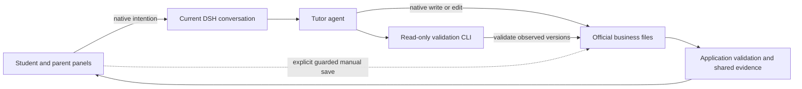

# Agent Note: Student learning flow and evidence architecture

Status: implemented

English | [中文](2026-11-12-student-learning-flow-architecture.zh.md)

## Problem

A learning operation needs to preserve the selected goal, published question, original answer, assistance and assessment through failure and later practice. Separate UI saves and queued tutoring prompts can lose that association. A reused question ID can borrow another block's assessment; mutable mistake classifications can retarget paper history; receipt or grading times can misrepresent when a child answered.

Parents need setup, school confirmation, photographed work and summaries in the same conversation. Multiple default forms introduce stale versions and partial course/progress saves. A cache keyed by a freshly resolved LocalFS object cannot reuse validated data, and revision-only refresh misses due dates and evidence-window changes. Repeating rich question schemas in resident tools raises context cost without making an operation recoverable.

## Decision

The current native DSH conversation is the default entry for every Student business operation. Panel shortcuts submit complete intentions and attachments to that conversation. The agent directly authors official business files with native tools and runs the packaged read-only CLI; the application independently validates the files before displaying facts. Explicit manual forms remain supplemental application-owned saves. There is no candidate-change area, Host publication tool or separate Student queue.

DSH owns conversation admission, execution, attachments, drafts and filesystem authorization. Student owns bounded official files, business validation, learning context, evidence interpretation and available actions. The student path keeps unfinished work visible; the parent page has pending work/practice records, knowledge/progress and profile/summary destinations. Foundation practice needs basic setup, while school alignment additionally needs explicit parent confirmation.

### Official files and validation

Format 2 stores one term in settings, one file per learning block and worksheet, bounded remaining collections, and a separate OpenMAIC lesson log. The [package README](../../../../plugins/dsh-student/packages/winterhuan/student/README.md#understand-the-implementation) owns exact paths, limits and CLI discovery. The [Student glossary](../../../../plugins/dsh-student/GLOSSARY.md) distinguishes a native DSH Session from a learning block and its questions.

Questions, responses, hints and current assessments belong to their stable term and entity identities. A saved original response precedes assessment; help and being stuck remain separate from correctness. Scope and source validation exclude invalid questions and contradictory assessments from valid display and evidence. Published worksheet content and used block content freeze their target, question basis and historical context, so editing or deleting a mistake does not rewrite history. Corrections replace the current assessment under the same response identity and add no answer, independent day or reward.

The reader checks relevant directory membership and actual file versions before and after reading, with bounded retries, then validates identities and cross-file references. Stable identity/version caches share parsed entities and query projections. Shanghai midnight, due times and evidence thresholds refresh affected projections without another write. No global publication manifest or atomic multi-entity transaction is implied.

### Dates and derived evidence

One normalized index derives mastery, review, diagnostics and summaries from validated block and worksheet responses and assessments. Installed curriculum facts remain release-maintained; cited user material supplies input rather than a second editable fact overlay. Adaptive teaching preserves original question generation, at most three relevant reference seeds and all 23 figure types. Teaching phases describe suitable assistance; they are not a mandatory course or mastery guarantee.

Current chat dates require the full consumed input version and matching Host receipt observation in the calling authorized Session. Queue insertion, an edited message ID, file writing and assessment do not establish answer time. Other Sessions' stored claims remain intact but their projected dates stay unknown without separately authorized observations. Paper answers use parent-confirmed calendar days, with worksheet-wide defaults, per-response dates and explicit unknown overrides; day precision supplies no within-day order.

Unknown dates stay outside dated metrics; unknown assistance is neither independent nor known help. Mixed same-day correctness, difficulty and help with unknown order retain difficulty and near review conservatively without erasing genuine independent days, earned stages or the one-advance-per-day limit. The 1/7/16/35-day curve retains early independent advancement, no stage regression and repeated-error handling.

Seven-day summaries use Shanghai today and the preceding six calendar days. First mastery means a goal first earned through effective answers in this term during that window and still mastered now; recovery through new answers is separate from repetition or passive ageing. Historical cutoffs replay effective facts. Review opportunities count each term/mistake once, including overdue work at window start and work genuinely becoming due during the window. Completion needs demonstrable independent correctness after becoming due. Early success cancels a future opportunity; later rescheduling does not erase completed work, and current difficulty remains visible.

### Failure, manual saves and recovery

Native admission, a saved business response and a valid saved assessment are separate observations. A running flag, disappearing message, explanatory text or receipt proves no business completion. Native Session durability also depends on its persistence service and successful flush. Inspection of uncertain admission never resends automatically. Business recovery retains question, response and attachment identities, including late assessment after end/switch, without promising exactly-once native delivery.

A registration-declared store restores draft state before rendering; components use plain Host callbacks. Manual drafts belong to the native Session, term and edited entity. Saves compare edited-field baselines, term identity and observed file versions; unrelated updates preserve drafts, conflicts retain them for explicit review, and course/progress save together. Old-term saves fail even when revisions coincide. Native and shell writes remain outside the application version guard: the pinned DSH composition disables file-observation policy by default, and validation after a write cannot recover history overwritten before observation.

Invalid relevant files remain preserved, retained displays become visibly stale and related manual saves pause. Unrelated valid data remains readable with partial status; incomplete evidence cannot supply a current summary. Bounded backups preserve only observed valid versions and are recovery material, not another authority. The user chooses a restore point; the agent preserves invalid originals, restores and revalidates explicitly. Backup discovery, read, pruning and write failures remain separate from valid business reads and saves. The CLI creates no backups, business writes, revisions or repairs, and success covers only the versions read.

Legacy v1 reads preserve original bytes. A verified migration backup also identifies required output paths; missing outputs keep the workspace explicitly migration-incomplete and withhold current facts until completion. Migration descriptions require verified original-byte backups and source versions before direct v2 authoring; an existing original backup is not overwritten. Original classifications, text, times and sources remain available, while unresolved bindings, assistance and actual dates stay pending review. A currently reclassified mistake cannot recover a worksheet's historical target. Historical screen timing, consumed workbook drafts and unsaved correction history may be unrecoverable; lower legacy mastery totals are accepted rather than invented evidence.

Migration/archive output and active-state replacement are separate writes with explicit partial results. Inspect and resume existing valid output under the same term/entity identities, preserve the archived term, and create a fresh identity for new setup. Old-plugin recovery uses verified v1 material in a separate workspace; in-place downgrade is unsupported.

### Transport, tools and lessons

The plugin-owned typed Remote uses native Gateway permissions and registered main Sessions without activating missing, child or disposed Agents. The Client resource follows file snapshots and native reconnection, marks retained failures stale and awaits stream disposal. Query and manual-save responsibilities share validators and exhaustive domain dispatch without a second action registry or upstream changes.

One resident read-only Student tool supplies bounded context and on-demand pointers. Source-derived strict schemas and valid examples share the application's file definitions; the built package ships the CLI without promising global PATH registration. Bounded nonzero JSON failures identify path, field, rule and correction. Resident parameter size is measured separately from schema reads, repair calls, full request history and provider tokens; a smaller schema establishes no net token or quality guarantee.

OpenMAIC generation, polling, retry and cookies stay in the tutor shell. The agent authors and validates the independent lesson file; the application reads it and the browser opens the external classroom. A ready URL proves neither attendance nor understanding. Consolidation uses the same question/answer/assessment path. The Host supplies no classroom proxy, embedded player or background service.

### Existing decision ownership

The scoped audit keeps the active Student decisions: their source confirmation, teaching, rendering and scheduling alternatives still guide future changes. This note owns native authoring, stable evidence identities, date source verification and recovery limits; it partially supersedes the entry and storage mechanisms in [learning](../feature/2026-10-05-student-learning.md), [photo confirmation](../feature/2026-10-16-student-photo-grading.md), [archive/grading](../feature/2026-10-25-student-archive-grading.md) and [weekly progress](../feature/2026-10-25-student-weekly-progress.md).

[Learning modules](../simplification/2026-10-25-student-learning-modules.md), [read path](../simplification/2026-10-25-student-read-path.md) and [model guidance](../simplification/2026-10-25-student-model-guidance.md) retain handler ownership, shared mastery/cache rules and one teaching-rule owner. [No time limits](../feature/2026-10-30-student-overhaul.md), [school frontier](../feature/2026-10-14-student-school-frontier.md), [prerequisite/spacing](../feature/2026-10-25-student-prerequisite-spacing.md), [review relaxation](../feature/2026-10-16-student-review-relaxation.md) and [OpenMAIC](../feature/2026-10-28-student-openmaic-lessons.md) retain their independent constraints. No earlier note is fully absorbed, archived or deleted.

## Alternatives considered

**Restyle or move the existing workbench only.** This preserves split UI-save/tutor operations and does not repair assessment bypass, mutable targets, partial saves or time invalidation. Module moves remain useful where responsibilities already fit.

**SQLite, event sourcing or a generic workflow engine.** These add migration and lifecycle obligations; local identity, validation and bounded-file rules address the recorded failures.

**Candidate files with Host acceptance, or forms as the default writer.** Both retain an extra handover between user intent and the agent. Direct official-file authoring respects the chosen native conversation entry; supplemental manual saves retain explicit application ownership.

**Many teaching tools or a restricted common-action mode.** More tool names retain duplicated schemas; a separate management mode adds discovery and switching or loses non-Web management. Queries and on-demand schemas support the complete native path.

**Mandatory four-stage teaching or bank-only questions.** The bank mostly supplies diagnostics and cannot cover every adaptive lesson. Repeating demonstrations can waste competent learners' effort, while bank-only generation loses original scenes and figures. Validated original content and evidence guide the next action.

**Host-owned OpenMAIC.** A proxy would take over the anonymous cookie and access code and add a long-running runtime. The tutor already owns the shell/cookie procedure; external classroom readiness remains separate from learner evidence.

## Verification

The primary integration entry is native conversation → actual native write/edit → built packaged CLI → independently validated application consumption. [Native CLI acceptance](../../../../plugins/dsh-student/packages/winterhuan/student/tests/native-cli.e2e.mjs) exercises deterministic model calls and real tools; unit/client regressions separately cover identity, invalid data, date source verification, frozen content, manual drafts and resource disposal. Handler returns, model prose and CLI self-report alone do not establish persistence or display correctness.

Recovery regressions exercise preserved legacy bytes, partial operations, backup bounds and explicit restoration. Real isolated DSH acceptance and fixed-Git installation remain release checks owned by [HANDOFF](../../../../HANDOFF.md). Maintained prose carries no temporary credentials, evidence directories or unpublished commit identifiers. Keyless tests do not establish real tutoring, OCR, external classroom quality, physical printing or provider token costs; those require separately recorded acceptance.

## Consequences

One conversation carries the operation, while independent validation makes saved facts and pending work inspectable. Direct file authoring requires schema discovery, validation and possible repair calls. It cannot authenticate parent statements, certify model answers, constrain all native overwrites or guarantee multi-file atomicity. Original responses and unknown facts remain durable even when they cannot contribute to dated statistics.

Format 2 and revised navigation require explicit migration and recovery discipline. The package keeps native DSH composition and filesystem permissions, supports non-Web management, and avoids maintaining a second writer or evidence ledger. Behavior repairs and structural moves are separately reviewable; the complete workflow is delivered through one release after its release acceptance.
