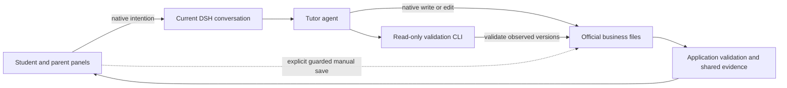

# Agent Note: Student 学习流程与证据架构

Status: implemented

[English](2026-11-12-student-learning-flow-architecture.md) | 中文

## 问题

一次学习操作需要在失败和后续练习中保留所选目标、已发布题目、原始作答、帮助情况与评分。分开的界面保存和排队教学提示可能丢失这些关联。复用题目 ID 可能借用另一学习块的评分；可变的错题分类可能重定向纸面历史；接收或评分时间可能误表孩子实际作答的日期。

家长需要在同一对话中完成设置、学校确认、照片核对与总结。多个默认表单带来陈旧版本和课程／进度部分保存。以 LocalFS 每次新解析的对象为键的缓存无法复用已验证数据，只按修订号刷新又会漏掉到期时间和证据窗口变化。常驻工具重复丰富题目 schema 会增加上下文成本，却不能使操作可恢复。

## 决策

当前原生 DSH 对话是每项 Student 业务操作的默认入口。面板快捷键向该对话提交完整意图和附件。agent（智能体）使用原生工具直接编写正式业务文件并运行随包提供的只读 CLI（命令行界面）；应用在显示事实前独立验证文件。明确展开的手动表单仍是应用拥有的补充保存。没有候选变更区、Host 发布工具或独立 Student 队列。

DSH 拥有对话接收、执行、附件、草稿和文件系统授权。Student 拥有有界正式文件、业务验证、学习上下文、证据解释和可用操作。学生主线始终显示未完成学习；家长页面分为待办／练习记录、知识／进度、档案／总结。基础练习需要基本设置，对齐学校还需要家长明确确认。

### 正式文件与验证

格式 2 将一个学期保存为设置、每个学习块和练习卷各一个文件、有界其余集合，以及独立 OpenMAIC 课程日志。[包 README](../../../../plugins/dsh-student/packages/winterhuan/student/README.zh.md#understand-the-implementation)拥有精确路径、上限和 CLI 定位说明。[Student 术语表](../../../../plugins/dsh-student/GLOSSARY.md)区分原生 DSH Session、学习块及其题目。

题目、作答、提示和当前评分属于稳定的学期及实体身份。评分必须有已保存的原始作答；帮助和卡住信号与正确性分开。范围和来源验证将无效题目及矛盾评分排除在有效展示和证据之外。已使用的发布内容冻结其目标和题目依据，包括练习卷来源，因此编辑或删除错题不会改写历史。更正以相同作答身份替换当前评分，不增加答案、独立日期或奖励。

读取器在读取前后检查相关目录成员和实际文件版本，有界重试后验证身份及跨文件引用。稳定身份／版本缓存共享解析后的实体和查询投影。上海午夜、复习到期时间与证据阈值即使没有新写入也会刷新相关投影。这不承诺全局发布 manifest（元数据清单）或多实体原子事务。

### 日期与派生证据

一个归一化索引从已验证学习块和练习卷的作答及评分派生掌握、复习、摸底与总结。已安装课程事实随发布维护；引用的用户材料作为输入，而非第二层可编辑事实。自适应教学保留原创出题、最多三个相关参考题和全部 23 种题图。教学阶段描述适合的帮助，不是必经课程或掌握保证。

当前聊天日期需要完整已消费输入版本及调用方获授权 Session 中匹配的 Host 接收观察。队列插入、编辑后的消息 ID、文件写入和评分都不能建立作答时间。其他 Session 的已保存声明保持原样，但没有另行授权的观察时，其投影日期仍为未知。纸面作答使用家长确认的日历日期，支持整卷默认值、逐作答日期和明确未知覆盖；日期精度不提供日内顺序。

未知日期不进入日期指标；未知帮助既不是独立作答，也不是已知帮助。同日正确、困难与帮助混合而顺序未知时，保守保留困难和近期复习，不抹去真实独立日期、已得阶段或每日最多推进一次的上限。1/7/16/35 天曲线保留提前独立推进、不降阶和重复错误处理。

七日总结使用上海今天及此前六个日历日。首次掌握指本学期中通过有效答案在窗口内首次获得且当前仍掌握的目标；通过新答案恢复与重复练习或证据被动变旧分别报告。历史截止点回放有效事实。复习机会每个学期／错题只计一次，包括窗口开始已逾期和窗口内真正到期的工作。完成需要能够证明发生在到期后的独立答对。提前成功取消未来机会；后续改期不会抹去已完成学习，当前困难仍可见。

### 失败、手动保存与恢复

原生接收、已保存业务作答和有效已保存评分是分别观察的事实。运行标记、消息消失、解释文本或接收回执都不能证明业务完成。原生 Session 的持久性还取决于其持久化服务和成功刷新。检查不确定接收状态不会自动重发。业务恢复保留题目、作答与附件身份，包括结束／切换后的迟到评分，不承诺原生恰好一次投递。

手动草稿属于原生 Session、学期和所编辑实体。保存比较编辑字段基线、学期身份和已观察文件版本；无关更新保留草稿，冲突保留草稿供明确复核，课程／进度一起保存。即使修订号相同，旧学期保存也失败。原生和 shell 写入不受应用版本保护：固定 DSH 组合默认禁用文件观察策略，写后验证无法恢复观察前已被覆盖的历史。

相关无效文件保持原样，保留的展示明确标为陈旧，相关手动保存暂停。无关有效数据以部分状态继续可读；证据不完整不能提供当前总结。有界备份只保留观察到的有效版本，是恢复材料而非另一份权威数据。用户选择恢复点；agent 明确保留无效原件、恢复并重新验证。备份失败单独报告。CLI 不创建备份、业务写入、修订号或修复，成功只覆盖所读取版本。

旧版 v1 读取保留原始字节。 已验证迁移备份还标明所需输出路径；缺少输出时工作区明确保持 migration-incomplete，完成前不提供当前事实。迁移描述要求先验证原始字节备份和来源版本，再直接编写 v2；不覆盖已有原件备份。原有分类、文本、时间和来源继续可用，未解决的关联、帮助和实际日期保持待核对。当前已重分类的错题不能恢复练习卷历史目标。历史屏幕时间、已消费练习册草稿和未保存更正历史可能无法恢复；接受更低的旧版掌握统计，不编造证据。

迁移／归档输出与活动状态替换分别写入，明确返回部分结果。以相同学期／实体身份检查并恢复已有有效输出，保留归档学期，为新设置创建新身份。恢复旧插件时在独立工作区使用已验证 v1 材料；不支持原地降级。

### 传输、工具与课程

插件拥有的类型化 Remote 使用原生 Gateway 权限和已注册主 Session，不激活缺失、子级或已释放的 agent。客户端资源跟随文件快照和原生重连，将保留的失败值标为陈旧，并等待流释放。查询与手动保存共享验证器和穷尽领域分派，不增加第二份动作注册表或修改上游。

一个常驻只读 Student 工具提供有界上下文和按需指针。来源生成的严格 schema 与有效示例共享应用文件定义；构建包提供 CLI，但不承诺全局 PATH 注册。有界非零 JSON 失败指出路径、字段、规则与修正。常驻参数大小与 schema 读取、修复调用、完整请求历史和提供商 token 分开测量；更小 schema 不证明净 token 或质量收益。

OpenMAIC 生成、轮询、重试与 cookie 留在导师 shell。agent 编写并验证独立课程文件；应用读取它，浏览器打开外部课堂。就绪 URL 不能证明上课或理解。巩固使用相同题目／作答／评分路径。Host 不提供课堂代理、嵌入播放器或后台服务。

### 既有决策归属

本次限定审计保留活跃 Student 决策：其来源确认、教学、渲染和调度替代方案仍指导后续修改。本笔记拥有原生编写、稳定证据身份、日期来源与恢复限制；它部分取代[学习](../feature/2026-10-05-student-learning.zh.md)、[照片确认](../feature/2026-10-16-student-photo-grading.zh.md)、[归档／批改](../feature/2026-10-25-student-archive-grading.zh.md)和[每周进度](../feature/2026-10-25-student-weekly-progress.zh.md)的入口及存储机制。

[学习模块](../simplification/2026-10-25-student-learning-modules.zh.md)、[读取路径](../simplification/2026-10-25-student-read-path.zh.md)和[模型指导](../simplification/2026-10-25-student-model-guidance.zh.md)保留处理器归属、共享掌握／缓存规则及教学规则单一归属。[无时长限制](../feature/2026-10-30-student-overhaul.zh.md)、[学校前沿](../feature/2026-10-14-student-school-frontier.zh.md)、[先修／间隔](../feature/2026-10-25-student-prerequisite-spacing.zh.md)、[复习放宽](../feature/2026-10-16-student-review-relaxation.zh.md)和 [OpenMAIC](../feature/2026-10-28-student-openmaic-lessons.zh.md)保留独立约束。没有旧笔记被完整吸收、归档或删除。

## 考虑过的替代方案

**只重排样式或移动现有工作台。** 这保留分开的界面保存／导师操作，不能修复评分绕过、可变目标、部分保存或时间失效。职责适合时模块移动仍有价值。

**SQLite、事件溯源或通用工作流引擎。** 它们增加迁移与生命周期义务；局部身份、验证和有界文件规则即可处理已记录失败。

**候选文件经 Host 接受，或表单作为默认写入方。** 两者都在用户意图和 agent 之间保留额外交接。直接编写正式文件遵循选定原生对话入口；补充手动保存保留明确应用归属。

**很多教学工具或受限常用动作模式。** 更多工具名仍重复 schema；独立管理模式增加发现与切换，或丢失非 Web 管理。查询和按需 schema 支持完整原生路径。

**强制四阶段教学或只用题库出题。** 题库主要提供摸底，无法覆盖每种自适应课。重复演示可能浪费已会学生的时间，只用题库又丢失原创场景和题图。已验证原创内容和证据指导下一步。

**Host 拥有 OpenMAIC。** 代理会接管匿名 cookie 与访问码并增加长运行时。导师已拥有 shell／cookie 流程；外部课堂就绪仍与学习证据分开。

## 验证

主要集成入口是原生对话 → 真正原生 write/edit → 构建后的随包 CLI → 独立验证的应用消费。[原生 CLI 验收](../../../../plugins/dsh-student/packages/winterhuan/student/tests/native-cli.e2e.mjs)使用确定性模型调用和真实工具；单元／客户端回归另外覆盖身份、无效数据、日期来源、冻结内容、手动草稿与资源释放。处理器返回、模型文字和 CLI 自报单独都不能证明持久化或正确展示。

恢复回归覆盖保留旧版字节、部分操作、备份上限和明确恢复。真实隔离 DSH 验收及固定 Git 安装仍是 [HANDOFF](../../../../HANDOFF.md)拥有的发布检查。维护文案不携带临时凭据、证据目录或未发布提交标识。无密钥测试不能证明真实教学、OCR、外部课堂质量、物理打印或提供商 token 成本；这些需要单独记录验收。

## 影响

同一对话承载操作，独立验证使已保存事实和待办可检查。直接编写文件需要发现 schema、验证和可能的修复调用。它不能认证家长声明、保证模型答案、约束全部原生覆盖或保证多文件原子性。原始作答和未知事实保持持久，即使无法贡献日期统计。

格式 2 和导航需要明确迁移与恢复纪律。包保留原生 DSH 组合和文件系统权限，支持非 Web 管理，避免维护第二个写入方或证据账本。行为修复和结构移动可分别审查；完整流程在发布验收后通过一次发布交付。
