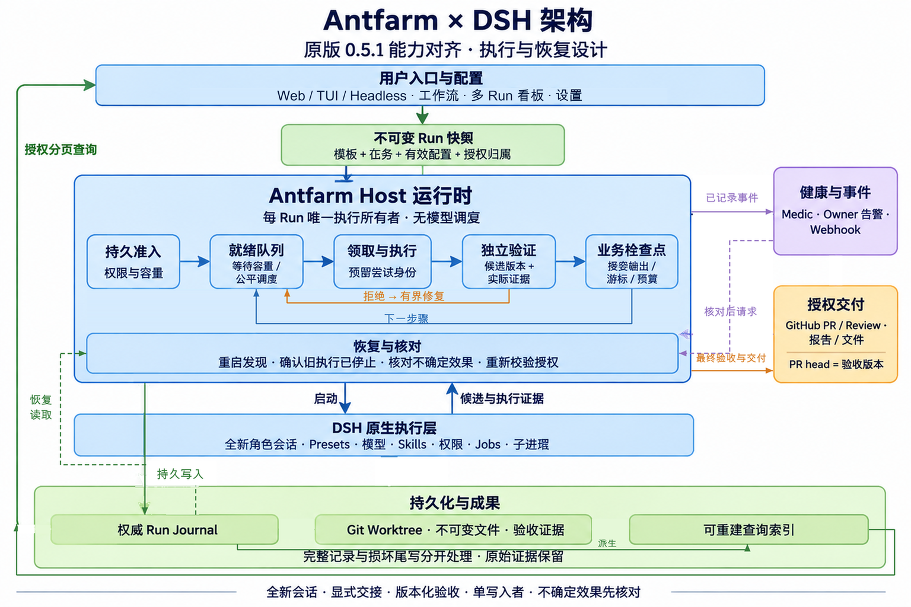
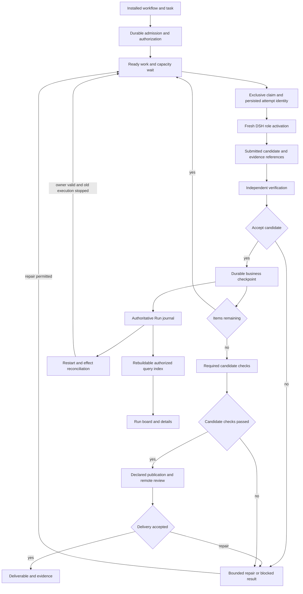

# Agent Note: Antfarm reusable team workflows and delivery plan

Status: proposed

English | [中文](2026-11-08-antfarm-team-workflow-plan.zh.md)

The [team runtime decision](../../implemented/architecture/2026-11-08-antfarm-team-workflow-runtime.md) records the implemented portion. This proposal remains active for external acceptance and native convergence conditions; [coverage](../../../../plugins/dsh-antfarm/PARITY.md) distinguishes implemented capabilities from verified outcomes.

## Problem

Repeated agent work needs a reusable method: named responsibilities, bounded tasks, explicit handoffs, independent checks, and a way to continue after failure. A reliable executor alone does not tell users which team to choose or preserve the knowledge that a fresh worker needs. A collection of role prompts alone cannot enforce execution order, acceptance, retry budgets, or resource ownership.

The original [Antfarm README](https://github.com/snarktank/antfarm/blob/a442ad7dcb8cf8746175cc4a2e2dcafd501156cf/README.md) presents installable specialist teams with repeatable workflows. Its [feature recipe](https://github.com/snarktank/antfarm/blob/a442ad7dcb8cf8746175cc4a2e2dcafd501156cf/workflows/feature-dev/workflow.yml) sizes stories to one fresh session, passes explicit outputs, requires commits, and separates story verification, integration testing, and review. Its [custom-workflow guide](https://github.com/snarktank/antfarm/blob/a442ad7dcb8cf8746175cc4a2e2dcafd501156cf/docs/creating-workflows.md) also describes research followed by writing. These are product principles; OpenClaw provisioning, SQLite, polling cron jobs, and persona file names are implementation choices.

The current [v2 decision](../../implemented/architecture/2026-11-08-antfarm-reimplementation.md) owns the existing serial coding runner and its safety obligations. [Checkpoint types](../../../../plugins/dsh-antfarm/src/persistence/types.ts) retain progress and summaries without candidate-version acceptance. [Execution](../../../../plugins/dsh-antfarm/src/runtime/orchestrator.ts) can repair after final review while retaining a previous test result. Its fixed handoff fields and generic summaries do not express the original workflow's environment facts and role-specific outputs. This plan addresses those gaps without treating existing development evidence as a released redesign.

The current [runtime configuration](../../../../plugins/dsh-antfarm/src/runtime/index.ts) is static, and the [Runs panel](../../../../plugins/dsh-antfarm/src/client/RunsPanel.tsx) provides read-only inspection. Users need to understand which configuration applies, adjust reusable methods safely, and act on running or blocked work without reconstructing raw identifiers. Configuration management and Run controls are part of this delivery.

Evidence is the original repository at `a442ad7` (`0.5.1`), DSH `dsh-v0.2.2-rc.1`, and the current plugin source and existing test assertions. No new original-project, native Team, or model execution was performed for this proposal. The [native orchestration proposal](2026-11-08-antfarm-native-orchestration.md) owns detailed DSH reuse and downstream persistence conditions; this note owns product design and implementation phases.

## Proposal

### Product purpose and initial scope

Antfarm provides installable, reusable professional team workflows that advance authorized work autonomously while the Host is running. Users select a workflow, supply a task and constraints, inspect progress, and receive a reviewed artifact or an actionable blocked result. Determinism applies to permitted transitions and required checks, not to model answers or a guarantee that every task succeeds.

The first delivery must cover every user-facing capability in the original `0.5.1` baseline, together with configuration management and Run-interface improvements. This replaces the earlier coding-only scope. Preserve specialist roles, fresh attempts, the three official templates, custom non-coding workflows, PR delivery, failed-Run recovery, autonomous operation, lifecycle management, diagnostics, notifications, and the workflow dashboard. Existing worktree and ownership protections remain until a tested replacement ships. OpenClaw-specific provisioning and transport may change; a missing equivalent is a delivery blocker.

| Workflow | Responsibility sequence | Deliverable |
|---|---|---|
| Feature development | Plan; setup; implement/verify each item; test; PR; review, with repair and rechecking | Tested PR, posted review, candidate identity, requirement coverage, and evidence |
| Bug fixing | Triage/reproduce; investigate; setup; fix; verify; PR | Fix PR, root cause, reproduction evidence, and regression checks |
| Security remediation | Scan; prioritize; setup; fix/verify each item; test/re-audit; PR | Remediation PR, severity-ranked findings, before/after audit, and remaining risks |
| Custom research | Research; synthesize; check sources; edit, as defined by the author | Report with traceable sources |
| Custom writing or document migration | Plan; produce; validate; review, as defined by the author | Versioned files and review findings |

A workflow declares its expected deliverable and side effects before start. The official coding templates include PR creation and, for feature development, GitHub review; choosing and authorizing that declared delivery authorizes its stated operations within the selected repository. Local-only delivery is an explicit alternative with distinct acceptance, not a substitute for PR parity. Neither mode implies merge authority. Unknown remote outcomes require reconciliation before another effect.

### Original-version capability coverage

Functional coverage means an executable DSH entry, preserved workflow purpose, and observed acceptance for each baseline capability. Command spelling, polling agents, SQLite, and the standalone dashboard process need not be copied. Compare the [original CLI](https://github.com/snarktank/antfarm/blob/a442ad7dcb8cf8746175cc4a2e2dcafd501156cf/src/cli/cli.ts), recipes, [step operations](https://github.com/snarktank/antfarm/blob/a442ad7dcb8cf8746175cc4a2e2dcafd501156cf/src/installer/step-ops.ts), [dashboard](https://github.com/snarktank/antfarm/blob/a442ad7dcb8cf8746175cc4a2e2dcafd501156cf/src/server/dashboard.ts), and [Medic](https://github.com/snarktank/antfarm/blob/a442ad7dcb8cf8746175cc4a2e2dcafd501156cf/src/medic/medic.ts), not just the README. Baseline declarations that are incompletely enforced must become explicit validated behavior, not copied bugs.

| Original capability or entry | DSH implementation responsibility | Required parity evidence |
|---|---|---|
| Install all; install/uninstall one workflow; full uninstall and force handling | Native plugin installation plus a versioned enabled-template registry; bounded teardown | All/single install, active-Run refusal, confirmed cancellation/drain, preserved user assets, and removal of owned registrations |
| Update; version/help; informational `ant` command | Native package update and template comparison; discoverable command/tool help and version/mascot output | Version identity, compatible update/rollback, retained overrides, and all informational entries reachable |
| Workflow list and discovery | Runtime catalog with purpose, version, enabled state, assets, and dependencies | Official and locally authored workflows are listed and validated |
| Run; runs; status by task, number, or id prefix | Runtime admission and authorized search/list projection | Stable display number; exact/substr/prefix search; disambiguation before mutations |
| Stop/cancel | Existing child and writer ownership, extended to all resource policies | No subsequent starts; settled children; retained artifacts and explicit disposition |
| Resume failed Run | Same-Run owner recovery with recorded budget grants and reconciliation | Accepted work retained; failed item/stage reattempted; cumulative history preserved |
| Peek/claim/complete/fail/stories worker operations | Role-scoped native attempt tools or a compatibility facade into the one driver | Only the matching attempt can submit; concurrent claims exclude each other; completion cannot bypass acceptance |
| Ordered steps, story loops, verify-each, retry targets, context substitution, progress archiving | Validated workflow adapter, bounded handoffs, and journal checkpoints | Feature/security loops, custom single-step flows, rejected-output isolation, and retrievable archived progress |
| Agent personas, shared agents, models, deadlines, roles, and external skills | Native presets plus imported bounded instructions and explicit asset/skill references | All six original role policies mapped; missing required skills diagnosed; no silent model/deadline loss |
| YAML/Markdown custom workflows, including research/writing | Local authoring/import and actual non-Git resource policy | Original guide's research-to-writing example and a custom loop execute |
| Autonomous cron progression, cheap polling, ensure-crons | Model-free Host dispatch, durable recovery intent, and an ensure-execution operation | Work advances without parent turns; idle dispatch uses no model; restart restores authorized work or names its blocker |
| Tested PR and GitHub review | Runtime-owned publication/review stages using DSH permissions | PR url/head and posted review resolve to the checked candidate; repair updates and rechecks the PR |
| Frontend detection, visual verification, browser E2E, and screenshot review | Coding templates and browser-capable presets | Frontend changes trigger browser checks and retained screenshots; missing browser capability blocks explicitly |
| Global/per-Run logs and events | Bounded runtime event projection and evidence retrieval | Event order, Run filtering, history retention, and cold reads after restart |
| Dashboard start/stop/status, workflow-stage board, details, output, stories, and refresh | Open/close/status of the native DSH workflow board and Run detail; no separate daemon | Multiple authorized Runs grouped by stage; output/criteria/attempts/events visible; new Runs discovered |
| Medic install/uninstall/run/status/log | Configurable Host health checks and repair within the existing driver | Stuck/stalled/dead Runs and orphaned execution resources detected; manual and periodic checks/history exposed |
| Retry-exhaustion and critical-health escalation | Native owner notification with persisted origin and delivery outcome | Original owner receives actionable failure/health alerts without an open Run panel |
| Workflow/run notification URL and auth | Explicit webhook subscription through native secret references | Expected lifecycle events delivered; auth redacted; failures observable and workflow-independent |

Track each row as planned, implemented, and verified against a named scenario during delivery. A mapping to DSH without an installed, usable entry is insufficient. Do not claim full coverage while any row lacks acceptance or an unresolved Host API prevents its behavior. Arbitrary DAG scheduling, simultaneous writers in one candidate, nested workflows, remote workflow marketplaces, and long-lived conversational Teams are not original-baseline requirements.

#### Original implementation semantics and adaptation decisions

The remote default branch still resolves to the pinned baseline when inspected. These comparisons come from reading that source and its tests, not new OpenClaw/GitHub execution evidence. Retain the useful original behavior, explicitly adapt host mechanisms, and strengthen unforced declarations or unsafe transitions.

| Original source behavior | Adaptation and required distinction |
|---|---|
| [Run creation](https://github.com/snarktank/antfarm/blob/a442ad7dcb8cf8746175cc4a2e2dcafd501156cf/src/installer/run.ts) transactionally saves Run/steps: first pending, others waiting. Failed cron setup marks the Run failed. | Persist admission, snapshot and initial cursor before receipt; scheduling faults have a durable, actionable state. Submission is distinct from execution and delivery acceptance. |
| [Two-phase cron](https://github.com/snarktank/antfarm/blob/a442ad7dcb8cf8746175cc4a2e2dcafd501156cf/src/installer/agent-cron.ts) uses a polling model for peek/claim, then spawns work. Work model falls back to workflow polling model; active Runs share workflow crons. | Replace polling turns with Host code while preserving effective work-model selection. Mark polling-only fields inactive. Shared scheduling survives until the last dependent Run settles. |
| [Claim](https://github.com/snarktank/antfarm/blob/a442ad7dcb8cf8746175cc4a2e2dcafd501156cf/src/installer/step-ops.ts#L485) checks predecessor completion but the single-step update does not check affected rows before returning work. | Preserve ordered readiness; require exclusive claim and durable attempt identity. Do not copy the claim race or cross-Run ordering. |
| [Completion](https://github.com/snarktank/antfarm/blob/a442ad7dcb8cf8746175cc4a2e2dcafd501156cf/src/installer/step-ops.ts#L679) merges multiline KEY values into global context; `expects` is stored but not checked there. | Import expectations into explicit schema/semantic checks and named dependencies. Preserve multiline output; reject missing/malformed results before advancing or changing accepted facts. |
| [Verify-each](https://github.com/snarktank/antfarm/blob/a442ad7dcb8cf8746175cc4a2e2dcafd501156cf/src/installer/step-ops.ts#L712) emits story done before verification and reopens it on retry; missing retry status takes the pass path. | Preserve item/verify sequencing and feedback. Separate submitted and accepted work; missing verdict never passes. Next item waits for required acceptance. |
| The loader normalizes `fresh_session`/`freshSession`, but the cron/step paths do not consume that flag to provide continuing sessions. | Keep fresh role attempts. Report imported inactive flags; do not promise a continuing-session mode from a parsed field alone. |
| [Failure](https://github.com/snarktank/antfarm/blob/a442ad7dcb8cf8746175cc4a2e2dcafd501156cf/src/installer/step-ops.ts#L1035) retries the current step/story; the guide's backward `retry_step` declaration is not enforced by that function. [Resume](https://github.com/snarktank/antfarm/blob/a442ad7dcb8cf8746175cc4a2e2dcafd501156cf/src/cli/cli.ts#L541) resets step counters and reloads the installed definition for crons. | Preserve current-item retry and same-Run recovery; enforce backward repair/return. Retain cumulative history, explicit budget grants and saved definitions. Reconcile uncertain effects before requeueing. |
| [SQLite](https://github.com/snarktank/antfarm/blob/a442ad7dcb8cf8746175cc4a2e2dcafd501156cf/src/db.ts) uses WAL; events/webhooks are best-effort outside business updates. | Give the authoritative journal an explicit crash-write recovery protocol. Derive events/indexes from committed transitions; notification outcomes cannot alter acceptance. |
| [Medic](https://github.com/snarktank/antfarm/blob/a442ad7dcb8cf8746175cc4a2e2dcafd501156cf/src/medic/checks.ts) detects stuck/stalled/dead/orphaned state; remediation can reset timed-out steps. | Preserve checks, cadence, history and bounds; time triggers inspection. Reuse execution only after prior workers stop and effects are reconciled. |
| [Provisioning](https://github.com/snarktank/antfarm/blob/a442ad7dcb8cf8746175cc4a2e2dcafd501156cf/src/installer/agent-provision.ts) imports personas/shared files/skills; installation preserves the main default agent. Some role restrictions conflict with required browser/research instructions. | Preserve methods/personas and required capabilities through native presets without changing the user's default agent. Diagnose missing skills, unsupported fields and capability conflicts; confine shared imports. |
| Dashboard reads shared Run/step/story/event/Medic data; feature-dev requires posted GitHub review. | Preserve authorized cross-owner boards and health views through bounded index reads. Preflight author/reviewer identities and support authorized human review continuation; role names do not establish different GitHub identities. |

### Responsibilities and execution structure

| Owner | Responsibility | Architectural reason |
|---|---|---|
| Workflow definition | Roles, input requirements, output schemas, order, item loops, checks, and repair paths | Makes the team's method inspectable and reusable |
| Antfarm Run runtime | Catalog/lifecycle, admission, scheduling, acceptance, budgets, checkpoints, recovery, publication, health repair, and resource disposition | Gives one owner control of business transitions |
| DSH | Presets, agent execution, session records, tools, permissions, jobs, and subprocess lifecycle | Reuses the installed execution environment |
| Optional native Agent Team | Continuing discussion, peer messages, and collaboration tasks | Supports open-ended coordination when a workflow needs it |
| Antfarm Client | Workflow/configuration management, authorized multi-Run board, progress/actions, evidence, events, and health | Gives users a clear next action without owning execution state |

Keep one execution owner and one authoritative journal per Run. Different Runs may execute concurrently within Host capacity. Admission, dispatch, recovery and Medic use the same transition authority, not independent schedulers. Retain direct native preset activations on the pinned release. Workflow and Team adoption follows the separately owned native-orchestration conditions; neither becomes a mandatory dependency merely to display roles. Do not create an idle model supervisor or mirror work items into a second task board.

The initial execution structure remains an ordered sequence, an item loop with independent verification, bounded repair edges, and final checks. Validate backward repair targets and references before execution. A repair cannot erase accepted history or bypass final acceptance. Defer arbitrary DAG scheduling, nested workflows, and parallel code integration until a concrete workflow requires them.

#### Authorization owner and execution lifetime

The Run stores its authorization owner independently of the temporary Agent object performing work. Its initiating Session remains attribution and navigation context. Closing a Client view does not cancel the Run. Session unloading, archiving and permission revocation have explicit policies; an archived or revoked owner cannot be silently replaced by the Host identity.

P0 must demonstrate a supported DSH lifetime that retains or reacquires the recorded owner's execution authority without another model turn. Effects validate the current supported live owner capability. If the pinned API cannot provide it, identify the exact unsupported operation and resolve its prerequisite before dependent implementation. A Session id, idle coordinator or fabricated Agent is insufficient; publication never derives permission solely from the saved snapshot.

Restart recovery validates authority, configuration and previous execution inactivity before acquiring a new execution owner. Lease expiry triggers inspection, not automatic transfer of write permission. Uncertain old workers or external effects remain interrupted for reconciliation.

#### Persistent dispatch and step transitions

Persist accepted submission with its initial waiting/ready state even when execution capacity is full. Only admission/queue limits or invalid authority reject submission; full execution capacity keeps admitted work queued. Store readiness and dispatch intent in the Run journal and rebuild the Host queue from those records. Waiting does not spend execution timeout or repair retries; it stays visible and cancellable.

Use one active Host dispatcher per storage root and enforce exclusive ownership before dispatch. Select eligible Runs in FIFO order and rotate after each attempt so one long Run cannot monopolize released capacity; respect Host/owner capacity and per-Run single-writer rules. A second Host cannot dispatch the same root without verified handover. This is a single-host design, not a distributed worker queue.

| Work state | Required transition |
|---|---|
| Waiting | Earlier declared outputs are not accepted; the work cannot be claimed. |
| Pending | Dependencies are accepted; wait for capacity without activating a model. |
| Claimed | Persist role, item/candidate, attempt id, reserved child id and expected Run revision under exclusive ownership before startup. |
| Running | Start the matching fresh activation and retain diagnostics; startup uncertainty requires reconciliation. |
| Verifying | Retain the submitted candidate; launch a separate fresh verifier when required. Submission cannot satisfy acceptance. |
| Accepted | Commit outputs, version-bound acceptance, cursor and budgets together; make the next eligible work pending. |
| Rejected, blocked or interrupted | Record feedback, budget or uncertainty; only the same runtime may enqueue a permitted repair/resume. |

The table describes business work; implementer and verifier have different attempt identities. Peek is read-only. Claim/complete/fail compatibility operations use this runtime and require the matching role, attempt and revision. Repeated completion returns its recorded outcome; stale or conflicting completion is rejected. Cancel before startup, callbacks after cancellation and expired attempts cannot advance a new attempt. Lease loss blocks further writes; confirm old workers stopped before replacement.

### Workflow definitions and role composition

A resolved definition captures workflow identity and version, required task inputs, roles, step inputs and declared outputs, acceptance conditions, repair budgets, and resource policy. Save the resolved definition before the start receipt. Edits to the source definition affect new Runs; they do not change an existing Run's promised work.

Each role selects a deployment-owned DSH preset, bounded Markdown instructions, and an optional model/deadline override. Skills belong to that role's preset composition; a role can describe its required skills without copying the user's skill directory. Verify availability before starting. Preserve distinct verifier, tester, and reviewer responsibilities: story criteria, cross-item behavior, and overall maintainability or design quality.

Map the original analysis, coding, verification, testing, PR, and scanning policies to native preset capabilities, including browser access for testing and declared frontend verification, and web/CVE lookup for scanning. Preserve role identity/persona and shared-agent methods as bounded assets; a role need not correspond to a unique Agent id. The original feature workflow has six agent definitions and seven steps, with developer reused for PR. Compatibility defaults are 20 stories, two story retries, 20-minute analysis/verification/PR/scanning deadlines, and 30-minute coding/testing deadlines; expose validated overrides instead of inheriting different plugin defaults silently.

Provide an explicit import adapter for the original YAML/Markdown definition: identity/name/version, initial context and template variables, agent files/skills/model/deadline, polling metadata, ordered single/loop steps, verify-each, output expectations, retries/escalation, and notification settings. Preserve original asset paths only within a canonical trusted source root, including shared-agent references, then materialize confined managed assets. Convert legacy global outputs to declared dependencies; validate expected outputs and repair targets. Polling-only model/interval fields describe the imported source and map to model-free dispatch/health policy where applicable; label fields with no execution effect. Import reports unsupported or unresolved fields before install rather than silently dropping them.

Exercise custom research-to-writing and story-loop definitions in the first delivery. Give reports/files immutable identity, retrieval, retention, and recovery checks without fabricated Git commits. Non-coding support is a concrete resource policy for the original extensibility, not an arbitrary workflow-platform expansion.

Capture the execution configuration and resource identities needed to assess recovery, including workflow assets, preset/configuration identity where the public API permits it, model routing, lockfiles, and relevant tool/skill versions. If a material execution dependency changed or cannot be checked, require reconciliation rather than claim the old snapshot reproduces the current environment. This is a compatibility record, not a second preset registry or a hermetic-build guarantee.

Package workflows remain immutable installation assets. Project or user overrides use separate files and existing discovery precedence. The first release supports structured configuration editing, file authoring, and validation. A generic graph editor, remote workflow marketplace, and automatic modification of repository instructions remain outside its scope. Validate parser inputs, instruction paths, schema support, references, and configured aggregate limits before effects.

### Template and plugin lifecycle

Install all or selected bundled templates through native plugin installation and a versioned enabled-template registry owned by the runtime. Installing one validates assets, presets, role permissions, skills, and commands without provisioning another agent host. Local authored/imported workflows use the same catalog. Preserve the original curated-bundle trust model; arbitrary remote workflow fetching is outside the baseline. Discovery/help and native tools replace writing instructions into the user's main-agent files.

Uninstall or disable refuses while the template has active Runs. An explicit forced operation cancels/drains owned work before removing its registrations and managed installation assets. Full plugin uninstall follows the same ordering for dispatch, health checks, notifications, and children. Retain user overrides and evidence by default; provide an explicit scoped purge of plugin-owned journals/cache/assets with an export/retention preview to cover original full teardown. Package removal does not authorize deleting unrelated user files or branches.

Update through DSH package management, showing installed/target versions and template changes. Validate the new package and dependencies before switching; failure retains the current installation. Existing Runs keep their saved definitions and compatible runtime or visibly require supported recovery; updates never replay effects. Preserve user copies and offer compare/reapply for newer bundles. Support rollback to an installed compatible version and ensure-execution to reconcile missing dispatch/health registration without duplicating a driver. Required DSH API/version changes are separately maintained prerequisites; never edit reference `upstream/` sources.

### Configuration management

Configuration has distinct owners and application times. A saved workflow expresses a reusable method; deployment policy limits what it can execute; a Run snapshot records the exact selection. Keeping these separate lets users tune a method without changing work already admitted or creating another DSH settings database.

#### Scopes and resolution

| Scope | Authoritative source | Editable content | Application time |
|---|---|---|---|
| DSH profile and Host | Native profile configuration and preset registry | Defaults, provider/preset references, deployment limits, storage policy, and Client refresh policy | Execution defaults at next admission; Client refresh live; structural fields through managed restart |
| Installed workflow | Read-only package assets | View, validate, or create an override copy | New Runs selecting that version |
| User workflow | Files in configured user workflow directories | Supported workflow fields and role instructions | New Runs resolving that source |
| Project workflow | Repository-local override files | Project-specific method, check commands, and role choices | New Runs in that project |
| Per-Run input | Start request and immutable effective snapshot | Task, constraints, criteria, and explicitly allowed execution overrides | This Run only |

Resolve a complete workflow source first, using project, configured-directory, then package precedence; show the winning source and shadowed copies. For overridable execution fields, apply schema/profile defaults, then the selected definition's explicit values, then allowed per-Run overrides. Do not merge steps, roles, or arrays by position across unrelated files. Deployment ceilings and DSH permission policy remain authoritative; a workflow or Run input cannot raise them.

Save the resolved workflow, permitted overrides, effective execution values, source revisions/content identities, and compatibility references before admission succeeds. Running and resumed work use this snapshot. A later configuration edit affects new Runs; an explicit plan or budget revision follows the recovery rules and records its change. Current permissions and limits are revalidated on resume; stricter policy can block it, while relaxed defaults do not silently replenish consumed budgets.

#### Management interface and application behavior

Use the [native DSH settings service](../../../../upstream/docs/subsystems/settings.md) and its existing Client settings extension points for profile fields. Antfarm must deliberately mark safe fields volatile and read them through its Config references; the current static Config does not automatically become editable. A live profile update changes the defaults captured by the next Run. Storage roots, worktree layout, and structural execution wiring require stopping admission, settling owned execution, and a managed configuration reload; moving existing journals is a separate migration. Show the required application step in the interface.

The management page groups template lifecycle, role execution, budgets/checks, workspace behavior, health, and notifications. Users can inspect templates, create user/project copies, edit supported fields, validate, compare, save, and restore inheritance. Controls cover default workflow, preset/provider/model references, deadlines, retry/attempt/recovery budgets, criteria/check commands, instructions, cleanup/retention, dispatch/health cadence, Client refresh, owner alerts, and webhook subscriptions. Advanced topology remains file-authored and validated. Preset composition, tools, skills, and credentials stay in native DSH settings with navigation links.

Every editable value shows its effective value, source scope, inherited or overridden state, save destination, and application time. Profile write availability comes from the native settings descriptor. Missing configuration providers or unavailable presets produce a correction path. Restore inheritance removes only the selected explicit override where the schema supports a default; required workflow fields cannot be unset. Removing a workflow copy requires a preview of the source that will become active. Neither operation deletes an installed template, a Run snapshot, or retained evidence.

#### Writes, conflicts, and drafts

Preserve the [existing editor reintroduction requirements](../../implemented/architecture/2026-11-08-antfarm-reimplementation.md): an explicit writable user/project scope, canonical-path confinement including symlink escapes, server-checked revision, per-target serialization, unique temporary files, atomic replacement, actionable stale-draft conflicts, and unsaved-draft protection. Reads and writes use the same target identity. Validate the entire resulting definition and instruction references before persistence. The Host chooses and confines the destination; a browser-supplied path is not write authority.

Native profile edits use DSH revision-aware writes; workflow files use a server revision/content identity and refuse stale saves, including external file edits. Concurrent clients must not overwrite each other. On conflict, retain the draft and show compare, reload, and reapply options; a fresh revision does not authorize silently replaying the old save. Leaving the editor, switching scope, or selecting another workflow offers save, discard, or stay when there are unsaved edits. A saved result is reread with its new revision and effective values.

Configuration writes follow their DSH resource authorization; Run effects additionally require the runtime's supported live owner authority. Credentials use native secret fields or references and redacted views. Never serialize credential values into workflow files, exported configuration, Run journals, or diagnostic evidence. Admission and saving both perform Host validation; Client validation provides early feedback only.

### Run data and accepted state

These concepts describe the planned data model, not an approved wire or journal schema. They can remain in the existing package and one journal; introduce modules only where concrete consumers need them.

| Concept | Required information | Meaning |
|---|---|---|
| Run | Owner, task, constraints, resolved workflow, repository base, workspace, execution configuration, budgets, and status | One authorized invocation of a reusable method |
| Work item | Stable id, bounded scope, ordered prerequisites, acceptance criteria, and current progress | Work that fits one fresh execution attempt |
| Attempt | Reserved child id, role, input references, target item/version, outcome, and diagnostics | One execution, including rejected or uncertain work |
| Acceptance | Item or final scope, artifact version, checked criteria, evidence references, and verdict | What the runtime accepted and on which version |
| Artifact reference | Commit or immutable file identity, location, content identity where needed, and retention information | How the next role or user retrieves the actual result |

Keep submitted work separate from accepted work. A developer can submit a candidate; the runtime accepts it only after the required independent checks. Failed outputs stay in attempt diagnostics and repair feedback. Acceptance history is immutable; current delivery eligibility is derived from acceptance for the current artifact version.

A business checkpoint commits accepted outputs, item progress, the next execution position, budgets, and applicable acceptance records together. Persist attempt identity before child startup. Failure to persist a required record stops scheduling; a child result cannot advance the workflow without the durable business checkpoint. Preserve the cross-process writer lease and the local single-operation admission rule.

#### Crash writes and recovery

The new journal format must identify complete records with sequence, length/content integrity and version checks, and define flush ordering for files and newly created directories. Publish accepted state only after its persistence barrier. A failed append poisons the writer and stops dispatch; an incomplete record never establishes acceptance. Existing v2 evidence does not silently gain these guarantees.

Distinguish an incomplete final write from a sequence gap, invalid complete record or middle corruption. Under verified exclusive ownership, preserve the original bytes and record their identity, validated prefix and recovery reason before creating a new authoritative journal generation. Recovery follows that explicit lineage and the last complete consistent checkpoint; it does not truncate the original or treat rejected/truncated data as success. Old v2 and unprovable corruption remain read-only. A new-format torn tail can recover only when the prefix is proven and all open attempts/effects are reconciled; otherwise it remains interrupted.

Choose the storage implementation after proving these obligations on the supported platforms. Retaining JSONL is acceptable with the complete protocol; SQLite/WAL is an alternative if it removes more custom durability machinery than it adds. Neither choice removes native child ownership or external-effect reconciliation. Only one journal generation is writable and authoritative at a time.

### Explicit handoffs and external memory

Replace the fixed summary-only handoff with declared, role-specific structured outputs. Use DSH's supported object-schema subset and plugin-owned semantic validation; do not implement a separate general JSON Schema engine. A step reads named outputs from declared earlier steps and its current item. Avoid a global namespace where unrelated roles overwrite the same field.

| Producer | Handoff content | Consumer |
|---|---|---|
| Planner | Ordered items, concrete criteria, scope, and assumptions | Implementer and verifier |
| Setup | Repository base, environment prerequisites, baseline failures, and check commands | Implementer and tester |
| Implementer | Candidate version, changed paths, implementation notes, and check references | Verifier |
| Verifier | Criterion-level findings, evidence, and repair instructions | Runtime and repair attempt |
| Tester/reviewer | Final-version findings, integration evidence, and remaining concerns | Runtime and user |

Separate memory into accepted facts and advisory learning. Accepted facts point to the authoritative plan, artifact, baseline, or acceptance. Advisory learning records useful codebase patterns and environment observations with their source attempt; later workers may recheck them. Learning cannot complete an item, authorize an effect, or silently rewrite the plan.

Each fresh activation receives the stable role method, original task constraints, current item, relevant accepted outputs, and latest applicable rejection feedback. Bound summaries and Antfarm's complete task prompt together; measure the full DSH request separately because presets, project instructions, and tools add context. Large reports and logs use artifact references with reliable retrieval; never silently truncate acceptance criteria. All model-visible input continues through DSH's logged request path.

Retain the original fresh-context principle by sizing work before execution. If an item repeatedly exceeds its execution budget, block for an explicit split or revised plan rather than quietly extending the conversation forever. Persist any approved plan revision and its relationship to existing accepted work.

### Candidate-version verification and final delivery

For coding workflows, require a local candidate commit and a clean source/configuration tree before verification. Include newly introduced source files in that requirement. Record the repository base, candidate commit, and relevant environment/check configuration. Excluded caches and installed dependencies are not proven immutable by Git; retain that limitation in the evidence.

The verifier reads the actual candidate and checks criteria independently of the implementer's summary. Deterministic commands execute through DSH's existing permission path. Their evidence identifies the command, cwd, actual exit outcome, and retained output. A model-written command list or `passed` field alone is not execution evidence. Semantic review records findings and coverage; it does not become a mathematical correctness guarantee.

Verification and review must not change the candidate source unnoticed. Sample its identity before and after checking; a change invalidates that check and enters repair or reconciliation. Test-generated files are acceptable only under the declared output policy. An agent with shell or skill access is not made filesystem-read-only merely by removing direct write tools.

All required final checks and remote review refer to one candidate version. If tests passed on C1 and review triggers repair C2, rerun affected criterion coverage and required local checks on C2, update the PR, then repeat required posted review against C2. Historical acceptance stays visible but cannot certify C2. Conservatively repeat final coverage/checks after repair; defer dependency-based selective invalidation.

A completed coding Run returns base/final commit, branch, changes, criterion coverage, check/review references, declared delivery mode, required PR/publication references, limitations, and workspace disposition. `completed` means artifact and declared delivery acceptance passed for that version. Job admission, teammate task completion, or developer submission cannot substitute for acceptance.

### Official template detail and remote delivery

Keep the original workflow ids `feature-dev`, `bug-fix`, and `security-audit`. Feature development preserves plan, environment/baseline setup, bounded implementation and independent verify-each, integration tests, PR creation, and posted review. Bug fixing preserves reproduction, root-cause investigation, setup, narrowly scoped fix, regression verification, and PR. Security audit preserves severity-ranked findings, itemized fixes/verification, full tests/build/smoke checks, repeated dependency/security audit, and PR explanation of resolved/remaining findings. Retain stage-specific handoffs and repair edges. An invalid/missing plan blocks; a verified no-findings/no-changes audit returns its evidence with an explicit no-PR disposition instead of fabricating a commit or PR.

Detect frontend changes from the actual base/candidate diff and record paths. Preserve original extension/directory detection and test-file exclusions, with explicit template overrides. Frontend work requires browser rendering, retained screenshots and visual findings during verification, browser E2E during testing, and visual design assessment during review. Record startup prerequisites, command/process lifetime, page/candidate identity, and screenshot references. Missing required browser/skill capability blocks explicitly. These checks evaluate the task's product separately from acceptance of Antfarm's own Client.

Official coding delivery requires an authorized repository/branch and GitHub integration through `gh` or a supported equivalent. Preflight checks authentication, remote identity, commands, and PR/review permissions. Save intent before push, PR creation, or review posting; retain candidate, branch, operation identity, URL/remote identity, and outcome. After lost responses or restart, inspect intent and remote state before another effect; exactly-once remote execution is not guaranteed.

Preserve feature-dev's test → PR → review order. Requested changes trigger fresh repair, final rechecking, update of the same PR without force-overwriting others' changes, and posted/rechecked review against the new head. Completion requires the PR head to match accepted checks and required review. Posting failure, including GitHub self-review restrictions, is an actionable blocker. Bug/security PRs retain required regression/audit evidence without an invented mandatory review stage. Automatic merge is outside the baseline. Explicit local-only mode cannot satisfy PR acceptance.

Preflight PR author and review actor separately. When the required approve/request-changes operation disallows self-review, provide a supported distinct review identity or an explicitly authorized human review continuation. Credentials remain native secret references scoped to the operation; never switch the user's global `gh` account. Human continuation verifies the posted review identity and candidate head before acceptance. A comment-only downgrade cannot satisfy a required approval.

### Failure, repair, and restart behavior

| Situation | Required transition | Recovery |
|---|---|---|
| Ordinary criterion rejection | Record rejected attempt; repair within budget | Fresh attempt with concrete findings |
| Required business decision missing | Persist blocked reason; settle current execution | Owner supplies the missing decision |
| Unavailable configuration or unsupported execution capability | Stop before dependent effects | Correct configuration and explicitly restart/resume |
| Provider, storage, or cleanup fault | Stop scheduling; retain diagnostic and output | Repair the fault and reconcile uncertain effects |
| Child effects possible without accepted checkpoint | Mark interrupted/uncertain | Inspect child record and artifact before resuming |
| Retry or total-attempt budget exhausted | Persist blocked or failed execution outcome according to policy | Same-Run owner resume, with recovery budget grants recorded |
| Cancellation | Cut off new starts, stop children, await release, then settle | Preserve output; cleanup is a separate checked disposition |

Separate infrastructure faults from business rejection. Missing presets or journal failures do not spend coding-repair retries. Preserve per-item, repair, and cumulative attempt history across resume. A failed Run can resume in place: the owner supplies corrections and any policy-allowed recovery grant, recorded as a new recovery segment and shown before submission. Never erase previous counts or accepted work. Execution/Job failure settles the current operation, not durable Run recoverability. Repair must rerun affected acceptance and final checks.

The active Host advances an admitted Run without requiring another parent model turn. The initiating Session remains the authority owner; exact live Agent checks continue at operations that require them. Explicitly retain or reacquire owner authority only through supported DSH APIs. Session unloading, archiving, and Host disposal must either wait for a supported lifetime owner or interrupt and preserve the Run; never impersonate an Agent by Session id.

The first delivery includes restart discovery and autonomous recovery where owner authority and execution state can be revalidated. Persist dispatch intent, reacquire supported owner lifetime, recheck permissions/configuration, reconcile unfinished attempts, and resume only after the old writer/child is confirmed inactive. Explicit recovery remains available for blockers and uncertain effects. Time-based reset cannot prove worker termination or absence of effects. Missing owner/dispatch APIs must be resolved before parity release; neither an empty coordinator nor reduced-scope claims satisfy this requirement.

Headless callers must wait for the Run's final result; admission into jobs is insufficient. Define the final-result wait in the same change as the background contract, and prove shutdown does not strand admitted work. Blocked execution may settle its job while the durable Run stays resumable. Cancelling or unloading the plugin waits for owned children and writer release.

### Health, events, logs, and notifications

These capabilities share authoritative runtime state and the one driver. Health inspection reports faults without activating a model; repair requires execution's owner/admission/writer checks. Notifications consume recorded transitions and cannot accept work or change scheduling.

#### Medic-equivalent health management

Expose enable/disable, manual check, status, and history through settings, commands/tools, and the board. Default to the original five-minute periodic cadence and 500 retained check records, configurable independently of Client visibility; derive stuck/stall thresholds from role deadlines plus grace. Reports carry severity, Run/item/attempt, last progress, cause, suggested action, actual repair result, and timestamps. Include latest-check details and rolling 24-hour issue/action totals.

| Original health check | Detection and response |
|---|---|
| Stuck step/story | Inspect child outcome and lease; retry confirmed stopped work within abandonment/recovery budget; reconcile uncertain effects |
| Stalled Run | Detect no durable progress beyond threshold; alert owner with dependency/provider/authority diagnostics |
| Dead/inconsistent Run | Compare stages/items with final acceptance; settle as failed/blocked for recovery, never infer completion from terminal children |
| Orphaned cron equivalent | Reconcile stale dispatch, Jobs, children, and registrations; remove only confirmed unowned inactive resources |

Queued capacity waits are not stuck executions and cannot be reset by elapsed role timeouts. Diagnose exhausted capacity or a missing dispatcher separately from an active attempt with no progress. Health repair never bypasses queue limits, owner checks or the normal claim protocol.

Bound automatic recovery; preserve the original abandonment ceiling of five, with overrides constrained by deployment policy. Time thresholds trigger inspection, not reset authority. Manual/periodic repairs serialize through the one driver; ensure-execution restores registration idempotently. Disable/uninstall stops and awaits owned checks without disabling unrelated DSH jobs.

#### Event history and delivery

Project durable Run/step/item/attempt transitions into an ordered timeline with stable identities/cursors, timestamps, readable labels, outcomes, and evidence. Document compatibility mappings for original run/step/story/pipeline event names and payload fields; distinguish submitted story output from verified acceptance. Provide recent/global and per-Run logs, count limits, task/number/id-prefix lookup, filters, and cold reads after restart. Separate accepted history from diagnostics and configure retention/export; rotating transient logs cannot delete recovery/delivery evidence. Client pagination and retrieval remain bounded and authorized.

Deliver retry-exhaustion, blocked, interrupted, completed, and critical-health alerts through supported DSH notification/session facilities. Default human/main escalation to the owning root Session; support explicit authorized recipient mappings for original `agent:` targets and workflow escalation rules. Resolve targets at install/start, and do not silently redirect an unresolved target. Persist origin, deduplication identity, and delivery result; reconnect exposes missed alerts. Declared recipient subscription does not authorize unrelated third-party messages. Failed delivery remains visibly pending/failed and cannot make a Run successful or spend repair retries.

Support original workflow `notifications.url` and per-Run URL overrides through explicit webhook subscriptions. Lifecycle events have stable identity and bounded payloads. Use native secret references rather than credential-bearing URLs in snapshots; import legacy auth into a redacted native slot before saving. Preserve the original five-second delivery timeout by default; optional retries are bounded and failures retain diagnostics. Uncertain transport can duplicate delivery; document deduplication without promising exactly-once effects. Webhook failures do not block execution or share acceptance transactions.

### Workspace and artifact ownership

Keep one isolated worktree per coding Run from its captured committed base. Preserve base-checkout edits and avoid automatic environment copying. One writer operates within a Run; independent Runs may proceed in separate worktrees within deployment limits. Freeze the candidate before any concurrent read checks and apply actual DSH permissions to their access.

Artifacts required for recovery or delivery must survive workspace cleanup. Store retained check evidence outside disposable worktrees or materialize its immutable reference before disposition. Cleanup checks repository identity and tracked, untracked, and ignored content, uses non-forced removal, and retains the branch. A cleanup failure retains output and reports its reason.

Workspace and deliverable policy belongs to the workflow. Coding uses Git/worktree identities. First-delivery research/writing uses immutable report/file identities with permitted output roots and conflict handling. Each policy has recovery/retention acceptance; custom workflows need not fabricate a Git repository.

### Running interface and product entry points

Extend commands/tools, the Runs sidebar, native main-view extensions, and settings. The Client reads runtime projections for method, accepted progress, blockers, and valid actions; it never scans journals or maintains another Run/task database. Initial delivery includes the original workflow-stage board across authorized Runs. Unrelated repository inventory and Team-task mirroring remain outside scope.

#### Multi-Run board and health view

Provide a native workflow view with template selection and Runs grouped by stage, including completed/failed/cancelled outcomes, task titles, stable numbers, and counts. Filter/search by workflow, state, owner, task, or Run identity. Keep the Session sidebar as a focused entry; the board shows all Runs the DSH principal may inspect, including inactive owners. Host resource authorization governs cross-Session reads; supplied Session ids are not credentials. Mutations still reacquire the recorded owner's authority.

Cards open steps, criteria, attempts, outputs, events, artifacts, configuration, health findings, and native Session links. Health summary shows enabled state, last check, issue/action totals, manual check, and history. Board open/close/status replaces the standalone dashboard daemon lifecycle; Host dispatch/health continue independently. Register native view slots and publish an explicit supported projection rather than assuming native Workflow cards observe Antfarm journals.

Maintain a Host-owned query index of Run identity/number, authorization attribution, workflow/stage, state, title, accepted counts and journal revision. It is a rebuildable projection of committed journals, not another task database or acceptance authority. Cold startup discovers/rebuilds it; normal list/search reads use bounded authorized pages and incremental committed updates, without reopening every full history. Missing/stale entries trigger bounded refresh and show projection freshness. Effects still validate the current journal and owner. Allocate stable Run numbers during serialized durable admission; do not derive them from a filtered list length.

#### Start and information hierarchy

The Runs header offers new Run, refresh, board/health, and workflow/settings navigation. Selection explains purpose, inputs/capabilities, expected outputs, source version, and effects. Task entry separates requirements, constraints, and advice. Coding preflight shows repository, committed baseline, worktree policy, effective configuration, and omitted uncommitted edits; non-coding preflight shows input/output roots and retention policy. Validate resolved inputs/dependencies before effects, retaining drafts and actionable field errors.

Run rows use a task title and workflow name, state, current stage, accepted-item count, and an actionable blocked reason. Raw Run and child ids remain secondary, available for diagnostics and copying. Progress counts accepted work, not submitted attempts; final testing and review remain visible after all items pass.

| Detail area | Primary content | Deeper inspection |
|---|---|---|
| Overview | Task, constraints, state, current role/item, accepted progress, and valid next action | Remaining budgets, failure classification, and recovery guidance |
| Execution | Ordered stages/items, attempts, accepted/rejected/uncertain outcomes | Native child-session links labeled by role, item, and attempt |
| Results and evidence | Candidate, criterion coverage, delivery verdict, PR url/head, review, retained artifacts, and workspace disposition | Actual checks, review findings, changed paths, and artifact references |
| Effective configuration | Workflow source/version and saved Run values | Scope/source comparison with current configuration and compatibility changes |
| Activity and health | Ordered events, latest alerts, and diagnosis | Bounded logs, Medic history, notification delivery results, and repair records |

Use progressive disclosure within the existing sidebar and native detail primitives. Fetch large evidence on demand, retaining a bounded status result. A settled Job does not turn a blocked Run into a completed one. A completed Run remains visibly unsettled while workspace disposition is pending; cleanup failure preserves the successful artifact and its diagnostic.

#### State-dependent actions and authority

| Run state | Available actions | Required condition |
|---|---|---|
| Queued | Inspect readiness/capacity, view, cancel | Persisted admission; cancellation prevents dispatch and releases only this Run's reservations |
| Starting or running | Inspect, open child, cancel | Owner authorization; cancellation waits for children and writer release |
| Blocked | Inspect reason, supply guidance, resume | Correct the recorded blocker; record any approved plan/budget change |
| Interrupted | Inspect child/artifact, reconcile when uncertain, then resume | Supported owner and checkpoint; no unresolved uncertain effect before another attempt |
| Completed | Open/copy candidate and evidence; clean up when eligible | Retained evidence and workspace checks before disposition |
| Failed execution | Inspect, correct inputs/dependencies, resume in place, or create a new Run | Owner recovery grant and reconciliation; preserve accepted work/history |
| Cancelled | Inspect retained output; clean up when eligible | Cancellation has settled and cleanup checks pass |
| Legacy or corrupt | Read available evidence | No mutation or inferred migration |

Host operations recheck owner, Run revision/state, and eligibility before effects. Pending controls prevent duplicate clicks; server admission/request identity prevent duplicate starts across retries/views. Lost responses expose lookup/reconciliation before another effect. Task/id-prefix matches resolve to an unambiguous Run before mutation. Read-only Remotes cannot impersonate owners by Session id; supported owner APIs are a P0 prerequisite.

Resume explains failure/blocker/uncertainty, remaining/granted recovery budgets, and affected stages; submission failure retains guidance. Cleanup/uninstall previews workspace, retained branch/artifacts, and any requested purge. Expose implemented actions with actionable unavailable states when owner authority cannot be reacquired. Publication follows the declared, authorized delivery scope.

#### Queries, feedback, and visual acceptance

Key queries, selection, and drafts by Session and Run/workflow identity. Abort or ignore stale responses after switching selection, scope, or Session. Query failures retain loaded content with an in-place retry notice; field validation and persistent recovery guidance stay beside their content. Transient save/action outcomes use the app-wide native Toast so they survive panel closure. Keep pending controls and loading treatments consistent with native primitives.

While visible, poll detail through execution and workspace disposition. Refresh board/lists on bounded cadence, including empty/all-terminal results, and expose manual refresh. Hidden views stop polling and refresh on return; Host dispatch/health continue independently. Native Workflow cards do not stream Antfarm journals; publish a supported projection if using notifications. Preserve selection/drafts, ignore stale responses, and fetch no full logs for list rows.

Use existing icons, typography, spacing/color tokens, native child navigation, and locale-owned copy. Verify light/dark readability, narrow panes, long task labels and paths, keyboard operation, focus restoration, accessible action names, and platform window clearance. Menus and overlays must dismiss correctly, fit the viewport, and escape clipping. Real DSH browser acceptance covers start, blocked/uncertain recovery, cancellation, stale drafts, Session switches, evidence retrieval, and final workspace disposition; arrange product/design review of the implemented interaction.

### Compatibility and existing evidence

Recipe and journal versions are explicit. Do not interpret a v2 success summary as candidate-version acceptance. If a new driver cannot faithfully resume the old format, retain an inspection path and an explicit choice to finish with the compatible package or start a new Run after review. Do not silently migrate, replay effects, or keep two full executors solely to upgrade unreleased development records.

Keep recognizable legacy and corrupt evidence read-only, and retain existing workspace protections. Update the owning README, DESIGN, subsystem reference, and implemented decision only when the corresponding behavior ships. A completed phase does not mark the entire plan implemented; the plan remains proposed until its initial delivery and release acceptance finish.

### Implementation phases

Phases follow dependencies and observable results. Preserve cancellation, admission, uncertain-recovery, and workspace tests until explicit versioned behavior replaces them. Source stays in `plugins/dsh-antfarm`; parent changes record documentation and published submodule pointers. Every capability-matrix row belongs to the initial release.

| Phase | Deliverable | Required evidence |
|---|---|---|
| P0: baseline and execution prerequisites | Inventory original source semantics and all entries; resolve owner lifetime/reacquisition, headless wait, evidence and authorization APIs; preflight GitHub actor constraints | A minimal real DSH Run advances without parent turns and validates owner unloading/revocation/restart; exact unsupported operations and remedies named; all matrix scenarios assigned |
| P1: durable execution foundation, after P0 | Persistent admission/readiness, Host/root ownership and capacity, attempt/worker APIs, checkpoints/crash recovery, failed-Run resume, autonomous restart, ensure-execution and rebuildable query index | Queued work survives restart; fair bounded dispatch; claim/start/cancel/late-result races; writer exclusion; torn-tail versus corruption; reconciled effects; headless final wait; index rebuild |
| P2: definitions, lifecycle and health, after P1 | Original import adapter, roles/models/skills, snapshots/handoffs, report/file policy, install/update/uninstall and Medic | Three official templates and research-to-writing/custom-loop imports; default/model fallback fidelity; confined resources; retained overrides; bounded stuck/stalled/dead/orphan checks |
| P3: independent acceptance, after P2 | Candidate evidence, browser/visual checks, regression/audit comparison and immutable non-coding results | C1→C2 invalidation; missing verdict rejection; screenshot/E2E requirements; actual checks; no-findings handling; retained evidence |
| P4: remote delivery and events, after P3 | PR/review/repair loop, events/logs, native owner escalation, authenticated webhooks | PR/head matches checks/review; lost-response reconciliation; cold-read logs; offline-owner alerts; webhook auth/failure/deduplication |
| P5: configuration and runtime interface, after P4 | Native forms, safe workflow editing, Session sidebar, authorized multi-Run board, health/history, search/actions/evidence | Conflict/path/concurrent-save/draft regressions; stale queries/actions; real browser themes, keyboard, narrow/wide views; product/design review |
| P6: full-parity acceptance and release, after P5 | Installed package with all matrix entries usable; paired docs and release material | Real DSH Web/TUI/headless/model cases; official PR and custom non-coding workflows; macOS/Linux; remote install/update/uninstall |
| Follow-up: native convergence | Qualified native execution/persistence replacement and optional continuing Team coordination | Native proposal's failure/ownership/durability/cold-read/teardown checks and net reduction of machinery |
| Follow-up: beyond-original capabilities | Generic graph editor, nested/DAG workflows, parallel candidate integration, additional domains | Separate concrete consumers and scoped decisions |

P0–P6 define full original coverage plus configuration/UI improvements. Prove execution lifetime and durable recovery before expanding templates, acceptance or management UI. Resolve settings/view prerequisites before their dependent phase; no requirement mandates modifying DSH if an existing supported capability satisfies it. Never silently exclude baseline capabilities or substitute read-only/manual-only behavior for a promised operation. Unresolved prerequisites keep the plan proposed and parity release blocked. PR, Medic, notifications, custom workflows, and restart recovery are initial requirements. Native executor replacement and beyond-original features do not delay equivalent plugin implementations.

## Alternatives considered

**A coding executor as the entire product.** It preserves safety but underrepresents reusable roles, workflow discovery, external memory, and explicit handoffs. Keep the runner as the runtime layer of a reusable method.

**A long-lived conversational Team as the default.** It supports dynamic peer coordination but changes the original fresh-context method, retains expanding conversation state, and does not enforce candidate acceptance. Use native Team for actual continuing discussion under the native proposal.

**Copy OpenClaw cron, SQLite, and persona provisioning.** Those mechanisms supply facilities missing from its host environment. DSH already owns agents and execution lifecycle; copying the stack would add scheduling, installation, and failure owners. Preserve autonomous advancement and role methods through the DSH runtime.

**Carry every prior output into each new worker.** It makes retrieval easy but recreates context growth and lets rejected or stale material influence decisions. Use declared inputs, bounded accepted facts, advisory learning, and retrievable artifacts.

**Treat a model verdict or completed task as acceptance.** It loses the artifact version and actual check evidence. Require independently recorded verification and explicit runtime acceptance.

**Infer precise invalidation and parallelize coding immediately.** It requires dependency analysis, isolated candidates, merge rules, and integrated acceptance before the core delivery is measured. Begin with serial writers and conservative final rechecking.

**Build a generic graph editor and arbitrary artifact framework first.** Original ordered/loop workflows and concrete coding/report policies cover the baseline without DAG scheduling or universal resource abstractions. Deliver original capabilities first; expand for concrete additional workflows.

**Keep configuration file-only or store every setting in Antfarm.** File-only management obscures effective values and application time. A separate settings store duplicates DSH profile, preset, permission, and secret ownership. Use native profile forms, safe workflow overrides, and immutable per-Run snapshots.

**Make the Client another orchestration owner.** Optimistic progress, raw journal scanning, or button-only concurrency checks can disagree with durable acceptance and replay effects. Keep projections bounded and actions checked by the authoritative runtime.

## Acceptance criteria

- Supported owner lifetime allows admitted work to progress without parent model turns or visible Client views; unload/archive/revocation and Host restart enforce the declared authority policy. Exact unsupported DSH operations are resolved before dependent delivery.
- Full execution capacity keeps authorized admitted work durably queued and cancellable. Queue restart, per-owner/Host bounds, fair dispatch, double claim, repeated completion and late callbacks cannot lose work or start a second writer.
- New-format crash injection distinguishes complete checkpoint, torn final write and middle corruption. Proven prefix recovery preserves original evidence and records authoritative lineage; open attempts require reconciliation. Old v2 is not silently promoted or truncated.
- Run index rebuild, incremental updates and authorized pagination work without full-history reads per list row. Missing/stale projections cannot authorize effects or fabricate accepted progress; concurrent admission produces distinct stable numbers.
- Required GitHub review preflights a valid actor and candidate head, supports authorized human continuation, and cannot silently substitute an ordinary comment for approval or switch global credentials.
- Every original-capability matrix row has an installed, discoverable entry and a named acceptance scenario. A newcomer can install/select a workflow, run authorized work, inspect/recover failure, and retrieve its declared deliverable. DSH mappings without usable entries do not satisfy parity.
- Official templates preserve their stage duties and PR outcomes. Feature review is posted against the checked PR head; repair updates the same PR and reruns checks/review. Bug/security PRs include regression/before-after audit evidence. Local-only results do not substitute for declared remote delivery.
- Frontend changes trigger task-product browser rendering, screenshot verification, E2E testing, and design review. Evidence identifies candidate/page/process lifetime; missing required browser capability cannot produce acceptance.
- Original custom research-to-writing and loop workflows import and execute with bounded context and retrievable immutable files. All role/model/deadline/skill mappings, original defaults, and supported source fields have coverage.
- Install/update/uninstall/rollback and ensure-execution validate assets/authority, retain user overrides, and drain active work. Scoped full teardown is available only for explicitly selected owned assets; updates cannot mutate saved definitions or replay effects.
- Workflow board/search shows all authorized Runs, stage progress, stories, output, events, and health. Number/task/id lookup disambiguates actions. Health checks cover stuck/stalled/dead/orphan cases, retain history, and repair only confirmed inactive execution through the existing driver.
- Owner escalation works with a closed panel or disconnected Client. Native/webhook event delivery exposes origin, authentication, deduplication, and failed/uncertain transport; notification failures cannot advance or fail business acceptance.
- Configuration management shows source precedence, effective values, override state, save destination, and application time. A user can create and edit a writable workflow copy, validate it, save it, and restore inheritance without modifying package assets. Native profile forms respect provider availability and DSH revision checks.
- Configuration edits affect new Runs; an existing or resumed Run retains its saved method and consumed budgets. Deployment ceilings cannot be raised by task inputs. Stricter current permissions/limits block invalid resumes explicitly; structural reload waits for owned execution to settle.
- Invalid definitions, symlink escapes, stale revisions, and concurrent saves cannot overwrite another target or draft. Conflict, close, and scope-switch interactions preserve unsaved work. Credentials remain native references/redacted values and never enter Antfarm exports or durable configuration/evidence.
- Run controls follow the state/action table and live owner checks. Duplicate/stale actions cannot create another driver or repeat admission. Lost responses require reconciliation; blocked/uncertain, completed, and failed execution remain distinct, with supported failed-Run recovery.
- The interface distinguishes submitted attempts from accepted progress and exposes role/item/attempt child links, candidate-version checks, final outcomes, and workspace disposition. Empty/all-terminal lists can discover new Runs; hidden panels stop polling; Session switches cannot display or mutate another selection through stale responses.
- Feature development, bug fixing, and security remediation preserve distinct role duties and complete through fresh bounded attempts. Every accepted item has concrete criterion coverage; final checks refer to one artifact version.
- Role handoffs distinguish accepted outputs, rejected feedback, and advisory learning. Missing references or excessive input fail explicitly; a fresh worker has a reliable way to retrieve large required material.
- A repair after tests passed on C1 produces C2 and prevents completion until all required final checks and criterion coverage apply to C2. Candidate mutation during a check invalidates that check.
- A model cannot establish execution evidence merely by reporting a command or `passed: true`. Evidence references resolve to retained execution records or artifacts, including after workspace cleanup.
- Required journal-write failure stops subsequent starts. Cancellation during startup, result handling, and child disposal cannot advance the Run. Owned execution and writer release finish before cancellation or plugin teardown reports completion.
- Two processes cannot operate one Run concurrently. Failed Runs resume in place with accepted work and cumulative history preserved; recovery grants are recorded. Restart revalidates owner/configuration and reconciles dispatch/attempts before autonomous progression. Uncertain effects require inspection; unresolved public-API prerequisites block parity release.
- Headless final-result waiting distinguishes admission, acceptance, blocking, and failure, and demonstrates no admitted work is abandoned by ordinary exit. Query and action failures preserve loaded Client content and disclose the next valid action.
- Version handling never promotes old summaries to new acceptance or silently replays old effects. Current legacy/corrupt inspection and worktree retention guarantees remain intact.
- Acceptance uses private per-case roots, allocated ports, isolated profiles, and explicit state barriers for races. Register resource cleanup immediately and await process/child exit; fixed sleeps do not establish readiness or cancellation.
- Run appropriate typecheck, build, and tests in the owning plugin; validate paired docs and package imports; record real DSH composition, browser, platform, and remote-install evidence before release. Deterministic fixtures establish mechanics; real-model scenarios establish observed usefulness.
- Measure time to accepted output, attempts, human interventions, final acceptance rate, and available token/cost data on representative tasks. Report unavailable usage data and remaining blockers rather than invent thresholds or claim universal quality.

## Risks

Journal crash recovery and query indexes add Host responsibilities. Keep their implementation proportional to demonstrated durability and list/search consumers; compare SQLite against the complete custom protocol before choosing. A query projection may lag without invalidating committed work, but cannot be used to make business transitions.

Schema-valid outputs can still be wrong, and specialist agents may share correlated mistakes. Independent artifact inspection, meaningful deterministic checks, and criterion coverage improve observability but do not guarantee semantic correctness. Real-model acceptance must include failures and human intervention.

Fresh sessions repeat role instructions and may increase retrieval work. Overly small items also increase scheduling and model overhead. Measure full assembled inputs and task completion cost before tightening context or splitting every item further.

Commits identify source, not the whole execution environment. Installed dependencies, caches, external services, and generated output can change. Record relevant configuration, reject changed candidate source, and keep environmental limitations visible.

Owner activation, evidence retrieval, or native state APIs may not support required restart, cross-Session views, or notifications on the pinned release. Resolve those API/version prerequisites and retain explicit recovery while developing. A reduced-scope fallback cannot be called full parity; independent journals and qualified native APIs remain necessary until replacement acceptance passes.

Writable management introduces path, revision, and draft ownership obligations. Native profile live-update semantics also differ from immutable Run execution. Implement and test both persistence paths explicitly; resolving current defaults during every attempt would break snapshot guarantees. Client Run controls depend on an authorized owner API that the current inspection gateway does not provide.

Versioned acceptance may require compatible-package handling of older Runs. Full parity introduces authenticated remote effects, restart ownership, health repair, and non-Git retention. Verify each mechanism and expose uncertain outcomes. Parallel candidate writing, generic DAG/editing, and native Team convergence remain beyond the original baseline.
