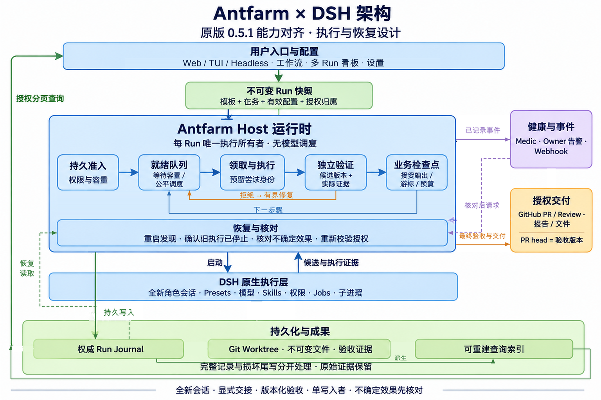
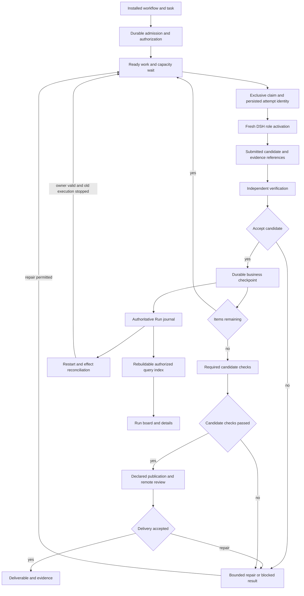

# Agent Note: Antfarm 可复用团队工作流与交付规划

Status: proposed

[English](2026-11-08-antfarm-team-workflow-plan.md) | 中文

[团队运行时决策](../../implemented/architecture/2026-11-08-antfarm-team-workflow-runtime.zh.md)记录已实现部分。本规划继续保留外部验收与原生收敛条件；[能力对照](../../../../plugins/dsh-antfarm/PARITY.zh.md)区分实现能力与已验证结果。

## 问题

重复的 agent（智能体）工作需要可复用的方法：明确职责、有界任务、显式交接、独立检查，以及失败后继续推进的方式。可靠执行器本身不能告诉用户应选择哪套团队，也不能保留全新执行者需要的知识。只有角色提示词则不能强制执行顺序、成果验收、重试预算或资源所有权。

原版 [Antfarm README](https://github.com/snarktank/antfarm/blob/a442ad7dcb8cf8746175cc4a2e2dcafd501156cf/README.md)提出可安装的专业团队和可重复工作流。[功能开发模板](https://github.com/snarktank/antfarm/blob/a442ad7dcb8cf8746175cc4a2e2dcafd501156cf/workflows/feature-dev/workflow.yml)将 story 控制在一次全新会话内，传递明确输出、要求提交，并区分 story 验证、集成测试与审查。[自定义工作流指南](https://github.com/snarktank/antfarm/blob/a442ad7dcb8cf8746175cc4a2e2dcafd501156cf/docs/creating-workflows.md)也描述了调研后写作。这些属于产品原则；OpenClaw 配置、SQLite、轮询 cron 和人设文件名属于实现选择。

当前 [v2 决策](../../implemented/architecture/2026-11-08-antfarm-reimplementation.zh.md)负责现有串行编码运行器及其安全义务。[检查点类型](../../../../plugins/dsh-antfarm/src/persistence/types.ts)保留进度与摘要，没有对应候选版本的验收记录。[执行器](../../../../plugins/dsh-antfarm/src/runtime/orchestrator.ts)可以在最终审查后修复代码，同时保留先前测试结果。固定交接字段和通用摘要不能表达原版工作流中的环境事实与角色专属输出。本规划处理这些缺口，不将已有开发证据视为重新设计已经发布。

当前[运行时配置](../../../../plugins/dsh-antfarm/src/runtime/index.ts)是静态配置，[Runs 面板](../../../../plugins/dsh-antfarm/src/client/RunsPanel.tsx)只提供只读查看。用户需要理解哪些配置生效、安全调整可复用方法，并直接操作运行中或阻塞的工作，无须从原始标识符还原上下文。配置管理和 Run 操作属于本次交付。

依据为原仓库 `a442ad7`（`0.5.1`）、DSH `dsh-v0.2.2-rc.1`、当前插件源码与已有测试断言。本提案没有新增原项目、原生 Team 或模型执行验收。[原生编排提案](2026-11-08-antfarm-native-orchestration.zh.md)负责详细的 DSH 复用与外部插件持久化条件；本文负责产品设计与实施阶段。

## 提案

### 产品目标与首期范围

Antfarm 提供可安装、可复用的专业团队工作流，在 Host 运行期间自主推进已授权工作。用户选择工作流、提供任务和约束、查看进度，最终获得经过审查的成果或可处理的阻塞结果。确定性适用于允许的状态转换和必需检查，不代表模型答案确定，也不保证所有任务成功。

首期必须覆盖原版 `0.5.1` 基线的全部用户能力，同时交付配置管理与运行界面优化，替代此前仅覆盖编码的范围。保留专业角色、全新尝试、三套官方模板、自定义非编码工作流、PR 交付、失败 Run 恢复、自主运行、生命周期管理、诊断、通知与工作流看板。现有 worktree 和所有权保护保留到经过测试的替代方案交付。OpenClaw 专属配置和传输可以改变；缺少对应能力即构成交付阻塞。

| 工作流 | 职责顺序 | 交付成果 |
|---|---|---|
| 功能开发 | 规划；准备；逐项实现／验证；测试；PR；审查，包含修复与复查 | 经过测试的 PR、已发表审查、候选身份、需求覆盖与证据 |
| 缺陷修复 | 分诊／复现；调查；准备；修复；验证；PR | 修复 PR、根因、复现证据与回归检查 |
| 安全整改 | 扫描；排序；准备；逐项修复／验证；测试／重新审计；PR | 整改 PR、按严重程度排序的发现、前后审计与剩余风险 |
| 自定义研究 | 按作者定义调研；综合；来源核查；编辑 | 来源可追溯的报告 |
| 自定义写作或文档迁移 | 按作者定义规划；产出；校验；审阅 | 有版本的文件与审阅发现 |

工作流在启动前声明预期成果与副作用。官方编码模板包含 PR 创建，功能开发还包含 GitHub 审查；用户选择并授权该交付方式，即授权所选仓库内声明的操作。本地交付是具有不同验收条件的显式替代方式，不能代替 PR 功能对齐。两种模式都不隐含合并权限。远程结果不确定时，下一次有副作用操作前必须核对。

### 原版功能覆盖

功能覆盖要求每项基线能力都有可执行的 DSH 入口、保留工作流目的并取得验收证据。命令拼写、轮询 agent、SQLite 和独立 dashboard 进程无须复制。对照[原版 CLI](https://github.com/snarktank/antfarm/blob/a442ad7dcb8cf8746175cc4a2e2dcafd501156cf/src/cli/cli.ts)、模板、[步骤操作](https://github.com/snarktank/antfarm/blob/a442ad7dcb8cf8746175cc4a2e2dcafd501156cf/src/installer/step-ops.ts)、[dashboard](https://github.com/snarktank/antfarm/blob/a442ad7dcb8cf8746175cc4a2e2dcafd501156cf/src/server/dashboard.ts) 和 [Medic](https://github.com/snarktank/antfarm/blob/a442ad7dcb8cf8746175cc4a2e2dcafd501156cf/src/medic/medic.ts)，不只对照 README。原版未完整强制执行的声明必须变成明确且经过校验的行为，不复制缺陷。

| 原版能力或入口 | DSH 实现职责 | 必需对齐证据 |
|---|---|---|
| 全部安装；单工作流安装／卸载；全部卸载与强制处理 | 原生插件安装与版本化启用模板注册；有界释放 | 全部／单个安装、活动 Run 拒绝、确认取消／排空、保留用户资源并移除所属注册 |
| 更新；版本／帮助；信息性 `ant` 命令 | 原生包更新与模板比较；可发现命令／工具帮助及版本／吉祥物输出 | 版本身份、兼容更新／回退、覆盖保留与全部信息入口可达 |
| 工作流列表与发现 | 包含目的、版本、启用状态、资源和依赖的运行时目录 | 官方及本地编写工作流均可列出与校验 |
| 运行；运行列表；按任务、编号或 id 前缀查询状态 | 运行时准入与授权搜索／列表投影 | 稳定显示编号；精确／子串／前缀搜索；修改前消除歧义 |
| 停止／取消 | 现有子会话与写入者所有权，扩展到所有资源策略 | 不再启动后续工作；子会话结算；保留成果并明确处置 |
| 恢复失败 Run | 同一 Run 的 owner 恢复，记录预算授予与核对 | 保留已接受工作；重新尝试失败工作项／阶段；累计历史保留 |
| Peek／claim／complete／fail／stories 执行者操作 | 角色作用域原生尝试工具，或接入唯一执行器的兼容层 | 仅匹配尝试可提交；并发领取互斥；完成不能绕过验收 |
| 有序步骤、story 循环、逐项验证、重试目标、上下文替换与进度归档 | 校验过的工作流适配、有界交接与日志检查点 | 功能／安全循环、自定义单步骤流程、拒绝输出隔离与归档进度可读取 |
| Agent 人设、共享角色、模型、超时、权限角色与外部 skills | 原生 presets、有界导入指令与明确资源／skill 引用 | 映射原版六类权限策略；诊断缺失必需 skills；模型／超时不静默丢失 |
| YAML／Markdown 自定义工作流，包括研究／写作 | 本地编写／导入及实际非 Git 资源策略 | 原版指南的调研后写作案例与自定义循环可执行 |
| Cron 自主推进、轻量轮询与 ensure-crons | 不调用模型的 Host 调度、持久恢复意图与 ensure-execution 操作 | 无须父模型回合即可推进；空闲调度不使用模型；重启恢复授权工作或指出阻塞 |
| 经过测试的 PR 与 GitHub 审查 | 运行时拥有的发布／审查阶段，使用 DSH 权限 | PR URL／head 和已发表审查对应检查过的候选；修复更新并重新检查 PR |
| 前端检测、视觉验证、浏览器 E2E 与截图审查 | 编码模板与支持浏览器的 presets | 前端改动触发浏览器检查并保留截图；浏览器能力缺失明确阻塞 |
| 全局／单 Run 日志与事件 | 有界运行时事件投影与证据读取 | 事件顺序、Run 过滤、历史保留与重启后冷读取 |
| Dashboard 启动／停止／状态、工作流阶段看板、详情、输出、stories 与刷新 | 打开／关闭／查看原生 DSH 工作流看板及 Run 详情状态；不增加独立守护进程 | 多个授权 Run 按阶段分组；输出／条件／尝试／事件可见；可发现新 Run |
| Medic 安装／卸载／运行／状态／日志 | 可配置 Host 健康检查，修复经现有执行器完成 | 检测卡住／停滞／异常终止 Run 与孤立执行资源；提供手动／定时检查及历史 |
| 重试耗尽与严重健康问题升级通知 | 原生 owner 通知，持久记录来源与投递结果 | 原 owner 无须打开 Run 面板也能收到可处理的失败／健康告警 |
| 工作流／Run 通知 URL 与认证 | 通过原生 secret 引用显式订阅 webhook | 投递预期生命周期事件；认证脱敏；失败可见且不影响工作流 |

交付期间按具名场景逐行跟踪 planned、implemented 与 verified。只映射到 DSH、却没有安装后可用入口，不能算覆盖。任何一行缺少验收或尚未解决的 Host API 阻止执行时，不能宣称完整覆盖。任意 DAG 调度、同一候选并发写入、嵌套工作流、远程工作流市场与长期对话 Team 不属于原版基线要求。

#### 原版实现语义与适配决定

核对时远程默认分支仍指向固定基线。以下对照来自该版本源码与测试阅读，不构成新的 OpenClaw／GitHub 执行验收。保留原版有效行为，明确适配宿主机制，并补强未强制的声明或不安全转换。

| 原版源码行为 | 适配及必需区别 |
|---|---|
| [运行创建](https://github.com/snarktank/antfarm/blob/a442ad7dcb8cf8746175cc4a2e2dcafd501156cf/src/installer/run.ts)以事务保存 Run／步骤：首步 pending，其余 waiting；cron 设置失败将 Run 标为 failed。 | 回执前持久保存准入、快照与初始游标；调度故障具有持久且可处理的状态。提交区别于执行及交付验收。 |
| [两阶段 cron](https://github.com/snarktank/antfarm/blob/a442ad7dcb8cf8746175cc4a2e2dcafd501156cf/src/installer/agent-cron.ts)通过轮询模型执行 peek／claim，再启动工作；工作模型回退到工作流轮询模型；活跃 Run 共享工作流 cron。 | 用 Host 代码替代轮询回合，保留有效工作模型选择。仅轮询字段标为不生效。共享调度保留到最后一个依赖 Run 结算。 |
| [领取](https://github.com/snarktank/antfarm/blob/a442ad7dcb8cf8746175cc4a2e2dcafd501156cf/src/installer/step-ops.ts#L485)检查前序完成，但单步骤更新返回工作前不检查受影响行数。 | 保留有序就绪；要求排他领取与持久尝试身份。不复制领取竞争或跨 Run 排序。 |
| [完成](https://github.com/snarktank/antfarm/blob/a442ad7dcb8cf8746175cc4a2e2dcafd501156cf/src/installer/step-ops.ts#L679)将多行 KEY 值合入全局上下文；`expects` 被保存，但此处不检查。 | 将输出期望导入明确 schema／语义校验与具名依赖。保留多行输出；推进或改变已接受事实前拒绝缺失／无效结果。 |
| [逐项验证](https://github.com/snarktank/antfarm/blob/a442ad7dcb8cf8746175cc4a2e2dcafd501156cf/src/installer/step-ops.ts#L712)在验证前发出 story done，retry 时重新打开；缺少 retry 状态进入通过路径。 | 保留工作项／验证顺序与反馈。区分提交和接受；缺少结论不能通过。下一项等待必需验收。 |
| 加载器规范化 `fresh_session`／`freshSession`，但 cron／步骤路径不通过此标志提供可延续会话。 | 保留全新角色尝试。报告导入的不生效标志；仅解析字段不能承诺可延续会话模式。 |
| [失败](https://github.com/snarktank/antfarm/blob/a442ad7dcb8cf8746175cc4a2e2dcafd501156cf/src/installer/step-ops.ts#L1035)重试当前步骤／story；指南中的向前 `retry_step` 声明不由该函数强制执行。[恢复](https://github.com/snarktank/antfarm/blob/a442ad7dcb8cf8746175cc4a2e2dcafd501156cf/src/cli/cli.ts#L541)重置步骤计数，并为 cron 重新读取已安装定义。 | 保留当前项重试与同一 Run 恢复；强制修复后返回原阶段。保留累计历史、显式预算授予与保存定义。重新入队前核对不确定效果。 |
| [SQLite](https://github.com/snarktank/antfarm/blob/a442ad7dcb8cf8746175cc4a2e2dcafd501156cf/src/db.ts)使用 WAL；事件／webhook 在业务更新之外尽力处理。 | 权威日志具有明确崩溃写入恢复协议。事件／索引从已提交转换派生；通知结果不能改变验收。 |
| [Medic](https://github.com/snarktank/antfarm/blob/a442ad7dcb8cf8746175cc4a2e2dcafd501156cf/src/medic/checks.ts)检测卡住／停滞／异常终止／孤立状态；修复可以重置超时步骤。 | 保留检查、频率、历史与上限；时间触发查看。旧执行者停止且效果核对后才复用执行。 |
| [资源准备](https://github.com/snarktank/antfarm/blob/a442ad7dcb8cf8746175cc4a2e2dcafd501156cf/src/installer/agent-provision.ts)导入人设／共享文件／skills；安装保留主 agent 默认项。部分角色限制与必需浏览器／研究指令冲突。 | 原生 presets 保留方法／人设及必需能力，不改变用户默认 agent。诊断缺失 skills、不支持字段与能力冲突；共享导入限制在可信范围。 |
| Dashboard 读取共享 Run／步骤／story／事件／Medic 数据；feature-dev 要求发表 GitHub 审查。 | 通过有界索引读取保留授权跨 owner 看板与健康视图。预检作者／审查者身份并支持授权人工审查接续；角色名不构成不同 GitHub 身份。 |

### 职责与执行结构

| 所有者 | 职责 | 架构意义 |
|---|---|---|
| 工作流定义 | 角色、输入要求、输出 schema、顺序、逐项循环、检查与修复路径 | 团队方法可以查看与复用 |
| Antfarm Run 运行时 | 目录／生命周期、准入、调度、验收、预算、检查点、恢复、发布、健康修复与资源处置 | 业务转换只有一个控制者 |
| DSH | Presets、agent 执行、会话记录、工具、权限、jobs 与子进程生命周期 | 复用已安装的执行环境 |
| 可选原生 Agent Team | 持续讨论、同伴消息与协作任务 | 在工作流需要时支持开放协作 |
| Antfarm Client | 工作流／配置管理、授权多 Run 看板、进度／操作、证据、事件与健康状态 | 用户能确定下一步操作，不拥有执行状态 |

每个 Run 保留一个执行所有者和一份权威日志。不同 Run 可在 Host 容量内并发执行。准入、调度、恢复和 Medic 使用同一转换权威，不成为独立调度器。在固定版本继续直接调用原生 preset activation。Workflow 与 Team 的采用遵循独立维护的原生编排条件；不因展示角色而成为必需依赖。不创建空闲模型监督者，也不将工作项镜像到第二个任务板。

首期执行结构仍为有序步骤、带独立验证的逐项循环、有界修复路径与最终检查。执行前校验指向更早步骤的修复目标和引用。修复不能删除已接受历史或绕过最终验收。任意 DAG 调度、嵌套工作流和并行代码集成，等待具体工作流提出需求。

#### 授权归属与执行生命周期

Run 保存授权 owner，独立于临时执行工作的 Agent 对象。发起 Session 保留归属与导航上下文。关闭 Client 视图不取消 Run。会话卸载、归档与权限撤销具有明确策略；不能将已归档或撤权的 owner 静默替换为 Host 身份。

P0 必须验证受支持的 DSH 生命周期可以维持或重新取得记录 owner 的执行权限，无须另一个模型回合。效果操作校验当前受支持的 live owner 能力。固定 API 无法提供时，指出具体不支持的操作，并在依赖实现前解决前提。Session id、空闲 coordinator 或伪造 Agent 均不足够；发布权限不能仅从保存快照推导。

重启恢复先校验权限、配置与旧执行不活动，再取得新的执行所有者。租约过期触发查看，不自动移交写权限。旧执行者或外部效果不确定时，保留中断并核对。

#### 持久调度与步骤转换

即使执行容量已满，也持久保存已接受提交及其初始等待／就绪状态。仅准入／队列限制或无效权限拒绝提交；执行容量已满时，已准入工作保持排队。就绪与调度意图保存在 Run 日志，Host 从记录重建队列。等待不消耗执行超时或修复重试，始终可查看及取消。

同一存储根仅一个活跃 Host 调度器，调度前强制排他所有权。按 FIFO 选择可执行 Run，每次尝试后轮转，避免长 Run 独占释放容量；遵守 Host／owner 容量与每 Run 单写入者规则。第二个 Host 必须经过确认移交才可调度相同根目录。此为单 Host 设计，不引入分布式执行队列。

| 工作状态 | 必需转换 |
|---|---|
| Waiting | 更早的声明输出尚未接受，不可领取工作。 |
| Pending | 依赖已接受；等待容量，不激活模型。 |
| Claimed | 排他所有权下，在启动前持久记录角色、工作项／候选、attempt id、预留 child id 与预期 Run 修订。 |
| Running | 启动匹配的全新 activation 并保留诊断；启动不确定时需要核对。 |
| Verifying | 保留提交的候选；需要时启动独立全新 verifier。提交不能满足验收。 |
| Accepted | 一次提交输出、版本验收、游标与预算；将下一可执行工作设为 pending。 |
| Rejected、blocked 或 interrupted | 记录反馈、预算或不确定情况；仅相同运行时能入队允许的修复／恢复。 |

表中描述业务工作；实现者与验证者具有不同尝试身份。Peek 只读。Claim／complete／fail 兼容操作使用此运行时，要求匹配角色、尝试和修订。重复完成返回已记录结果；过期或冲突完成被拒绝。启动前取消、取消后回调及过期尝试不能推进新尝试。租约丢失停止后续写入；替换前确认旧执行者已停止。

### 工作流定义与角色组合

解析后定义包含工作流身份与版本、必需任务输入、角色、步骤输入与声明输出、验收条件、修复预算和资源策略。在启动回执之前保存解析后定义。源定义编辑只影响新 Run，不改变已有 Run 承诺完成的工作。

每个角色选择部署提供的 DSH preset、有界 Markdown 指令，以及可选模型／超时覆盖。Skills 属于该角色的 preset 组合；角色可以声明所需 skills，不复制用户的 skill 目录。启动前核验可用性。保留 verifier、tester 和 reviewer 的不同职责：story 条件、跨工作项行为，以及整体可维护性或设计质量。

将原版 analysis、coding、verification、testing、PR 和 scanning 权限策略映射到原生 preset 能力，包括测试和声明的前端验证所需浏览器，以及扫描所需 web／CVE 查询。角色身份／人设与共享角色方法保留为有界资源；角色不必对应唯一 Agent id。原版功能工作流有六个 agent 定义、七个步骤，PR 复用 developer。兼容默认值为 20 个 stories、两次 story 重试，analysis／verification／PR／scanning 超时 20 分钟，coding／testing 超时 30 分钟；提供经过校验的覆盖，不静默继承不同的插件默认值。

为原版 YAML／Markdown 定义提供显式导入适配：身份／名称／版本、初始上下文与模板变量、agent 文件／skills／模型／超时、轮询元数据、有序单步骤／循环、逐项验证、输出期望、重试／升级通知及通知设置。原始资源路径只允许位于规范化可信来源根目录内，包括共享角色引用，再物化为受限托管资源。将旧全局输出转换为声明依赖；校验预期输出与修复目标。仅轮询使用的模型／间隔字段描述导入来源，适用时映射到无模型调度／健康策略；标明没有执行效果的字段。导入在安装前报告不支持或未解析字段，不能静默丢弃。

首期执行自定义调研后写作和 story 循环定义。报告／文件具有不可变身份、读取、保留与恢复检查，不伪造 Git 提交。非编码支持是承接原版扩展性的具体资源策略，不扩张为任意工作流平台。

记录评估恢复所需的执行配置与资源身份，包括工作流文件、公共 API 允许获取的 preset／配置身份、模型路由、锁文件及相关工具／skill 版本。重要执行依赖发生变化或无法核对时，要求人工核对，不能声称旧快照复现当前环境。这是兼容性记录，不是第二个 preset 注册器，也不保证构建环境完全可复现。

包内工作流保持为不可变安装资源。项目或用户覆盖使用独立文件和现有发现优先级。首版支持结构化配置编辑、文件编写与校验。通用图编辑器、远程工作流市场与自动修改仓库指令仍在范围之外。产生效果前校验解析输入、指令路径、schema 支持、引用与配置的总量限制。

### 模板与插件生命周期

通过原生插件安装与运行时拥有的版本化启用模板注册，安装全部或选定包内模板。单模板安装校验资源、presets、角色权限、skills 与命令，不另行部署 agent 宿主。本地编写／导入工作流使用同一目录。保留原版精选包资源的信任方式；任意远程工作流获取不属于该基线。发现／帮助与原生工具代替向用户主 agent 文件写入指令。

模板存在活动 Run 时，卸载或禁用必须拒绝。显式强制操作先取消／排空所属工作，再移除对应注册与托管安装资源。全部插件卸载对调度、健康检查、通知和子会话遵循同一顺序。默认保留用户覆盖与证据；提供对插件自有日志／缓存／资源的显式限定清除，并预览导出／保留方案，以覆盖原版完整释放。移除包不构成删除无关用户文件或分支的授权。

通过 DSH 包管理更新，展示安装／目标版本及模板差异。切换前校验新包与依赖；失败保留当前安装。已有 Run 保留保存的定义和兼容运行时，或明确要求走受支持恢复路径；更新不能重放效果。保留用户副本，新包模板提供比较／重新应用。支持回退到已安装的兼容版本，通过 ensure-execution 核对缺失调度／健康注册且不重复创建执行器。所需 DSH API／版本改动属于独立维护前提；不修改参考 `upstream/` 源码。

### 配置管理

配置具有不同所有者与生效时机。保存的工作流表达可复用方法，部署策略限制可执行能力，Run 快照记录准确选择。分开管理这些内容，用户才能调整方法而不改变已准入工作，也无须建立另一套 DSH 设置数据库。

#### 作用域与解析

| 作用域 | 权威来源 | 可编辑内容 | 生效时机 |
|---|---|---|---|
| DSH profile 与 Host | 原生 profile 配置与 preset 注册器 | 默认值、provider／preset 引用、部署限制、存储策略与 Client 刷新策略 | 执行默认值在下次准入生效；Client 刷新动态生效；结构字段通过受控重启生效 |
| 已安装工作流 | 只读包资源 | 查看、校验或创建覆盖副本 | 选择该版本的新 Run |
| 用户工作流 | 配置的用户工作流目录内文件 | 支持的工作流字段与角色指令 | 解析该来源的新 Run |
| 项目工作流 | 仓库本地覆盖文件 | 项目方法、检查命令与角色选择 | 该项目的新 Run |
| 单次 Run 输入 | 启动请求与不可变有效快照 | 任务、约束、条件与明确允许的执行覆盖 | 仅本次 Run |

先按项目、配置目录、包内资源的优先级选择完整工作流来源，展示生效来源与被覆盖副本。可覆盖执行字段依次应用 schema／profile 默认值、所选定义的显式值、允许的单次 Run 覆盖。不能跨无关文件按位置合并步骤、角色或数组。部署上限与 DSH 权限策略保持权威；工作流或 Run 输入不能提高这些上限。

准入成功前保存解析后工作流、允许的覆盖、有效执行值、来源修订／内容身份与兼容性引用。运行中和恢复的工作使用此快照。后续配置修改影响新 Run；显式计划或预算调整遵循恢复规则并记录变更。恢复时重新校验当前权限和限制；更严格策略可以阻止恢复，放宽默认值也不能静默补充已消耗预算。

#### 管理界面与生效行为

Profile 字段复用[原生 DSH settings 服务](../../../../upstream/docs/subsystems/settings.md)及现有 Client 设置扩展点。Antfarm 必须明确将安全字段声明为 volatile，并通过自己的 Config 引用读取；当前静态 Config 不会自动变成可编辑配置。动态 profile 更新改变下次 Run 捕获的默认值。存储根目录、worktree 布局与结构性执行接线需要停止准入、结算所属执行，再受控重新加载配置；迁移现有日志属于独立迁移。界面说明所需生效步骤。

管理页按模板生命周期、角色执行、预算／检查、工作区行为、健康与通知分组。用户可以查看模板、创建用户／项目副本、编辑支持字段、校验、比较、保存和恢复继承。控件覆盖默认工作流、preset／provider／模型引用、超时、重试／尝试／恢复预算、条件／检查命令、指令、清理／保留、调度／健康频率、Client 刷新、owner 告警和 webhook 订阅。高级拓扑继续通过文件编写并校验。Preset 组合、工具、skills 和凭据保留在 DSH 原生设置中，通过链接访问。

每个可编辑值展示有效值、来源作用域、继承或覆盖状态、保存位置与生效时机。Profile 写入可用性来自原生 settings 描述。缺少配置 provider 或 preset 不可用时给出修正路径。恢复继承仅在 schema 支持默认值时移除选定的显式覆盖；不能取消必需工作流字段。删除工作流副本前预览随后生效的来源。两种操作都不能删除安装模板、Run 快照或保留证据。

#### 写入、冲突与草稿

保留[现有编辑器重新引入条件](../../implemented/architecture/2026-11-08-antfarm-reimplementation.zh.md)：明确可写的用户／项目作用域、包含符号链接逃逸检查的真实路径限制、服务端修订校验、逐目标串行写入、唯一临时文件、原子替换、可处理的过期草稿冲突与未保存草稿保护。读写使用同一目标身份。持久化前校验完整结果定义和指令引用。Host 选择并限制保存位置；浏览器提交路径不构成写入授权。

原生 profile 编辑使用 DSH 修订感知写入；工作流文件使用服务端修订／内容身份，拒绝过期保存，包括外部文件修改。并发客户端不能互相覆盖。冲突时保留草稿，提供比较、重新加载和重新应用选项；取得新修订不意味着可以静默重放旧保存。离开编辑器、切换作用域或选择其他工作流时，如有未保存修改，提供保存、放弃或留在原处。保存后重新读取新修订与有效值。

配置写入遵循对应 DSH 资源授权；Run 效果还需要运行时支持的实时 owner 权限。凭据使用原生 secret 字段或引用及脱敏视图。不能将凭据值序列化到工作流文件、导出配置、Run 日志或诊断证据。准入和保存都执行 Host 校验；Client 校验仅提供提前反馈。

### Run 数据与已接受状态

这些概念描述规划中的数据模型，不代表已批准的传输或日志 schema。它们可以继续放在现有包和一份日志中；只有具体消费方需要时才拆分模块。

| 概念 | 必需信息 | 含义 |
|---|---|---|
| Run | Owner、任务、约束、解析后工作流、仓库基准、工作区、执行配置、预算与状态 | 对可复用方法的一次授权调用 |
| 工作项 | 稳定 id、有界范围、有序前置要求、验收条件与当前进度 | 一次全新执行尝试能够完成的工作 |
| 尝试 | 预留 child id、角色、输入引用、目标工作项／版本、结果与诊断 | 一次执行，包括拒绝或不确定的工作 |
| 验收 | 工作项或最终范围、成果版本、已检查条件、证据引用与结论 | 运行时接受了什么，以及对应版本 |
| 成果引用 | 提交或不可变文件身份、位置、必要时的内容身份与保留信息 | 后续角色或用户如何取得实际结果 |

区分提交的工作与已接受工作。开发者可以提交候选成果；运行时仅在必需独立检查完成后接受。失败输出保留在尝试诊断与修复反馈中。验收历史不可变；当前交付资格从当前成果版本的验收派生。

业务检查点一次提交已接受输出、工作项进度、下一执行位置、预算与适用验收记录。子会话启动前持久记录尝试身份。必需记录持久化失败时停止调度；没有持久业务检查点，子会话结果不能推进工作流。保留跨进程写入者租约与本地单操作准入规则。

#### 崩溃写入与恢复

新日志格式必须通过顺序、长度／内容完整性与版本检查识别完整记录，并定义文件及新建目录的刷盘顺序。只有持久屏障完成后发布已接受状态。追加失败使写入者失效并停止调度；不完整记录不能建立验收。现有 v2 证据不会静默取得这些保证。

区分未完成的最终写入、顺序缺口、无效完整记录与中部损坏。确认排他所有权后，先保留原始字节并记录其身份、已校验前缀与恢复原因，再创建新的权威日志代次。恢复沿明确来源关系使用最后完整一致的检查点；不截断原文件，也不将拒绝／截断数据当作成功。旧 v2 及无法证明的损坏保持只读。新格式尾写只有在前缀得到证明、全部未结尝试／效果已核对时才能恢复，否则保持中断。

在支持平台上证明这些义务后选择存储实现。完整协议下可保留 JSONL；若 SQLite／WAL 移除的自有持久化机制多于新增成本，可作为替代。两者都不能移除原生子会话所有权或外部效果核对。任一时刻仅一个日志代次可写且具有权威。

### 显式交接与外部记忆

用声明的角色专属结构化输出替代固定的摘要交接。使用 DSH 支持的对象 schema 子集与插件自有语义校验，不实现另一套通用 JSON Schema 引擎。步骤读取声明的更早步骤具名输出与当前工作项，避免不同角色覆盖同一个全局字段。

| 产出角色 | 交接内容 | 消费方 |
|---|---|---|
| Planner | 有序工作项、具体条件、范围与假设 | Implementer 与 verifier |
| Setup | 仓库基准、环境前提、基线失败与检查命令 | Implementer 与 tester |
| Implementer | 候选版本、修改路径、实现说明与检查引用 | Verifier |
| Verifier | 逐条件发现、证据与修复指导 | 运行时与修复尝试 |
| Tester／reviewer | 最终版本发现、集成证据与剩余问题 | 运行时与用户 |

记忆分为已接受事实与建议性经验。已接受事实指向权威规划、成果、基线或验收。建议性经验记录有用的代码库模式和环境观察，并保留来源尝试；后续执行者可以重新核对。经验不能完成工作项、授权效果或静默改写规划。

每个全新 activation 接收稳定角色方法、原始任务约束、当前工作项、相关已接受输出，以及最新适用的拒绝反馈。摘要与 Antfarm 完整任务提示共同限制总量；完整 DSH 请求另行实测，因为 presets、项目指令和工具也会增加上下文。大型报告与日志使用具有可靠读取入口的成果引用；不能静默截断验收条件。所有模型可见输入继续经过 DSH 的请求日志路径。

在执行前控制工作规模，保留原版全新上下文原则。工作项反复超出执行预算时，阻塞并要求明确拆分或修订规划，不静默无限延长对话。持久记录批准的规划修订，以及它与已接受工作的关系。

### 候选版本验证与最终交付

编码工作流要求本地候选提交，并在验证前确认源码／配置工作树干净。新引入的源文件也必须纳入该要求。记录仓库基准、候选提交与相关环境／检查配置。Git 不能证明排除的缓存和已安装依赖不可变；证据保留这一限制。

Verifier 读取实际候选成果，独立于实现摘要检查条件。确定性命令通过 DSH 现有权限路径执行。证据标明命令、cwd、真实退出结果与保留输出。模型编写的命令列表或 `passed` 字段本身不构成执行证据。语义审查记录发现与覆盖情况，不保证数学意义上的正确性。

验证与审查不能无提示地改变候选源码。检查前后读取其身份；变化使该项检查失效，并进入修复或核对。测试生成文件仅在声明的输出策略允许时有效。具有 shell 或 skill 权限的 agent，不会因为移除直接写工具而成为文件系统只读。

所有必需最终检查与远程审查对应同一候选版本。C1 测试通过后，审查触发修复 C2，必须在 C2 重做受影响条件覆盖及必需本地检查，更新 PR，再对 C2 重做必需已发表审查。历史验收仍可见，但不能认证 C2。修复后保守重做最终覆盖／检查；按依赖选择性失效留待后续。

完成的编码 Run 返回基准／最终提交、分支、修改、条件覆盖、检查／审查引用、声明交付模式、必需 PR／发布引用、限制和工作区处置。`completed` 表示该版本通过成果与声明交付验收。Job 准入、teammate 任务完成或开发者提交不能代替验收。

### 官方模板细节与远程交付

保留原版工作流 id：`feature-dev`、`bug-fix` 和 `security-audit`。功能开发保留规划、环境／基线准备、有界实现与独立逐项验证、集成测试、PR 创建和已发表审查。缺陷修复保留复现、根因调查、准备、小范围修复、回归验证与 PR。安全审计保留严重程度排序、逐项修复／验证、完整测试／构建／冒烟检查、重复依赖／安全审计，以及 PR 中已解决／剩余发现的说明。保留阶段专属交接与修复路径。无效／缺失计划导致阻塞；经过验证的无发现／无修改审计返回证据，并明确无需 PR，不能伪造提交或 PR。

从实际基准／候选 diff 检测前端改动并记录路径。保留原版扩展名／目录检测和测试文件排除，允许模板显式覆盖。前端工作要求验证阶段浏览器渲染、保留截图和视觉发现，测试阶段浏览器 E2E，审查阶段视觉设计评估。记录启动前提、命令／进程生命周期、页面／候选身份和截图引用。缺少必需浏览器／skill 能力时明确阻塞。这些检查验收任务产品，与 Antfarm 自身 Client 验收分开。

官方编码交付需要授权仓库／分支和 GitHub 集成，通过 `gh` 或受支持等价方式执行。预检校验认证、远程身份、命令和 PR／审查权限。推送、创建 PR 或发表审查前保存意图；保留候选、分支、操作身份、URL／远程身份与结果。响应丢失或重启后，下一次产生效果前检查意图与远程状态；不保证远程恰好执行一次。

保留 feature-dev 的测试 → PR → 审查顺序。要求修改时触发全新修复、最终复查、更新同一 PR 而不强制覆盖他人修改，并对新 head 发表／复核审查。完成要求 PR head 对应已接受检查与必需审查。发表失败，包括 GitHub 自审限制，构成可处理阻塞。缺陷／安全 PR 保留必需回归／审计证据，不额外虚构必需审查阶段。自动合并不属于基线。显式本地交付模式不能满足 PR 验收。

分别预检 PR 作者和审查执行者。必需 approve／request-changes 操作禁止自审时，提供受支持的不同审查身份，或明确授权的人工审查接续。凭据保留为原生 secret 引用，限定于当前操作；不切换用户全局 `gh` 账号。人工接续在验收前核对已发表审查身份和候选 head。降级为普通评论不能满足必需批准。

### 失败、修复与重启行为

| 情况 | 必需转换 | 恢复方式 |
|---|---|---|
| 普通验收条件被拒绝 | 记录拒绝尝试；在预算内修复 | 携带具体发现的新尝试 |
| 缺少必要业务决定 | 持久记录阻塞原因；结算当前执行 | Owner 提供缺失决定 |
| 配置不可用或执行能力不支持 | 在依赖效果前停止 | 修正配置后显式重新启动／恢复 |
| Provider、存储或清理故障 | 停止调度；保留诊断与输出 | 修复故障并核对不确定效果 |
| 子会话可能产生效果但没有已接受检查点 | 标记中断／不确定 | 检查子会话记录和成果后恢复 |
| 重试或总尝试预算耗尽 | 按策略持久记录阻塞或执行失败结果 | 同一 Run 的 owner 恢复，记录恢复预算授予 |
| 取消 | 禁止新启动、停止子会话、等待释放后结算 | 保留输出；清理属于独立校验的处置 |

区分基础设施故障与业务拒绝。Preset 缺失或日志失败不消耗编码修复重试。逐项、修复与累计尝试历史跨恢复保留。失败 Run 可以原地恢复：owner 提供修正与策略允许的恢复预算，记录为新的恢复段并在提交前展示。不删除原计数或已接受工作。执行／Job 失败结算当前操作，不终止持久 Run 的恢复能力。修复必须重跑受影响验收与最终检查。

活跃 Host 推进已准入 Run，不要求父模型再执行一个轮次。发起会话仍是权限 owner；需要权限的操作继续核验确切 live Agent。仅通过受支持的 DSH API 明确保留或重新取得 owner 权限。会话卸载、归档及 Host 释放，必须等待受支持的生命周期所有者，或中断并保留 Run；不能通过 Session id 冒充 Agent。

首期包含重启发现，以及可重新校验 owner 权限和执行状态的工作自主恢复。持久记录调度意图，重新取得受支持 owner 生命周期，复核权限／配置，核对未完成尝试，仅在确认旧写入者／子会话不活动后恢复。阻塞和不确定效果仍提供显式恢复。按时间重置不能证明执行者停止或没有效果。缺少 owner／调度 API 时必须在功能对齐发布前解决；空 coordinator 或缩小范围的声明都不能满足要求。

Headless 调用方必须等待 Run 最终结果，jobs 准入并不足够。后台契约修改同时定义最终结果等待，并证明退出不会遗留已准入工作。阻塞执行可以结算 job，持久 Run 仍可恢复。取消或卸载插件时等待所属子会话及写入者释放。

### 健康、事件、日志与通知

这些能力共享运行时权威状态与唯一执行器。健康查看无需激活模型即可报告故障；修复需要执行所用的 owner／准入／写入者检查。通知消费已记录转换，不能验收工作或改变调度。

#### Medic 等价健康管理

通过设置、命令／工具与看板提供启用／禁用、手动检查、状态和历史。默认采用原版五分钟定时频率及保留 500 条检查记录，可独立于 Client 可见性配置；卡住／停滞阈值由角色超时与宽限推导。报告包含严重程度、Run／工作项／尝试、最后进展、原因、建议操作、实际修复结果与时间戳。提供最近检查详情及滚动 24 小时问题／操作统计。

| 原版健康检查 | 检测与响应 |
|---|---|
| 卡住步骤／story | 查看子会话结果与租约；在遗弃／恢复预算内重试确认停止的工作；核对不确定效果 |
| 停滞 Run | 检测超过阈值没有持久进展；携带依赖／provider／权限诊断告警 owner |
| 异常终止／不一致 Run | 对比阶段／工作项与最终验收；结算为失败／阻塞以便恢复，不能从终态子会话推断完成 |
| 孤立 cron 等价情况 | 核对过期调度、Jobs、子会话和注册；仅移除确认无所有者且不活动的资源 |

等待容量的排队工作不属于卡住执行，不能按角色超时重置。容量耗尽或调度器缺失，与活跃尝试没有进展分别诊断。健康修复不能绕过队列限制、owner 校验或正常领取协议。

限制自动恢复；保留原版五次遗弃上限，覆盖值受部署策略约束。时间阈值触发查看，不构成重置权限。手动／定时修复通过同一执行器串行执行；ensure-execution 幂等恢复注册。禁用／卸载停止并等待所属检查，不禁用无关 DSH jobs。

#### 事件历史与投递

将持久 Run／步骤／工作项／尝试转换投影成有序时间线，包含稳定身份／游标、时间戳、易读标签、结果与证据。记录原版 run／step／story／pipeline 事件名称和内容字段的兼容映射；区分已提交 story 输出与通过验证的验收。提供近期／全局及单 Run 日志、数量限制、任务／编号／id 前缀查询、过滤与重启后冷读取。区分已接受历史和诊断，配置保留／导出；轮转临时日志不能删除恢复／交付证据。Client 分页与读取保持有界且经过授权。

通过 DSH 支持的通知／会话能力投递重试耗尽、阻塞、中断、完成与严重健康告警。Human／main 默认升级通知映射到拥有 Run 的根 Session；支持原版 `agent:` 目标和工作流升级规则的显式授权接收方映射。安装／启动时解析目标，不能静默重定向未解析目标。持久记录来源、去重身份和投递结果；重新连接后可查看错过的告警。声明的接收方订阅不授权向无关第三方发消息。投递失败保留可见待投递／失败状态，不能使 Run 成功或消耗修复重试。

通过显式 webhook 订阅支持原版工作流 `notifications.url` 与单 Run URL 覆盖。生命周期事件具有稳定身份和有界内容。使用原生 secret 引用，快照不保存含凭据 URL；保存前将旧认证导入脱敏原生字段。默认保留原版五秒投递超时；可选重试有界，失败保留诊断。传输结果不确定时可能重复投递；记录去重方式，不保证恰好一次。Webhook 失败不阻塞执行，也不参与验收事务。

### 工作区与成果所有权

编码 Run 从捕获的已提交基准创建独立 worktree。保留基础检出修改，不自动复制环境。单次 Run 内只有一个写入执行者；独立 Run 可以在部署限制内使用不同 worktree 并行。并发只读检查前冻结候选版本，并用实际 DSH 权限约束访问。

恢复或交付需要的成果必须在工作区清理后仍然有效。检查证据保存在可清理 worktree 之外，或在处置前形成不可变引用。清理核验仓库身份与已跟踪、未跟踪及忽略内容，使用非强制移除，并保留分支。清理失败时保留输出并报告原因。

工作区和交付策略属于工作流。编码使用 Git／worktree 身份。首期研究／写作使用不可变报告／文件身份、允许输出根目录与冲突处理。每种策略具有恢复／保留验收；自定义工作流不必虚构 Git 仓库。

### 运行界面与产品入口

扩展命令／工具、Runs 侧栏、原生主视图扩展与设置。Client 从运行时投影读取方法、已接受进度、阻塞和有效操作，不扫描日志或维护另一套 Run／任务数据库。首期包含跨授权 Run 的原版工作流阶段看板。无关仓库资产盘点与 Team 任务镜像仍在范围之外。

#### 多 Run 看板与健康视图

提供原生工作流视图，支持模板选择、按阶段分组 Run，包含完成／失败／取消结果、任务标题、稳定编号与计数。按工作流、状态、owner、任务或 Run 身份过滤／搜索。保留 Session 侧栏作为聚焦入口；看板展示 DSH 身份有权查看的全部 Run，包括不活动 owner。Host 资源授权约束跨 Session 读取；提交 Session id 不构成凭据。修改仍需重新取得记录 owner 的权限。

卡片打开步骤、条件、尝试、输出、事件、成果、配置、健康发现与原生 Session 链接。健康概览展示启用状态、最近检查、问题／操作统计、手动检查和历史。看板打开／关闭／状态代替独立 dashboard 守护进程生命周期；Host 调度／健康独立继续。注册原生视图插槽并显式发布受支持投影，不能假定原生 Workflow 卡片观察 Antfarm 日志。

Host 维护 Run 身份／编号、授权归属、工作流／阶段、状态、标题、已接受计数与日志修订的查询索引。它是已提交日志的可重建投影，不成为另一份任务数据库或验收权威。冷启动发现／重建；常规列表／搜索使用有界授权分页与已提交增量更新，不重新打开每份完整历史。缺失／过期项触发有界刷新并展示投影新鲜度。效果操作仍校验当前日志和 owner。稳定 Run 编号在串行持久准入时分配，不从过滤列表长度推导。

#### 启动与信息层级

Runs 顶栏提供新建 Run、刷新、看板／健康与工作流／设置入口。选择说明目的、输入／能力、预期输出、来源版本和效果。任务输入区分需求、约束与建议。编码预检展示仓库、已提交基准、worktree 策略、有效配置与未包含的未提交修改；非编码预检展示输入／输出根目录和保留策略。效果前校验解析输入／依赖，保留草稿和可处理字段错误。

Run 列表使用任务标题与工作流名称、状态、当前阶段、已接受工作项数量和可处理的阻塞原因。原始 Run 与 child id 作为次要信息，支持诊断和复制。进度统计已接受工作，不统计已提交尝试；全部工作项通过后仍展示最终测试与审查。

| 详情区域 | 主要内容 | 深入查看 |
|---|---|---|
| 概览 | 任务、约束、状态、当前角色／工作项、已接受进度与有效下一步 | 剩余预算、失败分类与恢复指导 |
| 执行过程 | 有序阶段／工作项、尝试、接受／拒绝／不确定结果 | 按角色、工作项与尝试标注的原生子会话链接 |
| 结果与证据 | 候选版本、条件覆盖、交付结论、PR URL／head、审查、保留成果与工作区处置 | 实际检查、审查发现、修改路径与成果引用 |
| 有效配置 | 工作流来源／版本与 Run 保存值 | 与当前配置的作用域／来源比较及兼容性变化 |
| 活动与健康 | 有序事件、最新告警与诊断 | 有界日志、Medic 历史、通知投递结果与修复记录 |

在现有侧栏和原生详情控件内渐进展开。大型证据按需读取，状态结果保持有界。Job 结算不能使阻塞 Run 变成完成。已完成 Run 在工作区处置期间仍显示未结算；清理失败保留成功成果与诊断。

#### 按状态提供操作与权限

| Run 状态 | 可用操作 | 必需条件 |
|---|---|---|
| 排队中 | 查看就绪／容量原因、详情、取消 | 已持久准入；取消阻止调度且只释放该 Run 的预留资源 |
| 启动中或运行中 | 查看、打开子会话、取消 | Owner 授权；取消等待子会话与写入者释放 |
| 阻塞 | 查看原因、提供指导、恢复 | 修正记录的阻塞；记录批准的计划／预算修改 |
| 中断 | 查看子会话／成果，不确定时核对，再恢复 | 受支持的 owner 与检查点；下一尝试前不存在未解决的不确定效果 |
| 完成 | 打开／复制候选与证据；满足条件时清理 | 处置前保留证据并检查工作区 |
| 执行失败 | 查看、修正输入／依赖、原地恢复或新建 Run | Owner 恢复预算与核对；保留已接受工作／历史 |
| 已取消 | 查看保留输出；满足条件时清理 | 取消已结算且清理检查通过 |
| 旧格式或损坏 | 读取可用证据 | 不修改或推断迁移 |

Host 操作产生效果前复核 owner、Run 修订／状态与可操作条件。进行中控件防止重复点击；服务端准入／请求身份防止重试或多个视图重复启动。响应丢失后先查找／核对，再产生效果。任务／id 前缀匹配在修改前必须明确到唯一 Run。只读 Remote 不能通过 Session id 冒充 owner；受支持 owner API 属于 P0 前提。

恢复说明失败／阻塞／不确定情况、剩余／授予的恢复预算和受影响阶段；提交失败保留指导。清理／卸载预览工作区、保留分支／成果与请求清除内容。提供已实现操作，无法重新取得 owner 权限时展示可处理的不可用状态。发布遵循声明且已授权的交付范围。

#### 查询、反馈与视觉验收

查询、选择与草稿按 Session 和 Run／工作流身份区分。切换选择、作用域或 Session 后取消或忽略过期响应。查询失败保留已加载内容，就地展示重试提示；字段校验和持续恢复指导保留在对应内容旁。短暂保存／操作结果使用全局原生 Toast，使其在面板关闭后仍可见。进行中控件与加载样式遵循原生控件规范。

可见时轮询详情直到执行与工作区处置完成。看板／列表按有界频率刷新，包含空列表／全终态结果，并提供手动刷新。隐藏视图停止轮询，返回时刷新；Host 调度／健康独立继续。原生 Workflow 卡片不会流式读取 Antfarm 日志；使用通知时发布受支持投影。保留选择／草稿，忽略过期响应，列表行不读取完整日志。

复用现有图标、字体、间距／颜色 tokens、原生子会话导航与 locale 自有文案。核验明暗主题可读性、窄面板、长任务名与路径、键盘操作、焦点恢复、可访问操作名称及平台窗口留白。菜单和浮层必须正确关闭、适应视口并避免裁切。真实 DSH 浏览器验收覆盖启动、阻塞／不确定恢复、取消、过期草稿、Session 切换、证据读取与最终工作区处置；为实现后的交互安排产品／设计评审。

### 兼容性与现有证据

工作流和日志版本显式记录。不能将 v2 成功摘要解释成候选版本验收。新执行器无法忠实恢复旧格式时，保留查看入口，并明确允许用兼容包完成旧 Run，或检查后启动新 Run。不静默迁移或重放效果，也不为升级未发布开发记录而保留两套完整执行器。

可识别的旧格式与损坏证据保持只读，保留现有工作区保护。对应行为交付后才更新所属 README、DESIGN、子系统参考与已实现决策。某个阶段完成不代表整个规划已实现；首期交付与发布验收完成前，规划保持 proposed。

### 实施阶段

阶段按依赖与可观察结果排序。取消、准入、不确定恢复和工作区测试保留到明确版本化行为替代它们。源码位于 `plugins/dsh-antfarm`；父仓库记录文档与已发布子模块指针。功能矩阵每一行都属于首期发布。

| 阶段 | 交付物 | 必需证据 |
|---|---|---|
| P0：基线与执行前提 | 清点原版源码语义与全部入口；确认 owner 生命周期／重新取得、headless 等待、证据和授权 API；预检 GitHub 身份限制 | 最小真实 DSH Run 无父模型回合推进，验证 owner 卸载／撤权／重启；列出具体不支持操作及解决方式；全部矩阵场景明确归属 |
| P1：持久执行基础，依赖 P0 | 持久准入／就绪、Host／存储根所有权与容量、尝试／执行者 API、检查点／崩溃恢复、失败 Run 恢复、自主重启、ensure-execution 与可重建查询索引 | 排队工作跨重启保留；公平有界调度；领取／启动／取消／迟到结果竞争；写入互斥；尾写与损坏区分；效果核对；headless 最终等待；索引重建 |
| P2：定义、生命周期与健康，依赖 P1 | 原版导入适配、角色／模型／skills、快照／交接、报告／文件策略、安装／更新／卸载及 Medic | 三套官方模板与调研后写作／自定义循环导入；默认值／模型回退一致；资源受限；覆盖保留；有界卡住／停滞／异常终止／孤立检查 |
| P3：独立验收，依赖 P2 | 候选证据、浏览器／视觉检查、回归／审计对比与不可变非编码结果 | C1→C2 失效；拒绝缺失结论；截图／E2E 要求；实际检查；无发现处理；保留证据 |
| P4：远程交付与事件，依赖 P3 | PR／审查／修复闭环、事件／日志、原生 owner 升级告警与认证 webhooks | PR／head 对应检查／审查；响应丢失核对；日志冷读取；离线 owner 告警；webhook 认证／失败／去重 |
| P5：配置与运行界面，依赖 P4 | 原生表单、安全工作流编辑、Session 侧栏、授权多 Run 看板、健康／历史、搜索／操作／证据 | 冲突／路径／并发保存／草稿回归；过期查询／操作；真实浏览器主题、键盘、窄／宽视图；产品／设计评审 |
| P6：完整对齐验收与发布，依赖 P5 | 安装包中全部矩阵入口可用；配对文档与发布材料 | 真实 DSH Web／TUI／headless／模型案例；官方 PR 与自定义非编码工作流；macOS／Linux；远程安装／更新／卸载 |
| 后续：原生收敛 | 满足条件的原生执行／持久化替换与可选持续 Team 协调 | 原生提案的失败／所有权／持久性／冷读取／释放检查，且净减少维护机制 |
| 后续：超出原版的能力 | 通用图编辑器、嵌套／DAG 工作流、并行候选集成和其他领域 | 独立具体消费方与范围决策 |

P0–P6 构成原版完整覆盖及配置／界面优化。扩展模板、验收或管理界面前，先证明执行生命周期与持久恢复。Settings／视图前提在依赖阶段前解决；现有受支持能力可满足要求时，不强制修改 DSH。不能静默排除基线能力，或用只读／仅手动行为替代承诺操作。前提未解决时，规划保持 proposed，功能对齐发布保持阻塞。PR、Medic、通知、自定义工作流和重启恢复均为首期要求。原生执行器替换与超出原版功能不阻塞插件等价实现。

## 考虑过的替代方案

**将编码执行器作为整个产品。**它保留安全性，但不能充分表达可复用角色、工作流发现、外部记忆与显式交接。执行器作为可复用方法的运行时层。

**默认使用长期对话 Team。**它支持动态同伴协作，但改变原版全新上下文方法，保留不断增长的对话状态，也不强制候选验收。实际持续讨论按照原生提案使用原生 Team。

**复制 OpenClaw cron、SQLite 与人设配置。**这些机制补足原宿主环境的设施。DSH 已管理 agent 和执行生命周期；复制整套实现会增加调度、安装与故障所有者。通过 DSH 运行时保留自主推进与角色方法。

**给每个新执行者携带全部前序输出。**读取方便，但会重新产生上下文膨胀，并让拒绝或过期内容影响决定。使用声明输入、有界已接受事实、建议性经验和可读取成果。

**将模型结论或完成任务视为验收。**这会丢失成果版本与实际检查证据。要求独立记录的验证和运行时显式接受。

**立即推断精确失效范围并并行编码。**核心交付尚未实测，就需要依赖分析、隔离候选、合并规则与集成验收。先使用串行写入者与保守最终复查。

**先构建通用图编辑器与任意成果框架。**原版有序／循环工作流与具体编码／报告策略足以覆盖基线，无须 DAG 调度或通用资源抽象。先交付原版能力，仅为具体新增工作流扩展。

**配置只通过文件管理，或把全部设置存入 Antfarm。**纯文件管理难以看清有效值与生效时机。独立设置存储会重复 DSH profile、preset、权限与 secret 所有权。使用原生 profile 表单、安全工作流覆盖与不可变单次 Run 快照。

**让 Client 成为另一个编排所有者。**乐观进度、原始日志扫描或仅按钮侧并发检查，可能与持久验收不一致并重放效果。投影保持有界，操作由权威运行时核验。

## 验收条件

- 受支持的 owner 生命周期使已准入工作无父模型回合或可见 Client 视图继续推进；卸载／归档／撤权与 Host 重启执行声明的授权策略。具体不支持的 DSH 操作在依赖交付前解决。
- 执行容量已满时，授权的已准入工作保持持久排队且可取消。队列重启、owner／Host 上限、公平调度、重复领取／完成和迟到回调不能丢失工作或启动第二个写入者。
- 新格式崩溃注入区分完整检查点、未完成最终写入与中部损坏。已证明前缀的恢复保留原始证据并记录权威来源关系；未结尝试必须核对。旧 v2 不静默升级或截断。
- Run 索引重建、增量更新与授权分页不要求逐列表行读取完整历史。缺失／过期投影不能授权效果或伪造已接受进度；并发准入产生不同稳定编号。
- 必需 GitHub 审查预检有效身份与候选 head，支持授权人工接续，不静默用普通评论替代批准或切换全局凭据。
- 原版功能矩阵每行都有安装后可发现入口及具名验收场景。新用户可以安装／选择工作流、执行授权工作、查看／恢复失败并取得声明成果。只有 DSH 映射、没有可用入口，不能算功能对齐。
- 官方模板保留阶段职责与 PR 结果。功能审查发表于检查过的 PR head；修复更新同一 PR 并重做检查／审查。缺陷／安全 PR 包含回归／前后审计证据。本地结果不能代替声明的远程交付。
- 前端改动触发任务产品的浏览器渲染、截图验证、E2E 测试和设计审查。证据标识候选／页面／进程生命周期；缺少必需浏览器能力不能验收通过。
- 原版自定义调研后写作与循环工作流能够导入执行，上下文有界，不可变文件可读取。覆盖全部角色／模型／超时／skill 映射、原版默认值和支持的来源字段。
- 安装／更新／卸载／回退及 ensure-execution 校验资源／权限、保留用户覆盖并排空活动工作。限定完整释放仅作用于明确选择的自有资源；更新不能修改保存定义或重放效果。
- 工作流看板／搜索展示全部授权 Run、阶段进度、stories、输出、事件与健康。编号／任务／id 查询消除操作歧义。健康检查覆盖卡住／停滞／异常终止／孤立情况，保留历史，并仅通过现有执行器修复确认不活动的执行。
- 面板关闭或 Client 断开后，owner 升级告警仍有效。原生／webhook 事件投递展示来源、认证、去重与失败／不确定传输；通知失败不能推进或使业务验收失败。
- 配置管理展示来源优先级、有效值、覆盖状态、保存位置与生效时机。用户可以创建和编辑可写工作流副本、校验、保存与恢复继承，不修改包资源。原生 profile 表单遵循 provider 可用性与 DSH 修订检查。
- 配置编辑影响新 Run；已有或恢复的 Run 保留保存的方法与已消耗预算。任务输入不能提高部署上限。当前更严格权限／限制明确阻止无效恢复；结构性重新加载等待所属执行结算。
- 无效定义、符号链接逃逸、过期修订和并发保存不能覆盖其他目标或草稿。冲突、关闭和作用域切换保留未保存工作。凭据保持为原生引用／脱敏值，不进入 Antfarm 导出或持久配置／证据。
- Run 控件遵循状态／操作表和实时 owner 检查。重复／过期操作不能创建另一个执行器或重复准入。响应丢失要求核对；阻塞／不确定、完成和执行失败保持可区分，失败 Run 支持恢复。
- 界面区分提交尝试与已接受进度，提供角色／工作项／尝试子会话链接、候选版本检查、最终结果和工作区处置。空列表／全终态列表能发现新 Run；隐藏面板停止轮询；Session 切换后过期响应不能展示或修改另一选中项。
- 功能开发、缺陷修复和安全整改保留不同角色职责，通过全新有界尝试完成。每个已接受工作项具有具体条件覆盖；最终检查对应同一成果版本。
- 角色交接区分已接受输出、拒绝反馈与建议性经验。缺失引用或过量输入明确失败；全新执行者有可靠入口读取大型必需材料。
- C1 测试通过后修复生成 C2，在所有必需最终检查与条件覆盖对应 C2 前不能完成。检查中候选变化使该项检查失效。
- 模型不能仅报告命令或 `passed: true` 就建立执行证据。证据引用对应保留的执行记录或成果，工作区清理后也可读取。
- 必需日志写入失败停止后续启动。启动、结果处理和子会话释放期间取消不能推进 Run。取消或插件释放报告完成前，所属执行与写入者释放已经结束。
- 两个进程不能同时操作一个 Run。失败 Run 原地恢复，保留已接受工作与累计历史，记录恢复预算授予。重启自主推进前复核 owner／配置并核对调度／尝试。不确定效果需要查看；公共 API 前提未解决时，功能对齐发布保持阻塞。
- Headless 最终结果等待区分准入、验收、阻塞与失败，并证明普通退出不会遗留已准入工作。Client 查询及操作失败保留已加载内容，并说明下一有效操作。
- 版本处理不能将旧摘要提升为新验收或静默重放旧效果。当前旧格式／损坏查看与 worktree 保留保证仍然有效。
- 验收使用每例私有目录、分配端口、隔离 profile 和明确状态屏障控制竞争。取得资源后立即登记清理，并等待进程／子会话退出；固定 sleep 不能证明就绪或取消。
- 在所属插件执行适用 typecheck、build 与测试；校验配对文档及包导入；发布前记录真实 DSH 组合、浏览器、平台与远程安装证据。确定性 fixture 固定执行机制；真实模型场景验证观察到的实用性。
- 在代表任务中衡量接受成果耗时、尝试次数、人工介入、最终验收率，以及可获取的 token／成本数据。无法取得的用量数据和剩余阻塞如实报告，不虚构阈值或宣称普遍质量。

## 风险

日志崩溃恢复与查询索引增加 Host 职责。实现规模服从已证明的持久性与列表／搜索需求；选型前比较 SQLite 和完整自有协议。查询投影延迟不会使已提交工作失效，但不能用于业务转换决定。

符合 schema 的输出仍可能错误，专业 agent 之间也可能存在相关性错误。独立成果检查、有意义的确定性验证和条件覆盖提高可观察性，但不保证语义正确。真实模型验收必须包含失败与人工介入。

全新会话重复角色指令，可能增加材料读取。工作项过小也会增加调度和模型开销。继续收紧上下文或拆分全部工作项前，衡量完整组装输入与任务完成成本。

提交标识源码，不能标识整个执行环境。已安装依赖、缓存、外部服务和生成输出可能变化。记录相关配置，拒绝检查中变化的候选源码，并保留环境限制。

固定版本的 owner 激活、证据读取或原生状态 API，可能不支持所需重启、跨 Session 视图和通知。解决这些 API／版本前提，开发期间保留显式恢复。缩小范围的降级不能称为完整对齐；替代方案验收通过前仍需独立日志与满足条件的原生 API。

可写管理增加路径、修订和草稿所有权义务。原生 profile 动态更新语义也不同于不可变 Run 执行。明确实现并测试两条持久化路径；每次尝试重新解析当前默认值会破坏快照保证。Client Run 操作依赖授权 owner API，当前查看网关尚未提供该能力。

版本化验收可能要求用兼容包处理旧 Run。完整对齐引入认证远程效果、重启所有权、健康修复与非 Git 保留。分别验证每项机制并展示不确定结果。并行候选写入、通用 DAG／编辑与原生 Team 收敛仍属于超出原版基线的能力。
