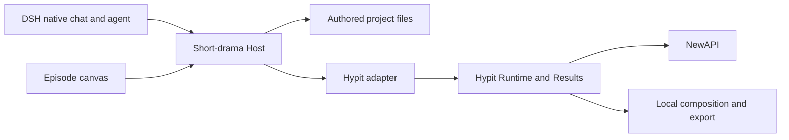

# Agent Note: Short-drama workbench with an episode canvas and native AI chat

Status: proposed

English | [中文](2026-11-08-short-drama-canvas-workbench.zh.md)

## Problem

The user needs a workbench that turns a script into a finished short-drama video through an infinite canvas and AI conversation. The difficult part is keeping characters, shots, generated candidates, dialogue timing and the selected edit consistent as the script changes. A canvas alone does not establish those relationships, and a successful generation request does not establish a usable finished episode.

Community DSH plugins cover parts of this workflow. Hypit supplies an executable video-project architecture, but its Studio is a source editor, timeline and inspector rather than the requested infinite canvas. Combining entire applications would duplicate content ownership, execution state and editing behavior.

## Proposal

Build an independent DSH short-drama plugin. It owns authored drama content, episode canvases, production intentions and user selections; DSH supplies native chat and agent execution; a narrow Hypit adapter supplies media execution, timing, composition and saved Results. Use the user's local NewAPI as the initial model gateway after verifying each media protocol. This is a proposal for a local workbench; no plugin or Hypit integration has been implemented or validated by this research.

Keep the initial implementation to one Host and one Client in a new plugin repository under `plugins/`, following the [repository ownership and dependency policy](../../../../HANDOFF.md). Keep DSH dependencies at `0.2.2-rc.1`. Separate content operations, Hypit adaptation and Client presentation into modules; split packages only when an independently used API requires it.

The first complete deliverable is one real 30–60 second vertical episode with reusable character references, several shots, dialogue, subtitles, preview and MP4 export. First validate the interface, media protocols and one-shot revision cycle in the acceptance order below. Expand to more providers, episodes and automation only after the episode proves the ownership and recovery rules.

## Responsibilities and interface

Each layer owns a different decision. The plugin decides what the creator intends to make and which media to use; Hypit decides how submitted work executes.

| Owner | Responsibility |
| --- | --- |
| DSH | Native conversation, agent tools, permissions, credentials, filesystem access and subprocess control |
| Short-drama Host | Project content, version checks, asset references, generation intentions, selections and dependency freshness |
| Short-drama Client | Episode canvas, inspectors, candidate comparison, preview and visible production status |
| Hypit adapter | Compile a pinned content revision into a video project; submit, inspect and reconcile Builds; import explicit Result references |
| Hypit Runtime and Results | Execution scheduling, provider receipts, accepted outputs, composition execution and finished Result storage |
| NewAPI providers | Exact image, video, speech and transcription request protocols and their supported inputs |

Pilot a main canvas with native chat in the right sidebar. The pinned [conversation slot contract](../../../../upstream/packages/client/ui-conversation/src/client/contract/slots.ts) exposes the reusable `conversation.content` Factory with an `embedded` variant; the upstream [subagent sidebar](../../../../upstream/packages/client/ui-subagent/src/client/sidebar-chat/index.tsx) already renders it. Its nested `conversation.session` being a single slot does not prevent embedding the enclosing Factory. Verify ordinary Session binding, draft and attachment preservation, switching and disposal in a real DSH profile. Keep the registered right-sidebar canvas as a fallback if that integration fails. Do not base either layout on host DOM relocation or imports of another plugin’s UI.

Use React, DSH theme primitives and registered slots. Evaluate `@xyflow/react` for draggable node cards, connections, pan and zoom before building a canvas engine; verify its chosen version, license and DSH bundling in the UI experiment. Keep transient interaction state in the Client and durable coordinates in a dedicated layout document. Dispose registrations and subscriptions with the plugin lifecycle.

One episode has one canvas. Project-wide characters, locations, appearance variants and visual style remain shared assets that episode nodes reference. Nodes expose script passages, storyboard groups, reference images, generated candidates, audio, composition and delivered files. Edges show actual content dependencies; dragging a node does not change shot order or video timing. A selected shot opens its inspector and candidate comparison; a compact timeline edits the selected composition.

## Script-to-video workflow

The canvas presents the work as editable deliverables. The creator can stop at each stage, revise earlier content and regenerate only the affected work.

| Stage | Deliverable and next action |
| --- | --- |
| Script | Episode outline, scene text and dialogue; review the story before production |
| Shared assets | Character and location descriptions, approved reference images and appearance variants |
| Storyboard | Stable shot IDs, action, framing, references, dialogue, intended duration and continuity notes |
| Generation | Version-bound image and video candidates; compare and explicitly select footage |
| Audio and timing | Dialogue audio, alignment, subtitles, music or effects, and explicit timing for non-dialogue action |
| Composition | Ordered selected clips, trims, audio policy, subtitle style and vertical output settings |
| Delivery | Decoded preview, final MP4, subtitles and an export manifest linking the selected inputs |

Use Hypit's script and narrative-temporal concepts for dialogue segments and semantic word or segment anchors. Establishing shots, silent actions and pauses also need explicit timing; speech alignment cannot determine every cut. Record whether each segment preserves generated audio or replaces dialogue with TTS. Mixing both without an explicit decision can double the spoken lines. Music and effects remain separate tracks.

The first version supports ordering, trimming, dialogue replacement, subtitles and export; simple transitions follow the finished-episode pilot. Advanced motion graphics, automatic lip synchronization, voice cloning, a general workflow editor and autonomous whole-series production are deferred. The pilot must select an audio strategy: narration or off-screen dialogue can use TTS, while visible speaking shots must retain verified usable generated speech or pass a manual lip-match review. Replacing audio alone does not synchronize lips. If dialogue exceeds the clip, require an explicit trim, rewrite or regenerated shot before export; do not silently truncate speech.

## Content, revisions and generated files

Each data category has one authoritative representation. Store editable scene prose as Markdown and structured shots, shared assets, selected candidates and composition as versioned JSON in the workspace. Layout JSON owns only coordinates and view state. The Client loads Host state; browser storage does not mirror authoritative content. Generated Hypit project source is derived from a recorded input revision. Editing that source in Hypit Studio is outside the first version because bidirectional editing would create a second content authority.

Every shot, asset version, candidate and production intention has a stable ID. A generation intention records the source revisions, prompt, reference identities, exact provider/model parameters and resulting Hypit Build or provider receipt. Candidate records retain explicit Result/output/file identities and media metadata. A composition records selected candidate IDs, ordering, timing and audio choices. Names and filenames are presentation, never the mechanism for adopting a result.

Scene Markdown owns dialogue wording. Give scenes and dialogue segments stable embedded IDs; shot JSON references those IDs and their source revisions instead of maintaining another editable copy of the lines. Rewording preserves an ID when the segment remains the same; splitting or merging creates new IDs with explicit predecessor mappings. Retire removed IDs without reusing them. Unresolved references block new generation and composition until the creator accepts a remapping. Existing candidates retain their frozen source versions. Dependencies must include dialogue, timing and shared asset versions, so stale detection can explain which input changed.

UI actions and agent tools call the same typed Host operations. Mutations require expected revisions, and workspace writes use DSH version-aware filesystem operations. A conflicting edit returns the current revision for reconciliation instead of silently replacing it. An operation that changes several documents publishes one coherent project revision: readers see either the previous revision or the complete new revision, never partially written content. Single-file checks do not provide this guarantee. The content pilot must choose and test a publication mechanism, including interruption before publication and recovery afterward. External edits enter as pending changes for validation against the published revision; they cannot silently alter a submitted Build.

Each submission materializes an immutable input snapshot from one published revision: generated Hypit source, structured inputs, exact execution parameters and versioned referenced media. Record content hashes and the snapshot identity with the intention. Compilation and execution read that snapshot, never mutable authoring paths. The inspected Hypit Runtime does not snapshot source files; module scope alone cannot freeze later file reads. Reject unresolved references before submission and prove that edits made while a Build is queued cannot change its inputs.

A changed prompt or reference marks only its dependent candidates and compositions stale. Retain old media and its selection until the creator adopts a replacement. A successful new candidate never silently becomes selected footage. Layout changes do not trigger generation. Export with stale selections requires an explicit decision to retain the named candidate versions for that composition revision, recorded in the export manifest; subsequent relevant edits require a new decision. Missing or undecodable media always blocks export. Recomposition explicitly references unaffected Hypit Results to reuse accepted media; this is deliberate reuse, not an assumed automatic cache.

Keep reusable media in durable project-owned storage or retained Hypit Results, rather than expiring provider URLs. When importing an external file, preserve a versioned copy if reproducibility is required: Hypit external-file references remain live and can change. A self-contained delivery must collect the referenced bytes and validate the exported files.

## Execution, recovery and cost

Hypit is the sole scheduler for media work. The plugin persists production intentions and their relationship to authored content, then observes Hypit execution; it does not maintain a second retry queue or copy Hypit's active database into browser state. DSH background jobs may report a subprocess or observation session, but their job id is not durable production identity.

Persist an intention before submission and map the accepted Build/receipt to it when available. Distinguish provider completion, collected and decoded media, user selection, composition success and delivered output. Before preview or delivery, inspect real dimensions, duration and audio streams and decode the media; an HTTP success, URL, filename or zero process exit is insufficient.

If a submission disconnects before its outcome is known, reconcile the saved Build identity or provider receipt. The adapter pilot must test the gap between Hypit accepting a Build and the Host recording its ID: use a supported persisted caller correlation key or an unambiguous lookup if available. A local intention ID alone does not prove which Build was accepted. If no supported lookup can establish the outcome, preserve the uncertain intention for operator attention and block automatic resubmission. Do not promise exactly-once billing. Browser refresh reconnects to existing work; losing a Hypit execution carrier may end its assigned attempt, so process restart is not automatic Build recovery. After reconciliation, a new attempt can explicitly reuse accepted earlier outputs.

A generation plan names its scope, models and concurrency before execution. Show estimates only when the provider exposes meaningful prices; otherwise mark cost unknown and use a creator-selected batch limit. Polling and file collection must not create new generation requests. Cancellation must distinguish stopping local observation from a provider-confirmed cancellation.

Use DSH credential management with a verified Host-to-Hypit credential bridge. Credentials must stay out of project files, Client state, command arguments, logs and tool results. The adapter pilot must identify which worker process resolves credentials, how it receives them and when updates take effect. Passing credentials only to a short-lived CLI process does not establish access for an existing worker. Verify initial use and rotation; if updates require a worker restart, expose that requirement and its effect on active Builds before applying it. Do not assume the two hosts share a credential store.

## AI interaction

Reuse native DSH chat for writing, planning, progress and steering. Selecting canvas nodes supplies their IDs and revisions to an explicit conversation action while preserving an existing composer draft and attachments. Load the current scene or shot, referenced asset versions and nearby continuity facts; retrieve larger documents on demand rather than adding the entire canvas or project to every turn.

Expose a small domain tool set: read context, revise script or storyboard, inspect assets/candidates, plan or submit generation, adopt a candidate, and compose or export. Return stable IDs, revisions, concise status or conflicts, and retrieval paths. Tools must preserve the same revision and selection rules as the UI. Stage-specific skill instructions can guide these tools without requiring a separate agent runtime or a permanent team of agents.

For example, “regenerate shot 3 with a closer camera, keep its character appearance and dialogue” revises that shot, submits a version-bound candidate and leaves existing selections intact. After the creator adopts the new clip, recomposition reuses the unchanged shots and updates only affected timing and subtitles.

## Reference choices and verified gaps

The following sources informed the proposal. Their useful mechanisms are references, not dependencies that the new plugin must import wholesale.

| Reference | What to adopt or validate |
| --- | --- |
| [Oh Story](https://github.com/zenstory-ai/oh-story-dsh/blob/148ac13c6c59f78f485ea841437ab00702ed3682/docs/ARCHITECTURE.md) | File-based content, draft/conflict handling and explicit production identity; avoid copying its DOM relocation approach |
| [AI Drama](https://github.com/HengryLiang/dsh-plugin-ai-drama/tree/c8798a8a010595cdd5ddff77beb2621f8ae6cb40/lib) | Structured assets, revisions, draft adoption and budget-aware orchestration; require revision checks on every mutation |
| [Infinite Canvas](https://github.com/NINKCH/dsh-infinite_canvas/tree/d24020d47e7b74a200069256defae8eb3c397ec1) | Workspace projects and episode canvases; avoid browser/Host content mirrors and inferred production completion |
| [Hypit Generation](https://github.com/hypit-ai/hypit/blob/2d31e88765e297f0795348b460c77a6067f12261/packages/generation/README.md) | Exact model inputs separate from provider wire mappings; unsupported fields must fail before submission |
| [Hypit local Runtime](https://github.com/hypit-ai/hypit/blob/2d31e88765e297f0795348b460c77a6067f12261/packages/runtime-local/README.md) and [Results](https://github.com/hypit-ai/hypit/blob/2d31e88765e297f0795348b460c77a6067f12261/packages/result/README.md) | One execution owner, retained receipts, separate Result saving, explicit output reuse and self-contained export |

Research on 2026-11-08 observed Hypit main preparing `0.3.2` and the latest GitHub release at `0.3.1`. Choose an immutable version after the adapter experiment; the inspected main snapshot is not evidence that its APIs ship in the released version. Prefer structured CLI JSON across a managed local process first. Verify command schemas, Result references and credential integration before selecting a library embedding.

No built-in NewAPI provider was identified in the inspected Hypit snapshot. Budget for a provider implementation until protocol tests prove an existing one compatible; changing a base URL or model name is not sufficient evidence. Keep project compilation and Result import in the workbench adapter, and media submission, polling and collection in the Hypit provider. For each selected route, record the tested model, supported reference inputs, duration and aspect-ratio limits, audio behavior, receipt/status fields and download format. Reject unsupported parameters before any billable submission. Adopt Hypit for the full workflow only after this route and its credential bridge work through the pinned distribution.

The user's `http://localhost:3001/v1/models` returned 55 model entries. Discovery used read-only requests; no image, video or speech generation was tested. The credential is intentionally absent from this note. Some media entries advertise generic chat endpoints, so model names and route availability do not prove generation support.

| Use | Discovered candidates | Verification required before selection |
| --- | --- | --- |
| Writing and planning | Native DSH configured model; NewAPI text models if needed | Structured storyboard quality and revision-safe tool use |
| Reference images | `gpt-image-2`, `gpt-image-2.5`, Agnes Image, Seedream or Qwen image edit | Generation/edit protocol, reference preservation and returned file format |
| Video | `agnes-video-2.5-flash`, `veo-3.1-fast`, `veo-3.1-quality`, `veo-3.1-lite`, `grok-imagine-video` | Submission/poll/collection protocol, duration, ratio, reference inputs and generated audio |
| Speech and alignment | `mimo-v2.5-tts`, ElevenLabs variants, `scribe_v1` | Voice controls, audio format, transcription timestamps and usable alignment |

Implement one verified image provider, one video provider and one speech path first. The catalog lists no Seedance or H3, and does not list the MiMo voice-design/clone capabilities referenced by Hypit. Do not map an unrelated model to those exact capabilities or promise voice cloning. Transcription alone is not evidence of word alignment. Generic NewAPI pricing ratios do not establish reliable per-video cost.

The [historical finished-episode note](../../archived/feature/2026-09-27-short-drama-finished-episode.md) is background for composition and media verification, not current implementation authority.

## Alternatives considered

**Fork a complete community studio.** Oh Story and AI Drama provide useful workflow evidence, but their application structure and production assumptions would become inherited maintenance obligations. A small independent plugin can reuse the proven decisions while fitting native DSH integration and explicit Hypit ownership.

**Build our own generation scheduler and rendering stack.** This would duplicate provider receipts, resource limits, timing and result persistence before establishing the creator workflow. Hypit is the preferred pilot backend. If its adapter or license prevents the intended product, replace that adapter with a smaller executor/composer; do not adopt two schedulers.

**Embed Hypit Studio as the whole workbench.** Its source/timeline/inspector interaction does not supply the requested infinite canvas and would introduce competing editable project source. Keep an optional diagnostic entry to the generated project after establishing a clear read-only or round-trip policy.

**Treat everything as a generic DAG node.** Creators need shots, character references, candidate selection and an edit. A general graph editor exposes execution details and makes essential domain rules optional; start with a small set of domain nodes and explicit dependencies.

**Own chat or project content in the browser.** A custom chat would duplicate DSH context and tool behavior. Browser-owned content would conflict with filesystem edits and agent operations. Preserve native chat and Host-owned versioned content.

## Acceptance criteria

Completion requires observable media output and reliable editing, not only a navigable canvas. Implement and verify in this order:

1. **Interface experiment:** Load a main canvas and embedded native chat in a real DSH development profile. Verify pan/zoom, node selection, themes, ordinary Session switching, draft/attachment preservation and disposal. Use the sidebar-canvas fallback only if the preferred layout fails; record the specific limitation.
2. **Media experiment:** Pin a Hypit distribution and prove one NewAPI image path, one video path and one speech path. Include a reference image in the video test, collect decodable files, and record actual protocol and capability limits. Verify worker credential access and rotation, unsupported-input rejection, the accepted-Build/unsaved-ID gap and interrupted Result saving. Decide whether to adopt Hypit before developing the complete production workflow; an unavailable capability stays unsupported.
3. **One-shot revision cycle:** Create shared references and one shot, generate two candidates, adopt one, revise its source, inspect stale status and adopt a replacement. Reopen the workspace with stable IDs, selections and layout. Concurrent UI/agent edits must conflict visibly. Split or merge a dialogue segment and resolve its shot references explicitly. Interrupt a multi-document publication and verify a complete old or new revision; edit authoring files after submission and prove the queued Build still uses its snapshot. Verify explicit stale-selection retention and no automatic resubmission after refresh or process loss.
4. **Finished episode:** Produce and watch a 30–60 second vertical MP4 with several selected shots, dialogue and subtitles under the chosen audio policy. Check visible speech against lip movement and reject truncated dialogue. Regenerate one shot and recompose with explicit reuse of unaffected media. Verify duration, dimensions, audio streams and subtitle timing; export playable media, subtitle files and a manifest identifying frozen inputs and any explicit stale-selection decisions. Collect all referenced bytes for self-contained delivery. Restart relevant processes during polling and report completed, failed or unknown outcomes accurately.

Use focused Host tests for revision conflicts, dependency freshness and explicit selection, plus adapter tests for capability rejection, uncertain submission and Result import. Provider calls and composition require a real media pilot; Client behavior requires real DSH validation. Record unsupported restart/cancellation cases instead of claiming universal recovery.

## Risks

Hypit has a [modified Apache license with additional conditions](https://github.com/hypit-ai/hypit/blob/2d31e88765e297f0795348b460c77a6067f12261/LICENSE). Self-use and internal commercial production are permitted; offering its functionality to third parties as a hosted service and commercial redistribution require authorization. Derived user-facing CLI/report/manifest surfaces must preserve the specified branding and copyright. The proposed local pilot fits the self-use scope; a publicly hosted or commercially distributed product needs a separate licensing decision. Generated outputs belong to their creator under that license.

Provider capabilities may differ from names in the model catalog, and local NewAPI availability does not imply availability from a cloud Host. Keep exact supported inputs explicit and report inaccessible endpoints. Character consistency and usable dialogue timing still depend on selected models and human review; the architecture cannot guarantee them.

Hypit API movement, ordinary-Session chat embedding, credential bridging and external-task uncertainty remain integration risks. Multi-document publication and immutable submission inputs need failure tests before production use. The pilot decides whether Hypit reduces implementation work in practice. Preserve the narrow adapter and independent content model so a backend change does not require replacing the canvas, script or asset history.
