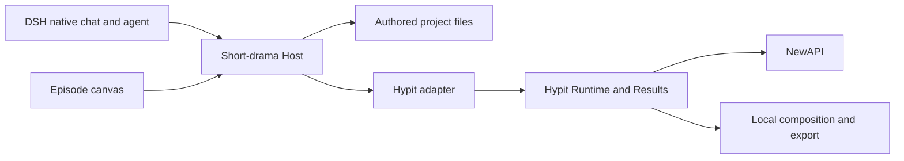

# Agent Note: 单集无限画布与原生 AI 对话的短剧工作台

Status: proposed

[English](2026-11-08-short-drama-canvas-workbench.md) | 中文

## 问题

用户需要通过无限画布和 AI（人工智能）对话，将剧本制作成短剧成片的工作台。难点是在剧本修改后，保持角色、镜头、生成候选、对白时间和已选剪辑的一致性。只有画布无法确立这些关系，生成请求成功也不代表已经获得可用的完整单集。

社区 DSH 插件覆盖了部分流程。Hypit 提供可执行视频项目架构，但其 Studio 是源码编辑器、时间线与检查器，而非所需的无限画布。组合完整应用会重复承担内容管理、执行状态和编辑行为。

## 提案

开发独立的 DSH 短剧插件。插件负责创作内容、单集画布、制作意图和用户选用；DSH 提供原生对话与 agent（智能体）执行；通过小型 Hypit 适配器获得媒体执行、时间编排、合成和 Result 保存能力。逐项验证媒体协议后，以用户的本地 NewAPI 作为首个模型网关。这是一份本地工作台提案；本次调研尚未实现或验证插件及 Hypit 集成。

首版在 `plugins/` 下的新插件仓库中保留一个 Host 和一个 Client，遵循[仓库源码归属与依赖策略](../../../../HANDOFF.md)。DSH 依赖保持 `0.2.2-rc.1`。内容操作、Hypit 适配和 Client 展示按模块分开；只有出现独立使用的 API 时才拆包。

首个完整交付是一条真实的 30–60 秒竖屏单集，包含可复用角色参考、多个镜头、对白、字幕、预览与 MP4 导出。先按下述验收顺序验证界面、媒体协议与单镜头修改闭环。单集证明数据归属与恢复规则后，再扩展提供方、集数和自动化。

验收单集必须通过角色行动、冲突与对白讲述故事，并限制人物和场景数量。旁白可用于技术试验，但全程依靠画外旁白推动的画面拼接不满足完整单集验收。人物表演、角色连续性与可用对白都属于创作者审阅的结果。

首版必须分别通过风格化 3D 动画与写实真人短剧的成片验收，先完成 3D，再完成写实真人。首条 3D 样片限定两个角色、一个场景、约 4–8 个镜头，在 30–60 秒内呈现明确冲突与一次转折。3D 样片通过后可以先试用，但只有两种风格各交付一条合格短片才算首版目标完成；3D 的验证结果不能替代写实真人验收。

写实真人路线先采用 AI 生成的虚构角色。创作者认可角色参考图后，再制作镜头。验收依据参考图检查跨镜头外貌，并审阅表演与对白。首版验收不要求根据指定真人照片还原人物；该能力需要单独确定范围并验证。

## 职责与界面

每层负责不同的决策。插件确定创作者要制作什么、选用哪些媒体；Hypit 确定已提交任务如何执行。

| 负责方 | 职责 |
| --- | --- |
| DSH | 原生对话、agent 工具、权限、凭据、文件系统访问与子进程控制 |
| 短剧 Host | 项目内容、版本检查、资产引用、生成意图、素材选用与依赖新鲜度 |
| 短剧 Client | 单集画布、检查器、候选比较、预览与可见的制作状态 |
| Hypit 适配器 | 将固定内容版本编译为视频项目；提交、查询和核对 Build；导入明确的 Result 引用 |
| Hypit Runtime 与 Results | 执行调度、提供方回执、已接受输出、合成执行和已完成 Result 存储 |
| NewAPI 提供方 | 图片、视频、语音和转写的具体请求协议及支持的输入 |

优先试验主区画布与右侧栏原生聊天。固定版本的[对话 slot 约定](../../../../upstream/packages/client/ui-conversation/src/client/contract/slots.ts)提供可复用的 `conversation.content` Factory，支持 `embedded` 变体；上游 [subagent 侧栏](../../../../upstream/packages/client/ui-subagent/src/client/sidebar-chat/index.tsx)已有调用。内部 `conversation.session` 为单一 slot，并不阻止嵌入外层 Factory。需在真实 DSH profile 中验证普通 Session 绑定、草稿与附件保留、切换和资源释放。若集成失败，保留已注册的右侧栏画布作为回退方案。两种布局都不以搬移宿主 DOM 或导入其他插件 UI 为基础。

使用 React、DSH 主题基础组件与注册 slot。自建画布引擎前，先评估 `@xyflow/react` 的节点卡片拖动、连线、平移和缩放，并在 UI 试验中验证所选版本、许可证与 DSH 打包。临时交互状态放在 Client，持久化坐标放在独立布局文档。注册项和订阅随插件生命周期进行 dispose（资源释放）。

一集对应一张画布。项目级角色、场景、外观变体和视觉风格作为共享资产，由单集节点引用。节点展示剧本文段、分镜组、参考图、生成候选、音频、合成与交付文件。连线展示真实内容依赖；拖动节点不改变镜头顺序或视频时间。选中镜头后打开检查器与候选比较；精简时间线用于编辑已选合成。

首版每个项目采用一种视觉风格。同一剧本制作另一种风格时，创建独立项目并复制剧本，分别维护角色参考、镜头候选、选用历史与成片。项目之间的修改不联动；编辑写实真人项目不改变已完成的 3D 项目。

## 从剧本到成片的流程

画布将工作呈现为可编辑的交付物。创作者可以在每个阶段停下，修改前序内容，并只重新生成受影响的部分。

首版同时支持已有单集剧本与一句故事想法两个入口。已有剧本先导入并检查人物、场景和对白，AI 的修改建议由创作者采纳；想法路径由 AI 在工作台内将想法发展成单集剧本。两个入口在创作者认可的单集剧本处汇合，再进入相同的角色参考、分镜与制作流程。认可后仍可修改剧本，并标明受影响的素材。两个入口都须纳入验收。

| 阶段 | 交付物与下一步 |
| --- | --- |
| 剧本 | 单集大纲、场景文本与对白；制作前审阅故事 |
| 共享资产 | 角色与场景描述、已认可的参考图与外观变体 |
| 分镜 | 稳定镜头 ID、动作、景别、参考、对白、预期时长与连续性备注 |
| 生成 | 绑定版本的图片和视频候选；比较并明确选用素材 |
| 音频与时间 | 对白音频、对齐、字幕、音乐或音效，以及非对白动作的明确时间 |
| 合成 | 已选片段的顺序、裁剪、音频策略、字幕样式与竖屏输出设置 |
| 交付 | 可解码预览、最终 MP4、字幕与关联已选输入的导出 manifest（元数据清单） |

采用 Hypit 的 script 和 narrative-temporal 概念处理对白分段，以及词或语段的语义锚点。空镜、无声动作和停顿还需要明确时间；语音对齐无法决定所有剪辑点。每段记录保留生成音频还是用 TTS 替换对白。未经明确选择就混合两者可能造成重复对白。音乐和音效保留独立轨道。

首版支持排序、裁剪、对白替换、字幕与导出；简单转场安排在完整单集试验之后。高级动态图形、自动口型同步、声音克隆、通用工作流编辑器和自主整季制作暂缓。

验收样片至少包含一个可见人物说话、口型与对白匹配的镜头。优先试验保留视频模型生成的原声，所有可见说话镜头都须人工检查口型与对白；原声或口型质量不达标时，该制作路径未通过验收。其他镜头允许画外对白，旁白或画外对白可用 TTS。不能用全程旁白代替可见说话镜头的验收。替换音轨本身不能同步口型。对白超过片段时长时，导出前需明确裁剪、改写或重新生成镜头，不静默截断语音。

同一角色跨镜头的声音必须保持一致。情绪和语气可以变化，但不能听起来像换了配音演员。两条验收样片都至少安排一个角色跨两个镜头说话，由创作者检查声音连续性。原声不够稳定时，需要重新验证制作方式，不能仅凭口型匹配判定通过；自动口型同步和声音克隆仍暂缓。

## 内容、版本与生成文件

每类数据只有一种权威表示。可编辑场景文本以 Markdown 保存，结构化镜头、共享资产、已选候选和合成以版本化 JSON 保存到工作区。布局 JSON 仅负责坐标与视图状态。Client 加载 Host 状态；浏览器存储不镜像权威内容。生成的 Hypit 项目源码由已记录输入版本派生。首版不支持在 Hypit Studio 中编辑该源码，因为双向编辑会建立第二个内容权威。

每个镜头、资产版本、候选和制作意图都有稳定 ID。生成意图记录源版本、提示词、参考身份、精确提供方／模型参数，以及对应的 Hypit Build 或提供方回执。候选记录保留明确的 Result／输出／文件身份与媒体元数据。合成记录已选候选 ID、顺序、时间和音频选择。名称与文件名只用于展示，不能作为采纳结果的匹配机制。

场景 Markdown 拥有对白正文。场景与对白段落使用内嵌的稳定 ID；镜头 JSON 引用这些 ID 及其源版本，不另存一份可编辑对白。段落身份不变的措辞调整保留 ID；拆分或合并创建新 ID 并记录明确的前序映射。删除的 ID 停用且不复用。引用无法解析时，阻止新生成与合成，直到创作者接受重新映射。已有候选保留冻结的源版本。依赖须包含对白、时间和共享资产版本，以便说明是哪项输入导致陈旧。

UI 操作和 agent 工具调用同一组强类型 Host 操作。修改必须携带预期版本，工作区写入使用 DSH 感知版本的文件系统操作。编辑冲突返回当前版本供核对，不静默覆盖。跨文档操作发布一个一致的项目版本：读取者只能看到旧版本或完整新版本，不能读到部分写入的内容。单文件检查不能提供这一保证。内容试验必须选定并验证发布机制，覆盖发布前中断与中断后恢复。外部编辑作为待核对变更，与已发布版本比较并验证，不能静默改变已提交 Build。

每次提交从一个已发布版本生成不可变输入快照，包含派生的 Hypit 源码、结构化输入、精确执行参数和版本化引用媒体。在意图中记录内容哈希与快照身份。编译与执行读取该快照，不读取可变的创作文件路径。已检查的 Hypit Runtime 不提供源文件快照，模块作用域也不能冻结后续文件读取。提交前拒绝无法解析的引用，并证明 Build 排队期间的编辑不会改变其输入。

提示词或参考变化只将其依赖候选和合成标为陈旧。创作者采纳替代结果前，保留旧媒体及其选用关系。新候选生成成功不会静默成为已选素材。布局变化不触发生成。使用陈旧选用导出时，须明确确认在该合成版本中保留指定候选版本，并写入导出 manifest；后续相关修改需要重新确认。媒体缺失或不可解码始终阻止导出。重新合成通过明确引用未受影响的 Hypit Results 来复用已接受媒体；这是主动复用，不是假定存在自动缓存。

可复用媒体保存在持久的项目存储或保留的 Hypit Results 中，不依赖会过期的提供方 URL。导入外部文件时，如需复现，应保留版本化副本：Hypit 的 external-file 引用保持实时，内容可能变化。自包含交付必须收集引用字节，并验证导出文件。

## 执行、恢复与成本

Hypit 是媒体任务的唯一调度器。插件持久化制作意图及其与创作内容的关系，然后观察 Hypit 执行；不维护第二套重试队列，也不将 Hypit 活跃数据库复制到浏览器状态。DSH 后台任务可以报告子进程或观察会话，但其 job id 不是持久的制作身份。

提交前保存意图，收到接受结果后关联 Build／回执。分别记录提供方完成、已收集且可解码媒体、用户选用、合成成功和交付输出。预览或交付前，检查真实尺寸、时长和音频流，并解码媒体；HTTP 成功、URL、文件名或进程零退出码都不足以证明可用。

提交断连且结果未知时，核对已保存的 Build 身份或提供方回执。适配试验必须覆盖 Hypit 接受 Build 后、Host 记录其 ID 前的间隙：若支持持久化调用方关联键或无歧义查询，则用其核对。本地意图 ID 本身不能证明哪个 Build 已被接受。若没有受支持的查询能确定结果，保留未知意图供人工处理，并阻止自动重提。不承诺只计费一次。浏览器刷新重新连接已有任务；Hypit 执行进程丢失可能结束其已分配尝试，因此进程重启不等于自动恢复 Build。核对后，新尝试可以明确复用此前已接受输出。

生成计划在执行前列明范围、模型与并发。只有提供方暴露有意义的价格时才显示估算；否则标记成本未知，并使用创作者选择的批次上限。轮询和文件收集不能创建新的生成请求。取消时区分停止本地观察与提供方确认取消。

采用 DSH 凭据管理，并验证 Host 到 Hypit 的凭据桥接。凭据不得进入项目文件、Client 状态、命令参数、日志或工具结果。适配试验必须明确由哪个 worker 进程解析凭据、如何接收以及更新何时生效。只向短命 CLI 进程传入凭据，不能证明已有 worker 可以使用。验证首次使用和凭据轮换；若更新需要重启 worker，执行前展示该要求及其对活跃 Build 的影响。不能假定两个宿主共享凭据存储。

## AI 交互

复用 DSH 原生对话进行写作、规划、进度反馈和 steering（中途引导）。通过明确的对话操作，将画布所选节点 ID 与版本加入上下文，同时保留已有输入草稿和附件。加载当前场景或镜头、引用资产版本与邻近连续性事实；按需检索更大文档，不在每轮塞入整张画布或整个项目。

提供少量领域工具：读取上下文、修改剧本或分镜、查看资产／候选、规划或提交生成、采纳候选，以及合成或导出。返回稳定 ID、版本、简短状态或冲突，以及检索路径。工具遵守与 UI 相同的版本和选用规则。分阶段 skill（技能）指令可以指导这些工具，无需另一套 agent 运行时或常驻 agent 团队。

AI 在阶段内连续推进，创作者在关键节点决定。依赖分镜与角色参考的制作工作开始前，先展示这些产物供审阅。付费生成通过明确的批次计划授权，不要求每次工具调用都确认。AI 可以推荐候选选用，创作者负责采纳，并支持批量采纳。阶段推进不代表授权未批准的付费批次，也不代表自动采纳候选。

例如，“重做第 3 镜，镜头更近，保持角色外观与对白”会修改该镜头，在已批准批次内提交绑定版本的生成请求，并保留现有选用关系。创作者采纳新片段后，重新合成复用未改动镜头，仅更新受影响的时间与字幕。

## 参考取舍与已确认缺口

以下来源支撑本提案。其有用机制作为参考，不要求新插件整体导入这些依赖。

| 参考 | 采用或验证的部分 |
| --- | --- |
| [Oh Story](https://github.com/zenstory-ai/oh-story-dsh/blob/148ac13c6c59f78f485ea841437ab00702ed3682/docs/ARCHITECTURE.md) | 文件内容、草稿／冲突处理与明确制作身份；避免照搬其 DOM 搬移方案 |
| [AI Drama](https://github.com/HengryLiang/dsh-plugin-ai-drama/tree/c8798a8a010595cdd5ddff77beb2621f8ae6cb40/lib) | 结构化资产、版本、草稿采纳与考虑预算的编排；每次修改都必须检查版本 |
| [Infinite Canvas](https://github.com/NINKCH/dsh-infinite_canvas/tree/d24020d47e7b74a200069256defae8eb3c397ec1) | 工作区项目和单集画布；避免浏览器／Host 内容镜像及推断制作完成 |
| [Hypit Generation](https://github.com/hypit-ai/hypit/blob/2d31e88765e297f0795348b460c77a6067f12261/packages/generation/README.md) | 精确模型输入与提供方协议映射分开；不支持的字段必须在提交前报错 |
| [Hypit 本地 Runtime](https://github.com/hypit-ai/hypit/blob/2d31e88765e297f0795348b460c77a6067f12261/packages/runtime-local/README.md) 与 [Results](https://github.com/hypit-ai/hypit/blob/2d31e88765e297f0795348b460c77a6067f12261/packages/result/README.md) | 单一执行负责方、保留回执、独立 Result 保存、明确输出复用与自包含导出 |

2026-11-08 调研观察到 Hypit main 正在准备 `0.3.2`，GitHub 最新 Release 为 `0.3.1`。适配试验后选用不可变版本；已检查的 main 快照不能证明其 API 已包含在发布版中。优先通过受控本地进程调用结构化 CLI（命令行界面）JSON。验证命令 schema、Result 引用和凭据集成后，再决定是否嵌入库。

在已检查的 Hypit 快照中未发现内置 NewAPI 提供方。在协议测试证明已有实现兼容前，按需要开发提供方估算工作量；修改地址或模型名不足以证明兼容。项目编译与 Result 导入归工作台适配器，媒体提交、轮询与收集归 Hypit 提供方。每条选用路径记录实测模型、支持的参考输入、时长与比例限制、音频行为、回执与状态字段及下载格式。付费提交前拒绝不支持的参数。该路径与凭据桥接通过固定发行版验证后，再将 Hypit 用于完整流程。

用户的 `http://localhost:3001/v1/models` 返回了 55 个模型条目。发现过程只使用读取请求；尚未测试图片、视频或语音生成。本记录有意不包含凭据。部分媒体条目声明通用聊天端点，因此模型名称和路由存在不能证明生成能力。

| 用途 | 已发现候选 | 选用前必须验证 |
| --- | --- | --- |
| 写作与规划 | DSH 原生已配置模型；按需使用 NewAPI 文本模型 | 结构化分镜质量与遵守版本规则的工具使用 |
| 参考图 | `gpt-image-2`、`gpt-image-2.5`、Agnes Image、Seedream 或 Qwen image edit | 生成／编辑协议、参考保持能力与返回文件格式 |
| 视频 | `agnes-video-2.5-flash`、`veo-3.1-fast`、`veo-3.1-quality`、`veo-3.1-lite`、`grok-imagine-video` | 提交／轮询／收集协议、时长、比例、参考输入与生成音频 |
| 语音与对齐 | `mimo-v2.5-tts`、ElevenLabs 变体、`scribe_v1` | 声音控制、音频格式、转写时间戳与可用对齐 |

先实现一个已验证图片提供方、一个视频提供方和一条语音路径。目录没有 Seedance 或 H3，也没有列出 Hypit 引用的 MiMo 声音设计／克隆能力。不要将无关模型映射为这些精确能力，也不要承诺声音克隆。转写能力不等于词级对齐。NewAPI 通用价格倍率无法确定可靠的单条视频成本。

[历史成片记录](../../archived/feature/2026-09-27-short-drama-finished-episode.md)仅作为合成与媒体验证的背景，不是当前实现权威。

## 考虑过的替代方案

**fork 完整社区工作台。** Oh Story 和 AI Drama 提供了有用的工作流证据，但其应用结构与制作假设会成为继承的维护责任。小型独立插件可以复用已验证决策，同时适配原生 DSH 集成和明确的 Hypit 职责。

**自建生成调度器和渲染栈。** 尚未建立创作流程就重复实现提供方回执、资源限制、时间编排和结果持久化。Hypit 是首选试验后端。如果其适配或许可证不符合目标产品，则以更小的执行器／合成器替换该适配器，不同时采用两套调度器。

**整体嵌入 Hypit Studio。** 源码／时间线／检查器交互不提供所需无限画布，还会引入相互竞争的可编辑项目源码。明确只读或双向编辑策略后，可以提供生成项目的可选诊断入口。

**把所有内容当作通用 DAG 节点。** 创作者需要镜头、角色参考、候选选用与剪辑。通用图编辑器暴露执行细节，并使必要领域规则成为可选项；先采用少量领域节点和明确依赖。

**让浏览器负责聊天或项目内容。** 自建聊天会重复 DSH 上下文与工具行为。浏览器负责内容会与文件系统编辑及 agent 操作冲突。保留原生对话，由 Host 管理版本化内容。

## 验收标准

完成意味着可观察的媒体输出与可靠编辑，不仅是能浏览的画布。按以下顺序实现和验证：

1. **界面试验：** 在真实 DSH 开发 profile 中加载主区画布与嵌入式原生聊天。验证平移／缩放、节点选择、主题、普通 Session 切换、草稿与附件保留，以及资源释放。仅在首选布局失败时回退到侧栏画布，并记录具体限制。
2. **媒体试验：** 固定 Hypit 发行版，验证一条 NewAPI 图片路径、一条视频路径与一条语音路径。视频测试包含参考图及同一角色在两个镜头中的对白，收集可解码文件，并记录口型匹配、声音连续性的实测结果，以及实际协议与能力限制。验证 worker 凭据访问和轮换、不支持输入的拒绝、Build 已接受但 ID 未保存的间隙，以及 Result 保存中断。在开发完整生产流程前决定是否采用 Hypit；不可用的能力仍标为不支持。
3. **单镜头修改闭环：** 创建共享参考与一个镜头，生成两个候选，采纳一个，修改来源，查看陈旧状态并采纳替代候选。重新打开工作区，ID、选用与布局保持稳定。UI 与 agent 并发修改必须产生可见冲突。拆分或合并对白段落，并明确修复镜头引用。中断多文档发布，验证只能读取完整旧版本或新版本；提交后编辑创作文件，证明排队 Build 仍使用快照。验证明确保留陈旧选用，以及刷新或进程丢失后不自动重提。
4. **两种风格的完整单集：** 在独立项目中按上述样片规格与音频策略，先制作并观看 3D 短片，再完成写实真人短片；每条都是 30–60 秒竖屏 MP4，包含多个已选镜头、对白与字幕。每条至少包含一个可见说话镜头，并至少有一个角色跨两个镜头说话；人工检查口型、对白与声音连续性，拒绝对白被截断的成片。写实真人还需依据认可的虚构角色参考图检查跨镜头外貌，并审阅表演。每条各重做一个镜头，明确复用未受影响媒体后重新合成，并验证另一项目的内容与成片未改变。验证时长、尺寸、音频流与字幕时间；导出可播放媒体、字幕文件，以及标识冻结输入和明确保留陈旧选用决定的 manifest。收集全部引用字节以实现自包含交付。轮询期间重启相关进程，准确报告完成、失败或未知结果。两条短片均通过才完成首版验收。

使用聚焦 Host 测试覆盖版本冲突、依赖新鲜度与明确选用，使用适配器测试覆盖能力拒绝、未知提交与 Result 导入。提供方调用和合成需要真实媒体试验；Client 行为需要真实 DSH 验证。记录不支持的重启／取消情况，不宣称通用恢复。

## 风险

Hypit 使用[带附加条件的修改版 Apache 许可证](https://github.com/hypit-ai/hypit/blob/2d31e88765e297f0795348b460c77a6067f12261/LICENSE)。允许自用和组织内部商业制作；以托管服务向第三方提供其功能，以及商业再分发需要授权。派生的用户可见 CLI／报告／manifest 界面必须保留规定的品牌与版权。本地试验提案符合自用范围；公开托管或商业分发产品需要另行决定许可证方案。该许可证规定生成输出归创作者所有。

提供方能力可能与模型目录名称不同，本地 NewAPI 可访问也不代表云端 Host 可以访问。明确列出精确支持输入，并报告不可访问端点。角色一致性和可用对白时间仍依赖所选模型与人工审阅；架构不能保证这些结果。

Hypit API 变化、普通 Session 的聊天嵌入、凭据桥接和外部任务未知状态仍是集成风险。多文档发布与不可变提交输入需要在生产使用前完成故障测试。试验决定 Hypit 是否实际减少实现工作。保留小型适配器与独立内容模型，使后端变化无需替换画布、剧本或资产历史。
