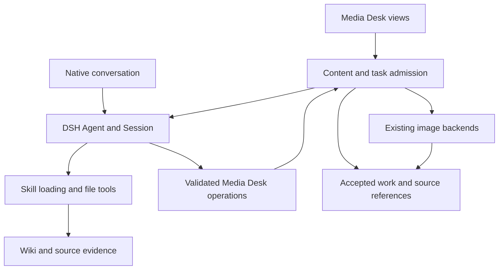

# Agent Note: Media Desk native Agents and Wiki-assisted creation

Status: proposed

English | [中文](2026-11-11-media-desk-native-agents.zh.md)

## Problem

Media Desk can produce and revise scripts, but its text requests bypass the DSH Agent loop. Installing a skill therefore does not give these requests file search, skill loading or a multi-step execution history. Monid supplies paid platform collection; the user's Wiki supplies existing knowledge. Replacing collection with knowledge-assisted creation requires different source and performance-data boundaries.

The user requested a complete migration assessment and a grill-with-docs review. This note is the reviewable proposal, not an implementation or a claim that integration tests passed. Source inspection covers the fork at `2.6.2-winter.1` and DSH at `dsh-v0.2.2-rc.1`. No real model, image provider or Monid call was made for this assessment. The [plugin glossary](../../../../plugins/dsh-media-desk/GLOSSARY.md) defines work, source material, production, style cards, writing rules and performance review.

## Proposal

Let Media Desk own authored content, accepted production assets and scheduling; let native DSH Agents execute conversation, research and text generation with skills and tools. Keep the existing image backends and presentation during the text migration. The complete migration includes chat, revision, planning, script generation and style extraction. A Wiki-reading experiment alone does not complete that scope.

Preserve the current five workbench views and existing content. Prefer the native conversation factory for chat, tool progress, approval and user questions. Use explicit, validated business operations to change workbench content; ordinary assistant prose is not an executable result protocol. Preserve the existing plan-before-script relationship and shared facts used by illustrations and storyboard generation.

### Review state and decision tree

The user confirmed all seven choices below and the complete design on 2026-11-11. No product decisions remain open in this review.

| Decision | Agreed choice | Review state |
| --- | --- | --- |
| Monid | Remove future account collection and its setup UI; retain imported content, account records, metrics and manual/CSV review | Confirmed by user |
| Wiki writes | Follow llm-wiki's existing automatic preservation policy for valuable synthesis | Confirmed by user |
| Conversation continuity | One continuing conversation per work and a separate global assistant conversation | Confirmed by user |
| Agent capabilities | Dedicated creation preset using native file/search/Shell/skill/question/permission mechanisms and Media Desk operations | Confirmed by user |
| Stop behavior | Native Stop affects the current turn; Cancel production affects the whole admitted production and its images | Confirmed by user |
| Failure handling | Preserve content and manual editing; report failure without automatically marking a template as completed production | Confirmed by user |
| Conversation reset | Start a new conversation after active work finishes or is cancelled and settles; retain old history and accepted work | Confirmed by user |

The grill-with-docs design review has passed. This note remains proposed because implementation and runtime acceptance are pending: the source-supported mechanisms below must pass phase-one experiments before broader migration.

Static review identified four engineering gaps. The design resolves them through SessionController ownership and a persisted preset, message/turn correlation with invalidated stale candidates, separate turn/production cancellation, and the existing same-host file-lock primitive. These are source-supported design choices, not completed integration experiments.

### Current call paths and migration coverage

The source map below identifies migration sites rather than a second API catalog. The implementation remains authoritative.

| Current path | Existing result or effect | Migration requirement |
| --- | --- | --- |
| [Chat and revision](../../../../plugins/dsh-media-desk/src/host.js) with [chat prompts](../../../../plugins/dsh-media-desk/src/ai.js) | `reply`, `ops`, `actions`, optional `revise`; local fallback on model failure | Native conversation and validated content operations; admit production on the Host |
| [Style extraction](../../../../plugins/dsh-media-desk/src/style.js) through `styleFromMaterial` | Normalized style card; optional account identity | Native task with selected samples and explicit source references; preserve preset and custom styles |
| [Production planning](../../../../plugins/dsh-media-desk/src/produce.js) | Title, shared facts, outline, image and storyboard prompts | Native task with a bounded structured result; accept a plan before dependent generation |
| [Script generation](../../../../plugins/dsh-media-desk/src/ai.js) through `articlePrompts` | Markdown article, original AI text and model label | Native task using the accepted plan, sources and writing rules |
| [Image generation](../../../../plugins/dsh-media-desk/src/images.js) and [subscription tool](../../../../plugins/dsh-media-desk/src/image-tool.js) | Cover, illustrations, storyboard frames and test image | Keep both backends; associate every output and retry with its production attempt |
| [Rule learning and Skill export](../../../../plugins/dsh-media-desk/src/learn.js) | Deterministic proposals and user-triggered `media-desk-voice` Skill export | Preserve review/activation and original AI text; prevent an old exported Skill from reapplying disabled rules |
| [Client actions and export](../../../../plugins/dsh-media-desk/client/desk.js) | Browser starts `produce` and paints cover text before saving | Host must admit production even if the browser disconnects; preserve cover-text/export behavior |
| [Monid](../../../../plugins/dsh-media-desk/src/monid.js) and [connect UI](../../../../plugins/dsh-media-desk/client/connect.jsx) | Platform posts, metrics, profile, cover download and cost | Apply the first-round decision across Host, Client, tests and guides |
| [Store](../../../../plugins/dsh-media-desk/src/store.js), [operations](../../../../plugins/dsh-media-desk/src/ops.js) and [settings](../../../../plugins/dsh-media-desk/src/settings.js) | Content, chat, undo, global model override and settings | Explicit data migration, task identity, source references and per-conversation model semantics |

`PLUGIN_SESSION_ID` is a process-generated gateway routing string, not a native Session. Chat history is filtered by work and truncated before each direct model request. Module-global model status cannot describe concurrent native conversations. The existing JSON response parser cannot safely consume an Agent's tool messages or intermediate replies.

Keep ordinary link capture through `harvest` and selected web-page samples through `harvestText`. Remove account collection and refresh, including the `account/refresh` route, Monid routes, CLI runner, setup/pricing UI and account-import mocks. Preserve historical account records, imported content and metrics for manual/CSV review. Remove automatic local-chat and structural-template substitution from the native text path; manual content editing and no-image production remain available. Never label a failed Agent task as completed production.

### Responsibility and execution flow

The Host owns task admission, input revision, output validation and acceptance. DSH owns message history, model execution, tool execution and native permission interactions. The Store owns editable work and accepted media; Session logs provide execution evidence. Neither browser state nor a final assistant sentence is a second authority for the work.

Keep one module responsible for native Agent ownership and task correlation. Callers submit a task, observe its state and request cancellation. Do not preserve a public `callModel(system,user)` abstraction that hides a tool-capable loop behind a promise for concatenated text. Skills, approval, continuation and cancellation are observable parts of the new contract.

### Agent creation, composition and recovery

Use the existing Web [SessionController](../../../../upstream/packages/api/session-controller/src/index.ts) for creation and cold recovery. Its public Host methods are `create(request)` and `resolveAgent(sessionId)`. Persist the Session ID actually returned by creation; a requested ID is not a guarantee of reuse. Existing works use `resolveAgent`, never `create` as a substitute for resume. The controller owns native handles and the loop; Media Desk owns its business tasks and associations, without a second `agents.create/resume` queue or a synthetic parent.

Register a dedicated `media-desk-creation` preset using existing DSH file/search/Shell/skill/question and compaction components, a creation persona, and Media Desk operations. Reuse the [standard preset](../../../../upstream/packages/bundle/web-app/presets/standard.patch.yml) as a component reference; do not inherit its coding persona, plugin management, schedules, goals or multi-Agent workflow by default. Host permissions and native approval still apply. The first release does not introduce automatic subagent delegation.

Opening or closing a panel only changes client subscriptions. Media Desk unload cancels its tasks and drains business writes without disposing controller-owned Sessions. Record a pending conversation association before creation, bind the returned ID before dispatch, and allow no business writes from an unbound Session. A crash between native creation and association may leave an unused Session; retain it for inspection rather than guessing its ownership from a label or deleting it automatically.

Declare business operations and admission hooks in the persisted preset, so [native recovery composition](../../../../upstream/packages/api/session-controller/src/agent.ts) reconstructs them before execution. A preset's plugin tree is shared by its composition generation: resolve ownership from the exact executing Agent, never a closure's current work. Mount the Host Store once; the preset consumes it. Missing associations disable business writes; missing preset/services produce a recoverable error instead of falling back to standard. The recovery experiment opens and submits through the native Session page first after restart.

Persist the conversation's DSH home, project/workspace association, Session ID and selected composition. Restore the recorded composition and model selection, then reconcile interrupted work. Do not resume a Session belonging to another Host environment by matching its ID alone. A local Wiki path is usable only on the machine executing the Agent; a cloud Host needs its own accessible copy and configured path.

Use an explicitly selected DSH workspace when connecting the workbench; do not silently use the process working directory or turn the Wiki root into the workbench workspace. Persist the association and prevent native workspace/preset controls from silently rebinding a work. A preset is restored from its current installed definition, not from a saved copy of old plugin code.

### Skill discovery and Wiki usage

Use DSH's [filesystem skill provider](../../../../upstream/packages/skill/skill-filesystem/README.md) and [skill loader](../../../../upstream/packages/skill/tool-skill/README.md). On the inspected laptop, `~/.agents/skills/llm-wiki` resolves to the Wiki-owned skill directory and its query reference exists. This establishes file availability, not successful loading in a particular Agent scope. Check the effective skill registry with the actual Agent and working directory; higher-priority same-name skills and custom roots can change the result.

The task explicitly identifies `llm-wiki` when Wiki knowledge is requested. The Agent loads the skill body, its query instructions and the Wiki's own rules before retrieval. Use `WIKI_PATH` when supplied, otherwise the skill's `~/wiki` default. Do not scan or inject the entire Wiki into every request, and do not implement a parallel vector database or Markdown crawler in Media Desk.

Retrieve relevant summaries first and follow their sources when factual verification is needed. Carry selected claims, source paths, source dates and uncertainty into the production plan. Preserve citations beside the work, outside the spoken script when appropriate. A source reference identifies where evidence comes from; it does not prove a claim is true. Missing, old or conflicting evidence must remain visible.

Knowledge summaries supply subject matter. Only explicitly selected author samples supply personal writing style. Keep DSH skill instructions distinct from Media Desk's existing `state.skills` writing-rule records; avoid treating those records as executable skills or rewriting them during migration.

Follow llm-wiki's existing automatic preservation policy: valuable new synthesis or verified factual corrections enter its maintenance workflow; simple lookup or repeated knowledge does not create another page. The skill remains authoritative for evidence verification, deduplication, raw-source preservation, navigation and logging. A user's explicit read-only instruction still overrides automatic preservation. Do not copy every draft into Wiki or add a Media Desk-specific approval requirement.

The Wiki and Media Desk retain separate write ownership. The Agent may maintain Wiki under its rules and actual filesystem permissions; Media Desk operations accept workbench content. Record written Wiki paths in the task result. A later production failure or workbench undo cannot roll those writes back; a retry checks the existing knowledge before writing again. Do not claim a cross-store transaction or automatic refund/rollback.

### Tasks, content operations and completion

A continuing conversation and a production attempt need separate identities. Every admitted attempt records its subject, input snapshot, Session, triggering messages, stage and requested model selection. Work tasks reference their work; global creation, style, rule and metric operations validate their own subject and scope. Creating a work returns its durable identity before dependent work is admitted. A second click must resolve to the existing admitted attempt or a visible conflict. Claim the attempt before asynchronous preparation; the current check-then-await sequence cannot prevent simultaneous starts.

The input snapshot includes selected material, style, active rules, voice and generation settings. Accepted stage outputs carry their own identities and dependencies: committing a script must not invalidate sibling images generated from the same accepted plan. User edits or changed inputs invalidate only incompatible dependent outputs. Record actual models used by native steps separately from the initial requested selection.

Replace JSON hidden in assistant prose with narrow operations for reading the current subject, applying validated edits and submitting a stage result. Keep schema limits and domain checks from `applyOps`, `normalizePlan`, `normalizeStyle` and `applyRevision`. Check the calling Session, owned subject, current attempt and expected content revision before accepting a write. Register operations only in their intended Agent scope; browser-supplied identifiers do not grant ownership.

Expose four bounded business tools: `media_desk_read` returns the owned subject and selected references without credentials; `media_desk_edit` applies the existing allowed operations and returns receipts; `media_desk_produce` admits production, regeneration or cancellation; `media_desk_submit_result` stages a plan, script or style result for the currently admitted stage. Resolve task and subject authority on the Host. A user cannot obtain another work's write authority by supplying a different ID. Keep browser navigation outside Agent output; receipts link to accepted work.

Give each admitted request one completion protocol. Record message IDs and the starting event position; associate consumed input with its actual turn and inspect that turn's durable outcome, not the last `turn/end` in the log. Flush the Session before final acceptance and settle input discarded before consumption. The [Agent runtime contract](../../../../upstream/packages/core/agent/src/runtime-types.ts) defines `whenIdle()` as quiescence, not task success. The [Headless runner](../../../../upstream/packages/bundle/headless/src/index.ts) demonstrates waiting, child settlement when enabled, and terminal inspection. A root Agent does not return the subagent activation's `result` object.

For structured stages, stage a bounded candidate associated with the admitted task, then validate and commit only for a successful corresponding turn and current input revision. Show incomplete streamed text as a preview, not as the accepted draft. Repeated result delivery returns the existing receipt; a different duplicate conflicts. Recover an accepted commit from its durable receipt if notification is lost. Content already accepted by an ordinary edit tool remains applied even if a later tool fails; report the partial outcome instead of claiming rollback.

Structured stages only stage results; they do not also perform immediate edits to the same subject. Ordinary conversational edits may commit immediately. Another edit to a structured stage's input causes an explicit conflict, avoiding self-invalidating candidates. Direct file edits must not bypass Media Desk's authoritative content operations.

Keep planning, script writing and style extraction serialized within the chosen conversation. Image work may run concurrently after its plan is accepted. A tool that requests another stage acknowledges admission and returns; it must not wait for another turn on its own currently running Agent. Native composer input, buttons and tool-requested work must share admission and revision checks. Determine whether a new message is a normal follow-up or an explicit interruption rather than silently mixing it into a structured stage.

Preserve native queue/steer semantics. Record stage message IDs and correlate `agent/inbox/claimed` with its turn. When a new user message is admitted into an active structured turn, invalidate that stage and candidate and stop its later stage scheduling; then preserve the message and call the native pre-step continuation so the Agent can answer it. Do not reject a claimed user message to stop a business task. Queued later turns retain their inputs and validate current dependencies when they start.

Claim notifications do not await asynchronous listeners, as the [event dispatcher](../../../../upstream/packages/core/agent/src/dispatch.ts) specifies. Invalidate the old stage and candidate synchronously when input is claimed; the pre-step hook then awaits the write queue for association and invalidation records. Failed persistence disables business-result acceptance while preserving claimed user input for native processing.

Use the persistent inbox target when exact queue/steer distinction is required; `agent/pre-step` itself has no delivery-mode flag and runs after inbox consumption. Cancelled programmatic stage messages are fenced by their recorded IDs without discarding unrelated user input. Result submission rechecks the current generation and dependencies under the Store's write queue. This protects native-page and second-browser input without modifying DSH's core or relying on a disabled composer.

Native [queue editing](../../../../upstream/packages/api/session-controller/src/commands.ts) may retain a message ID while replacing its content. Removing, editing or moving admitted programmatic stage input invalidates and settles its original stage; redelivery cannot revive the old attempt. At consumption, verify the message content, source and current target as well as its ID.

### Cancellation, conflicts and persistence

Persist an attempt's status separately from the presence of an in-memory Agent. Distinguish running, waiting for user input, succeeded, partially completed, failed, cancelled and interrupted outcomes as applicable to the task. Use actual DSH events for waiting and terminal states; do not infer them from silence or `idle`. Overall production is complete only when required text is accepted and every requested image has a settled outcome; image failures remain visible.

Cancellation marks the current attempt as unable to accept new results, cancels the active Agent turn and owned media requests, and waits for owned work to stop. Provider effects that already occurred may remain charged. An uncancellable remote image result may be retained as an unaccepted asset, but cannot overwrite the current production. Independent image regeneration needs cancellation and attempt ownership too.

Native Stop cancels the current turn while preserving queued DSH input. If that turn owns a structured stage, the stage stops and no subsequent text stage starts; already-admitted images may finish, and the production remains interrupted or partial rather than successful. The separate Cancel production action invalidates all owned pending stages and cancels owned images. Preserve unrelated follow-ups; clearing the entire inbox is not business cancellation.

Fence every write by attempt, work revision and stable asset identity; array position alone is insufficient. Editing, undoing, deleting or regenerating a work invalidates incompatible pending results. Preserve the user's newer work and report a conflict with a recoverable candidate. Undo applies to accepted workbench edits; it does not erase Session evidence, undo Wiki writes or refund model/image calls.

Use the public [`withFileLock`](../../../../upstream/packages/util/atomic-write/src/index.ts) primitive to hold one Media Desk data-directory ownership file for the Host's writing lifetime. Only create its parent directory before acquisition; Store/Settings initialization, migration, media acceptance and recovery run while the lock is held. Initialization awaits acquisition readiness, not the entire lifetime callback. Shutdown stops tasks and drains all owned writes before completing the callback and releasing the lock. A second writer fails after a bounded acquisition wait.

This protocol is limited to cooperating writers on one host and PID namespace with a local data directory. Do not steal an unknown or incomplete lock; do not claim shared-network-home support or power-loss durability. External processes write only isolated attempt output, never accepted content/state directly; the lock-owning Host imports validated results. The acquisition signal does not cancel an already-running lock callback, so teardown must explicitly settle it. Test normal release, killed-holder takeover, contention and surviving external output before rollout.

After restart, reconcile the saved task with Session outcomes and saved receipts. Do not automatically rerun a model, image generation or Wiki write whose external effects are uncertain. A user retry creates a new attempt against current content. Restore accepted text and media even when the previous execution did not finish; resume conversation history independently from repeating a failed task.

### Native conversation and workbench UI

Prefer embedding the official [conversation factory](../../../../upstream/packages/client/ui-conversation/src/client/contract/slots.ts). The [subagent sidebar](../../../../upstream/packages/client/ui-subagent/src/client/sidebar-chat/index.tsx) shows factory rendering, but does not itself prove ordinary Session integration. The existing Media Desk Client injects slots only; it must retain the right Session, provide its scope and explicitly mount the required Client dependencies.

Validate ordinary Session binding, tool cards, approval, user questions, draft input, attachments, cancellation, model selection and refresh before replacing the custom chat. Do not copy private conversation components or relocate host DOM. If embedding cannot satisfy these behaviors, use the native Session view as a temporary entry; do not ship a custom imitation that hides a pending approval.

Retain an ordinary Session reference inside a Media Desk-owned session child slot; do not redeclare `conversation.session`. Preserve workbench content actions while replacing transcript presentation. Map selected-passage/storyboard questions, suggestions, receipt navigation, undo and production-time input handling to supported interactions. Native workspace or preset controls must not silently move a work conversation to a different association.

Show content and production status in their existing workbench views. Show per-task failures next to retained work, with retry or source details where useful; transient operation outcomes use the host toast. Clear/reset acts on the selected conversation; it must not silently delete all work conversations as the current global clear route does.

Native Session selection and request records are authoritative for text models. Selection affects the next step whose preparation has not started, potentially within the current turn; native selection also updates the Host default asynchronously. Record requested and actually used models. Pinning one model for a whole production would need a separate tested policy. Image-model settings remain independent.

Replace destructive Clear with Start new conversation. After active work finishes or is cancelled and settles, create and bind a fresh Session while retaining the previous Session as history; accepted content, sources, styles and images stay intact. Late results from the old association cannot modify the new one. Starting a new global conversation affects only that global association.

### Existing images and historical data

Preserve HTTP image configuration, subscription-tool selection, requested image counts, cover typography, localized variants and export behavior. The subscription path has a specific tool/result/output-directory contract and currently rejects a pure PTC executor; native text execution does not make arbitrary image paths compatible. Preserve the existing no-HTTP-fallback/no-tool-retry behavior unless separately changed and verified. Do not let both the Agent and the Host independently submit the same images.

Bounded automatic HTTP retries stay within the admitted asset attempt; user retries create a new attempt. Durable acceptance receipts prevent reapplying a result, not duplicate billing for an uncertain provider request. Export one accepted production snapshot containing the script, cover text, selected assets and source references; selected evidence accompanies the export without entering the spoken script. Explicitly report missing images in a partial export.

Preserve deterministic rule proposals, activation and user-triggered Skill export. The current work's active writing rules must remain authoritative over a stale exported `media-desk-voice` Skill. Validate how the native Agent receives this precedence so a disabled rule is not reapplied through discovery. This export is separate from Wiki maintenance and must not be disabled accidentally by the Wiki-write policy.

Introduce a versioned, idempotent data migration with a pre-migration backup. Preserve item and account IDs, imported metrics, source URLs, drafts and original AI text, styles, writing rules, language-specific productions, media files and settings. Old custom chat can be retained as historical context, but must not be fabricated into native tool events. Legacy global model settings can seed newly created conversations once; they must not overwrite existing native model choices on every load.

Keep accepted business results, their receipts and task/conversation associations in the same atomic state replacement. Restrict undo to authored-content changes; it cannot restore old attempt states or decrease conflict-detection revisions. Media bytes are saved under stable attempt/asset identities before their accepted references commit. Unreferenced output is not a successful production. This keeps the current JSON Store without introducing a database or pretending two separate files commit transactionally.

Keep source references and task records explicit in storage and validation; unknown fields surviving a JSON read do not establish write-path support. Verify restoration using a copy of populated data. Rollback uses the prior package with its pre-migration backup; do not assume the prior package can safely write the new schema. Preserve newly created Session logs and outputs for inspection instead of deleting them during rollback.

### Implementation order

1. Prove SessionController-owned native root execution with the dedicated preset, explicit skill loading and a validated result receipt in an isolated DSH home. Prove ordinary Session embedding, native-page cold recovery and approval before building the migration around it.
2. Add task/conversation association, writer ownership, input revisions, receipts and idempotent data migration; test stale results and restart reconciliation before switching production calls.
3. Replace custom chat and revision execution with native conversation and scoped business operations. Ensure Host-side production admission works without the requesting browser.
4. Migrate plan, script and style stages to native tasks; connect Wiki retrieval and source references. Retain the existing media backends with attempt-bound results and consistent cancellation.
5. Apply the reviewed Monid and Wiki-write policies, migrate UI/settings/guides, remove obsolete direct-text transport and mock-only assumptions, then run the full acceptance sequence.

All implementation stays in `plugins/dsh-media-desk`; upstream remains read-only. The first integration targets the official Web composition with SessionController, preset registry, tools, skills, approval and questions available. Add exact `0.2.2-rc.1` dependencies for `dsh-api-session-controller`, `dsh-agent-preset-registry`, `dsh-atomic-write` and other actually consumed SDK packages; every used Remote requires its provider dependency and type import. Preserve fixed-Git prebuilt installation. Update real package contracts only when implemented; this proposed note owns planning.

## Alternatives considered

**Read Wiki files directly in the current prompt builder.** This is a smaller solution for selecting a few local files, but duplicates part of skill discovery and retrieval while leaving the requested Agent execution, approvals and reusable skills absent. It remains the fallback if native integration cannot meet the tested contract.

**Replace only `callModel()` with an Agent wrapper.** It preserves too many invalid assumptions: one final text blob, global model status, browser-owned production actions and memory-only jobs. It cannot establish task completion or safe writes after cancellation.

**Make a new Agent for every small generation call.** This can isolate structured stages but loses the user-selected continuing work conversation and repeats skill/context loading. Keep production-attempt identity separate from the continuing conversation instead.

**Move all content and orchestration into chat history.** Session evidence cannot replace editable works, scheduling, stable media identities or revision checks. Keep business acceptance and durable content in Media Desk.

**Copy Antfarm's scheduler or invent a parent Agent for the panel.** Native root Agents already exist. Antfarm's SQL workflow and fresh-attempt identity solve a different problem; reuse public DSH contracts and proven lifecycle patterns, not another plugin's business engine.

## Acceptance criteria

Design review and implementation acceptance are separate. No item below is claimed to have run in this assessment.

| Area | Required evidence |
| --- | --- |
| Design review | Every decision-tree branch resolved; sources support API claims; user confirms shared understanding; unresolved runtime hypotheses are named |
| Native execution | Real isolated DSH Session, correct preset/model, skill directory and loaded `llm-wiki`; search and read a fixture Wiki and return a source-backed draft |
| Coverage | Chat, local revision, planning, script and all style-extraction paths use native text execution; no hidden direct-LLM fallback |
| Global actions | Create a work before binding its task; switch/extract styles, manage rules and enter metrics without requiring a pre-existing work |
| Results | Missing/malformed/duplicate/stale submissions rejected; cancelled, discarded and failed turns never count as successful production |
| Concurrency | Simultaneous starts overlap under barriers; one admitted writer/attempt; editing, undo, deleting and regeneration reject late results |
| Restart | Reconnect before/after submission and commit; recover receipts without duplicate effects; interrupted external operations are not blindly replayed |
| UI | Ordinary work/global Session binding, tool output, approval/question response, attachments, model changes, cancellation and draft preservation in real DSH |
| Native entry points | Restart then enter through native UI first; submit/steer from another browser; edit/remove/move programmatic queue input; verify synchronous stage invalidation and persisted association; change models mid-turn; Stop preserves unrelated queued input; production cancellation fences owned work |
| Conversation reset | New work/global conversation preserves accepted content and previous history; active work settles first; old-association results are rejected |
| Images | HTTP and supported subscription modes, no-image mode, per-asset failure, separate regeneration, cover text and export remain usable |
| History | Populated fixture preserves all old content and metrics; migration is repeatable; unrelated profiles/history remain untouched; backup rollback demonstrated |
| Export and rules | One accepted revision supplies text/media/sources, partial exports disclose missing assets, original AI text still supports rule learning, disabled rules stay disabled |
| Wiki policy | Source paths/dates retained, unavailable and contradictory evidence disclosed, personal style uses selected samples, reviewed write policy exercised |
| Monid policy | Reviewed removal/retention reflected in every entry point; preserved historical metrics remain reviewable without a paid call |
| Packaging | Plugin syntax/type checks, build, tests, documentation checks and fixed-Git installation; exact SDK/Remote dependencies and prebuilt Client verified |

Use deterministic fixtures for admission, task outcomes and concurrency; unique temporary homes and event/barrier synchronization replace fixed sleeps. Browser evidence must come from a restarted development process and hard refresh. A mocked Agent loop cannot demonstrate real-model skill use; a separate, bounded real-model run must check retrieval, source quality and structured result submission. Document the model and actual result rather than equating a passing transport test with a good article.

## Risks

Native skills and tools add latency and context compared with a direct prompt. Measure first-turn and continuing-turn context, skill-loading overhead, tool steps and model usage. Missing Wiki files, restricted tools, incompatible presets or approval without a visible UI must produce actionable task states. Do not silently fall back to unsourced generated facts.

The largest integration risks are ordinary-session composition and ownership, correlating user/composer input with business attempts, cross-process Store ownership, and preserving content revisions through cancellation and recovery. Keep these ahead of UI polish. Platform freshness and live engagement remain outside Wiki retrieval, and completed scripts still do not imply automatic posting or finished video editing.

The supersession check found no prior Media Desk native-Agent decision. The [Antfarm identity note](../../implemented/architecture/2026-11-08-antfarm-original-agents-and-storage.md) remains authoritative for Antfarm; the separate [short-drama workbench proposal](2026-11-08-short-drama-canvas-workbench.md) retains its own product and media scope. This proposal neither supersedes them nor changes archived records. Engineering decisions stay here rather than being copied into the personal Wiki as implemented knowledge.
