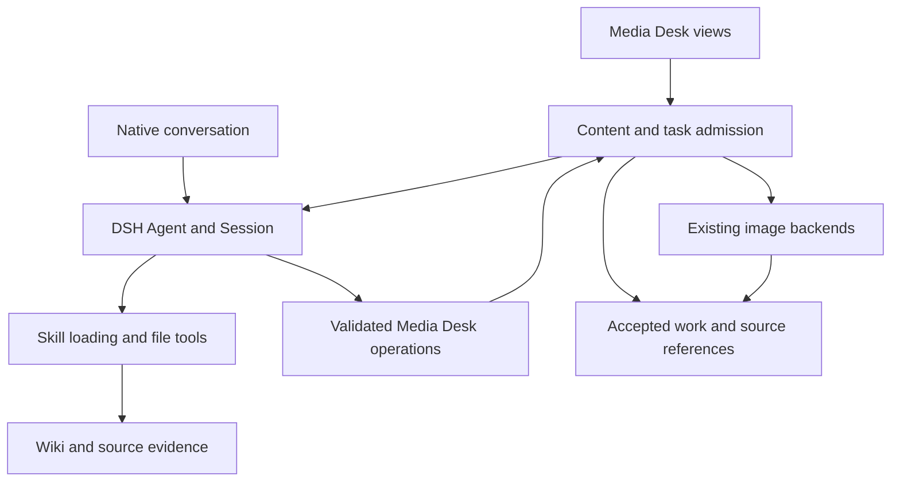

# Agent Note: Media Desk 原生 Agent 与 Wiki 辅助创作

Status: proposed

[English](2026-11-11-media-desk-native-agents.md) | 中文

## 问题

Media Desk 能成稿和改稿，但文字请求绕过 DSH Agent 循环。因此，安装技能不会为这些请求提供文件搜索、技能加载或多步执行历史。Monid 提供付费的平台采集；用户的 Wiki 提供已有知识。把采集替换成知识辅助创作，需要明确不同的素材与效果数据边界。

用户要求完整梳理迁移，并进行 grill-with-docs 审查。本文是可审查的提案，不是已实现功能，也不表示集成测试通过。源码核对范围为 fork `2.6.2-winter.1` 与 DSH `dsh-v0.2.2-rc.1`。本次梳理没有调用真实模型、图片服务或 Monid。[插件术语表](../../../../plugins/dsh-media-desk/GLOSSARY.md)定义作品、素材、成稿、风格卡、写作规则和复盘。

## 提案

Media Desk 管理创作内容、已接受的成稿素材与排期；原生 DSH Agent 使用技能和工具执行对话、研究与文字生成。文字迁移期间保留现有图片后端与展示。完整迁移覆盖对话、改稿、策划、脚本生成和风格提炼。仅证明能读取 Wiki，不算完成这些范围。

保留现有五个工作台视图及既有内容。优先使用原生对话工厂呈现聊天、工具进度、批准和用户问答。通过显式、经过校验的业务操作修改工作台内容；普通助手文字不作为可执行的结果协议。保留先策划后脚本的关系，以及配图和分镜共用的事实。

### 审查状态与决策树

用户于 2026-11-11 确认下列七项选择及完整设计。本次审查没有待定的产品选择。

| 决策 | 已确认选择 | 审查状态 |
| --- | --- | --- |
| Monid | 移除后续账号采集和配置界面；保留已导入内容、账号记录、指标及手动／CSV 复盘 | 用户已确认 |
| Wiki 写入 | 沿用 llm-wiki 对高价值综合的现有自动保存策略 | 用户已确认 |
| 对话连续性 | 每篇作品一个持续对话，全局助手另用独立对话 | 用户已确认 |
| Agent 能力 | 专用创作 preset，使用原生文件／搜索／Shell／技能／问答／权限机制及 Media Desk 操作 | 用户已确认 |
| 停止行为 | 原生 Stop 作用于当前轮次；取消成稿作用于整次已受理制作及其图片 | 用户已确认 |
| 失败处理 | 保留内容和手动编辑；明确报告失败，不自动把模板标成已完成成稿 | 用户已确认 |
| 对话重置 | 活动工作完成或取消并停稳后开始新对话；保留旧历史与已接受作品 | 用户已确认 |

grill-with-docs 设计审查已通过。本文保留 proposed 状态，因为实现与运行验收尚未完成：下文有源码支持的机制需要先通过第一阶段试验，再扩大迁移。

静态审查发现四个工程缺口。设计分别采用 SessionController 所有权与持久 preset、消息／轮次关联及过期候选失效、分开的轮次／成稿取消，以及现有同机文件锁原语解决。这些是有源码支持的设计选择，不是已经完成的集成试验。

### 当前调用路径与迁移覆盖

下表定位迁移位置，不建立第二份 API 目录。实现仍以源码为准。

| 当前路径 | 现有结果或效果 | 迁移要求 |
| --- | --- | --- |
| [对话与改稿](../../../../plugins/dsh-media-desk/src/host.js)及[对话提示词](../../../../plugins/dsh-media-desk/src/ai.js) | `reply`、`ops`、`actions` 和可选 `revise`；模型失败时本地回退 | 原生对话与校验后的内容操作；Host 接受成稿请求 |
| 经 `styleFromMaterial` 的[风格提炼](../../../../plugins/dsh-media-desk/src/style.js) | 规范化风格卡，可关联账号身份 | 原生任务携带选定样文与明确来源；保留预设和自定义风格 |
| [成稿策划](../../../../plugins/dsh-media-desk/src/produce.js) | 标题、共同事实、提纲、图片与分镜提示词 | 原生任务提交有界结构化结果；先接受策划案，再启动后续生成 |
| 经 `articlePrompts` 的[脚本生成](../../../../plugins/dsh-media-desk/src/ai.js) | Markdown 正文、AI 原文和模型名称 | 原生任务使用已接受的策划案、来源和写作规则 |
| [图片生成](../../../../plugins/dsh-media-desk/src/images.js)与[订阅工具](../../../../plugins/dsh-media-desk/src/image-tool.js) | 封面、配图、分镜图及测试图片 | 保留两个后端；每个结果与重试均关联对应成稿尝试 |
| [规则学习与技能导出](../../../../plugins/dsh-media-desk/src/learn.js) | 确定性规则提案和用户触发的 `media-desk-voice` 技能导出 | 保留审查／启用与 AI 原文；防止旧导出技能重新应用已停用规则 |
| [客户端动作与导出](../../../../plugins/dsh-media-desk/client/desk.js) | 浏览器启动 `produce`，保存前绘制封面文字 | 浏览器断开后 Host 仍能接受成稿请求；保留封面文字与导出行为 |
| [Monid](../../../../plugins/dsh-media-desk/src/monid.js)与[连接界面](../../../../plugins/dsh-media-desk/client/connect.jsx) | 平台帖子、指标、资料、封面下载与费用 | 将第一轮选择同步应用到 Host、Client、测试和指南 |
| [Store](../../../../plugins/dsh-media-desk/src/store.js)、[操作](../../../../plugins/dsh-media-desk/src/ops.js)与[设置](../../../../plugins/dsh-media-desk/src/settings.js) | 内容、聊天、撤销、全局模型覆盖与设置 | 显式数据迁移、任务身份、来源引用与按会话选择模型的语义 |

`PLUGIN_SESSION_ID` 是每个进程生成的网关路由字符串，不是原生 Session。每次直接请求模型前，对话历史按作品筛选并截断。模块全局模型状态无法描述并发的原生对话。现有 JSON 响应解析器不能安全消费 Agent 的工具消息或中间回复。

保留 `harvest` 提供的普通链接收藏，以及 `harvestText` 提供的选定网页样文。移除账号采集与刷新，包括 `account/refresh` 路由、Monid 路由、CLI runner、配置／费用界面及账号导入 mock。保留历史账号记录、已导入内容和指标，用于手动／CSV 复盘。原生文字路径移除自动本地对话和结构模板替代；手动内容编辑及无生图模式继续可用。不能把失败 Agent 任务标为成稿完成。

### 职责与执行流程

Host 管理任务受理、输入版本、结果校验与接受。DSH 管理消息历史、模型执行、工具执行和原生权限交互。Store 管理可编辑作品与已接受的媒体；Session 日志提供执行证据。浏览器状态和助手最终一句话都不是作品的第二份权威数据。

由一个模块负责原生 Agent 所有权与任务关联。调用方提交任务、观察状态并请求取消。不要保留以 `callModel(system,user)` 为公开抽象、把可调用工具的循环藏在拼接文字 Promise 后面的接口。技能、批准、继续执行与取消都是新约定中可观察的行为。

### Agent 创建、组合与恢复

创建与冷恢复统一使用现有 Web [SessionController](../../../../upstream/packages/api/session-controller/src/index.ts)。公开 Host 方法为 `create(request)` 和 `resolveAgent(sessionId)`。保存创建实际返回的 Session ID；请求中指定 ID 不保证被复用。已有作品使用 `resolveAgent`，不能以 `create` 代替恢复。原生句柄与循环由 controller 管理；Media Desk 管理业务任务和关联，不另设 `agents.create/resume` 队列，也不虚构父级。

注册专用 `media-desk-creation` preset，使用现有 DSH 文件／搜索／Shell／技能／问答及压缩组件，加上创作 persona 与 Media Desk 操作。[standard preset](../../../../upstream/packages/bundle/web-app/presets/standard.patch.yml)作为组件参考，不默认继承其编码 persona、插件管理、定时任务、目标或多 Agent 工作流。宿主权限和原生批准机制继续生效。首版不增加自动子 Agent 委派。

打开或关闭面板只改变客户端订阅。Media Desk 卸载时取消自己的任务并排空业务写入，不释放 controller 拥有的 Session。创建前记录待建立的对话关联，绑定返回 ID 后才派发任务；未绑定 Session 不能执行业务写入。原生创建与关联落盘之间崩溃可能留下未使用 Session，应保留检查，不能凭标签猜测归属或自动删除。

把业务操作及受理钩子声明在持久 preset 中，由[原生恢复组合](../../../../upstream/packages/api/session-controller/src/agent.ts)在执行前重建。preset 插件树在同一组合代际共享：依据实际执行 Agent 查询归属，不能在闭包保存“当前作品”。Host Store 只挂载一次，preset 消费它。缺关联时禁止业务写入；缺 preset／服务时显示可恢复错误，不回退 standard。恢复试验在重启后先打开原生 Session 页面并提交。

持久保存对话所属的 DSH home、项目／工作区、Session ID 与选定组合。恢复记录的组合与模型选择，再核对中断任务。不能只凭相同 ID 就恢复另一个 Host 环境的 Session。本地 Wiki 路径只能被执行 Agent 的机器使用；云端 Host 需要自己可访问的副本和路径配置。

连接工作台时明确选择 DSH 工作区，不能静默使用进程 cwd，也不把 Wiki 根目录改作工作台工作区。持久保存关联，防止原生工作区／preset 控件静默重绑作品。preset 恢复使用当前安装定义，不是旧插件代码的保存副本。

### 技能发现与 Wiki 使用

使用 DSH 的[文件系统技能提供方](../../../../upstream/packages/skill/skill-filesystem/README.md)和[技能加载器](../../../../upstream/packages/skill/tool-skill/README.md)。已检查的本机 `~/.agents/skills/llm-wiki` 指向 Wiki 内的技能目录，其查询参考文件存在。这只能证明文件可用，不能证明在某个 Agent 作用域中成功加载。用实际 Agent 和工作目录检查有效技能注册表；更高优先级的同名技能及自定义根目录都可能改变结果。

需要 Wiki 知识时，任务明确指定 `llm-wiki`。Agent 在检索前加载技能正文、查询说明与 Wiki 自身规则。存在 `WIKI_PATH` 时使用它，否则沿用技能的 `~/wiki` 默认值。不要每次请求都扫描或注入整个 Wiki，也不在 Media Desk 中另建向量库或 Markdown 爬取器。

先检索相关综合页，事实核验需要时沿其来源深入。把选定主张、来源路径、来源日期和不确定性带入策划案。引用保留在作品旁，必要时与口播正文分开。来源引用表示证据出处，不代表事实已经正确；缺失、过时或矛盾的证据必须可见。

知识综合页提供主题材料。只有明确选定的作者样文用于学习个人文风。DSH 技能指令与 Media Desk 现有 `state.skills` 写作规则记录保持区分；不把后者当成可执行技能，也不在迁移时改写它们。

沿用 llm-wiki 的现有自动保存策略：高价值新综合或已核验的事实纠正进入其维护流程；简单查找或重复知识不另建页面。事实核验、去重、原始来源保留、导航和日志继续以技能为准。用户明确只读时，仍优先遵守。不要把每篇草稿都复制到 Wiki，也不增加 Media Desk 专有的批准要求。

Wiki 与 Media Desk 分别管理自己的写入。Agent 按 Wiki 规则及实际文件权限维护知识库；Media Desk 操作接受工作台内容。任务结果记录写入的 Wiki 路径。后续成稿失败或工作台撤销不能回滚这些写入；重试前先核对已有知识。不能声称跨存储事务、自动退款或自动回滚。

### 任务、内容操作与完成判据

持续对话与一次成稿尝试需要不同身份。每次受理的尝试记录目标对象、输入快照、Session、触发消息、阶段与请求时模型选择。作品任务引用作品；全局创建、风格、规则和指标操作核对各自对象及范围。创建作品先返回持久身份，再受理依赖它的工作。第二次点击必须关联已受理尝试，或显示冲突。异步准备前先领取尝试；当前先检查再 await 无法防止同时启动。

输入快照包含选定素材、风格、启用规则、语气和生成设置。已接受的阶段结果拥有独立身份与依赖：脚本提交不能使同一已接受策划案生成的兄弟图片失效。用户编辑或输入变化仅使不兼容的依赖结果失效。原生各步骤实际使用的模型与最初请求的选择分别记录。

用读取当前对象、应用校验后编辑、提交阶段结果的少量操作，替换藏在助手正文中的 JSON。保留 `applyOps`、`normalizePlan`、`normalizeStyle` 和 `applyRevision` 的字段上限与领域校验。接受写入前核对调用 Session、所属对象、当前尝试和预期内容版本。操作仅注册在目标 Agent 作用域；浏览器提供标识不代表获得所有权。

提供四个有界业务工具：`media_desk_read` 返回所属对象及选定引用，不带凭证；`media_desk_edit` 应用现有允许操作并返回回执；`media_desk_produce` 受理成稿、重画或取消；`media_desk_submit_result` 为当前已受理阶段暂存策划案、脚本或风格结果。Host 判断任务与对象权限，不能通过换一个 ID 获得其他作品写权限。浏览器导航不由 Agent 输出执行；回执链接到已接受作品。

每个受理请求采用唯一的完成协议。记录消息 ID 与起始事件位置，把已消费输入关联到实际轮次并检查该轮的持久结果，不能取日志最后一条 `turn/end`。最终接受前 flush Session，消费前被丢弃的输入也需要结算。[Agent 运行时约定](../../../../upstream/packages/core/agent/src/runtime-types.ts)中的 `whenIdle()` 只表示停稳，不代表任务成功。[Headless runner](../../../../upstream/packages/bundle/headless/src/index.ts)示范等待、启用子级时的汇合及终态检查。根 Agent 不会返回子 Agent activation 的 `result` 对象。

结构化阶段先保存与已受理任务关联的有界候选结果；只有对应轮次成功、输入版本仍有效时，才校验并提交。未完成的流式文字显示为预览，不作为已接受的稿件。重复投递相同结果返回既有回执，不同重复结果报告冲突。通知丢失时通过持久回执恢复已接受提交。普通编辑工具已经接受的内容修改，即使后续工具失败仍然生效；报告部分完成，不能声称已经回滚。

结构化阶段只暂存结果，不同时立即编辑同一对象。普通对话编辑可以立即提交。其他操作修改结构化阶段的输入时，明确报告冲突，避免候选结果使自身失效。直接文件编辑不能绕过 Media Desk 的权威内容操作。

策划、脚本写作和风格提炼在选定对话内串行执行。策划案接受后，图片工作可以并发。请求下一阶段的工具只确认受理并返回，不能等待自己当前正在运行的 Agent 再执行另一轮。原生输入框、按钮和工具发起的工作必须共用受理与版本检查。区分新消息是普通后续输入还是明确中断，不静默混入结构化阶段。

保留原生 queue／steer 语义。记录阶段消息 ID，用 `agent/inbox/claimed` 关联所属轮次。新用户消息进入活动结构化轮次时，使旧阶段与候选失效并停止后续阶段调度；随后保留消息、继续原生 pre-step，让 Agent 回答用户。不能为停止业务任务而拒绝已领取的用户消息。后续排队轮次保留输入，开始时核对当前依赖。

[事件分派器](../../../../upstream/packages/core/agent/src/dispatch.ts)规定领取通知不等待异步监听器。领取输入时同步使旧阶段与候选失效；pre-step 钩子随后等待关联和失效记录的写队列结算。落盘失败时禁止接受业务结果，同时保留已领取用户输入继续原生处理。

需要精确区分 queue／steer 时读取持久 inbox target；`agent/pre-step` 本身没有投递模式字段，而且发生在 inbox 消费之后。取消的程序阶段消息按记录 ID 失效，不丢弃无关用户输入。结果提交在 Store 写队列中重新检查当前代次及依赖。这样能覆盖原生页面与另一浏览器的输入，无需修改 DSH 核心，也不依赖禁用某个输入框。

原生[队列编辑](../../../../upstream/packages/api/session-controller/src/commands.ts)可以保留消息 ID 并替换正文。删除、编辑或移位已受理的程序阶段输入时，使原阶段失效并结算；重新投递不能复活旧尝试。消费时除 ID 外，还核对消息正文、来源及当前 target。

### 取消、冲突与持久化

尝试状态的持久记录与内存中是否存在 Agent 分开。按任务需要区分运行、等待用户、成功、部分完成、失败、取消与中断。等待和结束状态来自实际 DSH 事件，不由无输出或 `idle` 推断。只有必要文字已接受、每张请求图片都有确定结果，整次成稿才算完成；图片失败仍需可见。

取消先使当前尝试不再接受新结果，再取消活跃 Agent 轮次及所属媒体请求，等待自己拥有的工作停止。服务商已经执行的操作可能仍计费。无法取消的远程图片结果可以保留为未接受素材，但不能覆盖当前成稿。独立重画也需要取消和尝试归属。

原生 Stop 取消当前轮次并保留 DSH 队列输入。如果该轮拥有结构化阶段，该阶段停止且不再启动后续文字阶段；已受理图片可以结束，成稿保持中断或部分完成，不标成功。独立的“取消成稿”使全部所属待处理阶段失效，并取消所属图片。保留无关后续消息；清空整个 inbox 不等于业务取消。

每次写入都检查尝试、作品版本与稳定素材身份，仅用数组位置不够。编辑、撤销、删除或重新成稿会使不兼容的待返回结果失效。保留用户的新内容，并报告带可恢复候选结果的冲突。撤销作用于已接受的工作台编辑；它不删除 Session 证据、不撤销 Wiki 写入，也不退还模型或图片费用。

使用公开的 [`withFileLock`](../../../../upstream/packages/util/atomic-write/src/index.ts)，在 Host 写入生命周期内持有 Media Desk 数据目录的一个所有权文件。取锁前只创建父目录；Store／Settings 初始化、迁移、媒体接受及恢复均在锁内。初始化等待取锁完成，不等待整个生命周期回调。关闭时先停止任务、排空所属写入，再结束回调释放锁。第二个写入者在有界等待后失败。

该协议限于同机、同 PID namespace、本地数据目录上的协作写入者。不抢占未知或不完整锁，不声称支持网络共享 home 或断电持久性。外部进程只写独立尝试结果，不直接写已接受内容／状态；持锁 Host 校验后导入。取锁 signal 不会取消已开始的持锁回调，退出必须显式等待其结束。上线前测试正常释放、被终止持有者接管、竞争及存活外部输出。

重启后，结合 Session 结果和已保存回执核对任务。模型调用、生图或 Wiki 写入的外部效果不确定时，不自动重跑。用户重试基于当前内容创建新尝试。前次执行未结束也要恢复已经接受的文字与媒体；恢复对话历史和重复失败任务分别处理。

### 原生对话与工作台界面

优先嵌入官方[对话工厂](../../../../upstream/packages/client/ui-conversation/src/client/contract/slots.ts)。[子 Agent 侧栏](../../../../upstream/packages/client/ui-subagent/src/client/sidebar-chat/index.tsx)展示了工厂渲染，但它本身不能证明普通 Session 集成。当前 Media Desk Client 只注入 slots；需要持有正确 Session 的引用、提供作用域，并显式挂载所需 Client 依赖。

替换自有聊天前，验证普通 Session 绑定、工具卡片、批准、用户问答、输入草稿、附件、取消、模型选择和刷新。不要复制私有对话组件或搬移宿主 DOM。若嵌入不能满足这些行为，暂时使用原生 Session 页面作为入口；不能交付会隐藏待批准请求的自制替代界面。

在 Media Desk 自有的 session 子槽中持有普通 Session 引用，不重新声明 `conversation.session`。替换对话展示时保留工作台内容动作。为选中文段／分镜提问、建议、回执跳转、撤销及成稿期间的输入确定受支持交互。原生工作区或 preset 控件不能静默改变作品对话的关联。

内容和成稿状态继续显示在现有工作台视图中。任务失败显示在保留的作品旁，必要时提供重试或来源详情；瞬时操作结果使用宿主 toast。清空／重置只作用于选定对话，不能像当前全局清空接口一样静默删除所有作品对话。

原生 Session 选择与请求记录是文字模型的真源。切换影响下一次尚未开始准备的 step，可能在当前轮次内生效；原生选择还会异步更新 Host 默认值。分别记录请求时与实际使用的模型。整次成稿固定一个模型需要另行制定并验证策略。图片模型设置保持独立。

把破坏性的“清空”改为“开始新对话”。活动工作完成或取消并停稳后，创建并绑定新 Session，旧 Session 保留为历史；已接受内容、来源、风格和图片保持完整。旧关联的迟到结果不能修改新关联。新建全局对话只改变该全局关联。

### 现有图片与历史数据

保留 HTTP 图片配置、订阅工具选择、图片数量、封面文字、不同语言版本和导出行为。订阅路径有明确的工具、结果和输出目录约定，目前拒绝纯 PTC 执行器；原生文字执行不会让任意图片路径自动兼容。除非另行修改并验证，保留现有不回退 HTTP、不重试订阅工具的行为。不能让 Agent 和 Host 各自重复提交同一批图片。

有上限的 HTTP 自动重试留在已受理素材尝试内；用户重试创建新尝试。持久接受回执防止重复应用结果，不保证效果不确定的服务商请求只计费一次。导出从同一份已接受成稿快照取得脚本、封面文字、选定素材和来源引用；证据随导出保存，不进入口播正文。部分导出明确说明缺失图片。

保留确定性规则提案、启用和用户触发的技能导出。当前作品的启用写作规则优先于过时的 `media-desk-voice` 导出技能。验证原生 Agent 如何收到这个优先关系，避免技能发现重新施加已停用规则。该导出与 Wiki 维护不同，不能被 Wiki 写入策略意外禁用。

引入有版本、幂等的数据迁移，并先备份。保留内容与账号 ID、导入指标、来源链接、草稿与 AI 原文、风格、写作规则、各语言成稿、媒体文件和设置。旧自有聊天可以保留为历史上下文，但不能伪造成原生工具事件。旧全局模型设置可以为新建对话初始化一次，不能每次加载都覆盖已有原生模型选择。

已接受业务结果、对应回执及任务／对话关联通过同一次原子状态替换保存。撤销仅作用于创作内容修改，不能恢复旧尝试状态或降低冲突检测版本。媒体字节先按稳定尝试／素材身份保存，再提交已接受引用。没有引用的输出不算成稿成功。这样保留当前 JSON Store，无需引入数据库，也不把两个文件的写入当成事务。

在存储和校验中显式定义来源引用与任务记录；未知字段能经过一次 JSON 读取保留下来，不代表写入路径支持它们。使用填充过数据的副本验证恢复。回滚使用旧包及迁移前备份，不能假设旧包可以安全写入新 schema。回滚时保留新产生的 Session 日志与结果以供检查，不删除它们。

### 实施顺序

1. 在独立 DSH home 中证明 SessionController 拥有的原生根执行、专用 preset、显式技能加载及校验后结果回执。先证明普通 Session 嵌入、原生页面冷恢复和批准机制可用，再围绕它们构建迁移。
2. 增加任务／对话关联、写入者所有权、输入版本、回执及幂等数据迁移；切换成稿调用前，先测试过期结果和重启核对。
3. 用原生对话及作用域内业务操作替换自有聊天与改稿执行。确保没有请求浏览器时，Host 仍能接受成稿工作。
4. 把策划、脚本与风格阶段迁移为原生任务，接入 Wiki 检索和来源引用。保留现有媒体后端，结果绑定尝试并统一取消语义。
5. 应用审查确定的 Monid 与 Wiki 写入策略，迁移界面／设置／指南，移除旧直接文字调用及仅适用于假模型的假设，再执行完整验收。

所有实现位于 `plugins/dsh-media-desk`；upstream 保持只读。首轮集成面向具备 SessionController、preset registry、工具、技能、批准和问答的官方 Web 组合。为 `dsh-api-session-controller`、`dsh-agent-preset-registry`、`dsh-atomic-write` 及实际消费的其他 SDK 包增加精确 `0.2.2-rc.1` 依赖；每个新增 Remote 都需要提供方依赖和类型导入。保留固定 Git 预构建安装。真实包约定仅在实现后更新；本提案拥有规划信息。

## 考虑过的替代方案

**在现有提示词构造器中直接读取 Wiki 文件。** 对选择少量本地文件而言改动更小，但会重复部分技能发现与检索，仍缺少本次要求的 Agent 执行、批准和技能复用。如果原生集成无法满足验证后的约定，可以回到这个方案。

**仅把 `callModel()` 替换成 Agent 包装器。** 它保留过多不再成立的假设：一个最终文字块、全局模型状态、浏览器负责成稿动作、仅在内存中的任务。它无法确定任务完成，也不能保证取消后安全写入。

**每次小型生成调用都创建新 Agent。** 这能隔离结构化阶段，但会丢失用户选择的持续作品对话，并重复加载技能与上下文。因此把制作尝试身份与持续对话分开。

**把全部内容和编排放入聊天历史。** Session 证据无法替代可编辑作品、排期、稳定媒体身份或版本检查。业务验收与持久内容继续由 Media Desk 管理。

**复制 Antfarm 调度器或为面板虚构父 Agent。** DSH 已提供原生根 Agent。Antfarm 的 SQL 工作流和全新尝试身份解决的是另一个问题；复用 DSH 公共约定与已验证的生命周期模式，不复制其他插件的业务引擎。

## 验收标准

设计审查与实现验收分别进行。本次梳理不声称已经执行下列任何一项。

| 领域 | 必需证据 |
| --- | --- |
| 设计审查 | 决策树所有分支已解决；来源支持 API 主张；用户确认共同理解；未验证的运行假设有明确记录 |
| 原生执行 | 真实独立 DSH Session、正确 preset／模型、技能目录及已加载的 `llm-wiki`；搜索读取测试 Wiki 并返回有来源的稿件 |
| 覆盖范围 | 对话、局部改稿、策划、脚本及全部风格提炼路径使用原生文字执行；没有隐藏的直接 LLM 回退 |
| 全局操作 | 先创建作品再绑定任务；切换／提炼风格、管理规则和录入指标不要求预先存在作品 |
| 结果 | 拒绝缺失、格式错误、重复冲突或过期提交；取消、丢弃和失败轮次不能算成稿成功 |
| 并发 | 通过屏障使同时启动真实重叠；仅一个写入者／尝试被接受；编辑、撤销、删除、重做均拒收迟到结果 |
| 重启 | 提交与落盘前后断连；恢复回执而不重复效果；中断的外部操作不盲目重放 |
| 界面 | 在真实 DSH 中验证作品／全局普通 Session 绑定、工具输出、批准／问答、附件、模型切换、取消和草稿保留 |
| 原生入口 | 重启后先从原生界面进入；另一浏览器提交／引导；编辑／删除／移位程序队列输入；验证阶段同步失效及关联落盘；轮次中切换模型；Stop 保留无关队列输入；取消成稿使所属工作失效 |
| 对话重置 | 新作品／全局对话保留已接受内容和旧历史；先结束活动工作；拒收旧关联结果 |
| 图片 | HTTP 与支持的订阅模式、无生图模式、逐图失败、独立重画、封面文字和导出仍可使用 |
| 历史 | 填充数据的 fixture 保留全部旧内容与指标；迁移可重复；不触碰无关 profile／历史；证明备份回滚可用 |
| 导出与规则 | 同一已接受版本提供文字／媒体／来源，部分导出说明缺失素材，AI 原文仍支持规则学习，停用规则保持停用 |
| Wiki 策略 | 保留来源路径／日期，说明缺失和冲突证据，个人文风使用选定样文，验证审查确定的写入策略 |
| Monid 策略 | 所有入口反映已确定的移除／保留选择；无需付费调用即可复盘既有指标 |
| 打包 | 插件语法／类型检查、构建、测试、文档检查和固定 Git 安装；验证精确 SDK／Remote 依赖与预构建 Client |

用确定性 fixture 验证受理、任务结果与并发；使用独立临时 home，以及事件／屏障同步，不用固定 sleep。浏览器证据必须来自重启后的开发进程和硬刷新。模拟 Agent 循环不能证明真实模型会使用技能；需要独立、有界的真实模型运行验证检索、来源质量和结构化提交。记录模型与实际结果，不把传输测试通过等同于文章质量合格。

## 风险

原生技能和工具相比直接提示词会增加延迟与上下文。测量首轮和继续轮次的上下文、技能加载开销、工具步骤及模型用量。Wiki 缺失、工具受限、preset 不兼容或批准请求没有可见界面时，必须提供用户可处理的任务状态。不能静默回退为无来源的事实生成。

主要集成风险是普通会话的组合与所有权、用户／输入框消息与业务尝试的关联、跨进程 Store 所有权，以及取消和恢复时的内容版本保留。先解决这些问题，再润色界面。平台新鲜度和实时互动仍不属于 Wiki 检索；脚本完成也不代表自动发布或完成视频剪辑。

替代关系检查没有找到现有 Media Desk 原生 Agent 决策。[Antfarm 身份笔记](../../implemented/architecture/2026-11-08-antfarm-original-agents-and-storage.zh.md)继续约束 Antfarm；独立的[短剧工作台提案](2026-11-08-short-drama-canvas-workbench.zh.md)保留自己的产品与媒体范围。本提案不替代它们，也不修改归档记录。工程决策保存在这里，不作为已实现知识复制到个人 Wiki。
