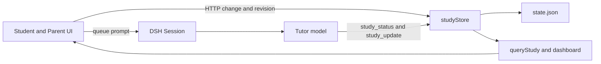
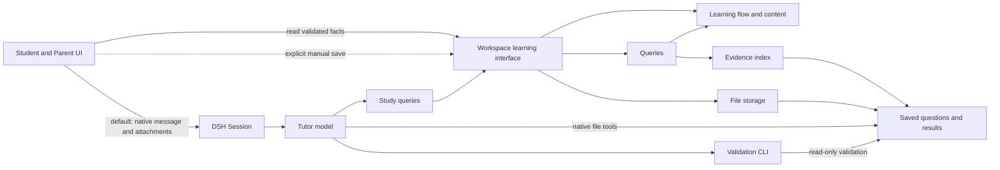

# Agent Note: Student learning flow and evidence architecture

Status: proposed

English | [中文](2026-11-12-student-learning-flow-architecture.zh.md)

## Problem

Student needs one recoverable learning path: choose a goal, answer one question, receive feedback, and turn the result into the next useful practice. Parents need to finish setup, photo review and marking without repeatedly switching between chat and several independent forms.

The current implementation already separates update handlers, shares mastery rules and stores learner responses. Its file cache does not hit across requests with the installed LocalFS backend. The remaining problems concern who owns the complete operation. Client actions save state and then queue a separate tutoring prompt. The model selects and publishes content and submits assessments. Some identity, scope and confirmation rules are enforced only after the learner has acted, or remain instructions that the implementation can bypass.

This proposal covers the current student submodule checkout, its Host and Client faces, model tools and skill, curriculum and exercise data, and tests. The package manifest is 0.1.8 and the DSH dependency is 0.2.2-rc.1. It proposes changes; it does not describe a completed redesign.

### Current operation paths

The shared store is useful, but sharing a file does not make the UI request, model turn and assessment one operation.

| Path | Current owner | Where the flow needs attention |
| --- | --- | --- |
| Setup and school progress | Parent forms → update handlers | A course save also makes a second progress save; other forms retain old revisions. |
| Start and choose a goal | Client selection + Host block + model prompt | The chosen goal is local UI state; the main recommendation can start a different goal. |
| Publish → answer → assess | Model task/record + UI answer/hint | Scope is checked too late; record can bypass the saved question and response. |
| Print → photograph → confirm | Worksheet + paper draft + parent marks | Question binding, confidence and assistance have different rules between entry points. |
| Review and parent summary | Replay + status + insight + dashboard | Time invalidation and historical completion are not represented consistently. |
| OpenMAIC classroom | Tutor shell + separate lesson file + UI | External generation and a learning assessment are distinct operations. |

### Confirmed defects

The following findings have source and caller evidence. Host identity, scope, worksheet binding, time and weekly-summary cases were also reproduced with synthetic in-memory states. Consecutive parent saves were reproduced in an isolated real DSH browser. A read-only probe of the installed LocalFS confirmed that repeated resolution produces different target objects with the same stable target key. The table identifies the change that should precede broader restructuring.

| Order | Observable problem | Evidence |
| --- | --- | --- |
| First | A second block can reuse q1, but its answer is rejected as already assessed and its feedback comes from the first block. | [session.ts:17,35](../../../../plugins/dsh-student/packages/winterhuan/student/src/learning/update/session.ts); [status.ts:63](../../../../plugins/dsh-student/packages/winterhuan/student/src/learning/status.ts); [learning-update.spec.ts:223](../../../../plugins/dsh-student/packages/winterhuan/student/tests/learning-update.spec.ts) |
| First | start → record accepts an independent correct result without task or answer; changing the record ID also bypasses alignment with a hinted question. | [session.ts:114–153](../../../../plugins/dsh-student/packages/winterhuan/student/src/learning/update/session.ts); [plugin.spec.ts:76](../../../../plugins/dsh-student/packages/winterhuan/student/tests/plugin.spec.ts) |
| First | A question outside the active scope can be published and answered. Assessment rejects it, and the next question is then blocked waiting for feedback. | [session.ts:18,24,129](../../../../plugins/dsh-student/packages/winterhuan/student/src/learning/update/session.ts) |
| First | Reclassifying or deleting a mistake changes or removes the goal of an already marked worksheet item. | [view.ts:32](../../../../plugins/dsh-student/packages/winterhuan/student/src/learning/view.ts); [paper.ts:18](../../../../plugins/dsh-student/packages/winterhuan/student/src/learning/update/paper.ts) |
| First | A worksheet with a transcription draft can replace its question and answer under the same IDs while retaining the old draft. | [paper.ts:30–44](../../../../plugins/dsh-student/packages/winterhuan/student/src/learning/update/paper.ts) |
| First | High transcription confidence admits unassessed items to bulk confirmation, which converts them to correct. Manual marking also defaults to independent instead of retaining known assistance. | [practice-view.tsx:228–233](../../../../plugins/dsh-student/packages/winterhuan/student/src/client/practice-view.tsx); [paper.ts:83,108](../../../../plugins/dsh-student/packages/winterhuan/student/src/learning/update/paper.ts) |
| First | Confirming a workbook photo without a prebuilt worksheet deletes the draft. An independent correct response only clears the teaching queue; its answer and result are not retained as evidence. | [paper.ts:153–180](../../../../plugins/dsh-student/packages/winterhuan/student/src/learning/update/paper.ts) |
| First | At an unchanged revision, tomorrow's due count can change from 0 to 1, but conditional polling updates only elapsed time. | [route.ts:86–89](../../../../plugins/dsh-student/packages/winterhuan/student/src/route.ts); [workspace.ts:39–40](../../../../plugins/dsh-student/packages/winterhuan/student/src/client/workspace.ts) |
| First | Saving interest tags succeeds, then saving the service address reports a conflict because that form still holds its first revision. Course and progress are also two writes. | [forms.tsx:20,29,85–95](../../../../plugins/dsh-student/packages/winterhuan/student/src/client/forms.tsx) |
| Next | Weekly minutes use seven Shanghai calendar days, while evidence uses the preceding 168 hours. A completed due review disappears from the denominator after rescheduling. A goal with three independent days and a recent correct response can count as newly mastered even when its current level is weak or practising. | [status.ts:100–139](../../../../plugins/dsh-student/packages/winterhuan/student/src/learning/status.ts) |
| Next | The state cache uses the resolved target object's identity. LocalFS returns a fresh object for each resolution, so repeated requests cannot reuse the validated state despite having the same target key. | [store.ts:68,98,109](../../../../plugins/dsh-student/packages/winterhuan/student/src/store.ts) |
| Next | Changing grade retains a course that no longer matches the profile, yet a new school block can use it. Explicit cross-book blocks cannot obtain their target's elements through the current elements query. | [profile.ts:21,47](../../../../plugins/dsh-student/packages/winterhuan/student/src/learning/update/profile.ts); [session.ts:87](../../../../plugins/dsh-student/packages/winterhuan/student/src/learning/update/session.ts); [store.ts:163–165](../../../../plugins/dsh-student/packages/winterhuan/student/src/store.ts) |
| Next | New questions inherit checked microsteps; choosing the whole book retains the previous unit; changing only a worksheet error cause is not submitted or is treated as unchanged. | [today-view.tsx:221,243](../../../../plugins/dsh-student/packages/winterhuan/student/src/client/today-view.tsx); [practice-view.tsx:190–201](../../../../plugins/dsh-student/packages/winterhuan/student/src/client/practice-view.tsx); [paper.ts:85](../../../../plugins/dsh-student/packages/winterhuan/student/src/learning/update/paper.ts) |

### Model and content costs

The registered study_update parameters serialize to 59,400 JSON characters across 34 actions. The task, record, worksheet and save-exercise branches account for 42,058 characters, or 70.8%, by repeating rich question content and the 23 figure variants. study_status adds 1,868 characters. These are measured character counts, not token counts or model-quality measurements. See [tools.ts](../../../../plugins/dsh-student/packages/winterhuan/student/src/tools.ts) and [schema.ts](../../../../plugins/dsh-student/packages/winterhuan/student/src/schema.ts).

The 12 maps contain 117 goals and the bank contains 122 seed questions, with at least one question for every goal. Role coverage does not yet provide a complete teaching sequence:

| Subject | diagnose | try | demo | vary | daily |
| --- | ---: | ---: | ---: | ---: | ---: |
| Chinese | 39 | 4 | 1 | 1 | 0 |
| Math | 30 | 2 | 1 | 1 | 0 |
| English | 43 | 0 | 0 | 0 | 0 |

The four teaching phases are currently question labels and model guidance. They are not an enforced progression. The redesign must retain original question generation and distinguish a validated reference question from an observed learner result.

## Proposal

The current native DSH conversation is the default operation entry. Users request profile setup, school progress, starting and continuing, answers and help, photos, assessment confirmation, worksheets, archives and OpenMAIC through chat. Panel shortcuts send native messages too. The agent directly authors official business files with native file tools, then runs the read-only validation CLI; the application validates and displays those files. Explicit manual forms remain application-owned saves. No candidate-change area or Host acceptance tool sits between agent authoring and official files.

The Host owns validated reading, learning context, evidence interpretation and available actions. The model executes user intent, explains, adapts scenes, prepares content, saves raw responses, assesses and recommends the next step. The Client uses the native conversation as its main entry, with learning and parent panels displaying validated facts. DSH owns conversation, queueing, attachments, model execution, drafts and filesystem authorization.

The product has one native conversation learning path and three parent information destinations. Panel actions send complete intents to the current agent; manual editing is an explicit supplement. It remains one student package with explicit Host and Client build faces, pinned to DSH 0.2.2-rc.1.

### Confirmed design

The user has confirmed that every business operation defaults to direct chat with the agent, direct authoring of official business files, CLI validation and application validation on reading. Explicit manual UI edits are application-owned saves. This includes profile, curriculum, school progress, blocks, content, answers, assessment, mistakes, worksheets, transcription, archives and OpenMAIC logs. The agent submits no candidate files for Host publication; validation establishes correctness rather than granting write permission.

The user has confirmed the main paths, file reads and backups, migration recovery, dates and same-day ordering, submission feedback, tool budget, testing entry and delivery approach. This proposal records unimplemented design; publish the specification, with code implementation handled through its task.

| Choice | Confirmed position | Read and recovery guarantees |
| --- | --- | --- |
| Default operations and authoring | Chat directly with the current agent; shortcuts send native messages. The agent authors official files and runs the CLI; the application validates on reading and saves explicit manual edits. | Validate current versions; do not promise to detect every unconditional native overwrite. |
| Official file organization | One term-settings file, one file per learning block and worksheet; questions, answers and assessments stay in their owning entity. OpenMAIC lessons remain separate. | Check directory membership and file versions before and after reading, then validate references; no global publication manifest. |
| Learning progression | The application shows available actions, the agent recommends, and the learner advances through an explicit message or shortcut. Teaching phases adapt to evidence. Ending or switching during pending assessment retains late assessment on the original question. | Distinguish native admission, saved response and valid assessment; inspect unknown status before recovering the same entity. |
| Parent navigation and setup | Three information destinations and chat-based staged setup. Explicit manual editing preserves entity drafts, detects actual field conflicts and saves course/progress together. | Native photo attachments, per-item confirmation sources and completion feedback from validated facts. |
| Unknown assistance and paper outcomes | Retain per-item answers, outcomes and assistance. Correct with unknown assistance counts as neither independent nor known help and is excluded from bulk confirmation. | Explicit parent verification, worksheet-wide dates with per-item overrides, and corrections without new responses. |
| Observation dates | Current chat answers use the matching input version's Host receipt time with an explicit source; paper answers use parent-confirmed dates. Unknown dates stay outside date-dependent mastery, scheduling and summaries. | Preserve precision; unknown same-day order retains difficulty and near review without erasing genuine independent days or earned stages. |
| Seven-day summary | Today and the previous six Shanghai days; distinguish first mastery from recovery through new answers. Count each genuinely due mistake once, include overdue work at the start, and require independent correctness for completion. | Replay effective facts at relevant cutoffs; rescheduling retains completed work and current difficulty remains separate. |
| Legacy evidence | Preserve original classifications, times, text and legacy sources. Only verifiable responses, assistance and actual dates count as new evidence; some legacy mastery counts may decrease. | The agent migrates after verifying an original-byte backup; recover partial outcomes with stable identities and restore the old plugin in a separate workspace. |

The main acceptance entry is native chat → real native write/edit → built read-only CLI → application validation on reading. Remove study_update, retain queries and non-Web use, and supply generated schemas/examples on demand. Review six phases separately and make one complete release. Existing decisions about original questions, all 23 figure types, review intervals and OpenMAIC shell ownership remain in force.

### Target modules

Use existing handlers and algorithms where their responsibilities already fit. Add only modules that remove duplicated knowledge from their real callers.

| Module | Interface and responsibility | Existing implementation to reuse |
| --- | --- | --- |
| Workspace learning | read(query) consumes agent-authored official files for panels and model queries. save(intent, expected) serves explicit manual edits only. Default shortcuts submit native messages without a prior business save or separate publication request. | studyStore queries and explicit UI update dispatch. |
| Learning flow and content | CLI and application share official-file schemas and business validation. Resolves the effective course, explicit scope, target and content before displaying a question; returns validated learning context and legal next actions. | curriculum, target resolution, diagnostic/review plans, session handlers. |
| Evidence | Builds one normalized index from effective screen and paper results. Owns identity, target binding, assistance and observation dates. | Attempts, paper results and existing replay rules. |
| Queries | Produces active context, progress, mastery, review, diagnostics, seven-day summary and page-specific projections from the same index. | mastery, schedule, status, view and dashboard. |
| File storage | Reads and validates official business files; supports application-owned writes, migration, stable file-version caches, containment, bounds, application-save version checks and archive recovery. | store and existing filesystem/sandbox integration. |

Move queryStudy out of store.ts. Keep the existing update handler families and exhaustive switch; action ownership does not need a second registry. Derive the normalized evidence index from saved block responses and worksheet outcomes on read, without persisting another evidence ledger.

### Official file organization

Save term settings, each learning block and each worksheet in separate official business files. Courses and confirmed school progress belong to term settings. A block owns its questions, raw responses, hints and assessments; a worksheet owns frozen content, per-item goals, transcription and confirmed outcomes. Other bounded business collections retain explicit ownership and stable identities. OpenMAIC lessons keep their independent lifecycle.

Question IDs are unique within their owning entity; term and entity identities must agree with the file. Agents and UI operations use the same official files and schemas. Do not create a file per action or model invocation. Validate cross-file references, without promising atomic changes across entities.

Discover entity files, check relevant directory membership and file versions before and after reading, then validate identities and references. Retry changing reads within a bound; do not add a global content-hash publication manifest. Incomplete, corrupt or invalid relevant files fail clearly. Preserve originals, mark previous displays stale and pause related manual saves. Independent valid data remains readable.

The application retains validated-version backups with count and space limits; backups are not another authoritative state. The user chooses a restore point explicitly, then asks the agent in chat to restore and revalidate it while retaining invalid originals. Do not replace files automatically; the CLI stays read-only. Backups protect only observed or explicitly backed-up versions, not every unseen unconditional overwrite. Application-save version checks cannot constrain shell or other native file writes.

### Identity and evidence rules

Use the [Student glossary](../../../../plugins/dsh-student/GLOSSARY.md) to distinguish a DSH Session, a learning block and a question. The current attempt.sessionId denotes a learning block. New interfaces must make that distinction explicit and follow the repository's ID typing rules.

| Fact | Proposed rule |
| --- | --- |
| Term identity | Each setup has a stable termId. Application saves check term identity and observed file versions, so an old panel cannot modify a new term with a coincidentally equal revision. |
| Screen question | Identify it by learning block and question ID. Save its subject, resolved target, source and figure together; CLI and application validation check scope before the question is presented as valid. |
| Raw answer | The agent preserves learner wording and available native message sources, then saves the formal response before assessment. Assessment refers to this response without replacing its wording or question content. Guided answers cannot become independent through another record ID. |
| Demonstration | An explanation or worked example is teaching content, not a fabricated learner response. Phase labels do not prove comprehension. |
| Paper question | Freeze the per-item target and full published content. mistakeId remains a source reference; later reclassification or deletion cannot retarget existing results. |
| Content changes | After publication, content used by an answer or transcription is immutable. Replace a question or sheet with a new identity; retain the old content and evidence. |
| Confidence and assistance | Transcription confidence, result and assistance are separate facts. A correct answer with unknown assistance remains assessed without adding an independent day or becoming known help. Unassessed results stay unassessed; manual and photo confirmation use the same assessment rules. |
| Observation dates | Current chat answers use the matching input version's Host receipt time with an explicit source and precision. Unknown matching remains unknown; never substitute a later business-file write or assessment time. Explicit manual entry distinguishes saving a current answer from entering a historical answer date; paper entry uses the parent-confirmed actual date. Unknown dates stay outside date-dependent mastery, scheduling and seven-day counts. Save a separate current stuck signal for help needed now. |
| Corrections | Correcting a mark does not create a new learner answer or independent day. A new actual attempt needs its own identity. Retain the original observation date and a separate correction time. |
| Retry | The same answer or assessment on the same identity is unchanged; conflicting reuse fails. Do not add an unbounded operation-receipt table. |

Keep paper dates at day precision, with an optional worksheet-wide answer date and per-item overrides; do not manufacture midnight timestamps. Receipt, transcription and assessment order cannot stand in for actual answer order. Mixed same-day correctness, errors or help with unknown order conservatively retain difficulty and near review, while preserving genuine independent days, earned stages and the daily advancement limit. Re-marking corrects the original response without creating another answer.

Resolve course validity again when planning new school learning. Profile edits retain historical material and block identities, but an incompatible old course becomes pending confirmation for future blocks. Preserve edits during an active block; do not rewrite that block's source history.

### Student learning path

The current native conversation is the main entry. Panels show the saved question, results and shortcut messages. A local recommendation or lesson list must not replace an unfinished question.

1. Before setup, offer a primary action that starts parent setup in chat. The agent collects and confirms the profile, writes and validates it, then allows foundation learning; school alignment follows.
2. With an unfinished question, show Continue this question. Otherwise show the selected goal or agent recommendation with subject, source and activity. A map start sends the selected goal to the agent and must use it.
3. The agent resolves goal and scope from one native start message, references a suitable seed or authors original content, saves it in the owning block and runs CLI validation. The panel reads a valid question.
4. The learner answers, requests a hint or says they are stuck directly in chat. The agent preserves wording and source, saving the response or help signal before assessment. Panels display figures and optional microsteps; native messages and saved responses remain while feedback is pending.
5. The agent saves and validates assessment, then explains feedback and recommends the next step in chat. The application shows valid outcomes and available actions. An explicit Continue message or shortcut advances; retain the current response and feedback.
6. Browsing does not silently change the active question. The learner ends or starts another block through chat; the agent closes the old block and retains its question and unassessed response. Late assessment belongs only to the original question, without reopening the old block or replacing the active question. Recover feedback with the same identity; ending needs no recap or time limit.

Use demo → guide → try → vary adaptively. An already competent learner can start with try. A saved stuck signal makes teaching or prerequisite support the next recommended action. Do not require every learner to pass through all four phases, and do not equate a phase transition with mastery.

Due review remains a small optional card for at most the current dueToday picks. It does not block new learning. Diagnostics, exploration, daily sheets and interest scenes remain available as ways to carry out a chosen activity.

### Parent destinations and operations

Three parent destinations show tasks, records and progress. Default actions send messages to the current native conversation; completing several separate forms is not the main flow. Explicit manual editing retains application-owned saves.

| Destination | Included work | Change from current navigation |
| --- | --- | --- |
| Pending work and practice records | Show transcription, pending review, marking, due work and filterable worksheet/mistake history; send processing messages to the agent. | Pending work first; photos and review stay in native chat. |
| Knowledge and progress | Show goals, definitions, relations, evidence, diagnostics and practice selection; send selected goals and scope to the agent. | Concepts join the map; collection is a shortcut message from details. |
| Profile and summary | Show profile, school confirmation, interests, OpenMAIC and term records; chat handles default edits, archiving and classroom generation. | Course/progress is one complete intent; manual editing is an explicit supplement. |

Confirm the initial profile in chat, then configure school alignment per subject. The agent saves material, course and optional confirmed progress as one intent in the term-settings file and validates it, without blocking foundation practice. Later progress changes can be requested in chat. Explicit manual setup retains the compound course/progress save interface.

Users send photos in native chat and identify an existing worksheet, workbook page or new mistake. The agent resolves the binding, saves transcription and runs the CLI. The parent explicitly confirms per-item results, assistance and dates in chat; the agent then saves confirmation. Panels distinguish submitted, awaiting transcription/review and recorded. Format validation proves neither correctness nor confirmation. Native attachment paths and original photo/message/worksheet identities survive retries. Explicit manual review remains an application-owned save.

Chat confirmation and explicit manual marking share rules. Bulk confirmation admits only clearly correct items with high transcription confidence and known assistance; incorrect, partial, uncertain and unassessed items need per-item decisions. Manual marking preserves or confirms assistance, and every editable field participates in change detection. The agent cannot treat unconfirmed transcription suggestions as parent confirmation.

Explicit manual forms retain drafts by term and entity. Refresh, polling and navigation preserve edits. Untouched forms use current versions; edited forms rebase only when original and latest fields agree. Related changes show current values and retain the draft. Application saves use file CAS; native chat drafts remain with DSH rather than another store.

### Submission and recovery

Default actions use the native Session path behind [AskTutor](../../../../plugins/dsh-student/packages/winterhuan/student/src/client/bridge.ts) to submit messages and attachments, returning requestId and admission outcome. They do not save plugin business state before separately queueing a tutoring prompt. Reuse the native composer, drafts, attachments and submission feedback without another student chat or queue. The agent saves facts and runs the CLI; views receive narrow facts and message actions.

Distinguish native message admission, saved business response and saved valid assessment. A chat receipt, agent-wide running flag or explanatory text is not business completion. A saved response without assessment is recovered by asking about the same question in chat. If no formal response exists, the agent restores its wording from native messages first. Repeated handling retains response identity without duplicate evidence.

The verified [native Session events](../../../../upstream/packages/api/session-controller/src/types.ts) retain event times and message sources. An input-version insertion into the inbox records when the Host received that version; user/message records its later consumption. Neither proves the exact click time or completed disk persistence. [Queue edits and moves](../../../../upstream/packages/api/session-controller/src/commands.ts) retain message IDs and rpcIds, so selecting the first or last insertion by ID is insufficient. Match the consumed content version and its effective receipt event; retain unknown when this cannot be established, never substitute assessment time. Native admission does not guarantee a business save; verify Session flush guarantees separately from business-file validation.

Native submission failure follows DSH draft and retry rules. Failed agent writes or validation cannot appear as saved business facts; users ask to repair or continue the same message/entity. Do not automatically resend unknown submissions. After disconnection, inspect native requests and official records, then recover the original question, response and attachments. Reload does not create another block, response or worksheet for recovery; do not claim exactly-once native delivery or durable admission receipts. Explicit manual-save failures retain form drafts and report their actual outcomes separately.

### Tool and content interface

Retain study_status, /study and non-Web management. Native chat is the default entry for every business operation. Every agent change directly edits official files and runs CLI validation. Remove study_update and update registration, skills, prompts, documentation and examples; retain neither its writer nor a migration-notice tool. Schemas and examples load on demand. Application-owned typed saves serve explicit manual editing only.

| Operation | Proposed input or result |
| --- | --- |
| study_status: learning-context | Term identity and actual file versions, active block, question, saved response, pending feedback, legal next action, target facts/source/method, hint ladder and at most three relevant seed questions. Resolves explicit scope and custom confirmed targets. Read-only queries expose verifiable native input-version sources and receipt times, retaining unknown when matching is insufficient. |
| Official business files | The agent reads, creates and edits them directly; the CLI and application validate the actual files without a separate write-acceptance tool. |
| Question, worksheet and saved-exercise files | The agent directly authors strict content objects or existing-content references. The CLI and application check format, identity, binding and applicability. |
| Assessment records | The agent authors question identity, outcome, feedback and answer basis in the owning block or worksheet, then runs CLI validation. Validation checks the referenced saved question and response and preserves known assistance. |
| Other business records and transcription | Parent oral edits, block operations, mistakes/photo intake and archives all use official files. Transcription and per-item confirmation stay in the owning worksheet. Keep confirmed edits distinct from unconfirmed intake; validate the independent OpenMAIC lesson file through the CLI. |

The official business files are the sole durable source for agent and UI changes. The agent creates and edits them directly with DSH's native file tools, then invokes the read-only validation CLI shipped with student. The application reads and validates those same files; it does not copy candidate changes into another committed store. Content retains strict question, worksheet and figure schemas. Check entity directory membership, versions and references; invalid or interrupted writes follow the read and recovery rules above.

The pinned DSH composition [disables the file observation policy](../../../../upstream/packages/bundle/base/cordis.patch.yml), so native write/edit can overwrite unconditionally by default. Validation after a write checks current content, references and verifiable sources; it cannot fully detect or recover overwritten history. Application version checks and limited backups do not extend into concurrency guarantees for all native writes. Application refresh uses actual file versions rather than relying on the agent to increment revision.

The CLI returns bounded machine-readable results: success identifies the file, kind, content version and checked state version; failure identifies the path, invalid field, violated rule and suggested correction, and exits with a nonzero code. The agent edits the file directly and reruns validation. The CLI does not author content, repair it automatically, or update learning records or revisions during validation.

The CLI and application share official-file schemas and business validation rules, checking identity, scope, referenced responses, assistance and confirmation where saved facts permit. Explicit manual saves use the same rules and version checks. Successful validation covers only the versions read during that invocation; later edits need renewed validation. Validation checks actual files and business conditions, rather than agent self-report or old CLI output, and does not grant file-write permission.

Ship the CLI entry with the fixed Git package. The skill states its actual executable location, invocation, supported file kinds, and schema/example resources without assuming global PATH registration. Both development checkouts and remote installations must exercise direct file authoring, CLI invocation, failure correction and subsequent consumption.

Generate machine-readable schemas and valid examples for each official business-file kind from the same source definitions and expose them as on-demand skill resources. Do not replace strict business data with unvalidated generic JSON or maintain a second hand-written figure/business schema. Keep bounded official records and archives; do not add a candidate-change ledger or another authoritative copy.

Each agent business change uses direct file authoring and CLI validation; validation failures add edits and reruns. Seed references reduce file content but still require validation. Official-file schemas are read on demand instead of residing in business-write tool parameters. Use the same registration probe to enforce at most 30,000 characters of resident Student tool-parameter JSON. Also measure tool definitions, schema reads, CLI output, first-turn/continuation tokens and full end-to-end calls; fewer characters alone do not establish token or quality gains.

Align the skill with executable behavior: explicit cross-book scope is allowed, target context uses that scope, and installed curriculum facts are release-maintained content. Stop instructing the tutor to modify published facts when no workspace facts-update operation exists. Keep user material as cited input; a future editable knowledge overlay is a separate feature. Correct figure examples that exceed schema limits.

### Queries, time and Client integration

Produce page-specific projections: today's activity, pending practice, knowledge/progress, and profile/summary. Heavy maps and full history are loaded only when requested. Repair server-side caching to use stable file identity and observed versions; use one evidence index per projection computation.

A full projection returns refreshAfter. Its validity considers term identity, actual official-file versions, query identity and every relevant time threshold: Shanghai day changes, future due times, seven-day summary windows, 10/14/35-day evidence rules and diagnostic intervals. Lightweight elapsed clocks can update separately. Active summary minutes also need a lightweight update. After a threshold or file edit, recompute the affected projection rather than returning unchanged solely because revision matches.

The summary uses today and the previous six Shanghai calendar days, labelled as the last seven days. First mastery counts goals that first reach mastery through effective answers in this term and remain mastered now. Recovery separately counts goals restored from weak or due through new answers. Practising an already mastered goal, or recovery caused only by adverse evidence ageing out, does not count as newly learned. Replay historical state from facts available at each cutoff; changing now on the current complete state does not reconstruct the past.

Count review completion by term and mistake identity, rather than by goal. Include mistakes already overdue at the window start or genuinely becoming due during it, once per mistake. Only effective independent correctness after becoming due completes the item; wrong, hinted and unassessed answers do not. An early success replaces a not-yet-due schedule, so the unrealized old opportunity is excluded from the denominator. Rescheduling retains completed work. If the same mistake becomes difficult again, current due work and support needs still reflect its latest state. Corrections recompute the summary from effective evidence.

Expose the workspace module through a plugin-owned typed Remote object and a DSH Client resource. Declare the session/workspace resources the method touches, bind types through Typert, and register contributions as effects. Keep business operations in student; do not change upstream sources or grow a generic DSH controller.

The Client resource owns reading, loading/failure state, subscription and release. Its provider still owns conditional polling or an existing registered stream; moving to useResource does not eliminate the provider's refresh work. Remove useStudy's duplicate React read lifecycle only after the replacement covers stale responses, cancellation and retained error data. Register draft state by session/term/entity; do not copy mastery or review history into it.

The transport migration must preserve permission checks, main-session restrictions, stale-write rejection and filesystem policy. It should use DSH's registered access controls instead of weakening trustedStudyRequest for remote hosts. Validate the published artifact and a configured proxy through the actual browser path before claiming remote use works.

### OpenMAIC

Keep generation, polling and retry in the tutor shell with the existing cookie jar. The agent directly authors the separate lesson file and runs CLI validation. The Host remains a validated reader; the browser opens the external classroom. Distinguish generating a classroom, opening it and recording later consolidation evidence. Link only the relevant goal's classroom to the main activity; put older lessons in recent courses.

A classroom URL or ready lesson is not proof that the learner attended or understood it. Post-class questions use the same publication, answer and assessment path. Do not introduce a Host proxy, embedded player or background classroom runtime as part of this proposal.

### Data migration and archive

Introduce student state format v2 for term identity and stable content/evidence bindings. This is a plugin file-format change, not a DSH Session-format change. Read v1 without modifying it. Before conversion, the agent in chat preserves and verifies an original-byte backup and source versions, then directly authors new official files and runs the CLI. The application validates current files; explicit application saves check versions. Changed sources or incomplete results stop clearly and report recoverable partial outcomes.

Migration and archives preserve stable term and entity identities; new setup creates a new term identity. Application-owned writes check term identity and observed file versions. The agent verifies old/new identities, sources and backups without replacing an existing original backup. Inspect, repair and resume partial outcomes under the same identities; retrying does not duplicate a valid existing archive. Reads do not migrate, and the CLI creates no backups or replacement files. Restore the old plugin with the verified v1 backup in a separate workspace, without in-place downgrade.

Freeze only bindings recoverable from explicit saved fields or verified archive snapshots. Legacy worksheet items whose original goal depended on a mutable mistake record retain their original text and results, with an unresolved binding requiring review. Do not guess their historic target from the current mistake classification. Preserve old classifications and timestamps with their legacy sources. Assessment or receipt time is not an actual answer time, and a default independent classification does not prove parent confirmation. Only records with verifiable responses, assistance and actual dates enter new evidence; retain other records as pending review and show the statistical gap.

A still-saved question with matching identity or a verified archive may recover some answer times and assistance. Historical screen-answer times, consumed independent-correct workbook drafts and unsaved correction history are not generally recoverable. Accept lower legacy mastery counts rather than inventing dates, assistance or target bindings to preserve the numbers.

Keep collection and file bounds, preserve corrupt/future-version files, and retain archive evidence. Backup/export and state replacement are separate writes. Report partial success explicitly and allow recovery against the same archive identity; never describe the pair as an atomic transaction. OpenMAIC's lesson file retains its existing independent lifecycle.

### Existing decision ownership

The scoped note audit found no earlier active student architecture proposal and no implemented decision fully superseded by this unbuilt proposal. Keep the following active owners. Implementation must update their mechanisms in the owning change and cross-link any decision that is actually replaced.

| Active owner | Retained guidance |
| --- | --- |
| [Learning modules](../../implemented/simplification/2026-10-25-student-learning-modules.md) | Handler ownership, exhaustive dispatch and compile-time action permission coverage. |
| [Read path](../../implemented/simplification/2026-10-25-student-read-path.md) | File-version caching, one mastery rule and the cost of full projection reads. |
| [Model guidance](../../implemented/simplification/2026-10-25-student-model-guidance.md) | One owner for teaching instructions; hint data comes from the target definition. |
| [Overhaul](../../implemented/feature/2026-10-30-student-overhaul.md) | No time limits, exercise bank, current review curve and edits during learning. |
| [Archive and grading](../../implemented/feature/2026-10-25-student-archive-grading.md) | Parent-confirmed bulk review, derived fields outside durable facts and preserved term exports. |
| [OpenMAIC](../../implemented/feature/2026-10-28-student-openmaic-lessons.md) | Shell/cookie ownership and the separate lesson lifecycle. |

The [learning decision](../../implemented/feature/2026-10-05-student-learning.md), [school frontier](../../implemented/feature/2026-10-14-student-school-frontier.md) and [prerequisite/spacing decision](../../implemented/feature/2026-10-25-student-prerequisite-spacing.md) continue to constrain sources, parent confirmation, default scope and review. Preserve 1/7/16/35-day intervals, same-day advancement limits, early independent advancement, no stage regression and existing repeated-error handling. Map browsing alone does not grant a learning scope.

### Delivery phases

Review the six phases separately and make one complete release after all phases; phase 1 has no separate release. Keep behavior fixes separate from module moves. Carry only the affected plugin checks and documentation changes; release uses the submodule-first process in HANDOFF.

| Phase | Concrete result | Exit evidence |
| --- | --- | --- |
| 1. Repair current contracts | Regressions and fixes for question identity, assessment bypass, early scope validation, frozen worksheet binding, bulk confirmation, time invalidation and compound parent saves. | Invalid paths fail; real tools/UI preserve valid answers and drafts. No architectural rewrite is needed for this phase. |
| 2. Unify flow, evidence and queries | Extract the shared index/query modules, persist resolved learning intent, correct summaries, and implement the v2 reader/writer migration. | Compare the same synthetic and copied legacy data before/after; explain only deliberate result corrections. |
| 3. Integrate DSH transport | Plugin-owned read-only Remote/resources, native message/attachment receipts, effect-owned callbacks and native drafts. Explicit manual saves use a separate typed interface. | Built-package Loader smoke, access checks, native message echo, reconnect and disposal. |
| 4. Rebuild user paths | Native conversation is the main operation entry; shortcuts send messages. Student state and three parent information destinations read outcomes; manual editing is explicit. | Real isolated DSH chat/photos, themes, narrow sidebar, keyboard/focus and print checks. |
| 5. Complete all native-chat operations and teaching context | Every default business intent goes to the agent for direct official-file authoring and packaged read-only CLI validation. The application validates reads; generated schemas/examples, cross-book context and skills align, with shared manual-save rules. | Native messages cover every intent; official files and CLI exits, parameter/full-flow cost, seeds/all 23 figures, fixed Git package and non-Web use. |
| 6. Rehearse migration and release | Copied real-format data, interrupted archive recovery, fixed Git package, remote install and final paired docs. | Restart and data comparison, typecheck/build/test, doc-sync and hygiene for changed surfaces, plus real DSH acceptance. |

Begin with phase 1. A new navigation structure cannot repair incorrect evidence, and extracting more files does not establish question identity or recover a failed submission.

## Alternatives considered

**Reorganize files and restyle the current workbench.** This preserves the current interaction model, but does not fix assessment bypass, mutable evidence targets, partial saves or time invalidation. Pure moves remain useful in phase 2 after the contracts are explicit.

**Use SQLite, event sourcing or a generic workflow engine.** These would add storage migration, execution policy and lifecycle obligations. The identified defects have local identity, evidence and timing causes; the current bounded file and DSH execution model can support the proposed fix.

**Candidate files with Host acceptance.** This would keep a guarded publication step, but the user chose direct authoring of official business files with application validation on reading. Do not add a candidate-change area or require a separate business tool to make an agent file write effective.

**Forms drive business changes while chat only explains.** This retains separate handovers for saving facts and requesting tutoring, with several forms as the default workflow. The user chose to send every business intent directly to the current agent. Panels read outcomes; explicit manual editing retains application-owned saves.

**Split teaching into many tools, or expose only eight common actions.** More tool names do not remove duplicated business schemas. An extra management mode would add discovery and switching, or lose /study and non-Web parent management. Keep queries, expose strict official-file schemas as on-demand resources, and validate direct file writes with the CLI.

**Encode a mandatory four-stage course for every target.** This offers predictable progression, but the current bank does not cover all phases and competent learners would repeat unnecessary demonstrations. Use an adaptive next action and explicit evidence; do not turn phase labels into mastery guarantees.

**Generate only from the existing exercise bank.** The bank covers every goal but mostly supplies diagnostics. This loses original scenes, variants and figures and does not support daily teaching. Keep referenced seeds and validated original drafts.

**Move OpenMAIC into the Host.** This changes a deliberate shell/cookie ownership decision and creates a separate long-running integration. It does not resolve the core answer/assessment problem. Keep the current integration and improve its placement and feedback.

## Acceptance criteria

Each scenario must verify the saved file or user-visible result through the real consuming interface. A handler's own return value, model self-report or agent running flag is insufficient evidence.

| Scenario | Required result |
| --- | --- |
| Default operation entry | Profile, progress, start, continue, answers, help, photos, confirmation, worksheets, archives and classroom requests run in the current native conversation. Shortcuts only send messages; the agent writes and validates business files. The application saves explicit manual edits. |
| Reuse q1 across two blocks | Both blocks in native chat preserve their own raw responses and feedback; no old assessment or checked step leaks. |
| Invalid assessment and scope | CLI and application validation reject assessment without a saved answer, mismatched identities, inconsistent assistance and out-of-scope questions. Invalid files are not presented as valid evidence; agent file editing remains available for correction. |
| Print, transcribe, reclassify and delete | Published question content and marked target remain stable. Source mistake edits/deletion do not erase or retarget history. |
| Photo confirmation and re-marking | High-confidence unknown/wrong/partial items cannot become bulk-correct. Assistance and error-only edits work identically through photo and manual paths. Re-marking creates no new independent day. |
| Workbook photo without a prebuilt worksheet | Every confirmed answer and result remains available after draft consumption, including independent-correct outcomes. |
| Repeated reads and direct file edits | Stable file identity and unchanged observed versions allow cache reuse; native file edits invalidate the affected validated data and queries. |
| Directory changes and invalid files | Changed directory membership or file versions trigger bounded rereads; persistent inconsistency or invalid references fail clearly. Preserve originals, mark previous displays stale and pause related manual saves. |
| Bounded backups and explicit recovery | Validated-version backups obey count and space limits. The agent restores and validates a user-selected point without automatically replacing invalid originals or claiming protection for unseen versions. |
| Time without writes | Across midnight, due times, evidence thresholds and the seven-day window, counts/recommendations refresh at the same revision. Unchanged polling retains its low-cost path. |
| Seven-day evidence | Completed due work stays in the summary after rescheduling. Previously mastered goals are not new mastery merely because practised again. |
| Consecutive parent edits | Default successive chat intents are saved and validated by the agent in the owning files; course/progress is one write. Explicit manual edits preserve drafts across unrelated updates, retain real field conflicts and reject stale versions. |
| Goal, subject and explicit scope | A chosen goal is the started goal; whole-book clears the old unit. Cross-book learning context matches the active scope. Incompatible school courses require confirmation for new blocks. |
| Submission, switching and restart | Distinguish native message admission, durable business response and valid assessment. Recover the same message, question and attachment after failure. Ending or switching retains late feedback on the original question without duplicate responses, worksheets, stars or evidence. |
| Unknown assistance and dates | Correct with unknown assistance is neither known help nor an independent day. Unknown answer dates create no recent failure, review schedule or seven-day result; original records and pending review remain visible. |
| Native time and same-day order | Match the consumed input version; queue edits or moves cannot substitute the first or last insertion by ID. Paper dates create no fabricated times or order. Mixed same-day outcomes retain current difficulty, genuine independent days and earned stages; re-marking adds no response. |
| Model definitions and original content | Remove study_update; preserve query access, oral management and all 23 figure variants. Enforce at most 30,000 characters of resident Student tool-parameter JSON using the same registration probe; report end-to-end calls and actual tokens separately. |
| Every agent write and CLI validation | Every default message-based business action directly edits official files and runs the CLI without candidate acceptance. Validation is read-only; invalid files return field errors and a nonzero exit. The application validates current files and shares manual-save rules. Parallel writes and invalid-file recovery have confirmed cases; the fixed Git package exposes a runnable CLI. |
| Legacy migration, term change and archive interruption | Preserve classifications, times and legacy sources; only verifiable facts enter new evidence. Missing bindings, dates or assistance remain pending review; original files/exports stay available. Old-term requests fail even with equal revisions. Export-success/state-failure is visible and recoverable. |
| Real Client and non-Web use | Built-package Loader and isolated browser cover native chat/shortcut messages, mode scope, themes, narrow panes, keyboard/focus, print layout, reconnect and attachments. /study supports native-chat setup, teaching and parent management without a browser. |

The main automated acceptance entry is native chat → real native write/edit → built CLI → application validation on reading. A deterministic model substitute exercises actual tools and consumed results; test explicit manual saves separately. Real isolated DSH and Loader use temporary Home/Documents, port 0, controlled clocks and race barriers with awaited cleanup. Do not replace race verification with broad retries or fixed sleeps. Keyless regressions do not establish real tutoring or OCR quality.

### Evidence gathered for this proposal

On 2026-11-12, the current student checkout passed pnpm run typecheck, pnpm run build and pnpm test: 159 tests in 16 files. These are baseline checks, not validation of the proposed implementation. The findings above expose missing acceptance paths in that green baseline.

An isolated DSH Home and Documents directory loaded the linked built student package in ego-browser. The walkthrough covered mode selection, first setup, parent navigation and consecutive settings saves with a synthetic learner. It reproduced the stale form revision. Local evidence is kept outside Git at /tmp/dsh-student-audit-20261112.uaOMnG; startup credentials are not part of this proposal.

No real model teaching, visual recognition, OpenMAIC request, physical printing or remote-proxy acceptance was performed. Their named implementation scenarios must include keyless recorded-session regression coverage and real-model sampling where quality depends on the model. UI walkthroughs do not establish tutoring or OCR quality.

## Risks

Legacy worksheet bindings may already have drifted. The original target cannot always be recovered, so some old results may remain outside target mastery until reviewed. Preserve the raw records and show this gap; do not manufacture a historical association to keep summary numbers unchanged.

On-demand official-file schemas reduce resident business definitions, but every agent change uses direct file authoring, CLI validation and failure-correction calls. Poor schema descriptions, CLI discovery or output could increase overall calls. Measure complete profile, learning, photo, worksheet and archive paths, not only schema characters. CLI format and business validation also cannot establish the truth of model answers or parent statements.

State v2 prevents an old plugin from safely writing the upgraded file. Keep the verified v1 backup, document restoration to a separate workspace, and rehearse partial backup/archive outcomes. Do not promise an in-place downgrade or atomic multi-file migration.

A stronger operation model can still be bypassed by a model that fabricates input claims; the plugin does not authenticate parents or certify AI answers. Preserve explicit confirmations, raw responses and unassessed results, and test the real native-tool path rather than trusting the prompt alone.

The new navigation changes habitual entry points, and transport integration changes runtime wiring. Keep the existing activities discoverable, preserve native draft/attachment behavior, and compare failure and access behavior in the actual shipped package. The migration has to remove replaced machinery rather than maintain both indefinitely.

