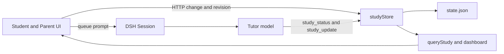
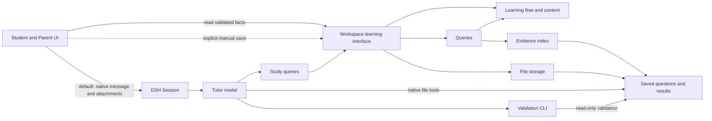

# Agent Note: 学生学习流程与证据架构

Status: proposed

[English](2026-11-12-student-learning-flow-architecture.md) | 中文

## 问题

student 需要一条可恢复的学习路径：确定目标、做一道题、得到反馈，再把结果用于下一次练习。家长需要一次完成设置、照片核对和批改，减少在对话与多张独立表单之间往返。

当前实现已拆分更新处理器、共用掌握度规则，并保存学生回答；文件缓存无法在已安装的 LocalFS 后端上跨请求命中。主要问题是完整操作的归属：Client 先保存状态，再另外排队发送辅导提示词；模型选择和发布内容、提交评分。部分身份、范围和确认规则在孩子作答后才检查，或仍是可以被实现绕过的指引。

本提案覆盖当前 student 子模块检出的 Host、Client、模型工具与 skill（技能）、课程与习题数据，以及测试。包清单版本为 0.1.8，DSH 依赖为 0.2.2-rc.1。以下是待实施方案。

### 现有操作路径

共用存储有价值，但共用文件不能保证 UI 请求、模型轮次和评分属于同一次操作。

| 路径 | 当前归属 | 需要处理的交接 |
| --- | --- | --- |
| 档案与学校进度 | 家长表单 → 更新处理器 | 课程保存后还要第二次保存进度；其他表单保留旧修订号。 |
| 开始与选择目标 | Client 选择 + Host 学习段 + 模型提示词 | 所选目标只在 UI 本地；主建议可以开始另一个目标。 |
| 出题 → 作答 → 评分 | 模型 task/record + UI answer/hint | 范围检查过晚；record 可以绕过已保存题目和回答。 |
| 打印 → 拍照 → 确认 | 练习单 + 转录草稿 + 家长批改 | 不同入口对题目关联、置信度和帮助程度采用不同规则。 |
| 复习与家长小结 | 重放 + 状态 + 洞察 + 工作台投影 | 时间失效与历史完成情况的计算口径不一致。 |
| OpenMAIC 课堂 | 辅导助手 shell + 独立课表文件 + UI | 外部生成与学习评分是不同操作。 |

### 已确认问题

以下问题均有源码和调用依据。Host 的身份、范围、练习单关联、时间和周报问题另用合成内存状态复现；家长连续保存问题在隔离的真实 DSH 浏览器复现。针对已安装 LocalFS 的只读探针确认：重复解析得到不同的目标对象，但稳定目标键相同。应先修复这些行为，再开展较大的结构调整。

| 顺序 | 可观察问题 | 依据 |
| --- | --- | --- |
| 先修 | 第二学习段允许复用 q1，但回答被当成已评分，反馈来自第一段。 | [session.ts:17,35](../../../../plugins/dsh-student/packages/winterhuan/student/src/learning/update/session.ts)；[status.ts:63](../../../../plugins/dsh-student/packages/winterhuan/student/src/learning/status.ts)；[learning-update.spec.ts:223](../../../../plugins/dsh-student/packages/winterhuan/student/tests/learning-update.spec.ts) |
| 先修 | start → record 没有 task 或 answer 也能保存独立答对；更换 record ID 还能绕过已请求提示题目的匹配。 | [session.ts:114–153](../../../../plugins/dsh-student/packages/winterhuan/student/src/learning/update/session.ts)；[plugin.spec.ts:76](../../../../plugins/dsh-student/packages/winterhuan/student/tests/plugin.spec.ts) |
| 先修 | 范围外题目可以发布并作答；评分才拒绝，下一题又因等待反馈而受阻。 | [session.ts:18,24,129](../../../../plugins/dsh-student/packages/winterhuan/student/src/learning/update/session.ts) |
| 先修 | 重新归类或删除错题，会改变或移除已批改卷题的目标。 | [view.ts:32](../../../../plugins/dsh-student/packages/winterhuan/student/src/learning/view.ts)；[paper.ts:18](../../../../plugins/dsh-student/packages/winterhuan/student/src/learning/update/paper.ts) |
| 先修 | 有转录草稿的练习单可以沿用同一组 ID 替换题面和答案，却保留旧草稿。 | [paper.ts:30–44](../../../../plugins/dsh-student/packages/winterhuan/student/src/learning/update/paper.ts) |
| 先修 | 转录置信度高的未判读题进入批量确认，并被转换为正确；手动批改还默认独立作答，没有保留已知帮助程度。 | [practice-view.tsx:228–233](../../../../plugins/dsh-student/packages/winterhuan/student/src/client/practice-view.tsx)；[paper.ts:83,108](../../../../plugins/dsh-student/packages/winterhuan/student/src/learning/update/paper.ts) |
| 先修 | 没有预建练习单的练习册照片确认后删除草稿；独立正确只清教学队列，没有把回答和结果保留为证据。 | [paper.ts:153–180](../../../../plugins/dsh-student/packages/winterhuan/student/src/learning/update/paper.ts) |
| 先修 | 修订号未变时，次日到期数可以从 0 变 1，条件轮询却只更新时间。 | [workspace.ts:39–40](../../../../plugins/dsh-student/packages/winterhuan/student/src/client/workspace.ts) |
| 先修 | 保存兴趣成功后，再保存服务地址报冲突，因为该表单仍使用首次修订号；课程与进度还分两次写入。 | [forms.tsx:20,29,85–95](../../../../plugins/dsh-student/packages/winterhuan/student/src/client/forms.tsx) |
| 随后 | 周报时长使用七个上海日历日，证据却使用过去 168 小时；复习重新排期后从完成分母消失；累计三个独立日期且近期答对的目标，即使当前仍薄弱或练习中，也可能计为新掌握。 | [status.ts:100–139](../../../../plugins/dsh-student/packages/winterhuan/student/src/learning/status.ts) |
| 随后 | 状态缓存以解析后的目标对象身份为键；LocalFS 每次解析都返回新对象，即使目标键相同，也无法复用跨请求的已校验状态。 | [store.ts:68,98,109](../../../../plugins/dsh-student/packages/winterhuan/student/src/store.ts) |
| 随后 | 更改年级后保留不匹配课程，新校内学习段仍能使用；显式跨册学习段又无法通过 elements 查询获取其目标的出题要素。 | [profile.ts:21,47](../../../../plugins/dsh-student/packages/winterhuan/student/src/learning/update/profile.ts)；[session.ts:87](../../../../plugins/dsh-student/packages/winterhuan/student/src/learning/update/session.ts)；[store.ts:163–165](../../../../plugins/dsh-student/packages/winterhuan/student/src/store.ts) |
| 随后 | 新题继承旧微步骤勾选；选择整册仍保留旧单元；仅修改卷题错因时不会提交，或被当成未变化。 | [today-view.tsx:221,243](../../../../plugins/dsh-student/packages/winterhuan/student/src/client/today-view.tsx)；[practice-view.tsx:190–201](../../../../plugins/dsh-student/packages/winterhuan/student/src/client/practice-view.tsx)；[paper.ts:85](../../../../plugins/dsh-student/packages/winterhuan/student/src/learning/update/paper.ts) |

### 模型与内容成本

已注册 study_update 的参数 JSON 有 59,400 个字符、34 个动作。task、record、worksheet、save-exercise 四个分支因重复完整题目与 23 种图形定义，占 42,058 个字符，即 70.8%；study_status 另有 1,868 个字符。这是实测字符量，不是 token 用量或模型质量测量。见 [tools.ts](../../../../plugins/dsh-student/packages/winterhuan/student/src/tools.ts) 与 [schema.ts](../../../../plugins/dsh-student/packages/winterhuan/student/src/schema.ts)。

12 份地图共有 117 个目标，题库有 122 道母题，每个目标至少有一道。用途覆盖尚不能提供完整教学题序：

| 科目 | diagnose | try | demo | vary | daily |
| --- | ---: | ---: | ---: | ---: | ---: |
| 语文 | 39 | 4 | 1 | 1 | 0 |
| 数学 | 30 | 2 | 1 | 1 | 0 |
| 英语 | 43 | 0 | 0 | 0 | 0 |

当前四个教学阶段是题目标签与模型指引，没有强制推进顺序。改造需要保留原创出题，并区分已校验的参考题与实际观察到的学生结果。

## 方案

默认操作入口是当前 DSH 原生对话。用户通过聊天发起档案设置、校内进度、开始与继续、作答与求助、照片处理、评分确认、练习单、归档和 OpenMAIC 操作；界面快捷动作也发送原生消息。agent 使用原生文件工具直接撰写正式业务文件，再运行只读 CLI 校验，应用校验读取并展示结果。显式使用手动表单时由应用保存。agent 写入与正式文件之间不增加候选变更区或 Host 接收工具。

Host 负责校验读取、学习上下文、证据解释和可用操作；模型负责执行用户意图、讲解、调整情境、准备内容、保存原回答、评分和推荐教学下一步。Client 以原生对话为主要入口，学习与家长面板展示已校验事实。对话、排队、附件、模型执行、草稿和文件系统授权继续由 DSH 承担。

产品结构为一条原生对话学习主线、三个家长信息入口；面板动作将完整操作意图发送给当前 agent，手动编辑作为显式补充。仍使用一个 student 包及明确的 Host、Client 构建面，DSH 固定在 0.2.2-rc.1。

### 已确认设计

用户已确认：全部业务操作默认直接与 agent 聊天，agent 直接撰写正式业务文件，CLI 校验，应用校验读取；显式手动界面操作由应用保存。范围包括档案、课程、学校进度、学习段、内容、回答、评分、错题、练习单、转录、归档与 OpenMAIC 课表。agent 不提交候选文件让 Host 发布；校验用于确保正确，不作为授予写入权限的步骤。

用户已确认主流程、文件读取与备份、迁移恢复、时间与同日顺序、提交反馈、工具预算、测试入口和交付方式。本提案记录待实施设计；规格可发布，代码实施另按任务开展。

| 选择 | 已确认结论 | 读取与恢复约定 |
| --- | --- | --- |
| 默认操作与写入 | 直接与当前 agent 聊天，快捷动作发送原生消息；agent 写正式文件并运行 CLI，应用校验读取；显式手动编辑由应用保存。 | 校验当前版本；不承诺发现所有原生无条件覆盖。 |
| 正式文件组织 | 一份学期设置、每个学习段一份、每张练习单一份；题面、回答与评分保留在所属实体内，OpenMAIC 课表独立。 | 读取前后核对目录成员与文件版本，再校验引用；不增加全局发布清单。 |
| 学习推进 | 应用展示可用操作，agent 推荐，学生明确发消息或点击快捷动作推进；阶段按证据适应性安排。等待评分时可结束或切换，迟到评分只归原题。 | 区分原生接收、回答保存、有效评分；未知状态先核对，再沿原实体恢复。 |
| 家长导航与设置 | 三个信息入口，默认在聊天中完成分步设置；显式手动编辑保留实体草稿，按实际字段识别冲突，课程与进度一次保存。 | 照片使用原生附件；逐题保留核对来源，完成反馈依据校验后的事实。 |
| 未知帮助与纸上结果 | 保留逐题回答、结果和帮助；未知帮助的正确不算独立，也不当已知求助，不自动批量确认。 | 家长明确核对；整张作答日允许逐题覆盖，改判不产生新回答。 |
| 观察日期 | 当下聊天回答使用可匹配的 Host 接收该输入版本时间并标明来源；纸上使用家长确认作答日。未知日期不进入依赖日期的掌握度、排期或小结。 | 保留时间精度；同日顺序未知时保留困难与近期复习，不抹掉真实独立日期或已获得阶段。 |
| 近七天小结 | 上海今天及前六日；首次掌握与经新作答恢复掌握分开。每条实际到期错题最多一次，纳入期初逾期，独立答对才完成。 | 按相关切点重放有效事实；重新排期不抹掉已完成，当前困难另外显示。 |
| 旧证据 | 保留原分类、时间、原文与旧来源；只把可核对的回答、帮助和实际日期计入新证据，接受部分旧掌握数字减少。 | 原始字节备份核对后由 agent 迁移；部分成功沿稳定身份恢复，旧插件恢复使用独立工作区。 |

主要验收入口为原生聊天 → 真实原生 write/edit → 构建后的只读 CLI → 应用校验读取。移除 study_update，保留查询与非 Web 使用，按需提供生成的 schema 与示例。六阶段分别审查，最终一次完整发布。原创出题、全部 23 种图形、复习间隔与 OpenMAIC shell 归属继续遵循既有决策。

### 目标模块

复用职责已合适的处理器和算法。新模块应消除实际调用方重复掌握的知识。

| 模块 | 接口与职责 | 复用的现有实现 |
| --- | --- | --- |
| 工作区学习 | read(query) 读取 agent 撰写的正式文件，供面板与模型查询使用；save(intent, expected) 仅服务显式手动编辑。默认快捷动作提交原生消息，无需先保存业务状态或另一次发布请求。 | studyStore 查询与显式界面更新分派。 |
| 学习流程与内容 | CLI 与应用共用正式文件 schema 和业务校验；题目显示前解析有效课程、显式范围、目标与内容；返回已校验学习上下文和合法下一步。 | curriculum、目标解析、摸底与复习计划、学习段处理器。 |
| 证据 | 从有效的屏上和纸上结果建立一份规范化索引；管理身份、目标关联、帮助程度和观察日期。 | 作答、纸上结果和既有重放规则。 |
| 查询 | 用同一索引生成当前上下文、进度、掌握度、复习、摸底、近七天小结和按页投影。 | mastery、schedule、status、view、dashboard。 |
| 文件存储 | 校验读取正式业务文件；支持应用保存、迁移、稳定文件版本缓存、包含关系、上限、应用保存版本检查与归档恢复。 | store 及已有文件系统与沙箱集成。 |

将 queryStudy 从 store.ts 移入查询模块。保留现有更新处理器族和穷尽 switch，动作归属无需第二个注册表。规范化证据索引由学习段回答与练习单结果在读取时派生，不再旁存一份证据总账。

### 正式文件组织

学期设置、每个学习段和每张练习单分别保存为正式业务文件。课程与已确认学校进度属于学期设置；学习段保存所属题目、原回答、提示和评分，练习单保存冻结题面、逐题目标、转录与确认结果。其他有界业务集合保留明确归属与稳定身份；OpenMAIC 课表保持独立生命周期。

题号在所属实体内唯一，文件中的学期与实体身份必须一致。agent 与界面操作使用同一批正式文件和 schema；不按每次动作或模型调用拆文件。跨文件引用须校验，多个实体的修改不承诺原子提交。

发现实体文件后，读取前后核对相关目录成员和文件版本，再校验身份与引用；读取变化只做有界重试，不增加全局内容哈希发布清单。相关文件不完整、损坏或无效时明确报错，保留原文件，将旧展示标为陈旧并暂停相关手工保存。独立且不受影响的有效数据仍可读取。

应用保留有数量与空间上限的已校验版本备份；备份不是另一份权威状态。用户明确选择恢复点，通过聊天让 agent 恢复并重新校验，保留无效原文件，不自动替换。CLI 保持只读。备份只保护实际观察或明确备份过的版本，无法覆盖所有未被观察的无条件覆盖；应用保存的版本检查也不能约束 shell 或其他原生文件写入。

### 身份与证据规则

按 [Student 术语表](../../../../plugins/dsh-student/GLOSSARY.md)区分 DSH 会话、学习段与题目。当前 attempt.sessionId 指学习段；新接口需要明确这一区别，并遵循仓库的 ID 类型规则。

| 事实 | 目标规则 |
| --- | --- |
| 学期身份 | 每次设置生成稳定 termId；应用保存检查学期身份与已观察文件版本，旧面板不能因修订号恰好相同而修改新学期。 |
| 屏上题目 | 用学习段与题号共同识别；科目、解析后的目标、来源和图形一起保存；CLI 与应用校验范围，题目通过校验后才作为有效题目展示。 |
| 原始回答 | agent 从原生对话保留学生原文和可用的消息来源，评分前写入正式记录；评分引用该回答，不能替换原文或题面。已帮助作答不能通过另一个 record ID 变为独立作答。 |
| 示范 | 讲解和例题属于教学内容，不能伪造为学生回答；阶段标签不证明理解。 |
| 纸上题目 | 冻结每题目标与完整发布内容；mistakeId 只作来源引用，后续归类或删除不能改变已有结果的目标。 |
| 内容修改 | 发布内容一旦被作答或转录使用就不可修改；换题或换卷使用新身份，保留原内容和证据。 |
| 置信度与帮助程度 | 转录置信度、结果、帮助程度分别记录；未知帮助的正确保留为已评分结果，不增加独立日期，也不当成已知求助。未评估结果保持未评估；手工与照片确认共用评分规则。 |
| 观察日期 | 当下聊天回答使用可匹配的 Host 接收该输入版本时间，明确标明来源与精度；匹配不足则未知，不能用稍后业务写入或评分时间代替。显式手工录入区分当下回答保存时间与补录的实际作答日。纸上以家长确认的实际作答日为准；未知日期不进入依赖日期的掌握度、排期和近七天统计。当前仍不会可另存当前求助信号。 |
| 更正 | 改判不产生新作答或新的独立一天；实际重做须有独立身份。保留原观察日期，另记更正时间。 |
| 重试 | 同身份的相同回答或评分返回未变化；冲突复用报错。无需增加无界操作回执表。 |

纸上日期保留日级精度，练习单可设置整张作答日并逐题覆盖，不制造午夜时间。收到、转录或评分先后不能替代实际作答顺序。同日正确、错误或求助混合且顺序未知时，保守保留困难与近期复习；真实独立日期、已获得阶段和每日最多一次推进仍保留。改判只更正原回答，不产生新作答。

规划新的校内学习时重新检查课程有效性。修改档案保留历史教材和学习段身份，但不匹配的旧课程对未来学习段变为待确认。继续允许活动学习段中编辑档案，同时保留该段的来源历史。

### 学生学习主线

主入口是当前原生对话；面板根据已保存学习状态展示当前题、结果与快捷消息。局部建议或课堂列表不能替代未完成题目。

1. 未设置时提供开始家长设置对话的主要动作；agent 在聊天中收集并确认档案，写文件并校验后即可通用基础学习，校内对齐随后配置。
2. 有未完成题目时显示继续本题；没有题目时显示所选目标或 agent 建议，以及实际科目、来源和活动。地图开始动作把所选目标发送给 agent，必须使用该目标。
3. agent 从一次原生开始消息解析目标与范围，引用合适母题或撰写原创内容、写入所属学习段并运行 CLI 校验；面板读取有效题目。
4. 学生直接在聊天中作答、请求提示或说明不会；agent 保留原文与来源，先写回答或求助事实，再评估。图形和可选微步骤由面板展示，等待反馈时保留原生消息及已保存回答。
5. agent 写入评分并校验，通过对话解释反馈与推荐下一步；应用展示有效结果和可用操作。学生明确发继续消息或点击快捷动作后换题，保留当前回答与反馈。
6. 浏览科目不暗改当前题。学生在聊天中结束或开始另一学习段，agent 收束旧段并保留原题与未评估回答；迟到评分只归原题，不重开旧段或替换当前题。恢复反馈沿用同一题目身份，结束不要求复述或限制时长。

适应性使用 demo → guide → try → vary。已有能力证据时可以从 try 开始；保存不会信号后，下一步建议教学或前置支持。不要要求每个学生机械走完四阶段，也不要把阶段推进当成掌握。

到期复习继续作为小副卡，最多处理当前 dueToday 选择，不阻挡新学习。摸底、探究、每日小卷和兴趣情境继续作为开展所选活动的方式。

### 家长入口与操作

三个家长入口展示任务、记录和进度；默认处理动作发送到当前原生对话，不以填写多张独立表单作为主要流程。显式手动编辑保留应用保存能力。

| 入口 | 承担任务 | 对现有导航的调整 |
| --- | --- | --- |
| 待处理与练习记录 | 展示转录、待核对、批改、到期事项和可筛选的练习单、错题历史；处理消息交给 agent。 | 待处理优先，照片与核对在原生对话完成。 |
| 知识与进度 | 展示目标地图、定义、关系、证据、摸底与练习选择；所选目标与范围通过消息交给 agent。 | 概念并入地图；收藏为详情中的快捷消息。 |
| 档案与小结 | 展示档案、校内确认、兴趣、OpenMAIC 与学期记录；默认修改、归档或生成课堂通过聊天执行。 | 课程与进度作为一次完整意图；手动编辑为显式补充。 |

首次使用在聊天中确认档案，再按科设置校内对齐；agent 将教材、课程和可选的已确认进度作为完整意图写入一份学期设置并校验，不阻挡基础练习。后续进度可通过聊天独立修改；显式手动设置保留课程与进度一次保存的接口。

用户通过原生聊天发送照片并说明已有练习单、练习册页或新错题的用途；agent 核对关联、保存转录并运行 CLI，家长在聊天中明确逐题结果、帮助与日期，agent 再写确认记录。面板区分已提交、待转录、待核对与已记录；格式校验不代表答案正确或已经确认。附件沿用 DSH 原生路径，重试沿用原照片、消息与练习单身份；显式手工核对仍由应用保存。

聊天确认与显式手工批改共用规则：批量确认只纳入判读明确正确、转录置信度高且帮助已知的题目；答错、半对、存疑和未评估题逐题明确裁决。手工批改须保留或确认帮助，包括错因在内的全部可编辑字段参与变更判断。agent 不能把没有明确家长核对的转录建议当作确认。

显式手动表单按学期与实体保留草稿。刷新、轮询和切换保留编辑；未编辑表单使用当前版本，已编辑表单只有在原字段与最新字段一致时才可换用新基线。相关字段变化时显示当前值并保留草稿，应用保存执行文件 CAS；原生聊天草稿沿用 DSH，不另存一套。

### 提交与恢复

默认动作通过 [AskTutor](../../../../plugins/dsh-student/packages/winterhuan/student/src/client/bridge.ts) 所用的原生 Session 提交消息与附件，返回 requestId 和接收结果；不先保存插件业务状态、再额外排队辅导提示词。复用原生输入框、草稿、附件和提交反馈，不建设另一套 student 聊天或队列。agent 保存业务事实并运行 CLI，视图接收精简事实与发送消息的动作。

区分原生消息已接收、业务回答已保存和有效评分已保存；聊天回执、agent（智能体）的 running 标志与解释文字都不是业务完成证据。已有回答而无评分时，用户通过聊天请求同题反馈；缺少正式回答时，agent 先从原生消息恢复原文再保存。重复处理保持同一回答身份，不重复证据。

已核对的[原生 Session 事件](../../../../upstream/packages/api/session-controller/src/types.ts)保留事件时间与消息来源。输入版本插入 inbox 的事件时间表示 Host 接收该版本；user/message 时间表示稍后的消费，均不能证明精确点击或磁盘保存完成时间。[队列编辑与移队](../../../../upstream/packages/api/session-controller/src/commands.ts)保留消息 ID 与 rpcId，因此不能仅按 ID 取首次或最后一次插入时间。须核对实际消费的内容版本及其有效接收事件；无法可靠匹配时保留未知，不能借用评分时间。原生回执不提供业务保存保证，Session 持久化的 flush 保证与业务文件校验分别核对。

原生提交失败沿用 DSH 草稿与重试规则；agent 写文件或校验失败时，面板不能显示业务已保存，用户可沿原消息与实体请求修正或继续。状态未知时不自动重发，断线后先核对原生请求和正式记录，再沿原题、回答及附件恢复。重载不为恢复而创建新学习段、回答或练习单；不声称原生传输恰好一次或回执已完成持久化。显式手动保存失败保留表单草稿，另行报告实际结果。

### 工具与内容接口

保留 study_status、/study 和非 Web 管理；原生聊天是全部业务操作的默认入口。所有 agent 业务改动直接编辑正式文件并运行 CLI。移除 study_update，同步更新注册、skill、提示词、文档与示例；不保留旧写入能力或迁移提示工具。正式文件 schema 与示例按需读取，应用类型化保存接口仅用于显式手动编辑。

| 操作 | 目标输入或结果 |
| --- | --- |
| study_status：learning-context | 学期身份与实际文件版本、活动学习段、题目、已保存回答、待反馈状态、合法下一步、目标事实与来源及方法、提示阶梯、最多三条相关母题；支持显式范围与已确认自定义目标，通过只读查询提供可核对的原生输入版本来源与接收时间，匹配不足则未知。 |
| 正式业务文件 | agent 直接读取、创建和修改；CLI 与应用校验实际文件，不增加写入接收工具。 |
| 题目、练习单与收藏习题文件 | agent 直接撰写严格内容对象或已有内容引用；CLI 与应用校验格式、身份、关联及适用条件。 |
| 评分记录 | agent 在所属学习段或练习单中撰写题目身份、结果、反馈和答案依据，再运行 CLI 校验；校验检查关联的已保存题目与回答，并保留已知帮助程度。 |
| 其他业务记录与转录 | 家长口述修改、学习段操作、错题与照片录入、归档等全部采用正式文件；转录与逐题确认保留在所属练习单内。保持已确认编辑与待确认录入的区别，OpenMAIC 课表纳入 CLI 校验。 |

正式业务文件是 agent 与界面改动的唯一持久事实来源。agent 使用 DSH 原生文件工具直接创建和修改，再调用随 student 发布的只读校验 CLI；应用读取并校验同一批文件，不把候选变更复制到另一份正式存储。内容沿用严格的题目、练习单和图形 schema。按实体核对目录成员、版本与引用，无效或中断写入按上述读取与恢复规则处理。

固定 DSH 组合[停用文件观察策略](../../../../upstream/packages/bundle/base/cordis.patch.yml)，原生 write/edit 默认可以无条件覆盖。CLI 的事后校验能检查当前内容、引用及可核对来源，不能完整检测或恢复被覆盖的历史；应用版本检查和有限备份不扩展为所有原生写入的并发保证。应用刷新以实际文件版本为依据，不依赖 agent 递增 revision。

CLI 输出有界的机器可读结果：成功时给出文件身份、种类、内容版本与已核对的状态版本，失败时给出文件路径、错误字段、违反的规则和修正建议，并以非零退出码结束。agent 根据结果直接修改文件，重新运行校验；CLI 不代写内容、不自动修复，也不在校验时更新学习记录或修订号。

CLI 与应用共用正式文件 schema 和业务校验规则，检查可从已保存事实核对的身份、范围、关联回答、帮助程度与确认条件；显式手工保存执行相同规则和版本检查。校验成功只适用于该次读取的文件版本，后续修改须重新校验。校验检查实际文件与业务条件，不能信任 agent 自述或旧 CLI 输出，也不作为授予 agent 文件写入权限的步骤。

CLI 入口随固定 Git 发布包提供，skill 明确说明实际可执行位置、调用方式、支持的文件种类、schema 与示例的读取路径，不假设全局 PATH 已注册。开发检出与远程安装都须验证直接写文件、运行 CLI、修正失败和重新消费的完整路径。

从同一源码定义生成各类正式业务文件的机器可读 schema 和有效示例，作为按需读取的 skill 资源。不能用未经校验的通用 JSON 代替严格业务数据，也不能手写第二份图形或业务 schema。正式记录与归档保持有界，不增加候选变更总账或另一份权威副本。

每次 agent 业务改动使用直接写文件和 CLI 校验，校验失败还会增加修改与重跑。母题引用可以减少文件内容，仍需校验。正式文件 schema 按需读取，不常驻在业务写入工具参数中。用同一注册探针核对 Student 常驻工具参数 JSON 总量不超过 30,000 字符；同时测量工具定义、schema 读取、CLI 输出、首轮与继续轮次 token 及完整流程调用成本，不能把字符减少直接当作 token 或质量改进。

让 skill 与可执行行为一致：允许显式跨册范围，目标上下文按该范围解析；安装包内课程 facts 由发布维护。没有工作区 facts 更新操作时，停止要求辅导助手修改发布内容。用户资料保留为带引用的输入，可编辑知识覆盖层另作功能决策。修正超过 schema 限制的图形示例。

### 查询、时间与 Client 集成

按页面生成今日活动、待处理练习、知识与进度、档案与小结投影。完整地图与历史按需加载；修正服务端缓存，使用稳定文件身份与已观察版本，并在一次投影计算中共用证据索引。

完整投影返回 refreshAfter，有效性同时考虑学期身份、正式文件实际版本、查询身份及全部相关时间阈值：上海日界、未来到期时刻、近七天小结窗口、10/14/35 天证据规则、摸底间隔。已学时钟可以单独轻量更新；活动中的小结分钟数同样需要轻量更新。跨过阈值或发生文件编辑后重算相关投影，不能只因 revision 相同就返回未变化。

小结使用上海今天及前六个日历日，名称为近七天。首次掌握统计本学期首次由有效作答达到掌握、且当前仍掌握的目标；恢复掌握另列经新作答从薄弱或到期恢复的目标。再练已掌握目标、或仅因错误或帮助证据随时间过期而恢复，不计为新学会。历史状态按各时间切点可用的事实重放；不能把当前完整状态换一个 now 当作过去状态。

复习完成以学期与错题身份计数，不以目标代替错题。纳入窗口开始时已逾期、或窗口内真正到期的错题，每条最多一次；只有到期后的有效独立正确算完成，错误、提示与未评估不算。未到期前提前成功取消旧排期，不将从未实际到期的旧机会计入分母。重新排期不抹掉已完成；同条错题之后再次困难时，当前待复习与支持需求仍反映最新状态。更正按有效证据重新计算小结。

通过插件自有的类型化 Remote 对象与 DSH Client 资源暴露工作区模块。声明方法触及的会话与工作区资源，通过 Typert 绑定类型，以 effect 注册贡献。业务操作留在 student，不修改 upstream，也不扩展通用 DSH 控制器。

Client 资源管理读取、加载与失败状态、订阅和释放。提供方仍负责条件轮询或既有注册流；接入 useResource 不会自动消除刷新工作。替代实现覆盖陈旧响应、取消及错误时的数据保留后，再删除 useStudy 的重复 React 读取生命周期。草稿状态按会话、学期和实体声明，不能复制掌握度或复习历史。

传输迁移须保留权限检查、主会话限制、陈旧写入拒绝和文件系统策略。使用 DSH 已注册的访问控制，不通过放宽 trustedStudyRequest 来支持远程主机。声称远程可用前，须通过实际浏览器路径验证发布产物及已配置代理。

### OpenMAIC

生成、轮询和重试继续由辅导助手 shell 使用既有 cookie jar 完成。agent 直接撰写独立课表文件并运行 CLI 校验，Host 保持已校验读取，浏览器打开外部课堂。区分生成课堂、打开课堂和课后巩固证据记录。主活动只关联相关目标的课堂，旧课收进最近课程。

课堂 URL 或可上课记录不能证明孩子已上课或理解。课后题沿用同一出题、作答与评分路径。本提案不引入 Host 代理、嵌入播放器或课堂后台运行时。

### 数据迁移与归档

为学期身份和稳定内容、证据关联引入 student 状态格式 v2。这是插件文件格式变更，不是 DSH 会话格式变更。读取 v1 不修改文件；默认由对话中的 agent 在转换前保留并核对原始字节备份和源文件版本，再直接撰写新正式文件并运行 CLI。应用校验当前文件，显式应用保存执行版本检查；来源变化或结果不完整时明确停止并报告可恢复的部分结果。

迁移与归档保留稳定学期和实体身份，新设置生成新学期身份；应用保存检查学期身份与已观察文件版本。agent 核对新旧身份、来源和备份，不覆盖已有原始备份；部分完成按同一身份核验、修正并继续，已有有效归档不因重试而重复生成。读取不迁移，CLI 不创建备份或替换文件；旧插件恢复使用已核验 v1 备份和独立工作区，不原位降级。

只冻结可从明确保存字段或已核验归档快照恢复的关联。旧卷题的原目标若依赖可变错题记录，保留原题面与结果，并把无法确定的关联标为待核对；不能根据当前错题归类猜原目标。保留旧分类与时间，并标明旧来源；评分或接收时间不能直接转换为实际作答时间，默认独立分类不能证明家长确认过帮助程度。只有可核对回答、帮助与实际日期的记录进入新证据，其余保留待核对并显示统计缺口。

仍保存的同身份题目或已核验归档可以提供部分回答时间和帮助依据；历史屏上作答时间、已消费的独立正确练习册草稿及未保存的更正历史不能普遍恢复。接受部分旧掌握数字减少，不能为维持数字而补造日期、帮助或目标关联。

保留集合与文件上限，不覆盖损坏或未来版本文件，并保存归档证据。备份或导出与状态替换是独立写入；明确报告部分成功，并允许针对同一归档身份恢复，不能称为原子事务。OpenMAIC 课表保留现有独立生命周期。

### 既有决策归属

限定范围的笔记检查没有发现更早的活动 student 架构提案；尚未实施的本提案也没有完全取代任何已实施决策。保留以下活动记录。实施时在所属改动中更新其机制，并与实际被替代的决策交叉链接。

| 活动记录 | 保留的指导 |
| --- | --- |
| [学习模块](../../implemented/simplification/2026-10-25-student-learning-modules.zh.md) | 处理器归属、穷尽分派、编译期动作权限覆盖。 |
| [读路径](../../implemented/simplification/2026-10-25-student-read-path.zh.md) | 文件版本缓存、单一掌握度规则、完整投影读取成本。 |
| [模型指引](../../implemented/simplification/2026-10-25-student-model-guidance.zh.md) | 教学指引单点维护，提示数据来自目标定义。 |
| [全面改造](../../implemented/feature/2026-10-30-student-overhaul.zh.md) | 无时长限制、习题库、当前复习曲线、学习中可编辑。 |
| [归档与批改](../../implemented/feature/2026-10-25-student-archive-grading.zh.md) | 家长批量确认、派生字段不落盘、学期证据导出。 |
| [OpenMAIC](../../implemented/feature/2026-10-28-student-openmaic-lessons.zh.md) | shell 与 cookie 归属、独立课表生命周期。 |

[学习决策](../../implemented/feature/2026-10-05-student-learning.zh.md)、[学校进度界线](../../implemented/feature/2026-10-14-student-school-frontier.zh.md)和[前置与间隔决策](../../implemented/feature/2026-10-25-student-prerequisite-spacing.zh.md)继续约束来源、家长确认、默认范围与复习。保留 1/7/16/35 天间隔、同日推进限制、提前独立答对可推进、不降阶段和既有反复错误处理。单纯浏览地图不授予学习范围。

### 分阶段实施

六阶段分别形成可审查的结果，全部完成后一次完整发布，阶段 1 不单独发版。行为修复与模块移动分开提交；运行所影响插件的检查并同步文档。发布遵循 HANDOFF 的子模块优先流程。

| 阶段 | 具体结果 | 完成依据 |
| --- | --- | --- |
| 1. 修复现行约定 | 为题目身份、评分绕过、发布前范围校验、冻结卷题关联、批量确认、时间失效、家长复合保存增加回归并修复。 | 无效路径被拒绝；真实工具与 UI 保留有效回答和草稿。本阶段无需架构重写。 |
| 2. 统一流程、证据与查询 | 提取共用索引与查询模块，保存已解析学习意图，修正小结，实现 v2 读写迁移。 | 用同一组合成及复制的旧数据比较前后结果，只列出有意修正的差异。 |
| 3. 接入 DSH 传输 | 插件自有只读 Remote 与资源、原生消息及附件提交回执、effect 所有的回调与原生草稿；显式手工保存使用独立类型化接口。 | 构建包 Loader 冒烟、访问检查、原生消息回显、重连与释放验证。 |
| 4. 重建用户流程 | 原生对话为主要操作入口，快捷动作发消息；学生状态与家长三个信息入口读取结果，手工编辑为显式补充。 | 真实隔离 DSH 的聊天、照片、两种主题、窄侧栏、键盘与焦点、打印检查。 |
| 5. 完成全部原生对话业务操作与教学上下文 | 所有默认业务意图交给 agent，直接写正式文件、随包 CLI 只读校验；应用校验读取，提供生成的 schema 与示例、跨册上下文与同步 skill，手工保存共用规则。 | 原生消息覆盖全部业务意图，正式文件与 CLI 成败核验、参数与完整调用成本、母题及 23 种图形、固定 Git 包与非 Web 使用。 |
| 6. 演练迁移与发布 | 复制的真实格式数据、归档中断恢复、固定 Git 包、远程安装、最终双语文档。 | 重启与数据比较、typecheck/build/test、所改接口的 doc-sync 和 hygiene、真实 DSH 验收。 |

建议从阶段 1 开始。新导航不能修复错误证据，拆更多文件也不能建立题目身份或恢复失败提交。

## 备选方案

**整理文件并重做工作台样式。** 能保留现有交互方式，但不能修复评分绕过、证据目标可变、部分保存或时间失效。约定明确后，阶段 2 仍可进行纯模块移动。

**使用 SQLite、事件溯源或通用工作流引擎。** 会增加存储迁移、执行策略与生命周期义务。已发现问题有明确的身份、证据和时间成因，现有有界文件与 DSH 执行方式足以支持改造。

**候选文件与 Host 接收。** 可以保留受控发布步骤，但用户选择直接撰写正式业务文件、应用校验读取；不增加候选变更区，也不要求另一个业务工具让 agent 文件写入生效。

**表单驱动业务、聊天只作讲解。** 会保留业务保存与辅导消息的两次交接，默认操作仍依赖多张表单。用户选择全部业务意图直接发送给当前 agent；面板读取结果，显式手动编辑保留应用保存。

**拆成多个教学工具，或只暴露八个常用动作。** 工具名称增多不会消除重复业务 schema；额外管理模式增加发现和切换步骤，或丢失 /study 及非 Web 家长管理。保留查询，将正式文件的严格 schema 放入按需读取资源，通过 CLI 校验直接文件写入。

**让每个目标都强制走完四阶段。** 推进可预测，但当前题库没有覆盖全部阶段，已有能力的学生还会重复不必要的示范。采用适应性下一步和明确证据，不把阶段标签当成掌握保证。

**只从既有题库取题。** 虽覆盖全部目标，但主要提供摸底题；会失去原创情境、变式与配图，也不足以支撑每日教学。保留母题引用与已校验原创草稿。

**把 OpenMAIC 移入 Host。** 会改变已明确的 shell 与 cookie 归属，并增加长期运行的集成。不能解决核心作答与评分问题；保留当前集成，改善入口和反馈。

## 验收标准

每个场景通过实际消费接口核对保存文件或用户可见结果。处理器自己的返回值、模型自述、agent running 标志都不能单独作为完成证据。

| 场景 | 必须得到的结果 |
| --- | --- |
| 默认操作入口 | 档案、进度、开始、继续、作答、求助、照片、核对、练习单、归档与课堂请求通过当前原生对话执行；快捷动作只发消息，业务文件由 agent 写入并校验，显式手工编辑由应用保存。 |
| 两段复用 q1 | 原生对话中的两段分别保留自己的原回答、显示自己的反馈，不串旧评分或微步骤勾选。 |
| 无效评分与范围 | CLI 与应用校验拒绝没有已保存回答、身份不匹配、帮助程度矛盾及范围外题目；无效文件不作为有效证据展示，agent 仍可直接编辑修正。 |
| 打印、转录、归类与删除 | 已发布题面和已批改目标稳定；来源错题编辑或删除不移除、重定向历史。 |
| 照片确认与改判 | 高置信未知、错误、半对题不能变为批量正确；照片与手工路径一致处理帮助程度及仅错因修改；改判不产生新独立一天。 |
| 没有预建练习单的练习册照片 | 草稿消费后仍可读取每题已确认回答与结果，包括独立正确结果。 |
| 重复读取与直接文件编辑 | 稳定文件身份与未变化的已观察版本允许缓存复用；原生文件编辑使受影响的已校验数据与查询失效。 |
| 目录变化与无效文件 | 读取前后目录成员或文件版本变化时有界重试，仍不一致或引用无效则明确失败；保留原文件、标明旧展示陈旧并暂停相关手工保存。 |
| 有限备份与明确恢复 | 已校验版本备份遵守数量与空间上限；用户选择恢复点后由 agent 恢复并校验，不自动覆盖无效原文件，不声称保护从未观察过的版本。 |
| 没有写入的时间变化 | 跨日、到期、证据阈值和近七天窗口时，同修订号下数量与建议及时刷新；未变化轮询保留低成本路径。 |
| 近七天证据 | 复习重新排期后已完成事项仍在小结；再练已掌握目标不直接算新增掌握。 |
| 家长连续编辑 | 默认连续聊天意图由 agent 保存到对应文件并校验；课程与进度一次写入。显式手工编辑无关更新保留草稿，真实字段冲突保留编辑，保存不串旧版本。 |
| 目标、科目与显式范围 | 所选目标就是开始目标；整册选择清除旧单元；跨册上下文匹配活动范围；不匹配校内课程对新学习段要求确认。 |
| 提交、切换与重启 | 区分原生消息接收、业务回答落盘和有效评分；失败沿原消息、题目与附件恢复，等待评分可结束或切换，迟到反馈只归原题，不重复作答、练习单、星星或证据。 |
| 未知帮助与日期 | 未知帮助的正确不当已知求助、不计独立日期；未知作答日不制造近期错误、复习排期或近七天结果，原记录与待核对状态仍可见。 |
| 原生时间与同日顺序 | 匹配真正消费的输入版本，队列编辑或移队不误用 ID 的首次或末次插入时间；纸上日期不制造时间或顺序，同日混合结果保留当前困难、真实独立日期和已获得阶段，改判不增加回答。 |
| 模型定义与原创内容 | 移除 study_update，保留查询入口、口述管理及 23 种图形；用相同注册探针核对 Student 常驻工具参数 JSON 总量不超过 30,000 字符，完整调用数与真实 token 另行报告。 |
| 全部 agent 写入与 CLI 校验 | 全部默认消息业务动作直接编辑正式文件并运行 CLI，无候选接收步骤。校验只读，失败给字段错误和非零退出码；应用校验实际当前文件，手工保存共用规则。并行写入和无效文件恢复有已确认验收，固定 Git 包中可发现并执行 CLI。 |
| 旧档案迁移、换学期与归档中断 | 保留原分类、时间与旧来源，只把可核对事实计入新证据；缺失关联、日期或帮助的记录待核对，原文件和导出可用；即使修订号相同也拒绝旧学期请求；导出成功而状态失败可见、可恢复。 |
| 真实 Client 与非 Web 使用 | 构建包 Loader 与隔离浏览器覆盖原生聊天及快捷消息、模式范围、主题、窄面板、键盘与焦点、打印布局、重连与附件；/study 无浏览器仍能通过原生对话设置、教学和家长管理。 |

主要自动验收入口为原生聊天 → 真实原生 write/edit → 构建后的 CLI → 应用校验读取，使用确定性模型替身验证真实工具和消费结果，显式手工保存另测。真实隔离 DSH 与 Loader 使用临时 Home/Documents、port 0、受控时钟和并发屏障，等待清理完成；不以宽松重试或固定睡眠代替竞态核验。无密钥回归不证明真实教学或识图质量。

### 本次提案核验

2026-11-12，当前 student 检出通过 pnpm run typecheck、pnpm run build、pnpm test：16 个文件、159 项测试。这是现状基线，不是新方案实现的验收；上述问题暴露了绿色基线缺少的场景。

在隔离 DSH Home 与 Documents 目录中，ego-browser 加载链接安装的 student 构建包；用虚构学生走查模式选择、首次设置、家长导航与连续设置保存，并复现表单修订号陈旧。临时本地证据位于 Git 之外的 /tmp/dsh-student-audit-20261112.uaOMnG；启动凭据不写入提案。

本次未进行真实模型教学、视觉识别、OpenMAIC 请求、实体打印或远程代理验收。相应实施场景须有无密钥记录会话回归；质量依赖模型的部分另做真实模型抽查。UI 走查不能证明教学或识图质量。

## 风险

旧卷题关联可能已经漂移，原目标并非总能恢复；部分旧结果可能在核对前不计入目标掌握度。保留原记录并显示这一缺口，不能为维持小结数字而制造历史关联。

按需读取正式文件 schema 可以减少常驻业务定义，但每次 agent 改动使用直接写文件、CLI 校验与失败修复调用。schema 描述、CLI 发现或输出不足可能增加总调用量；须测档案、学习、照片、练习单与归档的完整路径，不能只看字符量。CLI 格式与业务校验也不能证明模型答案正确或家长陈述真实。

状态 v2 升级后，旧插件不能安全写入。保留已核验 v1 备份，说明恢复到独立工作区的方法，并演练备份与归档的部分结果。不能承诺原位降级或跨文件原子迁移。

更强的操作结构仍不能认证模型输入陈述的真实性；插件不认证家长，也不保证 AI 答案。保留明确确认、原始回答和未评估结果，通过真实原生工具路径验证，不能只依赖提示词。

新导航改变常用入口，传输集成改变运行时接线。保留学习活动的可发现性和原生草稿、附件行为，并在实际发布包中比较失败与访问行为。迁移完成后删除被替代机制，不能长期维护两套。

