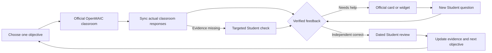

# Agent Note: Student learning follows official OpenMAIC

Status: proposed

English | [中文](2026-11-22-student-openmaic-learning-loop.zh.md)

## Problem

Student already has objectives, responses, assessments, weaknesses and mistake review, but children must choose among practice, classroom generation, recent lessons, consolidation and parent information. Parents also manage service addresses, queries and retries. The user wants a simplified design and phased checklist first: make official `dsh-openmaic` the classroom core so children can keep using it. Existing data must be merged, with one source exercise per question family in the bank.

The current [TodayView](../../../../plugins/dsh-student/packages/winterhuan/student/src/client/today-view.tsx) presents classrooms, today's plan, interest practice, due reviews, other activities, printing, understanding reminders and diagnostics together; it falls back to any ready classroom when none matches the recommended objective. The [lesson list](../../../../plugins/dsh-student/packages/winterhuan/student/src/client/lessons-view.tsx) separately exposes generation, queries, retries and consolidation. [Prompts](../../../../plugins/dsh-student/packages/winterhuan/student/src/client/prompts.ts) and the preset still require shell/curl operations against a local service. These capabilities need an ordered path rather than more parallel entries.

### Official preview evidence

On 2026-11-22, the [official plugin](https://github.com/THU-MAIC/dsh-openmaic) 0.4.0 was installed and tried in the isolated `openmaic-preview` profile on DSH 0.2.2-rc.1, pinned to `09c1693cfe83224db89fdd4abd245ac9174d3a05`. Student source inspection and this official preview are separate evidence. The daily Student installation and learner data were unchanged.

| Official capability | Observed result | Use in the new Student |
| --- | --- | --- |
| `openmaic_generate` | The native call returned HTTP 425 `ANON_IDENTITY_REQUIRED`, creating no task; it was not retested after configuring accessCode. | Primary generation entry for complete classrooms; authentication and recovery need acceptance first. |
| `openmaic_widget` | The make-ten widget's three interactive steps worked; refresh reset interactions and fullscreen layout was broken. | Demonstrate a method through manipulation in the native conversation. |
| `openmaic_render` | Correct/incorrect feedback in an inline quiz worked; a later generation corrected an explanation. | Short concept cards, hints and remedial teaching; interaction scores do not directly become learning evidence. |
| `openmaic_slide`, `openmaic-teach` | Capability declarations were inspected, without independent teaching acceptance. | Supply slide presentation and guided-question teaching respectively, loaded on demand. |
| Complete classroom on the official website | After login, a failed scene was resumed and all seven pages completed; playback, navigation, interaction and the quiz were tried. | Establishes that the complete classroom form works; does not establish native plugin generation. |
| OpenMAIC quiz runtime records | Login cookies read two actual attempts, grading and stable record identities from the hosted service in the browser and backend; anonymous and other-learner requests return 403. | Verified read foundation for classroom-response synchronization; Student import and long-term authorization maintenance remain unverified. |

The [make-ten demonstration classroom](https://open.maic.chat/classroom/stage-MuBk6lq-L0pF?ref=share) contains an introduction, explanation, interactive demonstration, method review, practice, quiz and summary. It is a playable interactive classroom rather than an exported video. Actual audio and PPTX export were not verified.

A single-choice classroom question accepted “split into 2 and 4” but rejected the equivalent “split into 4 and 2” during browser observation; the later persisted records establish only submissions of A and B, not a submission of D. Generation success cannot guarantee content quality. The official generation client keeps `openmaic_access` only within one call, fetches the returned pollUrl directly, and provides no callable recovery tool after timeout. Successful access-code verification also produced no observed cookie of that name; the official plugin does not reuse browser account credentials. Native generation authentication, same-origin addresses and durable recovery are initial engineering gaps.

Additional inspection of OpenMAIC revision `ce7f05a8ae915df3de2e5dfbbe68cd7f7d79a0e6` found [quiz writes](https://github.com/THU-MAIC/OpenMAIC/blob/ce7f05a8ae915df3de2e5dfbbe68cd7f7d79a0e6/lib/quiz/runtime.ts) recording draft/submitted/reviewed, answers and results; [runtime storage](https://github.com/THU-MAIC/OpenMAIC/blob/ce7f05a8ae915df3de2e5dfbbe68cd7f7d79a0e6/packages/%40openmaic/storage/src/runtime/http.ts) lists sessions for a stage/learner and reads their records; the [hosted-service route source](https://github.com/THU-MAIC/OpenMAIC/blob/ce7f05a8ae915df3de2e5dfbbe68cd7f7d79a0e6/app/api/persistence/%5B...path%5D/route.ts) authorizes the request owner and refuses other learner partitions. Source timestamps are caller-supplied display metadata, and quiz payloads lack assistance or question snapshots. Missing DSH-tool feedback therefore does not mean the classroom has no records, but those records require additions before becoming valid Student evidence.

Hosted tests on 2026-11-22 returned 200 for the current account's learner-key, sessions, records and classroom questions. Two actual attempts contained seven draft/submitted/reviewed records with original option values, grading, attempt/record IDs, seq and client timestamps; repeated backend reads preserved identities and content. A backend request carrying only the login `auth_token` cookie succeeded; anonymous and synthetic other-learner partition requests returned 403, while a Bearer-only request returned 404 for this session. The `.env` access code verified successfully without issuing `openmaic_access`; its standalone flow still returned 403 when reading the current learner partition. Credentials remained in test memory and were absent from business files and evidence. Current questions are readable, but historical question versions, assistance, trusted answer dates, long-term login maintenance and Student import remain unverified; reviewed means grading completed, not spaced review completed. Local evidence is in `~/.dsh/profiles/openmaic-preview/feedback-verification/`.

The inspected official source also exposes a [stage manifest](https://github.com/THU-MAIC/OpenMAIC/blob/ce7f05a8ae915df3de2e5dfbbe68cd7f7d79a0e6/app/api/stages/%5Bid%5D/manifest/route.ts) with monotonic stage/scene revisions, which detects content changes but does not recover historical questions. Hosted availability was not tested. A Student adapter cannot reconstruct assistance or actual answer dates absent from original records. Inline widgets currently report height only and retain no response events or interactive state; using them for instruction does not require treating their scores as evidence.

## Proposal

Make Student organize learning while official OpenMAIC supplies classrooms and teaching presentation. Children have one primary Learning entry with one objective and one next step; Parent contains setup and records. Native conversation still executes operations, and shortcut buttons send complete intents. Existing official files store responses and assessments, with shared CLI and application validation.

This proposal specializes the [learning-flow proposal](../architecture/2026-11-12-student-learning-flow-architecture.md), retaining native conversation, direct file editing, assistance and actual-date rules. It proposes replacing that proposal's primary OpenMAIC shell path, parallel navigation and duplicate bank entries, and changes generation ownership and archive retention in the [external classroom record decision](../../implemented/feature/2026-10-28-student-openmaic-lessons.md). The rationale for separate generation logs, isolated credentials and browser playback still applies. These changes remain proposed until implemented.

Classroom-response synchronization and feedback into later teaching are required in the first usable version rather than deferred options. The learner's path starts with a learning need/objective; source exercises organize teaching and variations internally, without requiring the child to select one first.

The first version uses hosted official classrooms with automatic response import and supplementary checks/reviews recorded in Student. It does not depend on the hosted service adding every evidence field. Unknown facts remain unknown; completing the loop requires saved actual responses to change the next learning task. Full in-class assistance/version/time capture and inline-widget response synchronization are later extensions, requiring supported official changes or a controlled compatible service.

Once a parent confirms the learning scope and school progress, Student recommends objectives, prepares lessons and organizes remedial teaching and review within that scope without per-lesson approval. The child explicitly chooses Continue, Change content or Rest; automatic preparation does not authorize automatic successive questions. Changes outside the confirmed scope need parent confirmation.

### Defining and selecting learning goals

A goal states a checkable capability with applicable constraints and assessment criteria. For example, “calculate two-digit subtraction with borrowing within 100” is a capability goal, with checking as a separate capability; “finish Unit 1” is a course-coverage description. Organize goals as subject → capability area → checkable goal. Grade, textbook and unit are curriculum associations, methods are teaching attributes, and new learning/remediation/review are uses of the same goal rather than duplicate goals.

Derive candidate goals from verified curriculum requirements and teaching materials within the parent-confirmed scope. School progress limits default new-learning candidates; actual responses and compatible historical evidence identify prerequisite gaps and remedial needs. Keep the current unfinished activity first, then its gaps, bounded due review and the next learnable school-aligned goal. When prior evidence is missing, use a short targeted check rather than assume the learner knows nothing or require a complete exam. OpenMAIC teaches the selected goal; generated suggestions must pass scope, source and assessment checks before becoming goals. Interests usually change the scenario rather than create another copy of a capability.

| Subject | Capability areas | Example goals for the redesign |
| --- | --- | --- |
| Mathematics | Numbers/calculation, shapes/directions, measurement/life applications, classification/patterns | Explain carrying with the make-ten method; calculate subtraction with borrowing and verify it; explain multiplication as equal groups; calculate payment/change; describe directions or a classification rule. |
| Chinese | Characters/words, reading evidence, expression/accumulation | Distinguish similar characters and form words; locate a character's or event's evidence in a passage; sequence events; explain a fable with evidence; describe a picture in connected sentences. |
| English | Word/form meaning, listening, spoken interaction, reading/writing within confirmed scope | Recognize position words; choose the matching position after hearing a word; describe an object's position orally; greet or introduce oneself in a short exchange; understand a simple written instruction. |

Each goal needs its capability statement, scope constraints, acceptable evidence/criteria, necessary prerequisites, verified material associations and applicable source exercises. A goal may use several question families, and one source exercise may serve compatible goals. Assess English listening, speaking and written work separately; a written answer cannot prove spoken or listening performance. Progress states and activity purposes organize the same goal without adding new bank entries.

The current maps mix course-coverage entries with capabilities: some Chinese entries bundle an entire unit, and some English entries combine word recognition and spoken tasks. Rebuild the capability structure from verified curriculum/material requirements before mapping the old catalog. Old entry counts do not define the new goal set, and the old catalog is a course/history index rather than authority for capability coverage. Each proposed goal must identify what the learner can do, the applicable difficulty/scope, how it is checked and its necessary prerequisites; split independently assessable capabilities while keeping numeric/textual variations as instances. Establish the reviewed capability-goal tree and goal–source-exercise associations before migration.

Historical responses map only to goals their original question/evidence supports; a broad old unit assessment cannot establish every new sub-goal. Preserve original IDs and evidence, leaving uncertain mappings pending. The [capability reconstruction draft](../../../../plugins/dsh-student/docs/capability-rebuild/README.md) delivers the three-subject goal tree, criteria, prerequisites, 123 families and conditional mappings for 117 old goals and 122 old questions; its goal counts result from decomposition rather than prescribe a fixed number of learning tasks. Thirteen capabilities lack old course associations; specific textbooks and actual historical evidence still need checking, and the running curriculum and daily records have not been migrated.

### Simplified user design

First use reuses an existing profile. In a new workspace, a parent provides nickname, region/school structure, grade, term and school year through one complete confirmation or guided conversation; missing facts still need confirmation. Textbooks and school progress can follow later, with unconfirmed alignment explicitly labeled foundation learning. Interests are optional. Children do not choose learning modes, intensity, source exercises or generation flags.

| Page | Default content | Secondary entries |
| --- | --- | --- |
| Learning | Current objective, one-sentence recommendation reason and next-step button; during checking, one question and the native answer entry. | Change content, rest, expand the tutor; explicitly report “I finished” beside a ready classroom. |
| Parent | Today's learning and pending reviews, with original responses and feedback available. | Learner profile and school progress, lesson history, practice records, photo checks, printing and archiving. |

Example Learning page: Qiqi · Math; today, “make ten”; “turn 8+7 into 10+5”; button “Start class”. After classroom responses are saved, returning to Student directly shows synchronized feedback. Only missing evidence requires one to three supplementary challenges, asked individually with breaks allowed. Results say “You could do it today; try one question tomorrow” or “Making ten still needs practice; let's manipulate it together”. A classroom completion report cannot replace response synchronization.

After finishing the current question, prioritize the current objective's remedial teaching or prerequisite gap, then a short due review covering at most two source exercises, followed by a school-aligned new objective. Completed short review leads to new learning rather than repeatedly starting more backlog reviews on Continue. Select due items by current prerequisite relevance, then due date and stable identity; retain postponed items without resetting their dates or stages. Explicit Change content can select additional review or another confirmed subject. Synchronization or parent-review delays preserve the original work and allow a different activity without repeating the unresolved response.

Continue learning replaces separate generate/query/retry/consolidation buttons, with technical details expanded only for failures or parent needs. Interest practice, diagnostics, oral arithmetic, dictation and inquiry move under Change content; their capabilities remain. The knowledge map, mistakes and settings join one Parent entry, with records, printing and migration still discoverable. Stars and statistics do not occupy the primary action position.

### Source exercises and existing data

The bank stores only source exercises, with one stable source-exercise ID per question family. Group by capability, core method and problem structure; numbers, characters, scenes and wording are variation factors. Do not group merely by “calculation/multiple choice”, or force questions with the same objective but different methods together. Reuse existing exercises ownership rather than add a parallel bank. A source exercise retains its family description, method, allowed variation factors/constraints, answer criteria and sources; teaching, diagnostics and consolidation are use attributes rather than separate copies.

Interpret objectives as actual capabilities rather than use objectiveId strings to divide families. The same family across textbooks or volumes still has one source exercise, associated with multiple compatible objectives; instances retain their actual objectiveId and historical scope. Apply constraints for the current grade and school progress without expanding the learner's scope through grouping. Replay actual responses per source exercise for mistake review rather than add old mistake stages together; retain error causes, avoid repeated same-day advancement and preserve difficulty when order is unknown.

For example, 8+7, 9+6 and 8+6 belong to the “make-ten method for addition with carrying within 20” source exercise, constrained to addends below ten and a sum requiring carrying; subtraction with borrowing belongs to another source exercise. Consolidation generates only needed basic, understanding or variation tasks, without adding concrete numeric questions to the bank. Open questions retain acceptable-answer criteria rather than require one string.

[Queries](../../../../plugins/dsh-student/packages/winterhuan/student/src/learning/queries.ts) currently deduplicate shipped and workspace exercises only by ID, and [source validation](../../../../plugins/dsh-student/packages/winterhuan/student/src/files/validation.ts) depends on old exerciseId values. Neither existing exercise nor objective counts establish semantic coverage or duplication. Rebuilding must resolve both the effective goal/bank structure and old references rather than delete questions only from UI lists.

| Existing data | Merged result |
| --- | --- |
| Shipped source exercises, workspace exercises and same-family variants | Retain one effective source exercise per family, merging unique method notes, sources and variation constraints; map old IDs to its ID. Suspected matches or conflicting answers await checking. |
| Question content, responses and assessments in blocks/worksheets | Associate the source exercise and retain original question content/responses as historical evidence rather than bank entries; current source exercises must not replace historical questions. |
| Same-family mistakes and repeated practice | Display one review item per learner/source exercise while retaining each actual response, date, assistance and error cause for review replay across terms; grouping families does not merge actual practice occasions. |
| Duplicate imports of one response | Deduplicate only when source and stable response identity establish the same response; identical questions or wording do not establish one occasion. |
| Old classrooms | Retain original URLs/generation history; import checkable responses from authorized historical classrooms explicitly bound to the learner into source-exercise history. Missing associations, assistance or dates remain pending, without inferred completion. |
| Earlier terms | Retain original archives and reference validated evidence; carry compatible mastery baselines and unfinished reviews without copying responses, resetting review stages or awarding first mastery again. |

On isolated copies, produce a merge list, old-ID mapping and conflict/pending items before migrating and validating every reference. Repeated migration must add no source exercises, responses or review occasions; retain pre-migration backups and a recovery path. New questions first look up source exercises, generating variants for an existing family and adding a source exercise only for a genuinely missing family. Source-exercise methods/constraints internally organize classrooms, variations, response associations and reviews; the learner still starts with an objective.

### Learning loop

New objectives or objectives needing teaching prioritize complete classrooms. Short reviews and diagnostics stay in Student's native conversation, with official cards/widgets for visual help. Errors receive targeted teaching and a variant question; regenerate a complete classroom only for a method or prerequisite gap. Reuse suitable teaching content without repointing answered instances to another child or block; replaying an old classroom alone creates no new response or mastery credit.

Checks cover basic application, method understanding and simple variation, using valid classroom responses first and supplementing only missing tasks, at most three. Understanding can appear through manipulation or a brief response rather than a long recital. Solve questions and save their basis before presenting them, checking equivalent options. Apply subject-specific criteria: method/reasoning in mathematics, textual evidence/expression in Chinese, and distinct listening, speaking and written capabilities in English. Written correctness cannot establish unobserved listening or speaking mastery. Each next question requires the learner's action; unverified assessments remain pending.

| Saved facts | Single primary next step |
| --- | --- |
| Current question unanswered, or response awaits a valid assessment | Continue the question or obtain feedback; refresh neither replaces the question nor resends the response. |
| Current objective has no reusable classroom | Prepare a classroom; first save local block and lesson identities. |
| Service created a task that is not ready | Continue that task and display confirmed status; timeout must not cause resubmission. |
| Classroom ready, without a completion report | Enter or resume class; “I finished” is only a completion report. |
| Classroom responses await synchronization, or evidence is missing on return | Synchronize original records first and supplement only missing checks, without resending existing responses. |
| Consolidation has valid assessments but needs help or includes errors | Use official teaching aids, then try a variation. |
| Consolidation ended with independent correct evidence, without mastery | Derive next-day short review from the actual answer day; rest or change content today. |
| Revisit evidence meets existing mastery conditions | Update the recommendation and choose the next objective within parent-confirmed scope. |

Browsing another subject must not replace an unfinished block; explicitly changing content retains recoverable earlier learning. The primary classroom entry must match term, subject, objective and this learning identity, without fallback to another ready classroom. Viewing, completion reports, classroom-response synchronization, ended checks and mastery remain distinct.

### Official plugin composition

Compose the pinned official plugin into the Student preset so one Student installation supplies classrooms, cards, widgets, slides and teaching skills; users do not configure two learning modes. Official tools still execute in native conversation. Student's study instructions own objectives, evidence and next steps, while official teaching resources own presentation methods. Do not add another model executor, player or cross-origin iframe.

Use the official online service by default, retaining existing self-hosted services as an advanced parent setting. Pin installation/development versions and verify DSH 0.2.2-rc.1 rather than infer compatibility from official wildcard peers. Put accessCode in secret configuration, outside lesson logs, questions, chat and public documentation.

The Host maintains account authorization automatically; parents configure credentials once rather than periodically copy `auth_token`. The verified hosted login flow reads a public key, encrypts the password with RSA-OAEP/SHA-256, performs account login, then signs the selected account. The `.env` test using `OPEN_MAIC_USER` and `OPEN_MAIC_PASSWORD` obtained a new seven-day token without using the old token; it resolved the same learner and read the original responses with status 200 and unchanged content. Use `auth_token` as a Cookie for the tested service; accessCode remains separate and cannot grant those reads.

Before generation or synchronization, check expiry and automatically log in when less than 24 hours remain. Permit one login refresh after an authentication-expiry response; permission or missing-resource errors do not justify repeated logins. Serialize renewal, verify the selected account and learner against the saved binding, then atomically replace the credential and resume the original task. Expiry metadata only schedules renewal; successful service identity checks establish the binding. Failed renewal retains progress; verification challenges, changed passwords or ambiguous account selection go to the parent with a concrete recovery action.

Credentials and cached tokens remain in restricted Host secret configuration, outside learning files, model parameters, tool receipts and classroom URLs. The preview browser Cookie was replaced after validating the new token; automatic browser renewal through a supported login handoff is not yet verified. Browser playback and Host background access have separate login states, so release acceptance must verify both after expiry. Extending Cookie lifetime or periodically reading records does not renew the account token.

Retest native generation with the verified account-login transport and any required access code. The official package exports no generation client or progress callback; do not assume Student can intercept task identity after submission. Prefer an official supported fix; if necessary, maintain a pinned compatibility revision that exposes an authenticated client and structured task notifications for generation/recovery and authorized runtime reads. Student's Host adapter reuses that client, keeping one credential owner. Do not edit installed artifacts or copy teaching renderers.

The compatible revision must expose and durably save jobId, pollUrl and available run/retry identities promptly after successful submission. After interruption, query the original task and retry only when the service confirms a retryable failure. Check uncertain submissions first; a random client ID cannot establish service idempotency. Resolve relative pollUrl against the configured origin, and never send credentials cross-origin. Task metadata stays separate from answer files; agents continue editing and validating learning records.

When authentication or quota is unavailable, retain the objective and state with an explicit recovery path. Users may log in/continue on the official website and explicitly associate the resulting classroom URL, or choose native remedial teaching. This is recovery, not acceptance of native plugin composition. The release's main path must actually create, complete and recover a classroom through official tools.

### Required bidirectional learning feedback

Reuse OpenMAIC RuntimeStore and classroom question data through one Host learning adapter into existing Student blocks rather than add a score database. The official service records actual interactions and supports durable reads; the pinned official plugin revision supplies authenticated access and generation handles. Student owns import, learner binding, source-exercise mapping, effective assessment and subsequent learning. Agents still edit official files for ordinary conversation. Importing authorized external facts is a new machine-data entry and must share official-file validation and save-time version checks.

| Direction | Required data | Consumer outcome |
| --- | --- | --- |
| Student → OpenMAIC | Confirmed objective/source exercise, applicable scope, error causes and necessary mastery/review summary, assembled into the supported classroom requirement; retain the learning binding locally. | Classrooms/remedial teaching address the current gap; the plugin receipt identifies the local task without assuming the hosted service accepts Student-specific fields. |
| OpenMAIC → Student | Original responses, submission/assessment identities and available question/progress facts; retain any recorded assistance, timestamps or content versions, with absent fields explicitly unknown. | Update the original block, source-exercise history, pending checks and next step; missing mastery evidence is supplemented in Student. |

Each child has one stable Student learner identity continuing across terms; workspaces and MAIC accounts are separate associations. A family can share one MAIC account, but each child uses separate classroom instances and blocks. One service origin/stage/MAIC learner partition binds to only one Student learner. Reuse teaching templates by creating separate classroom instances, never by sharing an answer partition across children. Bindings also identify the workspace, term, block, local classroom and external scene/attempt. Opening a share link creates no binding; ambiguous historical ownership awaits parent checking without automatic import.

New classroom generation maps source exercises to scenes/questions and saves original question instances, options and grading criteria before opening the classroom. When the service exposes its monotonic manifest, read it around snapshot capture and synchronization to detect edits. A stable question ID or current content alone cannot establish the historical version; responses without a provable matching instance remain pending. Each actual response has stable attempt/response identity, and assessment updates reference it. Retain original option values and matching labels; never invent a historical label from today's edited options.

Import on return to Student, Continue, session restoration and while an active classroom has pending records; serialize reads per classroom and back off after failures. Distinguish draft, submitted and reviewed: drafts earn no response credit, reviewed updates the submitted response's assessment, and a genuine retry creates another response. Preserve runtime sequence and submission identity rather than infer process from arrival order or score totals. Repeated synchronization of one submission/question maps to one Student response. Advance the saved checkpoint after durable block saving; a lagging checkpoint can replay safely, while a failed save must not acknowledge records. Automatic import and agent edits use the same version-checked save; on conflict, reload and merge by original identity.

Keep raw official timestamps and assistance fields as source facts without inferring missing facts. A response can have checked correctness while its independence or answer date remains unknown; it informs teaching but cannot establish mastery or advance a dated review. Student captures supplementary/review responses through the live native answer entry, retaining actual input, date basis and assistance used before submission or solution reveal. Photo/historical dates need their existing confirmation path. Unverifiable facts remain unknown; seeing a solution then repeating that same instance cannot count as independent.

Supplement only the missing capability or evidence with a fresh source-exercise variant, at most three questions per check; never repeat a response merely to validate grading. The new response has its own real answer date and does not repair the historical response's unknown date or assistance. An unresolved original item stays available to parents while valid new evidence advances learning. Errors or missing evidence therefore need not block the child until every historical item is checked.

Retain official grading as a source result. Student checks it against the source exercise's criteria and original question instance, and owns the effective assessment used for mastery and review. Automatically correct clearly equivalent answers with a saved basis; unresolved grading conflicts await parent review. Missing assistance/date fields follow supplementary checking rather than routine parent approval. Correcting one response replaces its effective assessment without adding an attempt or discarding the official result. Validate new question content first and replay review from confirmed facts; synchronization itself does not guarantee learning quality.

In the first version, render/widget/teach provide instruction; assessable answers are captured through Student's native conversation. Existing iframe height messages, clicks and self-reported scores are not response evidence. Extending inline response capture later requires stable activity/question/attempt identity, validated input, Host persistence and restart recovery; it is not a first-version dependency. Complete-classroom responses still require durable runtime reads rather than DOM extraction, screenshots or model claims as the sole source.

Before release, verify the hosted classroom → automatic import → Student check/review → next official teaching task path. Full hosted evidence may later use supported interfaces/revisions or a controlled compatible OpenMAIC service; the first version keeps missing fields unknown and supplements them locally. Display syncing, saved, pending or failed status with one relevant recovery action. Do not count unknown history as mastery or require parents to transcribe classroom results.

### Minimal data and feedback

Current Student supports Chinese, mathematics and English, with built-in maps for both terms of grades one and two; this redesign retains that scope. [Current reads](../../../../plugins/dsh-student/packages/winterhuan/student/src/files/read.ts) do not load earlier-term evidence, and [current recommendations](../../../../plugins/dsh-student/packages/winterhuan/student/src/learning/mastery.ts) usually put due mistake review after new learning. The proposal adds validated archive references and the bounded short-review priority described above.

Add learner/term/block/source-exercise bindings and import checkpoints to the [classroom log](../../../../plugins/dsh-student/packages/winterhuan/student/src/openmaic.ts), and stable question-instance references, external response sources, completion facts and planned checks to [learning blocks](../../../../plugins/dsh-student/packages/winterhuan/student/src/files/schema.ts). Classroom responses and necessary supplementary checks reuse one block rather than add another consolidation entity; worksheets retain their purpose. Local lesson identity exists before external task creation.

| Owner | Stored facts |
| --- | --- |
| Existing settings | Stable learner identity, profile and parent-confirmed scope; changing terms retains learner identity. |
| Existing collections | Source exercises, compatible goals and old-ID aliases; generated variants remain historical instances. |
| Blocks and worksheets | Original question instances/responses, source grading, effective assessments, assistance and date sources and pending facts. |
| Existing classroom log | Local/external associations, generation task handles and recovery/import checkpoints; no duplicate score history. |
| Original term archives | Historical files and referenced classroom records, loaded and validated through explicit references. |
| Restricted Host secrets | Account/password, access code and cached credentials; separate from all learning evidence. |

Mastery, mistakes and the next action are derived from these validated facts; no parallel score database or global workflow file is introduced.

Derive the next step from existing files. Each planned check needs an actual response and an effective assessment before it is completed; errors may complete an attempt while retaining remedial needs. Pausing, changing content or pending external history preserves incomplete checks. Repeated Continue reuses the block, and late assessments stay with the original response/term. Missing lesson associations cannot justify classroom progress claims, but valid local responses still contribute.

Keep old files readable and never infer associations from names, objectives or nearby times. Archives carry referenced classroom records, and trimming the eighty-row log must retain active references. Validate format revisions, migration and recovery on isolated copies rather than silently rewrite daily history.

Retain the three-distinct-actual-date requirement for independent correct work and the existing current-error, assistance and mistake conditions. A compatible verified historical baseline avoids requiring three new dates simply because the term changed; recent valid errors or unresolved mistakes can still weaken it. Mistakes keep 1/7/16/35-day intervals and same-day advancement limits. Next-day objective checks derive from valid actual answer dates and may be satisfied by other independent work. Unknown dates or assistance create neither dated advancement nor mastery; assessment corrections replay outcomes without duplicate credit.

Next-class requirements carry only objective facts, source-exercise method/variation constraints, confirmed scope, necessary prerequisites or error causes, due tasks and one interest scene. Consume saved feedback rather than send the complete profile or unbounded classroom summaries. Clicks and dwell time describe process, not response or mastery evidence.

### Cross-term continuity

Preserve the original term archives; current blocks retain their own termId and reference validated earlier evidence rather than copy old entities into the current term. Inherit mastery baselines only for explicitly compatible capabilities and scope constraints; a shared source-exercise ID alone cannot prove a more advanced goal. Missing mappings or unverifiable history remain pending, while a fresh targeted check can establish current evidence without requiring all old learning to be repeated.

Carry unfinished mistake reviews through the learner/source-exercise history with their due dates and stages. Replay the actual dated evidence rather than sum stages, reset overdue dates or clear old errors at rollover. Load only the relevant validated archive references; invalid or missing archives create visible pending issues rather than invented progress.

First mastery follows the same learner and capability across terms, replacing the previous current-term-only definition. Preserve original milestone records; the combined view uses the earliest verified achievement and marks inherited progress as a mastery baseline, without new credit. New evidence after weakness establishes recovered mastery. Changing textbooks or learning scope never grants mastery of a broader capability without matching evidence.

### Phased implementation checklist

| Order | Concrete changes | Observable delivery |
| --- | --- | --- |
| 1. Goals, source exercises and existing-data merge | Rebuild the capability-goal tree from verified requirements, then map course/old goals and question families; add learner identity, archive references, old-ID aliases and repeatable migration. | Reviewable goal definitions, checks, prerequisites and goal/family mappings before an isolated migrated copy; one source exercise per family, intact history and only evidence-supported inherited progress. |
| 2. Official path and minimal associations | Pin the official dependency/necessary compatibility revision, compose the Student preset, connect single-owner account login, secure renewal, structured generation handles and owner-scoped recovery. | Native complete-classroom generation and restart recovery; expiry replacement preserves the same account, background reads and browser playback; shared accounts never mix child classroom instances. |
| 3. Connect classroom responses and feedback | Read authorized runtime records; map submissions/questions/source exercises, preserve raw grading/unknown fields, check effective assessments and save with version checks/checkpoints. | Actual errors/retries/corrections reach the original block; repeated/out-of-order imports add no credit; missing history remains unknown and local targeted checks supplement only missing evidence. |
| 4. Simplify entry and complete one lesson | Change `desk.tsx`, `today-view.tsx`, `lessons-view.tsx`, `prompts.ts` and study resources; provide Learning/Parent entries and one next step, folding separate generation management. | A child completes objective → classroom response → automatic synchronization → feedback/necessary checks; valid responses are not repeated and variants add no bank entries. |
| 5. Remedial teaching and next-day review | Use official render/widget/teach for instruction and native Student responses for evidence; add bounded review priority and cross-term evidence replay to existing mastery/scheduling. | At most two source exercises per short-review round; no automatic questioning; actual dated review changes later official teaching, with inherited baselines and no duplicate first-mastery credit. |
| 6. Isolated acceptance and completion | Verify old data/archive references, retention, unknown evidence, shared accounts, credential expiry, import conflicts/restarts, all supported subjects and real DSH UI/conversation. | Type checks, build, relevant tests and documentation checks; actual classroom response → automatic import → Student review → next official task, with recovery evidence. |

Steps 1–6 comprise the first usable version; merging navigation, replacing buttons or manually copying scores is insufficient. Implementation belongs only in the Student submodule and any necessary official compatibility revision repository, never read-only upstream. This delivery is a proposal, without implementation, daily-data migration, release or daily profile updates; release work follows concrete accepted results.

## Alternatives considered

**Use only the official plugin and delete Student records.** Current official DSH tools do not connect classroom responses/reviews to Student and cannot directly own its old learning history. Add bidirectional adaptation, reusing classroom runtime and Student evidence rather than abandon records.

**Keep curl primary and defer official components.** Parents retain local-service management burden, contrary to this request to redesign around the official plugin. Old services remain only advanced settings and legacy record compatibility rather than the child's primary path.

**Generate a complete classroom after every error.** This increases waiting and quota use; targeted widgets and variant questions suit short gaps better.

**Embed classrooms or copy the teaching runtime.** This adds browser authentication, replay and maintenance work; an external classroom with explicit return suffices initially.

**Treat official scores as mastery.** The preview revealed equivalent-answer misclassification; return original responses, question content and assessment sources for validation, retaining pending items rather than convert total scores directly into mastery.

**Delete all historical questions/responses in a family.** Files become smaller but lose original wording, responses and assessment bases. Group the bank and presentation while retaining historical evidence; response deduplication requires evidence of the same input occasion.

**Require three repeated questions on return and defer classroom feedback.** This adds response burden and loses classroom process; use actual classroom evidence first and supplement only missing capabilities or evidence.

**Reset progress at each term or require every goal to be retested.** This wastes verified history and repeats first-mastery credit. Preserve source records and compatible baselines while checking new scope and evidence.

**Treat one service account as one child.** Family accounts can contain different children's work. Stable learner identity and separate classroom instances preserve ownership without requiring one account per child.

**Wait for full hosted or inline evidence before the first version.** Verified response reads already support diagnosis and subsequent learning. Keep absent facts unknown and capture missing checks/reviews in Student; full event capture remains an extension rather than introduce a service-maintenance burden now.

## Acceptance criteria

1. New users can start foundation learning after brief parent confirmation, while existing profiles continue directly; children need not choose modes, generation flags or query/retry actions.
2. Student installation composes official capabilities; actual native generation and original-task recovery pass. Automatic expiry renewal retains the same account/learner, and both background reads and browser playback continue without periodically copying tokens.
3. Learning emphasizes only the current objective's next step and supports classroom-response synchronization, necessary checks, remedial teaching/review and the next objective; parents can inspect original responses/feedback, without requiring three repeated questions when valid classroom evidence exists.
4. Refresh, restart, subject browsing, repeated Continue and late assessments mix no classrooms, lose no answers and create no duplicate records; unanswered and unassessed work both resume.
5. Independent correct work on three actual dates plus existing current-error/help/mistake conditions determines mastery. Unknown assistance/dates do not advance dated review or establish independence; new targeted checks have their own dates. Corrections replay outcomes without adding attempts; watching and scores are not mastery.
6. Old profiles and unassociated lessons remain readable; archives/log retention protect new references; isolated DSH verifies themes, narrow windows, actual classroom return, durable recovery and failures.
7. Each confirmed family has one source exercise in the effective shipped/workspace bank, without storing variants as entries; every old ID resolves or explicitly awaits checking. Same-family mistakes share one displayed item, retaining repeated actual responses and historical questions. Repeated migration adds no entries or evidence.
8. The actual hosted path passes: classroom response → durable authorized read → Student assessment/save → missing check or dated review → next official teaching task reflecting saved feedback. Hosted missing fields remain unknown; widget scores or model claims cannot substitute for evidence. Verify edited questions, solution-reveal retries, concurrent saves, repeated/out-of-order reads and interruption.
9. Term rollover carries compatible mastery baselines and unfinished reviews through validated references without copying responses, resetting dates/stages or granting new first-mastery credit. Broader scope and new errors still affect current progress.
10. Shared accounts use separate child classroom instances; one stage/learner partition cannot bind two Student learners. Ambiguous historical ownership remains pending, and forbidden reads cause neither repeated login nor cross-learner import.
11. Current work and remedial prerequisites precede a short review of at most two source exercises, then school-aligned new learning. Backlogs do not consume successive Continue actions; Rest/Change content retain resumable work, dates and stages.
12. Real DSH acceptance covers Chinese, mathematics and English within confirmed scope, themes, narrow windows, keyboard and non-Web conversation. Written responses do not falsely establish listening/speaking mastery.

## Risks

Official online authentication, quota and API changes may block native generation; establish supported conventions before choosing compatibility patches. Website experience does not remove this risk. Widgets currently reset on refresh and have broken fullscreen layout; initially use inline presentation and resume learning through locally saved responses. AI content can still be wrong; question bases and retesting reduce risk without guaranteeing correctness.

New associations and source-exercise grouping affect persisted files, historical references and retention. Validate migration, archive replay and concurrent import before daily use; conflicts remain pending rather than delete records for similar wording. The hosted service's missing independence/date/history fields mean some supplementary checking is unavoidable in the first version. Native generation with account credentials, automatic browser login handoff and hosted manifest availability remain engineering verification gaps. The proposal's checks validate documentation, not implemented integration or long-term operation.
