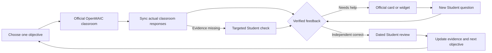

# Agent Note: Student 以官方 OpenMAIC 串起简化学习闭环

Status: proposed

[English](2026-11-22-student-openmaic-learning-loop.md) | 中文

## Problem

Student 已有目标、作答、评价、薄弱点和错题复习，但孩子需要在练习、生成课堂、最近课程、课后巩固和家长资料之间选择。家长还要处理服务地址、查询与重试。用户希望先看简化设计和分步改造清单：以官方 `dsh-openmaic` 为课堂核心，让孩子能持续使用。旧数据需要合并融合，同类型题目在题库中只保留一道母题。

当前 [TodayView](../../../../plugins/dsh-student/packages/winterhuan/student/src/client/today-view.tsx)同时呈现课堂、今日计划、兴趣练习、到期复习、其他活动、打印、理解提醒和摸底；就绪课堂未匹配建议目标时会回退到任意就绪课堂。[课程列表](../../../../plugins/dsh-student/packages/winterhuan/student/src/client/lessons-view.tsx)另外暴露生成、查询、重试和巩固。[提示词](../../../../plugins/dsh-student/packages/winterhuan/student/src/client/prompts.ts)与 preset 仍要求 shell/curl 操作本地服务。这些能力需要串成顺序，而不是继续增加并列入口。

### 官方体验证据

2026-11-22，在独立 `openmaic-preview` profile、DSH 0.2.2-rc.1 上安装并体验 [官方插件](https://github.com/THU-MAIC/dsh-openmaic) 0.4.0，固定修订为 `09c1693cfe83224db89fdd4abd245ac9174d3a05`。当前 Student 源码检查与此次官方体验是两类证据；未修改 Student 日常安装或学生数据。

| 官方能力 | 已观察结果 | 新 Student 中的用途 |
| --- | --- | --- |
| `openmaic_generate` | 原生调用返回 HTTP 425 `ANON_IDENTITY_REQUIRED`，未创建任务；配置 accessCode 后未复测。 | 完整课堂的主要生成入口；认证与恢复必须先验收。 |
| `openmaic_widget` | 凑十法组件的三个交互步骤可用；刷新重置交互，放大视图异常。 | 需要可操作示范时，在原生对话内补讲。 |
| `openmaic_render` | 内联小测验的正确与错误反馈可用；曾通过再次生成修正解释。 | 短概念卡、提示和补讲；交互分数不直接入学习证据。 |
| `openmaic_slide`、`openmaic-teach` | 已检查能力声明，未独立完成教学验收。 | 分别提供课件呈现与提问式教学方法，按需加载。 |
| 官方网页完整课堂 | 登录后恢复失败场景，完整生成七页；播放、换页、交互和测验已体验。 | 证明完整课堂形态可用；不能证明插件生成链路已打通。 |
| OpenMAIC 测验运行记录 | 官网登录 Cookie 可在浏览器和后台读取两次真实作答、批改与稳定记录身份；匿名和其他 learner 分区请求返回 403。 | 课堂作答同步已有可验证的读取基础；Student 导入及长期授权维护尚未验收。 |

[凑十法示范课堂](https://open.maic.chat/classroom/stage-MuBk6lq-L0pF?ref=share)包含导入、解释、交互示范、方法回顾、练习、测验和总结。它是可播放互动课堂，不是导出的视频。未验证实际语音音频或 PPTX 导出。

浏览器体验中，课堂单选题把“拆成2和4”判对、把等价的“拆成4和2”判错；之后读取的持久记录只证实 A、B 两次提交，未证实 D 提交。内容质量不能用生成成功保证。官方生成客户端只在单次调用中保留 `openmaic_access`，直接 fetch 返回的 pollUrl，超时不提供可调用的恢复工具。访问码验证成功也没有观察到该 cookie；官方插件没有复用浏览器账户登录凭据。原生生成的认证、同源地址和持久恢复是首轮工程缺口。

此次补查 OpenMAIC 修订 `ce7f05a8ae915df3de2e5dfbbe68cd7f7d79a0e6`：[测验写入](https://github.com/THU-MAIC/OpenMAIC/blob/ce7f05a8ae915df3de2e5dfbbe68cd7f7d79a0e6/lib/quiz/runtime.ts)记录 draft/submitted/reviewed、answers 和 results；[运行存储](https://github.com/THU-MAIC/OpenMAIC/blob/ce7f05a8ae915df3de2e5dfbbe68cd7f7d79a0e6/packages/%40openmaic/storage/src/runtime/http.ts)能列出某课堂与学习者的 sessions，再读取 records；[官网服务路由源码](https://github.com/THU-MAIC/OpenMAIC/blob/ce7f05a8ae915df3de2e5dfbbe68cd7f7d79a0e6/app/api/persistence/%5B...path%5D/route.ts)按请求所有者鉴权，禁止访问别的 learner 分区。源码显示时间戳由调用方提供，主要是显示元数据；测验 payload 未保存帮助程度或题面快照。因此“官方工具缺回传”不等于课堂底层完全没有记录，但现有记录不能不经补齐就算有效 Student 证据。

2026-11-22 官网实测：当前账户的 learner-key、sessions、records 和课堂题面读取均返回 200，两次实际作答共有七条 draft/submitted/reviewed 记录，包含原选项、批改、attempt/record ID、seq 和客户端时间；重复后台读取的身份与内容一致。仅携带登录 `auth_token` Cookie 的后台请求可读取，匿名请求与合成其他 learner 分区请求返回 403；单独 Bearer 请求读取该会话返回 404。`.env` 访问码验证成功但未签发 `openmaic_access`，单独访问码流程读取当前 learner 分区仍返回 403。凭据仅用于测试内存，未写入业务文件或证据。当前题面可读，但历史题面版本、帮助程度、可信作答日期、长期登录维护和 Student 导入未验收；reviewed 表示批改完成，不是完成间隔复习。本机证据位于 `~/.dsh/profiles/openmaic-preview/feedback-verification/`。

此次核对的官方源码还提供[课堂 manifest](https://github.com/THU-MAIC/OpenMAIC/blob/ce7f05a8ae915df3de2e5dfbbe68cd7f7d79a0e6/app/api/stages/%5Bid%5D/manifest/route.ts)，含单调递增的课堂/场景修订号，能发现内容变更但不能还原历史题面；官网可用性未实测。Student 适配器无法从原记录中重建缺失的帮助或真实作答日期。内联组件目前只回传高度，没有作答事件或持久交互状态；用它补讲不必把组件分数当学习证据。

## Proposal

把 Student 设计成学习的组织者，官方 OpenMAIC 提供课堂与教学呈现。孩子默认只有“学习”主入口，看到一个目标和一个下一步；“家长”容纳设置与记录。原生对话仍执行操作，快捷按钮发送完整意图；已有正式文件保存回答和评价，CLI 与应用共用校验。

本提案细化[学习流提案](../architecture/2026-11-12-student-learning-flow-architecture.zh.md)，保留其原生对话、直接文件编辑、帮助与真实日期规则。它拟替换其中的 OpenMAIC shell 主路径、并列导航及重复题库条目，并改变[外部课堂记录决策](../../implemented/feature/2026-10-28-student-openmaic-lessons.zh.md)的生成归属与归档保留；生成日志独立、凭据隔离和浏览器播放的理由仍适用。实现前这些变化都是提议。

[每日学习 spec](2026-11-25-student-daily-learning-plan.zh.md)补充跨科安排、范围确认、每日收尾和统一进度展示，并提议以最小每日计划文件保存安排事实，以及在后续学习日重新评估已结束复习轮次的需求。本提案继续拥有课堂、原始证据和学习段规则；这些调整尚未取代当前运行行为。

课堂作答回传与后续教学反馈是首个可用版本的必需交付，不留作后续选项。学生主线从学习需求与目标开始；母题是后台组织教学和变式的依据，孩子不需要先选择母题。

首版采用官网完整课堂、自动作答导入及 Student 中记录的补缺检验与复习，不等待官网增加全部证据字段。未知事实保留未知；闭环要求已保存的真实回答改变下一次学习任务。课堂内完整帮助/版本/时间捕获和内联组件作答同步属于后续扩展，需要官方支持的改造或受控兼容服务。

家长确认学习范围与校内进度后，Student 在该范围内自动推荐目标、准备课堂、组织补学与复习，不逐课请求批准。孩子仍明确选择“继续”“换内容”或“休息”；自动准备不等于自动连续提问。超出已确认范围的调整需要家长确认。

### 学习目标的定义与选择

目标表示一项可检验能力，带适用约束与评分判据。例如“能计算100以内两位数退位减法”是能力目标，验算另作独立能力，“完成第一单元”是课程覆盖描述。目标按科目 → 能力领域 → 可检验目标组织。年级、教材和单元是课程关联，解法是教学属性，新学/补学/复习是同一目标的用途，不各建一份目标。

从家长确认范围内已核对的课程要求与教材资料提炼候选目标。校内进度限制默认新学候选，真实回答和兼容旧证据识别先修缺口与补学需要。先续当前未完活动，再处理其缺口、有限到期复习及下一个校内可学目标。旧证据不足时做短针对性检验，不默认孩子全不会，也不先做整份考试。OpenMAIC 教已选目标；生成建议先核对范围、来源与判据，再纳入目标。兴趣通常只改变情境，不复制另一份能力。

| 科目 | 能力领域 | 本次改造的目标示例 |
| --- | --- | --- |
| 数学 | 数与运算、图形与方位、测量与生活应用、分类与规律 | 用凑十法说明进位；退位减法并验算；说明乘法是几个几；计算应付和找零；说明方向或分类标准。 |
| 语文 | 识字与词语、阅读与依据、表达与积累 | 辨析形近字并组词；从文中找到人物或事件的依据；按顺序复述；结合情节说明寓言道理；看图说连贯的话。 |
| 英语 | 词形词义、听力理解、口语交际、确认范围内的阅读与书写 | 认读位置词；听词选择对应位置；口头描述物品位置；简短问候或自我介绍；读懂简单书面指令。 |

每个目标需要能力描述、范围约束、可接受证据/判据、必要先修、已核对教材关联与适用母题。一个目标可使用多个题型，一个母题也可服务兼容目标。英语听、说和文字分别检验，文字回答不能证明听说表现。进度状态与活动用途组织同一目标，不新增题库条目。

旧地图混合课程覆盖条目与能力，部分语文条目打包整个单元，部分英语条目混合认读与口语任务。先依据已核对课程/教材要求重建能力结构，再映射旧目录。旧条目数量不决定新目标集合，旧目录只作为课程/历史索引，不作为能力覆盖的依据。每项新目标必须写明孩子能做什么、适用难度/范围、如何检验及必要先修；独立可检验的能力拆开，数字/文本变式仍只作实例。迁移前先形成可审查的能力目标树及目标—母题关联。

历史回答只映射到原题面/证据支持的新目标，旧整单元评分不能证明每项拆分能力。原 ID 与证据保留，不确定映射待核对。[能力目标重建稿](../../../../plugins/dsh-student/docs/capability-rebuild/README.zh.md)已交付三科目标树、检验判据、先修、123类母题和117条旧目标/122道旧题的条件映射；目标统计来自能力分解，不作为固定学习任务数。13项能力尚无旧课程关联，具体教材与真实历史证据仍需核对，当前运行地图和日常数据未迁移。

### 用户看到的简化设计

首次使用先复用已有档案。新工作区由家长通过一句完整确认或分步对话提供称呼、地区/学制、年级、学期和学年；缺失事实仍需确认。教材与学校进度可稍后补齐，未确认时明确显示基础学习。兴趣是可选补充。孩子不选学习模式、强度、母题或生成参数。

| 页面 | 默认内容 | 次级入口 |
| --- | --- | --- |
| 学习 | 当前目标、一句话推荐理由、下一步按钮；检验时显示当前一题和原生作答入口。 | 换内容、休息、展开助手；就绪课堂旁可明确报告“我上完了”。 |
| 家长 | 今天的学习与待复习事项，能查看原回答和反馈。 | 学习档案与校内进度、课程历史、练习记录、照片核对、打印与归档。 |

学习页示例：琪琪 · 数学；今天学“凑十法”；“把8+7变成10+5”；按钮“开始上课”。课堂作答保存后，返回 Student 直接查看同步后的反馈；只有证据不足时才补一到三道小挑战，一题一答，允许停下。结果显示“今天会做了，明天再试1题”或“凑十这一步还需要练，我们一起操作一次”。课堂完成报告不能代替作答同步。

当前题收尾后，优先处理当前目标的补学或先修缺口，再做最多两个母题的到期短复习，随后进入校内新目标。短复习结束后推荐新学习，不能重复“继续”又启动更多积压复习。到期项先按当前先修关联，再按到期日和稳定身份排序；推迟项保留原日期与阶段。主动“换内容”可选更多复习或另一已确认科目。同步或家长核对等待时保留原学习，允许换活动，不重复未解决的回答。

独立的生成/查询/重试/课后巩固按钮由“继续学习”承接，技术详情仅在故障或家长需要时展开。兴趣练习、摸底、口算、听写和探究收进“换内容”；不把全部能力删除。家长的知识地图、错题与设置合并到一个家长入口，原有记录、打印和迁移能力仍可发现。星星和统计不占据主动作位置。

### 母题与旧数据融合

题库只保存母题，每种题型一个稳定母题 ID。按能力、核心解法和题目结构归并，数字、人物、场景和表达方式是变式因素；不能只按“计算题/选择题”合并，也不能把目标相同但解法不同的题硬合并。先沿用现有 exercises 数据归属，不新增平行题库。母题保留题型描述、解法、允许变化的因素与约束、答案判据和来源；教学、摸底、巩固是用途属性，不能各存一份同类题。

知识目标按实际能力理解，不以 objectiveId 字符串作为题型边界。跨教材或册次的同一题型仍只保留一母题，可关联多个兼容目标，实例继续保存本次 objectiveId 和历史范围；按当前年级与校内进度取适用约束，不能因归并扩大孩子的学习范围。错题复习按母题重放实际作答，不把旧错题的阶段相加；保留各错因，同日不重复推进，未知顺序保留困难。

例如 8+7、9+6 和 8+6 归入“20以内进位加法的凑十法”母题，数字约束包括十以内加数与需要进位；退位减法属于另一母题。巩固只按缺口生成基本、理解或变式任务，不把具体数字题追加进题库。开放题保留接受答案的判据，不强制唯一字符串。

现有[查询](../../../../plugins/dsh-student/packages/winterhuan/student/src/learning/queries.ts)合并内置与工作区题库时只按 ID 去重，[来源校验](../../../../plugins/dsh-student/packages/winterhuan/student/src/files/validation.ts)依赖旧 exerciseId。题目或目标的旧条目数都不能证明能力覆盖或语义重复。重建须同时处理有效目标/题库结构和旧引用，不能只删除 UI 列表里的题。

| 旧数据 | 融合结果 |
| --- | --- |
| 内置母题、工作区保存题、同类型变式 | 每类保留一个有效母题；合并独有解法说明、来源与变式约束，旧 ID 映射到母题 ID。疑似同类或冲突答案先待核对。 |
| 学习段与练习单中的题面、回答、评价 | 关联母题，保留当时题面与原回答作为历史证据，不另作题库条目；不能用今天的母题覆盖历史题面。 |
| 同类错题与多次练习 | 按学生/母题展示一个复习项，保留每次实际作答、日期、帮助和错因，跨学期重放复习；合并题型不合并真实学习次数。 |
| 重复导入的同一回答 | 只有来源与稳定回答身份能确认相同时才去重；相同题面或原话不足以证明是同一次回答。 |
| 旧课堂 | 保留原地址与生成历史；对已授权且明确绑定学生的历史课堂导入可核对作答，归入母题历史；缺失关联、帮助或日期保留待核对，不猜已学完。 |
| 旧学期 | 保留原归档并引用已校验证据；延续兼容的掌握基线与未完成复习，不复制回答、不重置复习阶段、不再授予首次掌握。 |

在隔离副本先产出归并清单、旧 ID 映射、冲突与待核对项，再迁移并校验所有引用。迁移可重复执行而不增加母题、回答或复习次数，保留迁移前备份与恢复路径。新题先查母题；已有同型就生成变式，只有确实缺少题型才补母题。后台用母题的方法与约束组织课堂、变式、作答归属和再练；学生仍从学习目标开始。

### 学习闭环

新目标或需要教学的目标优先进入完整课堂。短复习和摸底留在 Student 原生对话，需要视觉帮助时使用官方卡片或组件。答错先针对错处补讲，再做一题变式；只有方法或先修缺口需要完整教学时才重备课堂。复用适合的教学内容，已作答实例不重绑到另一孩子或学习段；重看旧课堂本身不增加回答或掌握。

检验覆盖基本应用、方法理解与简单变式，优先使用有效课堂回答，只补缺项，最多三题。理解可用操作或简短回答体现，不强制长复述。题目先独立求解并保存依据，再呈现给孩子；有选项时检查等价答案。判据按学科区分：数学看方法/推理，语文看依据/表达，英语区分听、说与文字能力。文字正确不能证明未观察的听说掌握。每道下一题仍由学生明确推进；未核实评分保留待核对。

| 已保存事实 | 唯一主要下一步 |
| --- | --- |
| 当前题未回答，或回答待有效评价 | 继续这题或获取反馈；刷新不换题、不重发答案。 |
| 当前目标没有可复用课堂 | 准备课堂；先保存本地学习段与课堂身份。 |
| 服务已创建任务，尚未就绪 | 继续同一任务；显示已确认状态，不能因超时重新提交。 |
| 课堂就绪，未报告学完 | 去上课或继续上课；“我上完了”只是完成报告。 |
| 已有课堂作答尚未同步，或已返回但证据不足 | 先同步原记录；只补缺失的检验任务，不能重发已有回答。 |
| 本次巩固已有有效评价，但需帮助或答错 | 用官方教学辅助补讲，再尝试变式。 |
| 本次巩固结束，有独立正确且尚未掌握 | 按实际作答日安排次日短复习；当天可休息或换内容。 |
| 再练证据满足已有掌握条件 | 更新建议；在家长确认范围内选择下一目标。 |

切换浏览科目不能替换未完学习段；主动换内容时保留可恢复的原学习。课堂主入口必须匹配学期、科目、目标和本次学习身份，禁止回退到别的就绪课堂。观看、完成报告、课堂作答同步、检验结束和掌握分别表达。

### 官方插件融合方式

将固定官方插件组合进 Student preset，让一次 Student 安装提供课堂、卡片、组件、课件与教学 skill；用户不用另外配置两套学习模式。官方工具仍在原生对话里执行，Student 的 study 指引负责目标、学习证据和下一步，官方教学资源负责呈现方法。不另建模型执行器、播放器或跨站 iframe。

默认采用官方在线服务；已有自建服务作为家长高级设置保留。安装与开发层固定版本并验证 DSH 0.2.2-rc.1，不能凭官方的通配 peer 声明推断兼容。用户的 accessCode 配在秘密配置中，不进入课表、题目、聊天或公开文档。

Host 自动维护账户授权，家长一次配置凭据，不必周期性复制 `auth_token`。已验证的官网登录流程依次获取公钥、以 RSA-OAEP/SHA-256 加密密码、账户登录及选定账号签发。`.env` 中 `OPEN_MAIC_USER` 与 `OPEN_MAIC_PASSWORD` 的实测在不使用旧 Token 时取得新七天 Token，确认同一 learner，读取原作答返回 200 且内容一致。实测服务使用 `auth_token` Cookie；accessCode 与它分开，不能授予上述读取权限。

生成或同步前检查有效期，剩余不足 24 小时时自动登录。服务返回授权过期后允许重登一次；权限或资源不存在错误不能触发反复登录。续登串行执行，核对选定账号与 learner 的原绑定，再原子替换凭据并继续原任务。有效期信息只用于安排刷新，身份绑定仍通过服务验证。续登失败保留进度；验证挑战、密码变更或账号选择不明确时，给家长一个具体恢复操作。

账号密码和缓存 Token 放在权限受限的 Host 秘密配置中，不进入学习文件、模型参数、工具回执或课堂链接。预览浏览器 Cookie 已在核对新 Token 后替换；通过受支持登录交接自动更新浏览器凭据尚未验证。浏览器播放与 Host 后台读取的登录态分开，发布验收必须覆盖两端过期后的续登。延长 Cookie 或定时读记录不能续签账户 Token。

复测已验证账户登录传输和所需访问码下的原生生成。官方包没有导出生成客户端或进度回调，不能假定 Student 能在提交后截取任务身份。优先采用官方支持的修复版；必要时维护固定兼容修订，提供受保护客户端与结构化任务通知，用于生成恢复和已授权 runtime 读取。Student Host 适配器复用该客户端，凭据由一处维护。不修改已安装产物，不复制教学渲染器。

兼容版本需要在提交成功后及时暴露并持久保存 jobId、pollUrl 与可用的 run/retry 身份；中断沿原任务查询，服务确认失败且可重试时才重试。未知提交结果先核对，不能用客户端随机 ID 假设服务支持幂等。相对 pollUrl 解析到已配置原点，跨源地址不能携带凭据。任务元数据独立于回答文件，学习业务记录继续由 agent 编辑并校验。

认证或配额暂不可用时保留原目标与状态，明确提示恢复方法。用户可以在官方网页登录/继续，并显式关联生成的课堂 URL，或选择原生补讲；这是一条恢复路径，不能作为插件原生融合已完成的验收。发布主线必须通过官方工具实际创建、完成并恢复课堂。

### 必须打通的双向学习反馈

复用 OpenMAIC 的 RuntimeStore 与课堂题目数据，通过一个 Host 学习适配器接入既有 Student 学习段，不另建成绩数据库。官方服务记录真实交互并支持持久读取；固定官方插件修订提供已授权访问与生成任务身份。Student 负责导入、学生绑定、母题映射、有效评分和后续学习。普通对话仍由 agent 直接编辑正式文件；外部已授权事实的机器导入必须共享正式文件校验和保存时的版本检查。

| 方向 | 必须贯通的内容 | 消费结果 |
| --- | --- | --- |
| Student → OpenMAIC | 已确认目标与母题、适用范围、错因及必要掌握/复习摘要，组成现有支持的课堂 requirement；本次学习绑定保存在本地。 | 课堂与补讲针对当前缺口；插件回执关联本地任务，不假定官网接受 Student 专有字段。 |
| OpenMAIC → Student | 原回答、提交/批改身份及可取得的题目/进度事实；保存已有帮助、时间、内容版本来源，缺失字段明确为未知。 | 更新原学习段、母题历史、待核对项和下一步；掌握证据缺项在 Student 补齐。 |

每个孩子有跨学期延续的稳定 Student 学生身份，工作区与 MAIC 账号是另外的关联。家庭可以共用一个 MAIC 账号，但各孩子使用独立课堂实例与学习段。同一服务原点/stage/MAIC learner 分区只能绑定一个 Student 学生。教学模板通过创建独立课堂实例复用，不能让不同孩子共用作答分区。绑定还标识工作区、学期、学习段、本地课堂和外部 scene/attempt。打开分享链接不产生绑定；历史归属不明确时交家长核对，不自动导入。

新课堂把母题映射到场景/题目，打开前保存原题目实例、选项与评分判据。服务提供单调 manifest 时，在题面保存与同步前后读取它，检查内容变更。稳定 questionId 或当前内容本身不能证明历史版本；无法证明对应题面时，原回答保留待核对。每次实际作答有稳定 attempt/response 身份，批改更新引用该回答。保留原选项值与对应标签，不能从今天修改后的选项补造历史标签。

返回 Student、点击继续、恢复会话及活动课堂仍有待同步记录时自动导入；同一课堂串行读取，失败后延长重试间隔。区分 draft、submitted 与 reviewed：草稿不计作答，reviewed 更新已提交回答的评分，真正重答才产生另一回答。保留 runtime 序号和提交身份，不按到达顺序或总分推断过程。同一提交/题目的重复同步只对应一条 Student 回答。学习段持久保存后才推进同步检查点；检查点落后可安全重放，保存失败不能确认已同步。自动导入与 agent 编辑共用版本校验保存；冲突时重读并按原身份合并。

保留官方原时间戳与帮助字段作为来源，不推断缺失事实。回答可以已核实正确，但独立性或作答日仍未知；它可用于教学诊断，不能形成掌握或推进按日复习。Student 通过实时原生作答入口记录补题/复习，保存实际输入、日期依据及提交或答案揭示前的帮助。照片/历史日期沿用现有确认途径。无法核实的事实保留未知；看过答案后重答同一实例不能算独立。

只对缺失能力或证据生成新的母题变式，每次检验最多三题，不为核对评分重复原回答。新回答有自己的真实作答日，不反过来填补历史回答未知的日期或帮助。原待核对项仍供家长查看，有效新证据可以推动学习；不要求孩子等全部历史记录核对完才能继续。

官方成绩保留为来源结果。Student 按母题判据与原题目实例核对评分，负责掌握和复习使用的有效评分。明确等价的答案自动改判并保存依据；未能解决的评分冲突交家长核对。缺帮助/日期字段走补缺检验，不逐项请求家长批准。同一回答改判只替换有效评分，不增加作答次数，也不丢弃官方原结果。新题内容先校验，复习从已确认事实重放；回传本身不是学习质量保证。

首版 render/widget/teach 提供教学，可评分回答通过 Student 原生对话保存。现有 iframe 高度消息、点击或自报分数不是作答证据。后续扩展内联作答捕获需要稳定活动/题目/作答身份、输入校验、Host 持久保存及重启恢复，不作为首版依赖。完整课堂作答仍采用持久 runtime 读取，不能只靠 DOM 提取、截图或模型自述。

发布前验证官网课堂 → 自动导入 → Student 检验/复习 → 下一官方教学任务的真实路径。官网全量证据以后可通过受支持接口/修订或受控兼容 OpenMAIC 服务接入，首版缺项保留未知并在本地补齐。显示同步中、已保存、待核对或失败，并提供一个对应恢复动作。不能把未知历史算掌握，也不要求家长手抄课堂结果。

### 最小数据与反馈

当前 Student 支持语文、数学、英语，内置地图覆盖一、二年级上下学期，本次改造保留该范围。[当前读取](../../../../plugins/dsh-student/packages/winterhuan/student/src/files/read.ts)不加载旧学期证据；[现有推荐](../../../../plugins/dsh-student/packages/winterhuan/student/src/learning/mastery.ts)通常把到期错题复习放在新学习后。本方案新增已校验归档引用及上述有数量上限的短复习优先规则。

扩展[课堂日志](../../../../plugins/dsh-student/packages/winterhuan/student/src/openmaic.ts)的学生/学期/学习段/母题绑定与导入检查点，扩展[学习段](../../../../plugins/dsh-student/packages/winterhuan/student/src/files/schema.ts)的稳定题目实例引用、外部回答来源、完成事实和计划检验任务。课堂回答与必要补题复用一个学习段，不另增巩固实体；练习单保留用途。创建外部任务前已有本地课堂身份。

| 归属 | 保存事实 |
| --- | --- |
| 现有 settings | 稳定学生身份、档案与家长确认范围；切换学期保留学生身份。 |
| 现有 collections | 母题、兼容目标与旧 ID 别名；生成变式只作为历史实例。 |
| 学习段与练习单 | 原题目实例/回答、来源评分、有效评分、帮助/日期依据与待核对事实。 |
| 现有课堂日志 | 本地/外部关联、生成任务身份与恢复/导入检查点；不重复保存成绩历史。 |
| 原学期归档 | 历史文件及引用的课堂记录，通过明确引用读取与校验。 |
| Host 受限秘密配置 | 账号密码、访问码与缓存凭据；与全部学习证据分开。 |

掌握、错题和下一步从上述已校验事实推导，不新增平行成绩数据库或全局工作流文件。

下一步从现有文件推导。计划检验任务取得真实回答与有效评分才算完成；答错可以结束一次尝试并保留补学需要。暂停、换内容或外部历史待核对时，保留未完检验。重复继续沿用学习段，迟到评分仍归原回答/原学期。缺失课堂关联不能证明课堂进度，但有效本地回答仍能计入学习。

旧文件保持可读；不能按同名、同目标或时间接近猜课堂关联。归档携带引用的课堂记录；八十条日志上限的整理不得删除活动引用。格式修订、迁移与恢复必须在隔离副本验证，不静默重写日常历史。

保留三个不同实际作答日独立正确及现有当前错误、帮助和错题条件。兼容且已核实的历史基线不因换学期要求重新积累三个日期；新的有效错误或未完成错题仍可使其变弱。错题保持 1/7/16/35 天间隔及同日推进上限。次日目标检验从有效实际作答日推导，其他独立练习可满足它。未知日期或帮助不制造按日推进或掌握；评分更正重放结果，不重复计功。

下一课需求只带目标事实、母题方法与变式约束、确认范围、必要先修或错因、到期任务及一个兴趣情境，消费已保存反馈，不传整份档案或无限课堂摘要。点击与停留时间只描述过程，不能代替回答或掌握证据。

### 跨学期延续

保留原学期归档，当前学习段保持自己的 termId，通过引用使用已校验旧证据，不把旧实体复制到当前学期。掌握基线只继承明确兼容的能力及范围约束；母题 ID 相同不能单独证明更高要求的目标。缺映射或无法核实的历史保留待核对，可用新针对性检验建立当前证据，不要求全部旧学习重做。

未完成错题复习沿学生/母题历史延续，保留原到期日与阶段。按真实日期证据重放，不把阶段相加，不在换学期时重置逾期日或清除旧错误。只加载相关且已校验的归档引用；归档缺失或无效时显示待核对问题，不补造进度。

首次掌握沿同一学生与能力跨学期判断，替代原先仅限本学期的定义。原里程碑记录保留，合并视图采用最早已核实达标，继承成果显示为掌握基线，不产生新奖励。变弱后通过新证据达标属于恢复掌握。换教材或扩大范围不能在缺对应证据时授予更高能力的掌握。

### 分步改造清单

| 顺序 | 具体改造 | 可验收交付 |
| --- | --- | --- |
| 1. 目标、母题与旧数据融合 | 依据已核对要求重建能力目标树，再映射课程/旧目标与题型，补稳定学生身份、归档引用、旧 ID 别名及可重复迁移。 | 隔离迁移前先审查目标定义、检验判据、先修与目标/题型映射；每类一个母题，历史完整，只继承证据支持的成果。 |
| 2. 官方链路与最小关联 | 固定官方依赖/必要兼容修订，组合 Student preset，接通单处账号登录、安全续登、结构化生成身份和按所有者恢复。 | 原生完整课堂生成与重启恢复；凭据到期替换保留同一账户、后台读取与浏览器播放；共享账号不混孩子的课堂实例。 |
| 3. 接通课堂作答与反馈 | 读取已授权 runtime；关联提交/题目/母题，保留原评分/未知字段，核对有效评分，使用版本检查与检查点保存。 | 真实错误/重答/改判进入原学习段；重复/乱序导入不重复记功；缺失历史保留未知，本地针对性检验只补缺项。 |
| 4. 简化入口并串完一课 | 调整 `desk.tsx`、`today-view.tsx`、`lessons-view.tsx`、`prompts.ts` 和 study 资源；提供学习/家长两入口与唯一下一步，收起独立生成管理。 | 孩子完成目标 → 上课作答 → 自动同步 → 查看反馈/必要补题；已有有效作答不重做，变式不新增题库条目。 |
| 5. 补学与次日再练 | 官方 render/widget/teach 补讲，Student 原生回答提供证据；在现有掌握/调度中加入有上限的复习优先及跨学期证据重放。 | 一轮短复习最多两个母题，不自动连问；真实按日复习改变后续官方教学，继承基线不重复授予首次掌握。 |
| 6. 隔离验收与收尾 | 核对旧数据/归档引用、保留规则、未知证据、共享账号、凭据过期、导入冲突/重启、全部支持科目及真实 DSH 界面/对话。 | 类型检查、构建、相关测试与文档检查；真实课堂作答 → 自动导入 → Student 复习 → 下一官方任务，并保留恢复证据。 |

步骤 1–6 组成首个可用版本；只合并导航、换按钮或手工抄分不算完成。实现位置仅在 Student 子模块及必要的官方兼容修订仓库，禁止改只读 upstream。本轮交付是方案，不实施、不迁移日常数据、不发布、不更新日常 profile；发布另按已完成验收的具体结果开展。

## Alternatives considered

**只用官方插件，删除 Student 学习记录。** 当前官方 DSH 工具未把课堂作答与复习接入 Student，不能直接承担旧学习历史。需要补齐双向适配，复用课堂 runtime 与 Student 证据，而不是放弃学习记录。

**继续 curl 为主，官方组件作为后续选项。** 保留家长管理本地服务的负担，不能满足本次以官方插件重新设计的要求。旧服务只保留为高级设置与旧记录兼容，不作为孩子主路径。

**每次答错生成完整新课堂。** 增加等待和配额消耗；针对性组件补讲和变式题更适合短缺口。

**嵌入课堂或复制教学运行时。** 增加浏览器认证、回放和维护负担；外部课堂加明确返回已足够支撑首轮。

**把官方分数直接当掌握。** 实测存在等价选项误判；回传原回答、题面与批改来源并校验，保留待核对项，不能把总分直接变成掌握。

**删除同类题的全部历史题面与作答。** 可以减小文件，却失去当时问法、原回答和批改依据。只归并题库与展示，保留历史证据；回答去重必须有同一次输入的证据。

**固定让孩子返回重做三题，推迟课堂回传。** 增加作答负担且丢掉课堂过程；先用真实课堂证据，只补缺失能力或证据。

**每学期重置进度或要求所有目标重新检验。** 浪费已核实历史并重复授予首次掌握。保留来源记录与兼容基线，核对新范围和新证据。

**把一个服务账号当作一个孩子。** 家庭账号可能含不同孩子的学习。稳定学生身份与独立课堂实例保留归属，不要求每个孩子另开账号。

**等待官网或组件具备全部证据再交付首版。** 已验证作答读取能支持诊断和后续学习。缺事实保留未知，在 Student 记录补缺检验/复习；完整事件捕获保留为扩展，首版不新增服务维护负担。

## Acceptance criteria

1. 新用户通过简短家长确认即可开始基础学习，已有档案直接继续；孩子不用选择模式、生成参数或处理查询/重试。
2. Student 安装组合提供官方能力，真实原生生成与原任务恢复通过。自动到期续登保留同一账号/learner，后台读取与浏览器播放都能继续，不要求周期性复制 Token。
3. 学习页只突出当前目标的下一步，能完成课堂作答回传、必要补题、补讲/再练和下一目标，且家长能查原回答与反馈；已有有效课堂证据不要求固定重答三题。
4. 刷新、重启、科目浏览、重复继续与迟到评分不串课堂、不丢答案、不制造重复记录；未回答和待评价均可恢复。
5. 三个实际作答日独立正确及现有当前错误/帮助/错题条件决定掌握。未知帮助/日期不推进按日复习或证明独立性，新补缺检验有自己的日期。评分更正重放结果、不增加尝试，观看与分数不等于掌握。
6. 旧档案与无关联课堂仍可读，归档和日志保留保护新引用；隔离 DSH 验证主题、窄窗口、真实课堂返回、持久恢复和故障路径。
7. 内置与工作区有效题库中每种已确认题型只有一个母题，变式不入库；旧 ID 全部解析或明确待核对，同型错题合并展示，多次真实作答及历史题面保留。重复迁移不增加条目或证据。
8. 官网真实路径通过：课堂作答 → 持久授权读取 → Student 核对保存 → 补缺检验或按日复习 → 消费已保存反馈的下一官方教学任务。官网缺字段保留未知，组件分数或模型自述不能替代证据；验证题面编辑、看答案后重答、并发保存、重复/乱序读取和中断。
9. 换学期通过已校验引用延续兼容掌握基线和未完成复习，不复制回答、不重置日期/阶段、不重复授予首次掌握；更高范围和新错误仍影响当前进度。
10. 共享账号使用各孩子独立课堂实例，同一 stage/learner 分区不能绑定两个 Student 学生。历史归属不明保留待核对，禁止读取不触发重复登录或跨学生导入。
11. 当前题与补学先修优先，一轮短复习最多两个母题，随后进入校内新学习。积压不持续占据每次继续；休息/换内容保留可恢复学习、日期和阶段。
12. 真实 DSH 验收覆盖确认范围内语文、数学、英语及主题、窄窗口、键盘和非 Web 对话。文字回答不能误记听说掌握。

## Risks

官方在线认证、配额与 API 演进可能阻塞原生生成，必须先明确支持约定再确定兼容补丁；网页体验不能消除此风险。组件当前刷新重置交互、放大视图异常，首轮使用内联呈现并以本地保存的回答恢复学习。AI 内容仍可能出错，题目依据与复测只能降低风险，不能保证正确。

新关联与母题归并影响持久文件、历史引用和保留规则；日常使用前须验证迁移、归档重放与并发导入。冲突保留待核对，不凭题面相似删除记录。官网缺独立性/日期/历史题面字段，首版难免需要少量补缺检验。账户凭据下的原生生成、浏览器自动登录交接及官网 manifest 可用性仍待工程验证。本方案的检查验证文档，不代表融合实现或长期运行已验收。
