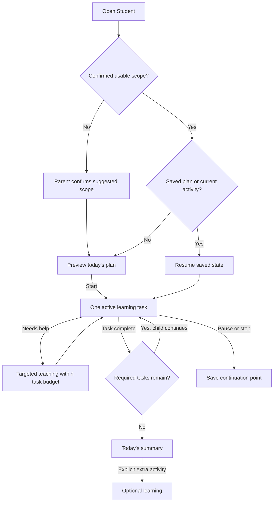

# Agent Note: Student daily learning plan and learner flow spec

Status: proposed

English | [中文](2026-11-25-student-daily-learning-plan.zh.md)

## Problem

Children entering Student each day need to know what to learn, why those activities were selected, how to continue, and when they can finish. Parents need to confirm learning directions and school progress without choosing subjects, goals or questions every day. The capability catalog, learning records and continuation query provide part of this foundation, but do not organize these decisions into a stable, recoverable daily plan.

This spec serves product, implementation and acceptance review. It covers daily selection, initial setup, learner presentation, parent intervention, resumption and progress display. Every new rule is proposed; this document does not claim implementation or authorize release or migration of real learning data.

### Current evidence

The review examined Student `0.2.6` production logic and source at `951bd73`. Real DSH verification covered initial entry only; synthetic profiles reproduced the following states through official reads and queries. Populated browser flows, real model teaching and online classrooms were not accepted in this review.

| Problem | Observable result | Source |
| --- | --- | --- |
| Recommendations lack daily organization | The page queries the locally remembered subject, initially math; it has no cross-subject daily task list or completion boundary. | [Subject selection](../../../../plugins/dsh-student/packages/winterhuan/student/src/client/desk.tsx), [context query](../../../../plugins/dsh-student/packages/winterhuan/student/src/client/workspace.ts) |
| Scope confirmation has no complete path | A profile without `learningScopes` holds learning; the primary button opens the generic parent page, while the profile setup intent omits scope confirmation. | [Learning page](../../../../plugins/dsh-student/packages/winterhuan/student/src/client/today-view.tsx), [copy](../../../../plugins/dsh-student/packages/winterhuan/student/src/client/locales.ts) |
| Ended blocks can lose remedial priority | A synthetic incorrect counting response requests teaching while active; after block end and on the next day, selection moves to a new goal while counting remains `weak`. This case has no additional mistake declaration or round constraint. | [Continuation query](../../../../plugins/dsh-student/packages/winterhuan/student/src/learning/mastery.ts) |
| Recommendation and display disagree | The same synthetic capability is weak in `goalProgress`, but has no corresponding old map objective or displayed weak point. | [Dashboard projection](../../../../plugins/dsh-student/packages/winterhuan/student/src/dashboard.ts), [learning page](../../../../plugins/dsh-student/packages/winterhuan/student/src/client/today-view.tsx) |

## Proposal

Parents confirm scope, Student selects a small set of daily tasks, and children enter one activity through Start today's learning. Each task saves its goal, selection reason and completion condition; actual responses inform subsequent recommendations. Daily selection is automatic, while starting, changing content, adding practice and stopping require explicit child actions.

### Scope and existing decisions

Retain the [learning-flow and evidence architecture](../architecture/2026-11-12-student-learning-flow-architecture.md): native conversation, direct agent authoring of official files, read-only CLI validation and independent application reads. Retain capabilities, question families, source verification and classroom binding from the [OpenMAIC learning loop](2026-11-22-student-openmaic-learning-loop.md). This proposal owns daily organization and page states above that loop.

This proposal partially changes the earlier choice to derive every next step from existing files without a plan file: add daily arrangement files within one learner and term to preserve the order users saw or selected. Mastery, assessment and review due dates still derive from original evidence. It also proposes one new bounded review on a subsequent learning day after the previous review round ended, under the rules below. Existing proposals remain active and cross-linked; no implemented note is fully superseded or requires archival here.

Preserve the intent of [removing time limits](../../implemented/feature/2026-10-30-student-overhaul.md) and the [school frontier](../../implemented/feature/2026-10-14-student-school-frontier.md): task counts establish an expected stopping point, without daily minute caps, forced breaks or missed-day catch-up requirements. Home mastery cannot advance the school unit automatically. This scope does not expand curriculum coverage, rebuild the bank, change mastery thresholds, add background reminders or introduce a separate model runner.

### Roles and success

| Role | Default responsibility | Observable success |
| --- | --- | --- |
| Parent | Confirm learner, scope, school progress and available learning modalities; inspect requests for help. | Ordinary learning days need no further question or goal selection after setup. |
| Student | Generate plans from valid evidence and confirmed scope, prepare current teaching, explain selection and save resumption points. | Refreshes, different conversations and later days preserve continuity; all pages agree on the same facts. |
| Child | Start, answer, ask for help, change content, pause or stop; ask their own questions. | The first screen explains the current task and has one primary action, without requiring knowledge of families or evidence budgets. |

## First-use and scope confirmation

Setup proceeds through the current native conversation, while the workbench shows a confirmation summary and specific outstanding steps. Existing profiles fill only missing information instead of repeating setup.

1. Confirm learner and term; school materials and the current unit may be added later.
2. Choose subjects for automatic selection and either Follow school or Build foundations. Parents may describe their intent naturally without entering capability IDs, family IDs or number-range fields.
3. Suggest a concrete scope, its basis and available modalities from the verified catalog. When school mode lacks a current unit, parents can supply it or explicitly confirm a foundational scope; school progress is never guessed.
4. Show one summary of included content, excluded content and practice modalities. Save `learningScopes` and related settings after explicit parent confirmation; show Start today's learning only after successful independent reading.

The missing-scope primary button opens the matching step, such as Confirm math scope, with existing information and suggested values. Cancellation or failure retains the draft and missing-field explanation; returning parents resume that step. Missing scope excludes only that subject, while other confirmed subjects can produce a plan. Setup blocks all learning only when no subject has usable scope.

Select written, oral, listening, audiovisual and performed capabilities according to available modalities. Without audio input or observation evidence, written practice cannot count as listening or speaking assessment. Tasks needing unavailable equipment or parent observation cannot become impossible default tasks.

## Daily selection policy

Plans use the `Asia/Shanghai` calendar day and belong to a stable learner identity and current term. Initial reads may produce a read-only preview. The first explicit Start saves and independently verifies the plan through the native flow before starting its first task. Page opening, polling and midnight neither write files nor invoke model preparation automatically.

### Default task amount

Schedule at most two required tasks: one short review when needed and one main task. Short review includes at most two question families. The main task addresses one capability through resumption, remedial teaching, a short diagnostic or new learning. Without review needs, schedule only the main task instead of creating filler. When no new learning fits, review alone is valid; when nothing fits, explain why without creating an empty task.

Parents may choose Light for one daily task; Standard is the default. These are initial product defaults, not conclusions about educational effectiveness. Children can reduce tasks or rest at any time. After completion, explicitly choosing Learn a little more adds one optional activity, marked separately, without undoing original completion or generating further required tasks automatically.

### Candidates and ordering

One query builds candidates across all confirmed subjects before selecting daily tasks. The subject currently being browsed does not determine the default plan. Goal identity combines capability and applicable scope; families organize instances, and textbook units constrain eligibility.

| Order | Selection rule | Exclusions and stopping rules |
| --- | --- | --- |
| 1. Resume activity | Preserve the original unanswered, unassessed or unsynchronized task first; offer Continue or Set aside at start. | Recover original records when sources fail. Explicit deferral permits other valid tasks, without resending responses or recreating classrooms. |
| 2. Current gap | Use remedial teaching as the main task when actual evidence shows a current-goal or necessary prerequisite difficulty. | Address only the required scope, without requiring global prerequisite mastery; ending a block cannot erase remedial needs. |
| 3. Short review | Select families from valid due records, supporting the current goal first, then earliest due date and stable ID. Merge equivalent family/scope display entries. | At most two automatic review families per day; backlog does not expand today's workload. Unknown dates or sources cannot create due dates. |
| 4. Main learning | Without required resumption or current-gap teaching, select a subject, then unresolved weakness, unfinished capability, necessary short diagnostic, or eligible new learning in that order. | New goals respect confirmed school units, foundational scope and modalities. Selecting only `untouched` goals must not skip weak goals in ended blocks. |

For the main subject, consider only subjects with executable candidates. Prefer subjects not used as the main subject during the last three actual learning days, then the least recent main-learning day. On first use, apply the confirmed preference order, otherwise Chinese, math, English as the stable order. Subject coverage requires at least one valid assessed actual response in the main task; browsing, generation, skipping and unknown sources do not count. Resuming an activity or addressing its current gap may override coverage with an explanation; the system does not promise all three subjects every day.

Within one subject and priority, order by eligible school sequence, prerequisite relation to the current goal, least recent valid practice day and stable goal ID. Difficulties without a verified due date remain remedial candidates, without being labeled overdue. Merge main and review tasks requiring the same family and scope so the child supplies evidence once. Without another suitable candidate, leave the second slot unused.

### Cold start and reasons

Grade and materials establish candidate scope, not what the child knows. On first learning within a scope, reuse compatible original responses first. If evidence is insufficient, embed a small diagnostic in the main task, with at most three new check instances, stopping once the next action is established. Missing history displays Not yet known instead of Weak.

Each task carries a child-facing reason, such as Yesterday you missed one while counting; today we will try another method. Parent details expose the basis, original responses and scope. Without supporting evidence, explain that the activity will explore what the child knows, instead of inventing difficulty, school progress or interests.

## Learning and completion

Daily task completion, block end, successful review and capability mastery represent separate facts. Completion clicks, classroom viewing, stopping and stars cannot increase independent responses, review stages or mastery.

| Current state | Primary action | Saved or derived result |
| --- | --- | --- |
| Plan ready | Start today's learning | Save and verify the plan, then open its first task; retain identity if preparation fails. |
| Question unanswered | Submit answer | Bind the original response only to its original question; distinguish receipt, saving and assessment. |
| Response awaiting assessment | Show processing status; retry processing on failure | Do not request another answer; resume handling of the same response. |
| Incorrect or helped response | Learn together | Teach the specific gap, then try a variant within remaining allowance; persistent difficulty can end this attempt with future teaching retained. |
| Task reaches its defined ending condition | Next task, or today's summary if none remains | Show outcomes separately as independent, helped or pending verification. |
| All required tasks completed | View today's learning | Mark the plan completed; Learn a little more is optional, without automatic new questions. |
| Child stops or skips | Finish for today | Mark stopped or partial completion explicitly; unattempted tasks cannot become completed. |

Each task saves a verifiable ending condition. A review task may end after all selected families have an actual attempt and valid assessment. Incorrect outcomes remain Needs consolidation and do not count as successful review. A main task ends after its agreed teaching and short checks justified by available evidence, without waiting for long-term mastery across three independent days. Without actual responses, record only the end of teaching or pending verification, not verified learning achievement.

Retain the allowance of at most three new questions per check round, reusing valid classroom responses and checking only missing criteria. At the limit, a task can end this attempt with Needs teaching; automatically creating rounds cannot extend checks indefinitely. Unresolved difficulties remain candidates, with the next activity beginning through targeted teaching or a different method. Unknown historical facts do not block unrelated new activities, and new responses cannot fabricate those old facts.

## Pause, day changes and amendments

Plan states are ready, active, paused, completed and stopped for today; blocking reasons attach separately to affected tasks. Task states are ready, active, paused, completed, deferred, skipped and carried forward; outcomes are stored separately from states. Pending source verification or assessment adds a visible waiting state and cannot display unsupported completion.

| Event | Rule |
| --- | --- |
| Refresh, close page or switch DSH conversation | Restore the same learner, term, day, plan, task, question and round independently of browser subject preferences. |
| Pause | Save the resumption point without ending the question or refunding check/review allowances; continuation opens the original task. |
| Finish for today | Preserve completed and unfinished work and stop automatic progression; re-entry that day shows the summary and explicit Continue. |
| Midnight during an activity | Keep the activity in its original plan; record actual answer dates from evidence. Midnight cannot insert a new plan or reset allowances. |
| Start on a later day | Create today's plan on the first explicit Start. Prefer references to resumable tasks, preserving block, question, response and round identities. Mark the old plan's task as carried forward, without duplicate completion or rewards. |
| Several missed days | Select a bounded set for today, retaining old resumption references without accumulating missed daily workloads. |
| New learning day after an ended review round | Current due facts may establish one new daily review. Preserve the old round's end. Unfinished rounds retain consumed allowances; crossing a date alone refunds nothing. |
| Same-day re-entry, reorder or subject switch | Do not grant automatic review allowance again. Families entered that day remain counted; explicit Learn a little more creates a separate optional activity. |
| Parent narrows scope or changes school progress | Defer unstarted tasks that become invalid and explain why. Preserve affected active records and stop adding out-of-scope questions pending adjustment; saved responses remain attached to their original questions. |
| Parent expands scope or changes preferences | Offer Adjust remaining tasks after saving. Do not silently replace current content; the next day uses new settings by default. |
| Late assessment, historical import or correction | Update actual capability and future candidates. Ended plans may show corrected factual outcomes without reopening tasks or counting historical work as today's practice. |

Default to one plan per day. Explicit same-day resumption reuses and revises that plan. Optional activities after completion are attached separately without changing the original required list's completion. Every amendment saves its reason and replaced item; reordering cannot move or delete existing questions and responses.

A carried task directly references its original task identity and activity, with progression owned only by the current plan. Historical plans retain transfer references without following chains across days to find responses. Daily automatic review allowance aggregates all plans for the learner and date, including families newly entered that day in activities crossing midnight. Entry time constrains workload only and cannot replace actual answer dates or grant evidence. Both original-round and current-day remaining allowances constrain newly entered families.

## Student and parent presentation

Make the learning workbench the visible primary area in Student mode, showing the current learner and daily state when entering an existing learning workspace. Native conversation remains the executor and tutor for the current activity. Narrow-window switching between task and conversation preserves position, drafts and submission status. Missing model or workspace setup produces a specific parent-facing explanation.

| Page state | Primary content | Single primary action |
| --- | --- | --- |
| Scope missing | Existing profile, specific missing information and suggested scope | Ask a parent to confirm the relevant subject scope |
| Today ready | One or two tasks, short reasons and order | Start today's learning |
| Learning active | Current question or teaching activity, response area and feedback | The action for the current question, without another ambiguous Continue button |
| Paused | Completed work and the named unfinished task | Continue learning |
| Sync or submission failure | Original response, explicit processing status and recovery explanation | Check or recover original processing |
| Completed or stopped for today | Work attempted, remaining consolidation and next continuation | View today's learning; extra practice is secondary |
| No suitable task in scope | Confirmed scope and the reason no task fits | View optional activities or request a scope adjustment |

Help me, Change content and Finish for today remain discoverable secondary actions. Child pages omit capability IDs, family allowances, source hashes, remaining check budgets and internal round states; teaching steps use child-facing language. Progress indicators describe today's tasks instead of capability mastery. An ended round cannot still announce one available review family.

The parent page retains Profile and summary, Knowledge and progress, Practice and grading, and Classroom records, with genuine parent action items grouped at the top. Daily controls expose reasons, unstarted-task adjustments, scope updates and reduced workload. Specify today's content affects that day only and cannot silently widen long-term scope. Out-of-scope requests first confirm a change, explicitly limited to today or persistent.

## Shared progress and persistence

### One capability state for every page

Continuation, today's list, knowledge map, weak points, task feedback and parent summaries consume one evidence projection keyed by capability and scope. Old curriculum objectives display explicit associations. When one old item maps to several capabilities, show details or Partial knowledge instead of averaging an unsupported mastery value. Missing mappings display Needs association without hiding actual responses.

Three independent dates are only one mastery condition. Pages use the full mastery decision, not three dots or a correct current answer alone. Plan completion ratios cannot feed mastery, review stages or rewards. All pages must agree for identical evidence and query dates.

### Saved facts and write ownership

Add `.study/plans/YYYY-MM-DD.json` for daily arrangements, uniquely owned by `learnerId + termId + day`, with `Asia/Shanghai` fixed as its timezone. This path and the fields below are proposed contracts; old workspaces without plans remain valid. Daily files store arrangements and user choices without copying questions, original responses, assessments or capability states.

| Content | Minimal saved fields or references | Validation |
| --- | --- | --- |
| Plan identity | File format version, plan ID, learner, term, day, timezone, revision, creation time and policy version | Path and identity match; no second default plan for the same day. |
| Settings basis | Confirmed settings version, participating subjects, workload and explainable selection reasons | Scope is valid at selection; settings changes revalidate unstarted tasks. |
| Task | Stable task ID, purpose, subject, goal and scope, order, ending condition, state and outcome basis | At most two required tasks; completion or difficulty claims have original factual support. |
| Activity binding | Original term and block, round, worksheet, lesson and existing response references | Match learner, scope and question ownership; cross-day references do not copy responses. |
| User choice | Pause, stop, defer, skip, amendment reasons, carry-forward/back references and optional activities | The source of each action is traceable; passive page refresh cannot create choices. |

The Host returns deterministic previews, saved plans and legal actions through read-only queries. The agent executes Start or amendment intents, directly saves official plan/activity files and runs the CLI. The application confirms success only after independently reading actual versions. Explicit manual adjustments retain application version checks. Validation rejects out-of-scope candidates, identity conflicts and unsupported completion, without adding a candidate publication area, model-certified success or a writing CLI.

Each Start reuses saved plan and operation identities before binding an activity. Repeated requests, multiple clicks and unknown receipt results first inspect original processing instead of creating another plan, block or classroom. Multiple conversations carry observed versions; conflicts retain the user's choice and require rereading before continuation, without promising detection of every unconditional native overwrite.

Plan and block writes are not cross-file atomic. A saved plan without an activity displays Preparation incomplete. An existing activity without a saved plan reference is linked after identity verification. Missing or invalid plans preserve originals and saved evidence, pause affected progression and offer recovery; they cannot reset learning to blank or fabricate completion.

Queries load full content only for today, the original plan of a resumed activity and the last three actual learning days needed for subject selection. Historical details load by date. Metadata scans cover at most 1,000 plans in the current term, each at most 1 MiB and included in the existing 32 MiB active-term limit. Continuation references point directly to original tasks; cycles and multilevel transfer chains are invalid. At the limit, request archival or adjustment without automatic deletion. File validation and recovery scenarios must cover these initial storage limits.

## Delivery sequence

Implement in this order within the Student submodule. Every stage retains a working native learning path; delivery of this document does not imply that these stages have passed.

| Stage | Work | Delivery condition |
| --- | --- | --- |
| 1. Shared capability state | Unify continuation, map, weak points and parent records around capability/scope projections; include weak goals from ended blocks. | One response produces consistent views, and block end preserves remedial needs. |
| 2. Scope confirmation | Add targeted scope steps, a natural-language summary and return to learning. | A user with a profile can confirm and start without internal IDs. |
| 3. Daily plan and recovery | Read-only selection, official saving, task states, subject coverage, day changes and concurrency recovery. | Restart restores the same bounded plan without duplicate activities or responses. |
| 4. Learner page | Prioritize current activity, one primary action, daily closure, parent action items and optional activities. | Main paths work in wide/narrow windows and light/dark themes. |
| 5. Real flow acceptance | Verify native conversation, actual files, classroom feedback and display in an isolated profile. | Meet the table below and record versions, evidence and gaps before considering release. |

## Alternatives considered

**Continue asking parents to select each day.** This gives precise daily control but preserves the main burden. Parent-specified content remains an optional override.

**Let the model decide afresh on every opening.** This is flexible, but plans drift across conversations and retries, making resumption and duplication hard to explain. Use deterministic selection and stable plans, while the model adapts teaching within scope.

**Change only buttons and layout.** This reduces visual noise but cannot fix skipped weak goals, missing daily organization or inconsistent progress. Address business state first.

**Require three subjects daily, fixed minutes or practice proportional to mistakes.** This creates uniform progress displays but may ignore needs, modalities and fatigue. Use bounded tasks and actual-day coverage with voluntary stopping.

**Save no daily arrangement.** This avoids a file type but cannot reliably distinguish seen plans, skipped tasks and extra activities after refresh. Save those arrangement facts without copying assessment or evidence.

## Acceptance criteria

These are implementation acceptance requirements and have not been executed. Synthetic data verifies pure policy and file behavior. UI and native teaching paths require real DSH verification through `ego-browser` in an isolated profile; component tests and model statements cannot substitute.

| ID | Scenario | Required observable result |
| --- | --- | --- |
| A01 | New profile without materials or scope | Suggest understandable foundations; confirmation and independent reading allow one Start into today's task. |
| A02 | Existing profile missing math scope | The primary action opens math confirmation directly; back, cancel, failure and re-entry preserve context. |
| A03 | Math confirmed, English unconfirmed | Math remains schedulable; English setup does not block all learning. |
| A04 | No historical evidence | A small diagnostic belongs to the main task, without assuming weakness or requiring a full exam; at most three new checks. |
| A05 | All three subjects have executable candidates and no required continuation | The least-covered main subject receives priority; browsing or clearing local preferences cannot change a saved plan. |
| A06 | Incorrect counting, block end, re-entry and next-day Start | Difficulty remains a remedial candidate; `endedAt` cannot restrict selection to untouched goals. |
| A07 | Large due-review backlog | At most two automatic review families and two required tasks; the remainder explicitly stays for later. |
| A08 | Incorrect/helped responses exhaust checks | Provide targeted teaching and permit closure with difficulty retained; do not create endless new check rounds. |
| A09 | Daily tasks completed before long-term mastery | Today is complete while capability retains its actual state; no automatic additions or false mastery. |
| A10 | Pause, refresh, restart and another native conversation | Resume the same task, question and round; saved answers and drafts cannot attach to another question. |
| A11 | Start at 23:59 and answer at 00:01 | Activity stays in the original plan; the actual response belongs to the next date. Midnight neither grants allowance nor inserts tasks. |
| A12 | Ended review round followed by next-day due needs | A new plan can schedule one bounded review. Same-day reopening does not regrant automatic allowance; unfinished rounds retain consumption. |
| A13 | Several days without use | Today's workload remains bounded, without accumulated daily lists; original unfinished activities remain resumable. |
| A14 | Learn a little more after completion | Optional work has an explicit request and separate record; original completion persists without automatic further additions. |
| A15 | Parent narrows scope, changes school unit or requests out-of-scope content | No new out-of-scope questions; preserve responses and distinguish temporary from persistent confirmed scope changes. |
| A16 | Capability shown in recommendation, map, weak points and parent page | Scope, independent dates and mastery agree; missing old mappings display Needs association instead of no history. |
| A17 | Multiple clicks, concurrent conversations or unknown Start result | Check existing identities and versions, restoring one default plan and original activity without resending responses or recreating lessons. |
| A18 | Interruption after plan write, missing reference or invalid file | Preserve originals and evidence and show specific recovery; no fabricated completion or silent reset. |
| A19 | OpenMAIC responses awaiting sync or service unavailable | Recover the original lesson without mastery from unverified sources; explicit deferral permits other valid tasks. |
| A20 | Late assessment or parent correction of an old question | Correct original evidence and capability only; do not reopen completed plans or count new practice/rewards today. |
| A21 | Light/dark, wide/narrow and Chinese/English | One clear primary action, readable copy and unobscured layout; waiting, error, empty and return paths work. |
| A22 | Plan-file or reference limit reached | Give a concrete limit and recovery action without unbounded traversal or automatic deletion; older workspaces without plans remain usable. |

Implementers record type checking, build, relevant tests and documentation checks. Product review confirms default task amount, selection reasons, scope summaries and child-facing copy. Real acceptance must include Confirm scope → Start → Answer → Help → Complete → Next-day continuation, separately stating whether native classroom generation and feedback were exercised. Synthetic queries from the current audit are regression-scenario inputs only.

## Risks

Daily plans add persistence and recovery complexity, while direct native file editing can still overwrite unobserved changes. Stable identities, version checks and partial-write recovery must be implemented together. Plans record arrangements; copying capability or assessment state would recreate competing sources of truth.

Default workload and subject rotation require product validation and cannot be claimed suitable for every child. Persistent difficulty, unavailable equipment or school progress may override coverage for extended periods. Explain this to parents and suggest adjustments instead of scheduling out-of-scope or pointless tasks for balance.

Next-day scheduling after an ended review changes the current allowance policy. Implementation must distinguish a new learning day, an unfinished round and same-day repeated requests; otherwise review can disappear or reopening can repeatedly add questions. Mixing daily completion with capability mastery in copy would introduce misleading progress again.
