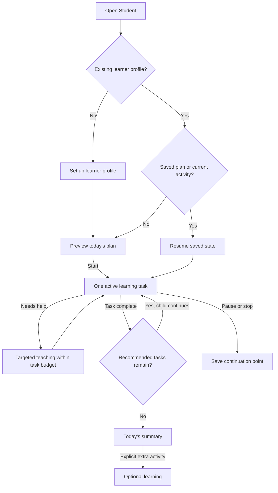

# Agent Note: Student daily learning plan and learner flow spec

Status: proposed

English | [中文](2026-11-25-student-daily-learning-plan.zh.md)

The [unit course spec](2026-11-27-student-unit-course-spec.md) further defines full interactive lessons for new learning, mini-lessons for review and explanation, unit outlines, and generation per lesson on demand. It partially refines this proposal's teaching order while retaining native file persistence, real evidence, and bounded assessment; course organization and generation behavior remain to be implemented.

## Problem

Children entering Student each day need to know what to learn, why those activities were selected, how to continue, and when they can finish. Parents need to confirm learning directions and school progress without choosing subjects, goals or questions every day. The capability catalog, learning records and continuation query provide part of this foundation, but do not organize these decisions into a stable, recoverable daily plan.

This spec serves product, implementation and acceptance review. It covers daily selection, initial setup, learner presentation, parent intervention, resumption and progress display. The user-approved design is implemented in the Student worktree, with verification recorded below. This note remains proposed until release; it does not authorize deployment or migration of real learning data.

### Current evidence

The pre-implementation review examined Student `0.2.6` production logic and source at `951bd73`. That review covered initial DSH entry only; synthetic profiles reproduced the following states through official reads and queries. Subsequent browser and native-model checks are recorded separately below.

| Problem | Observable result | Source |
| --- | --- | --- |
| Recommendations lack daily organization | The page queries the locally remembered subject, initially math; it has no cross-subject daily task list or completion boundary. | [Subject selection](../../../../plugins/dsh-student/packages/winterhuan/student/src/client/desk.tsx), [context query](../../../../plugins/dsh-student/packages/winterhuan/student/src/client/workspace.ts) |
| Scope confirmation has no complete path | A profile without `learningScopes` holds learning; the primary button opens the generic parent page, while the profile setup intent omits scope confirmation. | [Learning page](../../../../plugins/dsh-student/packages/winterhuan/student/src/client/today-view.tsx), [copy](../../../../plugins/dsh-student/packages/winterhuan/student/src/client/locales.ts) |
| Ended blocks can lose remedial priority | A synthetic incorrect counting response requests teaching while active; after block end and on the next day, selection moves to a new goal while counting remains `weak`. This case has no additional mistake declaration or round constraint. | [Continuation query](../../../../plugins/dsh-student/packages/winterhuan/student/src/learning/mastery.ts) |
| Recommendation and display disagree | The same synthetic capability is weak in `goalProgress`, but has no corresponding old map objective or displayed weak point. | [Dashboard projection](../../../../plugins/dsh-student/packages/winterhuan/student/src/dashboard.ts), [learning page](../../../../plugins/dsh-student/packages/winterhuan/student/src/client/today-view.tsx) |

## Proposal

Student reuses the learner profile, school progress and actual learning records to recommend today's content. Parents can add constraints when needed; children enter the activity through Start today's learning. Each task saves its goal, selection reason and completion condition. Actual responses guide subsequent learning, teaching and review. Children can continue, change content, pause or stop; learning after completion requires an explicit choice.

### Scope and existing decisions

Retain the [learning-flow and evidence architecture](../architecture/2026-11-12-student-learning-flow-architecture.md): native conversation, direct agent authoring of official files, read-only CLI validation and independent application reads. Retain capabilities, question families, source verification and classroom binding from the [OpenMAIC learning loop](2026-11-22-student-openmaic-learning-loop.md). This proposal owns daily organization and page states above that loop.

This proposal partially changes the earlier choice to derive every next step from existing files without a plan file: add daily arrangement files within one learner and term to preserve the order users saw or selected. Mastery, assessment and review due dates still derive from original evidence. It also proposes one new bounded review on a subsequent learning day after the previous review round ended, under the rules below. Existing proposals remain active and cross-linked; no implemented note is fully superseded or requires archival here.

Preserve the intent of [removing time limits](../../implemented/feature/2026-10-30-student-overhaul.md) and the [school frontier](../../implemented/feature/2026-10-14-student-school-frontier.md): recommended content and task ending conditions establish an expected stopping point, without daily minute caps, forced breaks or missed-day catch-up requirements. Home mastery cannot advance the school unit automatically. This scope does not expand curriculum coverage, rebuild the bank, change mastery thresholds, add background reminders or introduce a separate model runner.

### Roles and success

| Role | Default responsibility | Observable success |
| --- | --- | --- |
| Parent | Confirm learner and factual school progress; optionally constrain content and inspect help needs. | Existing information carries forward after upgrades; ordinary learning needs no per-subject unlocking. |
| Student | Recommend content from existing profile, valid evidence and optional parent constraints; prepare teaching and preserve resumption points. | Refreshes, different conversations and later days preserve continuity; pages agree on the same facts. |
| Child | Start, answer, ask for help, change content, pause or stop; ask their own questions. | The first screen explains the current task and has one primary action, without requiring knowledge of families or evidence budgets. |

## First-use and existing-data migration

Setup uses the current native conversation. Existing profiles, books, school units and learning records carry forward without repeating confirmation.

1. Reuse the existing learner and term identity; only a new profile requires basic setup.
2. Derive subject candidates from existing school progress and historical learning ranges. Optional parent constraints override defaults for their subject.
3. Without school progress, suggest a short diagnostic within the grade map. Never infer the current school unit or call missing evidence a weakness.
4. Parents can adjust content in settings. Save `learningScopes` only for an explicit extra constraint; automatic suggestions never create parent confirmations.

A missing `learningScopes` field does not block a subject. Migration first verifies exact-byte backups of official files and the complete lesson log, then fills known learner identity and legacy reference indexes. Original questions, responses, grades, assistance, dates and unknown facts remain intact. Validate in a copy, check current versions, write only necessary outputs with settings last, and independently read again. Repeating migration must not duplicate records or award mastery.

Select written, oral, listening, audiovisual and performed capabilities according to available modalities. Without audio input or observation evidence, written practice cannot count as listening or speaking assessment. Tasks needing unavailable equipment or parent observation cannot become impossible default tasks.

## Daily selection policy

Plans use the `Asia/Shanghai` calendar day and belong to a stable learner identity and current term. Initial reads may produce a read-only preview. The first explicit Start saves and independently verifies the plan through the native flow before starting its first task. Page opening, polling and midnight neither write files nor invoke model preparation automatically.

### Recommend today's content from actual needs

Select today's content from confirmed school progress, unfinished activities, actual capability evidence, difficulties and due review. Set no fixed daily task count and offer no Light or Standard workload modes. Each recommendation explains why it fits today; a main task addresses one capability through resumption, remedial teaching, a short diagnostic or new learning. Omit review when none is needed; review alone is valid when no new learning fits. When no content fits, explain why without generating filler or scheduling every candidate for today.

The learner home offers Today’s recommendations, Chinese, Math and English. Combined recommendations use confirmed subjects and label every item with its subject and reason; choosing a subject shows only its learning and review recommendations. Browsing or switching subjects cannot rewrite a saved plan or replace the current question or draft; explicitly starting that subject’s activity amends the arrangement. The learner page emphasizes the current recommendation and its reason; subsequent content adapts to valid learning feedback. Each task has a clear ending condition. Children may reduce content or rest at any time without completing every recommendation first. After completion, explicitly choosing Learn a little more adds one optional activity, marked separately, without undoing original completion or adding tasks automatically.

### Candidates and ordering

One query builds candidates across subjects using existing information before selecting daily tasks. Browsing a subject does not determine the default plan. Goal identity combines capability and applicable scope; families organize instances, and school units constrain eligibility.

| Order | Selection rule | Exclusions and stopping rules |
| --- | --- | --- |
| 1. Resume activity | Preserve the original unanswered, unassessed or unsynchronized task first; offer Continue or Set aside at start. | Recover original records when sources fail. Explicit deferral permits other valid tasks, without resending responses or recreating classrooms. |
| 2. Current gap | Use remedial teaching as the main task when actual evidence shows a current-goal or necessary prerequisite difficulty. | Address only the required scope, without requiring global prerequisite mastery; ending a block cannot erase remedial needs. |
| 3. Short review | Select families from valid due records, supporting the current goal first, then earliest due date and stable ID. Merge equivalent family/scope display entries. | At most two automatic review families per day; backlog does not expand today's workload. Unknown dates or sources cannot create due dates. |
| 4. Main learning | Without required resumption or current-gap teaching, select a subject, then unresolved weakness, unfinished capability, necessary short diagnostic, or eligible new learning in that order. | New goals respect confirmed school units, foundational scope and modalities. Selecting only `untouched` goals must not skip weak goals in ended blocks. |

For the main subject, consider only subjects with executable candidates. Prefer subjects not used as the main subject during the last three actual learning days, then the least recent main-learning day. On first use, apply the confirmed preference order, otherwise Chinese, math, English as the stable order. Subject coverage requires at least one valid assessed actual response in the main task; browsing, generation, skipping and unknown sources do not count. Resuming an activity or addressing its current gap may override coverage with an explanation; the system does not promise all three subjects every day.

Within one subject and priority, order by eligible school sequence, prerequisite relation to the current goal, least recent valid practice day and stable goal ID. Difficulties without a verified due date remain remedial candidates, without being labeled overdue. Merge main and review tasks requiring the same family and scope so the child supplies evidence once. Without another suitable candidate, add no content.

### Cold start and reasons

Grade and materials establish candidate scope, not what the child knows. On first learning within a scope, reuse compatible original responses first. If evidence is insufficient, embed a small diagnostic in the main task, with at most three new check instances, stopping once the next action is established. Missing history displays Not yet known instead of Weak.

Each task carries a child-facing reason, such as Yesterday you missed one while counting; today we will try another method. Parent details expose the basis, original responses and scope. Without supporting evidence, explain that the activity will explore what the child knows, instead of inventing difficulty, school progress or interests.

### Personalized independent learning and review

Personalized selection uses the current learner's actual responses, help records, verified assessments, necessary prerequisites and valid review dates for the relevant capability and scope. Children using the same grade and materials may receive different learning sequences and teaching methods. Interests may adapt the context but cannot replace capability evidence. After the child starts, the system uses each valid feedback result to decide the next step; the child only needs to answer or choose Continue, without parents arranging each activity.

| Learning state | Subsequent recommendation |
| --- | --- |
| Current checks satisfied, with prerequisites and scope permitting progression | Reuse compatible evidence, omit repetitive teaching of verified content and advance to the next eligible goal. Long-term mastery and subsequent review still follow the existing evidence rules. |
| Incorrect response, request for help or dependence on hints | Teach the specific error, adapt the explanation and difficulty within the current scope, and address necessary prerequisite gaps before checking missing evidence. |
| Learned content becomes due or difficulty recurs | Schedule review or remedial teaching from valid dates and original responses, updating recommendations under existing intervals and actual performance. One correct response does not cancel needed long-term consolidation. |
| Insufficient evidence, pending verification or persistent difficulty | Reuse verifiable records; use a short diagnostic or another teaching method when needed. Close at the existing check allowance with remedial needs retained, without repeatedly adding questions to obtain mastery. |

Valid feedback first updates recommendations. When the child continues, save amendments to unstarted content and their reasons. Active tasks, original questions and responses remain resumable and cannot be replaced by reordering. Recommendations may reduce, replace or reorder subsequent content; one incorrect response cannot automatically expand today's list. New recommendations cannot reopen completed or stopped plans; progression resumes only after an explicit continuation or addition. Page refresh and background polling only read state.

## Learning and completion

Daily task completion, block end, successful review and capability mastery represent separate facts. Completion clicks, classroom viewing, stopping and stars cannot increase independent responses, review stages or mastery.

| Current state | Primary action | Saved or derived result |
| --- | --- | --- |
| Plan ready | Start today's learning | Save and verify the plan, then open its first task; retain identity if preparation fails. |
| Question unanswered | Submit answer | Bind the original response only to its original question; distinguish receipt, saving and assessment. |
| Response awaiting assessment | Show processing status; retry processing on failure | Do not request another answer; resume handling of the same response. |
| Incorrect or helped response | Learn together | Teach the specific gap, then try a variant within remaining allowance; persistent difficulty can end this attempt with future teaching retained. |
| Task reaches its defined ending condition | Continue with the updated recommendation, or today's summary if none remains | Show outcomes as independent, helped or pending verification and explain the next step; save amendments on Continue. |
| Tasks in the current plan completed | View today's learning | Mark the plan completed; Learn a little more is optional, without automatic new questions. |
| Child stops or skips | Finish for today | Mark stopped or partial completion explicitly; unattempted tasks cannot become completed. |

Each task saves a verifiable ending condition. A review task may end after all selected families have an actual attempt and valid assessment. Incorrect outcomes remain Needs consolidation and do not count as successful review. A main task ends after its agreed teaching and short checks justified by available evidence, without waiting for long-term mastery across three independent days. Without actual responses, record only the end of teaching or pending verification, not verified learning achievement.

Retain the allowance of at most three new questions per check round, reusing valid classroom responses and checking only missing criteria. At the limit, a task can end this attempt with Needs teaching; automatically creating rounds cannot extend checks indefinitely. Unresolved difficulties remain candidates, with the next activity beginning through targeted teaching or a different method. Unknown historical facts do not block unrelated new activities, and new responses cannot fabricate those old facts.

## Pause, day changes and amendments

Plan states are ready, active, paused, completed and stopped for today; blocking reasons attach separately to affected tasks. Task states are ready, active, paused, completed, deferred, skipped and carried forward; outcomes are stored separately from states. Pending source verification or assessment adds a visible waiting state and cannot display unsupported completion.

| Event | Rule |
| --- | --- |
| Refresh, close page or switch DSH conversation | Restore the same learner, term, day, plan, task, question and round independently of browser subject preferences. |
| Pause | Save the resumption point without ending the question or refunding check/review allowances; continuation opens the original task. |
| Finish for today | Preserve completed and unfinished work and stop automatic progression; re-entry that day shows the summary and explicit Continue. |
| Midnight during an activity | Keep the activity in its original plan; record actual answer dates from evidence. Closing after midnight still shows that activity's summary; further learning in the same session is optional. Midnight cannot insert a new plan or reset allowances. |
| Start on a later day | Create today's plan on the first explicit Start. Prefer references to resumable tasks, preserving block, question, response and round identities. Mark the old plan's task as carried forward, without duplicate completion or rewards. |
| Several missed days | Recommend today's content from current needs, retaining old resumption references without accumulating missed daily workloads. |
| New learning day after an ended review round | Current due facts may establish one new daily review. Preserve the old round's end. Unfinished rounds retain consumed allowances; crossing a date alone refunds nothing. |
| Same-day re-entry, reorder or subject switch | Do not grant automatic review allowance again. Families entered that day remain counted; explicit Learn a little more creates a separate optional activity. |
| Parent narrows scope or changes school progress | Defer unstarted tasks that become invalid and explain why. Preserve affected active records and stop adding out-of-scope questions pending adjustment; saved responses remain attached to their original questions. |
| Parent expands scope or changes preferences | Offer Adjust remaining tasks after saving. Do not silently replace current content; the next day uses new settings by default. |
| Late assessment, historical import or correction | Update actual capability and future candidates. Ended plans may show corrected factual outcomes without reopening tasks or counting historical work as today's practice. |

Default to one plan per day. Explicit same-day resumption reuses and revises that plan. Optional activities after completion are attached separately without changing the original plan's completion. Every amendment saves its reason and replaced item; reordering cannot move or delete existing questions and responses.

A carried task directly references its original task identity and activity, with progression owned only by the current plan. Historical plans retain transfer references without following chains across days to find responses. Daily automatic review allowance aggregates all plans for the learner and date, including families newly entered that day in activities crossing midnight. Entry time constrains workload only and cannot replace actual answer dates or grant evidence. Both original-round and current-day remaining allowances constrain newly entered families.

## Student and parent presentation

The workbench has one functional navigation: Today, Knowledge and progress, Practice and marking, Lesson history, and Learning profile. Remove the Student/Parent switch; wrap destinations on narrow screens so all remain visible. Home, Learning and Today’s learning are states within Today, not parallel navigation destinations. Browsing another page or subject preserves the current activity, question and draft; returning to Today restores that flow state. Subject navigation appears only on Home; Learning shows the current subject, goal, question and tutor. Completing the current arrangement or explicitly stopping opens Today’s learning, grouped by subject with actual responses, consolidation needs and unfinished activities. Continue restores the original activity; Learn a little more explicitly adds an activity. Returning Home preserves current progress.

Existing activities without a daily plan enter Learning directly. Home can open Today’s gains when an activity or actual answers exist, even before a plan is saved; reading that page does not end the activity. The first explicit Pause, Stop or native Continue records only the original activity and the actual choice. It does not invent a historical Start, add other recommendations or count historical answers as today’s work. Gains list the actual topics, help, consolidation needs and pending results by subject, with a continuation entry for unfinished work.

Make the learning workbench the visible primary area in Student mode, showing the current learner and daily state when entering an existing learning workspace. Native conversation remains the executor and tutor for the current activity. Narrow-window switching between task and conversation preserves position, drafts and submission status. Missing model or workspace setup produces a specific parent-facing explanation.

| Page state | Primary content | Single primary action |
| --- | --- | --- |
| School progress missing | Existing profile and a grade-based diagnostic | Start without per-subject unlocking |
| Today ready | Today's recommended content, short reasons and the current priority task | Start today's learning |
| Learning active | Current question or teaching activity, response area and feedback | The action for the current question, without another ambiguous Continue button |
| Paused | Completed work and the named unfinished task | Continue learning |
| Sync or submission failure | Original response, explicit processing status and recovery explanation | Check or recover original processing |
| Completed or stopped for today | Work attempted, remaining consolidation and next continuation | View today's learning; extra practice is secondary |
| No suitable task in scope | Confirmed scope and the reason no task fits | View optional activities or request a scope adjustment |

Help me, Change content and Finish for today remain discoverable secondary actions. Child pages omit capability IDs, family allowances, source hashes, remaining check budgets and internal round states; teaching steps use child-facing language. Progress indicators describe today's tasks instead of capability mastery. An ended round cannot still announce one available review family.

Learning profile retains profile settings, weekly summaries and genuine parent action items. Knowledge and progress, Practice and marking, and Lesson history open directly from the main navigation. Daily controls expose reasons, adjustments or reductions to unstarted content, and scope updates. Specify today's content affects that day only and cannot silently widen long-term scope. Out-of-scope requests first confirm a change, explicitly limited to today or persistent.

## Shared progress and persistence

### One capability state for every page

Continuation, today's list, knowledge map, weak points, task feedback and parent summaries consume one evidence projection keyed by capability and scope. Old curriculum objectives display explicit associations. When one old item maps to several capabilities, show details or Partial knowledge instead of averaging an unsupported mastery value. Missing mappings display Needs association without hiding actual responses.

Three independent dates are only one mastery condition. Pages use the full mastery decision, not three dots or a correct current answer alone. Plan completion ratios cannot feed mastery, review stages or rewards. All pages must agree for identical evidence and query dates.

### Saved facts and write ownership

Add `.study/plans/YYYY-MM-DD.json` for daily arrangements, uniquely owned by `learnerId + termId + day`, with `Asia/Shanghai` fixed as its timezone. The implementation uses this path and the fields below; old workspaces without plans remain valid. Daily files store arrangements and user choices without copying questions, original responses, assessments or capability states.

| Content | Minimal saved fields or references | Validation |
| --- | --- | --- |
| Plan identity | File format version, plan ID, learner, term, day, timezone, revision, creation time and policy version | Path and identity match; no second default plan for the same day. |
| Settings basis | Confirmed settings version, participating subjects, learning records supporting selection and reasons | Scope is valid at selection; settings changes revalidate unstarted tasks. |
| Task | Stable task ID, purpose, subject, goal and scope, order, ending condition, state and outcome basis | Each recommendation traces to a valid learning need or explicit user choice; completion or difficulty claims have original factual support. |
| Activity binding | Original term and block, round, worksheet, lesson and existing response references | Match learner, scope and question ownership; cross-day references do not copy responses. |
| User choice | Pause, stop, defer, skip, amendment reasons, carry-forward/back references and optional activities | The source of each action is traceable; passive page refresh cannot create choices. The initiating choice may precede plan creation while the tutor prepares it; it cannot follow the saved update. |

The Host returns deterministic previews, saved plans and legal actions through read-only queries. The agent executes Start or amendment intents, directly saves official plan/activity files and runs the CLI. The application confirms success only after independently reading actual versions. Explicit manual adjustments retain application version checks. Validation rejects out-of-scope candidates, identity conflicts and unsupported completion, without adding a candidate publication area, model-certified success or a writing CLI.

Each Start reuses saved plan and operation identities before binding an activity. Repeated requests, multiple clicks and unknown receipt results first inspect original processing instead of creating another plan, block or classroom. Multiple conversations carry observed versions; conflicts retain the user's choice and require rereading before continuation, without promising detection of every unconditional native overwrite.

Plan and block writes are not cross-file atomic. A saved plan without an activity displays Preparation incomplete. CLI completion checks original ended activity and assessed-attempt structure; the application separately verifies sources and labels unverified outcomes as pending. An existing activity without a saved plan reference is linked after identity verification. Missing or invalid plans preserve originals and saved evidence, pause affected progression and offer recovery; they cannot reset learning to blank or fabricate completion.

Queries load full content only for today, the original plan of a resumed activity or the latest activity closed today, and the last three actual learning days needed for subject selection. Historical details load by date. Metadata scans cover at most 1,000 plans in the current term, each at most 1 MiB and included in the existing 32 MiB active-term limit. Continuation references point directly to original tasks; cycles and multilevel transfer chains are invalid. At the limit, request archival or adjustment without automatic deletion. File validation and recovery scenarios must cover these initial storage limits.

## Delivery sequence

The implementation follows these stages within the Student submodule. The verification record distinguishes automated regression, real browser behavior and live model tutoring; release remains separate.

| Stage | Work | Delivery condition |
| --- | --- | --- |
| 1. Shared capability state | Unify continuation, map, weak points and parent records around capability/scope projections; include weak goals from ended blocks. | One response produces consistent views, and block end preserves remedial needs. |
| 2. Reuse existing data | Migrate stable identity and legacy indexes; derive ranges from existing profile and progress. | Existing learners continue without repeated confirmations or lost history. |
| 3. Daily plan and recovery | Select from actual needs, adapt learning and review to feedback, and save plans and task states with subject coverage, day changes and concurrency recovery. | Restart restores the same plan; subsequent recommendations adapt to valid feedback without duplicate activities or responses or automatic questions after closure. |
| 4. Learner page | Prioritize current activity, one primary action, daily closure, parent action items and optional activities. | Main paths work in wide/narrow windows and light/dark themes. |
| 5. Real flow acceptance | Verify native conversation, actual files, classroom feedback and display in an isolated profile. | Meet the table below and record versions, evidence and gaps before considering release. |

## Alternatives considered

**Continue asking parents to select each day.** This gives precise daily control but preserves the main burden. Parent-specified content remains an optional override.

**Let the model decide afresh on every opening.** This is flexible, but plans drift across conversations and retries, making resumption and duplication hard to explain. Use deterministic selection and stable plans, while the model adapts teaching within scope.

**Change only buttons and layout.** This reduces visual noise but cannot fix skipped weak goals, missing daily organization or inconsistent progress. Address business state first.

**Require fixed daily task counts, three subjects daily, fixed minutes or practice proportional to mistakes.** This creates uniform progress displays but may ignore needs, modalities and fatigue. Recommend content from actual learning needs and consider subject coverage across actual learning days, with voluntary stopping.

**Save no daily arrangement.** This avoids a file type but cannot reliably distinguish seen plans, skipped tasks and extra activities after refresh. Save those arrangement facts without copying assessment or evidence.

## Acceptance criteria

These are implementation acceptance requirements; the record below distinguishes completed checks from remaining release coverage. Synthetic data verifies pure policy and file behavior. UI and native teaching paths require real DSH verification through `ego-browser` in an isolated profile; component tests and model statements cannot substitute.

| ID | Scenario | Required observable result |
| --- | --- | --- |
| A01 | New profile without materials or scope | Basic profile enables a short grade-based diagnostic without invented school progress. |
| A02 | Existing profile without `learningScopes` | Preserve confirmations and use existing school progress; no per-subject blocker. |
| A03 | Math has an explicit constraint, English has none | Math respects its constraint; English uses existing data or grade defaults. |
| A04 | No historical evidence | A small diagnostic belongs to the main task, without assuming weakness or requiring a full exam; at most three new checks. |
| A05 | All three subjects have executable candidates and no required continuation | The least-covered main subject receives priority; browsing or clearing local preferences cannot change a saved plan. |
| A06 | Incorrect counting, block end, re-entry and next-day Start | Difficulty remains a remedial candidate; `endedAt` cannot restrict selection to untouched goals. |
| A07 | Large due-review backlog | Recommend today's content from actual needs without scheduling the whole backlog. Retain the existing limit of two automatic review families per day; leave the remainder for later. |
| A08 | Incorrect/helped responses exhaust checks | Provide targeted teaching and permit closure with difficulty retained; do not create endless new check rounds. |
| A09 | Daily tasks completed before long-term mastery | Today is complete while capability retains its actual state; no automatic additions or false mastery. |
| A10 | Pause, refresh, restart and another native conversation | Resume the same task, question and round; saved answers and drafts cannot attach to another question. |
| A11 | Start at 23:59 and answer at 00:01 | Activity stays in the original plan; the actual response belongs to the next date. Midnight neither grants allowance nor inserts tasks. |
| A12 | Ended review round followed by next-day due needs | A new plan can schedule one bounded review. Same-day reopening does not regrant automatic allowance; unfinished rounds retain consumption. |
| A13 | Several days without use | Recommend from the current learning state without accumulated daily lists; original unfinished activities remain resumable. |
| A14 | Learn a little more after completion | Optional work has an explicit request and separate record; original completion persists without automatic further additions. |
| A15 | Parent narrows scope, changes school unit or requests out-of-scope content | No new out-of-scope questions; preserve responses and distinguish temporary from persistent confirmed scope changes. |
| A16 | Capability shown in recommendation, map, weak points and parent page | Scope, independent dates and mastery agree; missing old mappings display Needs association instead of no history. |
| A17 | Multiple clicks, concurrent conversations or unknown Start result | Check existing identities and versions, restoring one default plan and original activity without resending responses or recreating lessons. |
| A18 | Interruption after plan write, missing reference or invalid file | Preserve originals and evidence and show specific recovery; no fabricated completion or silent reset. |
| A19 | OpenMAIC responses awaiting sync or service unavailable | Recover the original lesson without mastery from unverified sources; explicit deferral permits other valid tasks. |
| A20 | Late assessment or parent correction of an old question | Correct original evidence and capability only; do not reopen completed plans or count new practice/rewards today. |
| A21 | Light/dark, wide/narrow and Chinese/English | One clear primary action, readable copy and unobscured layout; waiting, error, empty and return paths work. |
| A22 | Plan-file or reference limit reached | Give a concrete limit and recovery action without unbounded traversal or automatic deletion; older workspaces without plans remain usable. |
| A23 | Same grade and materials, different learning evidence or review needs | Recommend progression, remedial teaching or review as appropriate, with reasons; apply no fixed daily task count or required Light/Standard mode selection. |
| A24 | New valid responses or help records after Start | Select a suitable next step without parents choosing questions. Save amendments to unstarted content on Continue, preserve original questions, drafts and responses, and keep ended plans closed. |
| A25 | Current checks satisfied and next goal eligible, before long-term mastery | Permit recommended progression with future consolidation retained. Recommend review when due, using valid dates, independence and existing intervals; progression cannot count as mastery. |
| A26 | Choose a subject, start, stop, return and refresh | Subject navigation appears only on Home; every recommendation identifies its subject and matches the selection. Summary creates no completion evidence; continuation restores the same question and draft. The four parent sections remain separate. |
| A27 | Existing activity has no daily plan; inspect gains, pause and reload | Reading creates no plan; Pause/Stop binds only the original activity with the actual choice. Gains show no fabricated completion or historical answers as today’s work, and Continue restores the same question and draft. |

Implementers record type checking, build, relevant tests and documentation checks. Product review checks recommendations, reasons and child-facing copy. Real acceptance includes existing-data migration and Start → Answer → Help → Complete → Next-day continuation, separately reporting native classroom generation and feedback coverage. Synthetic queries supply regression cases only.

## Implementation verification

The Student `codex/student-daily-learning` worktree uses Node `24.22.2`, pnpm `11.7.0` and DSH `0.2.2-rc.5`. Source, generated Host/Client code, types and native study instructions are synchronized. The package remains `0.2.6`; the changes are delivered as a fixed Git package, without an npm release or a new tag.

### Automated checks

| Check | Result and evidence |
| --- | --- |
| Types and builds | Host, Client and script types and both build faces pass. Logs: `/tmp/student-legacy-flow-build.log`, `/tmp/student-legacy-flow-client-final.log`, `/tmp/student-legacy-flow-script-types.log`. |
| Regression suite | 43 files and 481 tests pass, including existing scopes, read-only old-activity projection, explicit pause adoption, original drafts, actual-day summaries, completed-plan preservation and pending topic results. Log: `/tmp/student-legacy-flow-tests-final.log`. |
| Native recovery | Real native tools, read-only CLI and independent reads pass migration interruptions, changed-source rejection, observed backups, restore, archive and old-term rejection. The model and learner data are scripted. Log: `/tmp/student-daily-recovery-final.log`. |
| Native classroom feedback | Native authoring, protected source reads, CLI validation, independent acceptance, restart and persisted question allowance pass against a synthetic HTTP classroom and scripted model. Log: `/tmp/student-daily-feedback-final2.log`. |
| Documentation | Paired spec and package READMEs pass structure and hash checks; the parent repository's 16 documentation checks and both repositories' whitespace checks pass. Log: `/tmp/student-existing-flow-docs.log`. |

### Real browser and model checks

The isolated `daily-qa` profile on port `3184` uses a fictional learner under `/tmp/student-daily-acceptance` and the linked worktree. The live run starts with the configured `group/never-stuck` provider, then switches the isolated session to the existing DeepSeek account's `DeepSeek-V4.1-Flash` model for continuation. No real learner directory is used. UI actions, native history, official files and independent workbench reads establish these results.

| Path | Observed result |
| --- | --- |
| Entry and scope | Student opens its workbench. Existing profiles use their books, school progress and grade defaults without per-subject confirmation gates. English recommendations and optional parent range adjustment are verified after migration. |
| Start and original answer | Start creates one plan and original question. The native agent saves the workbench answer `7` and its assessment; the independent reader displays correct feedback. Method and variation evidence remains missing, without granting mastery. |
| Midnight and recovery | The plan remains dated `2026-11-25`; the original receipt dates the answer to `2026-11-26`. Restart, refresh and a new conversation retain the same block, question and round. The draft survives refresh and appears in another conversation before saving. |
| Subject browsing | Home’s English selection shows grade-based recommendations while retaining the original math activity. Browsing creates no new plan, question or response. |
| Pause and summary | After explicit recovery guidance, the native agent saves the plan and task as paused while retaining the original activity and response. CLI validation and independent reads pass. The summary shows one actual independent response, the unfinished task and Continue, with no recommendation list or mastery claim. |
| Help and completion | Continue retains the original block and round. The next response retains its hint; the third response is independent. Explicit Finish completes the original plan. The summary shows three actual responses, two independent, one helped and one needing consolidation, without granting mastery. |
| Optional learning | Learn a little more adds a separate optional teaching activity without resetting the exhausted check round. Its additional question remains blocked by that allowance; creation and pause are verified, not a fourth assessed answer. Pausing it preserves the original completed state and completion time. The summary retains the three actual responses and offers Continue for the unfinished optional activity. |
| Presentation | Wide and 430-pixel narrow layouts are inspected in Chinese/light and English/dark. Narrow client and scroll widths agree; question, draft and controls remain usable. UI copy translates; authored lesson content retains its language. |

The live run exposed a timing-validation bug: a Start click can precede file creation while the native tutor prepares the task. Validation now preserves that original choice time and rejects a choice after the saved update; a regression test covers delayed creation. Midnight closure also exposed a missing original-plan read: the reader now retains the latest activity closed today, and Home sends Extra after completion. Optional pause returns to the summary while preserving completion. Regression tests cover these fixes. Recovery reuses the original response and receipt without resending the child's answer. The initial model repeatedly revisited old validation and pause rules and required interruption and explicit recovery guidance; this is not an uninterrupted usability pass. Screenshots and isolated native history remain under `/tmp/student-daily-acceptance`, with logs and screenshots copied to the Student worktree's ignored `.artifacts/student-daily-learning/`; these local artifacts are not release artifacts.

Live Help, completion and optional pause pass; the live continuation crosses midnight while retaining its original plan. A fresh later-day plan and task transfer are covered by automated tests, not a separate live later-day Start. Online classroom generation is not covered by this run; the scripted feedback check must not be reported as online acceptance or evidence of teaching quality.

### Existing-data and flow acceptance

On November 26, the daily learner archive was backed up byte-for-byte before the official migration description was applied: 11 blocks, 24 worksheets and 57 responses remain intact, with 10 legacy-reference indexes added. Original questions, answers, assessments, help, dates, learner and term identities are preserved; missing confirmations are not invented. CLI validation and repeat migration checks pass. The protected backup is `/Users/winter/.dsh/backups/student-data-migration-20261126-063111`; no learner data is committed.

A fresh synthetic pre-plan activity in the isolated profile passes Home → gains → original question, Pause → refresh → Continue → answer → Stop. The live tutor creates one plan with only the original activity and `pause`, `continue`, `stop` choices; it retains one original question and one authenticated native answer. The summary lists its actual topic and independent response while retaining unfinished work. CLI and independent reads pass, with no new task, historical Start or completion fabricated. Wide and 430-pixel layouts are inspected without horizontal overflow. Evidence: `/tmp/student-existing-flow-validation-final.json` and `/tmp/student-daily-acceptance/existing-flow-summary.png`.

The fixed remote package is installed in the daily `student` profile and that profile has restarted. All 813 tracked runtime and knowledge files match the built commit. The actual learner’s Home → gains → original English activity path is verified without submitting answers; the archive still has 11 blocks, 24 worksheets and 57 responses. Evidence: `/tmp/student-existing-flow-install.log`, `/tmp/student-existing-data-postfix-validation.json`.

## Risks

Daily plans add persistence and recovery complexity, while direct native file editing can still overwrite unobserved changes. Stable identities, version checks and partial-write recovery must be implemented together. Plans record arrangements; copying capability or assessment state would recreate competing sources of truth.

Personalized selection and subject rotation require validation against different learning records. Insufficient evidence supports exploratory recommendations, not a claim that the child's capability has been accurately determined. Persistent difficulty, unavailable equipment or school progress may override coverage for extended periods. Explain this to parents and suggest adjustments instead of scheduling out-of-scope or pointless tasks for balance.

Next-day scheduling after an ended review changes the current allowance policy. Implementation must distinguish a new learning day, an unfinished round and same-day repeated requests; otherwise review can disappear or reopening can repeatedly add questions. Mixing daily completion with capability mastery in copy would introduce misleading progress again.
