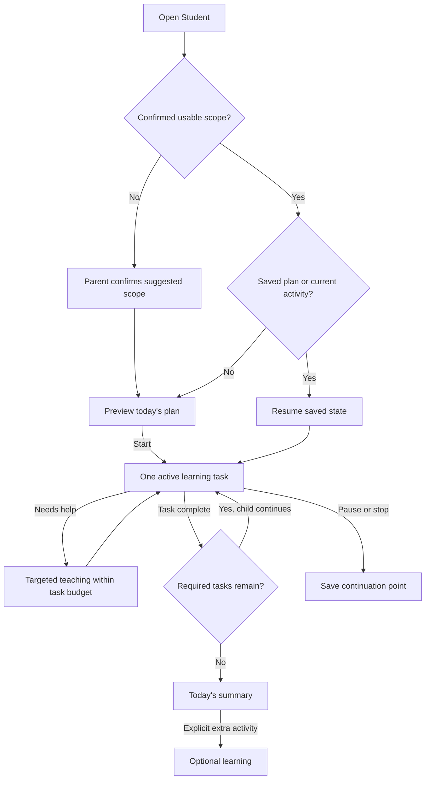

# Agent Note: Student 每日学习计划与学习主流程 spec

Status: proposed

[English](2026-11-25-student-daily-learning-plan.md) | 中文

## Problem

孩子每天进入 Student 后，需要知道今天学什么、为什么安排这些内容、怎样接着学，以及何时可以结束。家长需要确认阶段性学习方向和学校进度，无需每天选科、选知识点或准备题目。现有能力目录、学习记录和下一步查询已具备部分基础，但还没有把这些决策组织成稳定、可恢复的每日计划。

本 spec 面向产品、开发与验收，覆盖每日选题、首次设置、学生页面、家长干预、暂停续学和进度展示。全部新增规则均为提议；本文不代表功能已实现，也不授权发布或迁移真实学习数据。

### 当前依据

检查基于 Student `0.2.6` 的生产逻辑与 `951bd73` 源码。真实 DSH 仅验证首次进入界面；合成档案经正式读取与查询复现以下状态。有记录的完整浏览器流程、真实模型教学和线上课堂未在本次审查中验收。

| 问题 | 可观察结果 | 源码依据 |
| --- | --- | --- |
| 推荐缺少每日组织 | 页面按本地记住的学科查询下一步，初始默认为数学；没有跨科今日任务与完成边界。 | [学科选择](../../../../plugins/dsh-student/packages/winterhuan/student/src/client/desk.tsx)、[上下文查询](../../../../plugins/dsh-student/packages/winterhuan/student/src/client/workspace.ts) |
| 范围确认未闭环 | 有档案但缺少 `learningScopes` 时暂停；主按钮只切到通用家长页，档案设置意图没有包含范围确认。 | [学习页](../../../../plugins/dsh-student/packages/winterhuan/student/src/client/today-view.tsx)、[文案](../../../../plugins/dsh-student/packages/winterhuan/student/src/client/locales.ts) |
| 结束后遗漏薄弱目标 | 合成数数错答在活动中触发讲解；结束学习段后及次日推荐新目标，数数仍为 `weak`。该例没有额外错题声明或轮次约束。 | [继续查询](../../../../plugins/dsh-student/packages/winterhuan/student/src/learning/mastery.ts) |
| 推荐与展示不一致 | 同一合成能力记录在 `goalProgress` 中为薄弱，旧地图目标、页面薄弱点列表却没有对应项。 | [面板投影](../../../../plugins/dsh-student/packages/winterhuan/student/src/dashboard.ts)、[学习页](../../../../plugins/dsh-student/packages/winterhuan/student/src/client/today-view.tsx) |

## Proposal

家长确认范围，Student 安排当天的一小组任务，孩子通过“开始今天的学习”进入一个活动。每项任务保存目标、安排理由与结束条件；真实作答改变后续建议。每日安排自动推荐，开始、换内容、追加练习和停止由孩子明确操作。

### 范围与既有决策

沿用[学习流程与证据架构](../architecture/2026-11-12-student-learning-flow-architecture.zh.md)的原生对话、agent（智能体）直接编辑正式文件、只读 CLI（命令行界面）校验与应用独立读取规则。沿用 [OpenMAIC 学习闭环](2026-11-22-student-openmaic-learning-loop.zh.md)的能力、母题、来源核验和课堂绑定；本提案负责其上层的每日安排与页面状态。

本提案部分调整上述提案中“下一步完全由现有文件推导、不新增计划文件”的选择：增加学生和学期内的每日安排文件，保存用户已看到或选择的顺序；掌握、评价、复习到期仍从原证据推导。另提议允许下一学习日为已结束的复习轮次建立一次新的有限复习，具体约束见下文。旧提案保持有效并交叉引用，本次没有已被完全取代的 implemented 笔记需要归档。

保留[取消时长限制](../../implemented/feature/2026-10-30-student-overhaul.zh.md)与[学校进度界线](../../implemented/feature/2026-10-14-student-school-frontier.zh.md)的意图：任务数量给出收尾预期，不设置每日分钟上限、强制休息或补打卡；家里学会不能自动推进学校单元。本期不扩展课程覆盖、不重建题库、不改变掌握阈值、不新增后台提醒或独立模型执行器。

### 角色与成功标准

| 角色 | 默认职责 | 成功表现 |
| --- | --- | --- |
| 家长 | 确认学生、学习范围、学校进度与可用学习方式；查看需帮助事项。 | 完成设置后，正常学习日无需再次指定题目或目标。 |
| Student | 从有效证据和已确认范围生成计划，准备当前教学，解释建议并保存恢复位置。 | 刷新、换会话与次日进入均能接续；同一事实在各页面一致。 |
| 孩子 | 开始、回答、求助、换内容、暂停或结束；可提出自己的问题。 | 首屏能理解当前任务，主要操作只有一个，不必理解母题或证据额度。 |

## First-use and scope confirmation

设置由当前原生对话分步完成，工作台显示确认摘要与具体待办。已有档案只补缺少的信息，不重走全部设置。

1. 确认学生与学期；学校教材、当前单元可稍后补充。
2. 选择参与自动安排的学科与学习方向：“跟学校学”或“先打基础”。家长可用自然语言描述，不要求填写能力 ID、母题 ID 或数域字段。
3. 系统根据已核对目录给出具体范围建议、依据和可用方式。跟校模式缺少当前单元时，家长可补单元或明确确认基础范围；未经确认不猜学校进度。
4. 展示一张摘要：“学哪些内容、暂不安排哪些内容、如何练习”。家长明确确认后保存 `learningScopes` 等设置，独立读取成功才显示“开始今天的学习”。

范围不足的主按钮直接进入“确认数学学习范围”等对应步骤，带入已有信息和推荐值。取消或保存失败保留草稿和缺项说明；家长返回后接着完成该步骤。一个学科缺少范围只排除该科，其余已确认学科仍可生成计划；全部缺少时才进入设置状态。

文字、口头、听力、视听和实际操作能力按可用方式分别选取。没有音频输入或观察依据时，不把文字练习当听说检验；需要额外设备或家长观察的任务不得成为无法完成的默认任务。

## Daily selection policy

每日计划使用 `Asia/Shanghai` 的日期，属于稳定学生身份与当前学期。首次读取可只读预览；孩子首次点击开始时，由原生流程保存计划并经应用独立核验，再启动第一项。打开页面、轮询和午夜到来不写文件，也不自动调用模型备课。

### 默认任务量

默认安排最多两项必选任务：有需要时的一项短复习，以及一项主要学习。短复习最多包含两个母题；主要学习只围绕一个能力目标，可以是接续、补讲、短摸底或新学。没有复习需要时只安排主要学习，不为填满列表造题。没有合适新学时可以只复习；没有可用任务时解释原因，不产生空任务。

家长可选择“轻量”，每天只安排一项；默认值为“标准”。这些是初版产品默认值，不是教育效果结论。孩子随时可减少任务或先休息。完成后明确点击“再学一点”可追加一次自选活动，单独标注；不会撤销原计划的完成状态或自动产生更多必选任务。

### 候选与排序

同一查询先为全部已确认学科建立候选，再选择今日任务；页面正在浏览哪科不影响默认计划。目标身份为能力加适用范围，母题组织实例，教材单元只约束可学范围。

| 顺序 | 选择规则 | 排除与结束规则 |
| --- | --- | --- |
| 1. 恢复当前活动 | 优先保留未答题、待评价或待同步的原任务；启动时给出继续或暂放选择。 | 来源异常先恢复原记录；可显式暂放并进入其他有效任务，不能重发回答或重建课堂。 |
| 2. 当前缺口 | 当前目标或必要先修有真实困难证据时，把补讲作为主要任务。 | 只补当前需要的范围，不要求所有先修全局掌握；不因学习段结束删除补学需要。 |
| 3. 短复习 | 从有效到期记录选母题，优先支持当前目标，再按最早到期、稳定 ID 排序；同母题与等价范围合并展示。 | 当天自动复习总计最多两个母题，积压不扩大今日任务量；日期或来源不明不伪造到期时间。 |
| 4. 主要学习 | 无需恢复或补当前缺口时，先选学科，再在该科依次选未解决薄弱目标、未完成能力、必要短摸底、可学新目标。 | 新目标遵守已确认学校单元、基础范围和方式；不能只挑 `untouched` 而跳过结束学习段中的薄弱目标。 |

选择主要学科时，在有可执行候选的学科中，优先选择最近三个实际学习日未作为主要学科的科目；其次按最近主要学习日从远到近排序。首次使用按已确认的偏好顺序，没有偏好时采用语文、数学、英语的稳定顺序。主要任务至少已有一条有效、已评价的真实作答，才计一次学科覆盖；单纯浏览、生成、跳过或未知来源不计。恢复原活动与补当前缺口可优先于覆盖规则，界面说明原因，不承诺每天必学三科。

同科同优先级依次按学校可学顺序、与当前目标的先修关系、最近有效练习日从远到近、稳定目标 ID 排序。无已确认到期日的困难仍可成为补学候选，但不冒充到期复习。主任务与短复习需要相同母题及范围时合并，不重复要求同一份证据；无其他合适候选时不补满第二项。

### 冷启动与安排理由

年级和教材只能确定候选范围，不能证明孩子已会或不会。首次在一个范围内学习时，先复用兼容的原作答；证据不足则把少量摸底嵌入主要任务，最多三道新检验实例，够判断下一步即可停止。无学习记录显示“尚未了解”，不能显示“薄弱”。

每项任务带一个面向孩子的安排理由，例如“昨天数数容易漏掉一个，今天换个方法试试”。家长详情可查看选取依据、原回答和范围；没有来源依据时显示“先了解你会哪些”，不能编造困难、学校进度或兴趣。

## Learning and completion

今日任务完成、学习段结束、复习成功和能力掌握分别表示不同事实。点击完成、观看课堂、停止或获得星星均不能增加独立作答、复习阶段或掌握度。

| 当前情况 | 主要操作 | 保存或推导的结果 |
| --- | --- | --- |
| 计划已就绪 | 开始今天的学习 | 保存并核验计划，打开第一项；当前活动准备失败时保留身份。 |
| 当前题未回答 | 提交回答 | 原回答只归原题；显示接收、保存和评价状态。 |
| 已回答，等待评价 | 查看正在处理的状态；失败时重试处理 | 不要求再次作答；恢复同一回答的处理。 |
| 答错或依赖提示 | 一起学一学 | 先针对错处补讲，再在剩余额度内尝试变式；持续困难时结束本次尝试并保留后续补学。 |
| 本项已到预定结束条件 | 下一项；无下一项时查看今日收获 | 显示完成结果，区分独立完成、需要帮助、仍待核对。 |
| 所有必选任务已完成 | 查看今日收获 | 计划为已完成；可选“再学一点”，不自动生成新题。 |
| 孩子主动结束或跳过 | 今天先到这里 | 明确标为已结束或部分完成，不把未做任务标成完成。 |

任务保存可核验的结束条件。复习任务在选定母题均完成本次尝试并取得有效评价后可以结束，其中答错的任务结果为“仍需巩固”，不计复习成功。主要任务完成约定教学及已有证据所需的短检验即可结束，不等待跨三个独立日期的长期掌握；缺少真实回答时，只能记录教学活动已结束或待核对，不能声称已验证学习成果。

检验沿用每轮最多三道新题的额度，优先使用有效课堂回答，只补缺项。达到额度仍有困难时，本项可按“本次尝试结束、需补学”收尾；不能通过自动创建新轮次无限加题。未解决困难进入后续候选，但下一次活动以针对性教学或调整方式开始。未知历史事实不阻塞无关新活动，也不能靠新作答补造旧事实。

## Pause, day changes and amendments

计划状态为待开始、进行中、已暂停、已完成、今天已结束；阻塞原因另附在受影响任务上。任务状态为待开始、进行中、已暂停、已完成、已暂放、已跳过、已转入后续计划；结果和状态分开保存。来源核验或评价未完成时，页面叠加对应等待状态，不能显示无依据的完成。

| 事件 | 规则 |
| --- | --- |
| 刷新、关闭页面、换 DSH 会话 | 恢复同一学生、学期和日期的计划、任务、题目和轮次；不依赖浏览器本地学科偏好。 |
| 暂停 | 保存恢复位置，不结束题目、不返还检验或复习额度；继续时仍进入原任务。 |
| 今天先结束 | 保留已完成部分与未完任务，停止自动推进；当天再次进入显示总结及明确的“接着学”。 |
| 跨午夜仍在学习 | 当前活动继续属于原计划；实际作答日期按证据记录，午夜不插入新计划或重置额度。 |
| 次日重新开始 | 在首个明确开始动作上建立当天计划；优先引用可继续的旧任务，保留原 block、question、response 和 round 身份。旧计划中的任务标为已转入后续计划，不能重复计完成或奖励。 |
| 中断多天 | 今天重新选有限任务；旧任务保留可恢复引用，不把漏掉的天数累加成今日任务。 |
| 已结束复习轮次后的新学习日 | 允许根据当前到期事实新建一次当日复习；旧轮次保留结束状态。尚未结束的轮次沿用已消耗额度；跨天本身不返还额度。 |
| 同日重新进入、重排或切科 | 不再次获得自动复习额度；当天已进入母题持续计数，显式“再学一点”另记追加活动。 |
| 家长缩小范围或更换学校进度 | 未开始且不再合法的任务暂放并说明；受影响的活动保留原记录、停止新增范围外题目，提示调整。已保存回答仍归原题。 |
| 家长增加范围或修改偏好 | 保存后提供“调整今天剩余任务”；不无声替换进行中的内容，次日默认采用新设置。 |
| 迟到评价、补录历史或评分更正 | 更新真实能力与后续候选；已结束计划的事实结果可更正，但不自动重开当天任务，也不把历史作答算为今日新练习。 |

默认一天一份计划。当天明确重新开始复用原计划并记录修订；已经完成后追加的自选活动保存为附加项，不改变原必选清单的完成结论。每次调整保存原因与被替换项，既有题目和作答不随计划重排而移动或删除。

跨日接续的任务直接引用最初任务身份和原活动，只有当前计划负责推进；历史计划保留转出关系，不沿多天转移链寻找答案。当天自动复习额度按学生与日期汇总全部计划，包括跨午夜活动当日新进入的母题。进入时间仅用于限制任务量，不能代替实际作答日期或授予证据；原轮次剩余额度和当日剩余额度同时约束新进入的母题。

## Student and parent presentation

学习工作台成为学生模式下可见的主区域，进入已有学习工作区时直接显示当前学生和今日状态。原生对话继续执行教学与操作，作为当前活动的辅导区；窄窗口切换任务与对话时保留位置、草稿和提交状态。首次缺模型或工作区时，用面向家长的具体设置提示解释阻塞。

| 页面状态 | 主要内容 | 唯一主要动作 |
| --- | --- | --- |
| 缺少范围 | 已有档案、具体缺项、范围建议 | 请家长确认对应学科范围 |
| 今日待开始 | 一至两项任务、简短理由与先后关系 | 开始今天的学习 |
| 学习进行中 | 当前题目或教学活动、作答区、反馈 | 当前题对应操作；不另放一个含义不明的继续按钮 |
| 已暂停 | 已完成部分、未完任务的具体名称 | 接着学 |
| 同步或提交异常 | 保留原回答、明确处理状态、恢复解释 | 核对或恢复原处理 |
| 已完成或今天已结束 | 做了什么、仍需巩固什么、下次接续说明 | 查看今日收获；追加练习为次要动作 |
| 当前范围无合适任务 | 已确认范围和无任务原因 | 查看可选活动或请求调整范围 |

“我需要帮助”“换内容”“今天先到这里”作为可发现的次要操作。儿童页面不显示能力 ID、母题数额度、来源哈希、检验剩余预算或内部轮次状态；教学步骤使用孩子能理解的语言。进度条描述今日任务完成情况，不标为能力掌握进度。结束的轮次不能继续显示“本轮还可进入一类复习”。

家长页保留档案与总结、知识与进度、练习与批改、课堂记录，并在顶部集中显示真正需要家长处理的事项。每日计划支持查看安排理由、调整未开始任务、更新范围和降低任务量；“今天指定内容”只影响当天，不自动扩大长期范围。范围外指定先确认变更，明确今天一次有效还是持续有效。

## Shared progress and persistence

### 一份能力状态供全部页面使用

继续查询、今日列表、知识地图、薄弱点、任务反馈和家长总结使用同一份能力及范围的证据投影。旧课程目标通过明确课程关联展示；一个旧条目对应多项能力时展示明细或“部分已了解”，不平均出一个没有证据支持的掌握值。无映射保留“待关联”，不隐藏真实作答。

三个独立日期只是掌握条件的一部分；页面用完整的掌握判断显示“已掌握”，不能单凭三个圆点或本题答对判断。计划完成率不进入能力掌握、复习阶段或奖励推导。相同证据与查询日期下，各页面状态必须一致。

### 保存事实与写入责任

新增 `.study/plans/YYYY-MM-DD.json` 保存当日安排，每文件唯一归属一个 `learnerId + termId + day`，时区固定为 `Asia/Shanghai`。该路径与以下字段是待实现约定；旧工作区缺少计划文件仍是合法状态。每日文件只记录安排与用户选择，不复制题面、原回答、评分或能力状态。

| 内容 | 最小保存字段或引用 | 校验要求 |
| --- | --- | --- |
| 计划身份 | 文件格式版本、计划 ID、学生、学期、日期、时区、修订、创建时间、规则版本 | 路径与身份匹配；同日不能创建第二份默认计划。 |
| 设置依据 | 已确认设置版本、参与学科、任务量、可解释的选取原因 | 生成时范围有效；设置变化后重新校验未开始任务。 |
| 任务 | 稳定任务 ID、用途、科目、目标与范围、顺序、结束条件、状态、结果依据 | 必选最多两项；所有完成或困难结论都有原事实依据。 |
| 活动绑定 | 原学期及 block、round、worksheet、lesson 引用，已有 response 引用 | 匹配学生、范围与题目归属；跨日引用不复制回答。 |
| 用户选择 | 暂停、停止、暂放、跳过、调整原因、转入/转出计划引用、附加活动 | 操作来源可追溯；不能由无操作的页面刷新创建。 |

Host 通过只读查询给出确定性计划预览、已有计划和可用操作；agent 执行开始或调整意图，直接保存正式计划与活动文件，再运行 CLI。应用独立读取实际版本后确认成功。显式手动调整沿用应用版本检查。校验器拒绝越界候选、冲突身份和无依据完成；不新增候选发布区、模型自证成功或写入型 CLI。

每次开始先复用已保存计划与操作身份，再绑定活动。请求重复、连续点击或接收结果未知时先读取原处理，不创建另一计划、学习段或外部课堂。多会话修改带上已观察版本；冲突保留用户选择，先重读后继续，不承诺发现所有原生无条件文件覆盖。

计划与学习段不承诺跨文件原子写入。计划已保存但活动未建成时显示“准备未完成”；原活动已存在但计划引用未保存时，在身份核对后关联原活动。缺失或无效计划保留原件和已保存学习证据，暂停受影响的推进并提供恢复；不能退回空白学习状态或自动补造完成记录。

查询正文只加载当天、被恢复活动的原计划与选科所需的最近三个实际学习日；历史详情按日期读取。元数据扫描最多覆盖当前学期 1,000 份计划，单份最多 1 MiB，并计入现有活动学期 32 MiB 总上限。接续引用直接指向原任务，禁止循环或多级转移链。达到上限时提示归档或调整，不自动删除记录；这些初版存储上限需由文件校验与恢复场景共同覆盖。

## Delivery sequence

按以下顺序实施，代码均落在 Student 子模块。每阶段完成后保留可运行的原生学习路径；本 spec 的文档交付不等于这些阶段已通过。

| 阶段 | 工作 | 交付判据 |
| --- | --- | --- |
| 1. 统一能力状态 | 继续查询、地图、薄弱点和家长记录共用能力及范围投影；补齐结束后薄弱目标候选。 | 同一作答在各处一致，结束学习段不抹掉补学需要。 |
| 2. 范围确认闭环 | 补具体范围确认步骤、自然语言摘要和返回学习入口。 | 有档案的新用户能完成确认并开始，不需知道内部 ID。 |
| 3. 每日计划与恢复 | 只读选取、正式保存、任务状态、跨科覆盖、跨日与并发恢复。 | 重启恢复同一计划；每日任务有界，原活动与回答不重复。 |
| 4. 学生主页面 | 当前活动优先、单一主动作、今日收尾、家长待办与追加活动。 | 宽窄窗口、浅深主题下可完成主路径。 |
| 5. 真实流程验收 | 独立 profile 中验证原生对话、实际文件、课堂反馈与页面结果。 | 满足下表；记录实际版本、证据与未覆盖项后才考虑发布。 |

## Alternatives considered

**继续让家长每天指定内容。** 能精确控制当天任务，但保留了当前主要负担。家长指定内容保留为覆盖自动推荐的可选动作。

**完全让模型在每次打开时临时决定。** 能灵活生成内容，但计划会随对话和重试漂移，难以解释跨天恢复与重复任务。采用确定性选取和稳定计划，模型负责教学表达与范围内适应。

**只改按钮与布局。** 能减少首屏噪声，但无法修复结束后跳过薄弱目标、每日安排和进度口径分裂，因此先处理业务状态。

**固定每天三科、固定分钟数或按错题量追加。** 容易展示统一进度，但可能无视实际需要、可用方式与孩子疲劳。本方案用有限任务和实际学习日覆盖，允许主动停止。

**完全不保存每日安排。** 少一种文件，但刷新后不能可靠区分用户看过的计划、跳过的任务和追加活动。本方案只保存这些安排事实，避免复制成绩与证据。

## Acceptance criteria

以下是实施验收要求，尚未执行。纯规则和文件行为用合成数据验证；界面与原生教学路径必须在真实 DSH 独立 profile 中通过 `ego-browser` 验证，不能以组件测试或模型自述代替。

| ID | 场景 | 必须观察到的结果 |
| --- | --- | --- |
| A01 | 新档案、无教材、无范围 | 建议可理解的基础范围；确认保存并独立读取后，一次开始进入今日任务。 |
| A02 | 已有档案但缺数学范围 | 主按钮直接进入数学范围步骤；返回、取消、失败和重进均保留上下文。 |
| A03 | 数学已确认，英语未确认 | 自动计划可安排数学，英语缺项不阻断全部学习。 |
| A04 | 首次无历史证据 | 少量摸底用于主要任务，不默认薄弱，不先要求整份考试；最多三道新检验。 |
| A05 | 三科都有可执行候选、无必须接续的活动 | 最近未覆盖的主要学科获得优先；浏览学科或清除本地偏好不改已保存计划。 |
| A06 | 数数答错，结束学习段，再次进入及次日开始 | 困难仍保留为补学候选；不因 `endedAt` 而仅选择下一个未接触目标。 |
| A07 | 到期复习积压很多 | 当天自动复习最多两个母题，必选任务最多两项；其余明确留待后续。 |
| A08 | 本项答错或需要提示，达到检验上限 | 先提供针对性教学，允许本次收尾并保留困难；不循环生成更多检验轮次。 |
| A09 | 已完成今日任务，尚未满足长期掌握条件 | 今日显示完成、能力显示实际状态；不再自动追加，不误标掌握。 |
| A10 | 暂停、刷新、重启、换原生会话 | 继续同一任务、题目及轮次；已保存回答和草稿不串到新题。 |
| A11 | 23:59 开始，00:01 回答 | 活动仍属原计划，实际作答日期属次日；午夜不刷新额度或插入任务。 |
| A12 | 已结束复习轮次，次日存在新的到期需要 | 新计划能安排一次有限复习；同日重开不重复发放自动额度，未结束旧轮次保留消耗。 |
| A13 | 连续多天未使用 | 今天仍为有限任务，不累加欠下的每日清单；原未完活动可恢复。 |
| A14 | 完成后选择再学一点 | 附加活动有明确请求与独立记录，原计划保持完成；不自动再追加。 |
| A15 | 家长缩小范围、改学校单元或临时指定范围外内容 | 不生成新增越界题；原回答保存，临时/持续范围变更分别明确确认。 |
| A16 | 同一能力在推荐、地图、薄弱点与家长页展示 | 范围、独立日期和掌握状态一致；旧映射缺失显示待关联而非无记录。 |
| A17 | 重复点击、两会话并行、开始请求结果未知 | 核对既有身份与版本，恢复一个默认计划及原活动；不重发回答或重复建课。 |
| A18 | 计划写入后中断、引用缺失或文件无效 | 保留原件与学习记录，显示具体恢复操作；不伪造完成或静默重置。 |
| A19 | OpenMAIC 已有作答待同步或服务暂不可用 | 沿原课堂恢复，来源未核实不授予掌握；可显式暂放，其他有效任务可继续。 |
| A20 | 收到旧题迟到评分或家长更正 | 只修正原题与能力投影，不重开已完成计划、不计今日新回答或重复奖励。 |
| A21 | 浅色/深色、宽窗/窄窗、中文/英文 | 当前主要操作唯一、文案可读、无布局遮挡；等待、错误、空态和返回路径可完成。 |
| A22 | 达到计划文件或引用上限 | 返回明确限制与可恢复动作，不无界遍历或自动删除历史；缺计划的旧工作区仍可用。 |

实施者负责记录类型检查、构建、相关测试与文档检查结果；产品评审确认默认任务量、安排理由、范围摘要和孩子用语。真实验收必须覆盖至少一条“确认范围 → 开始 → 作答 → 帮助 → 完成 → 次日接续”的完整路径，并单独记录原生课堂生成与反馈是否实测。当前审查中的合成查询结果只能作为回归场景来源。

## Risks

每日计划增加持久化与恢复复杂度，原生直接文件编辑仍可能发生未被观察的覆盖；稳定身份、版本核对和部分完成恢复必须共同实现。计划只是安排记录，重复保存能力或评分会重新制造两套真相。

默认任务量与学科轮换是待产品验证的选择，不能宣称适合所有孩子。持续困难、设备限制或学校进度可能长期压过覆盖排序；应向家长解释并建议调整，不能为了均衡分配越界或无意义的任务。

已结束复习轮次的次日安排改变当前额度策略。实施必须区分新的学习日、继续未完轮次和同日重复请求；否则既可能漏掉复习，也可能通过重开反复加题。每日任务完成与能力掌握的文案若混用，会造成新的进度误导。
